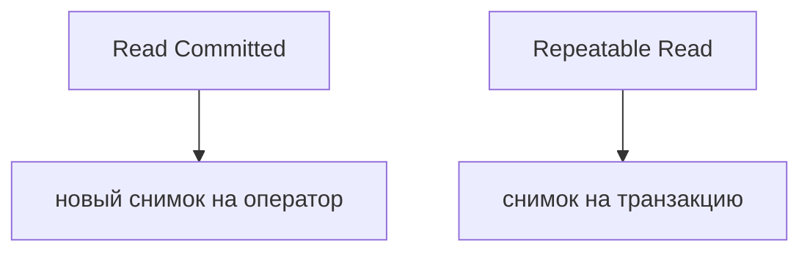

## Введение

ACID на собесе быстро сводят к слову «транзакция». Дальше спрашивают изоляцию: что видит параллельный запрос. В Postgres чтение по умолчанию — Read Committed, не Serializable.

## Раздел: Уровни

Read Committed видит уже закоммиченное на момент оператора. Повторный SELECT в той же транзакции может увидеть новую чужую фиксацию. Repeatable Read держит снимок транзакции. Serializable ловит больше пересечений и может отменить транзакцию с ошибкой сериализации — её надо повторять в приложении.

## Раздел: Ответ вслух

По умолчанию в Postgres Read Committed: каждый оператор видит свежие чужие коммиты. Если отчёт должен видеть один снимок, прошу Repeatable Read. Serializable не магия: при конфликте транзакция падает, и приложение повторяет её.

## Раздел: Плохой ответ

Плохой ответ: «у нас ACID, значит никто не видит чужие данные». Уровень по умолчанию как раз пускает чужой коммит к следующему оператору.

## Раздел: Термины

Изоляция — isolation level. Снимок — snapshot. Read Committed, Repeatable Read, Serializable — имена уровней.

## Лаба

**25 минут.** В [/game/sql](/game/sql) откройте два сеанса мысленно: один фиксирует новую строку, второй в Read Committed читает дважды. Скажите, увидит ли второй сеанс новую строку на втором SELECT.

## Схема: Снимок

## Тест

### Какой уровень у Postgres, если его не меняли?

**Ответ:** Read Committed

**Пояснение:** Это заводская настройка.

### Два SELECT в одной транзакции увидели разное число строк. Это возможно в RC?

**Ответ:** да

**Пояснение:** Второй оператор видит новые коммиты.

### Отчёт должен не прыгать посредине. Что просить?

**Ответ:** Repeatable Read

**Пояснение:** Один снимок на транзакцию.

### Serializable вернул ошибку сериализации. Что делает приложение?

**Ответ:** повторяет транзакцию

**Пояснение:** Отказ здесь штатный, не «база сломалась».

### Можно ли считать ACID заменой выбора уровня?

**Ответ:** нет

**Пояснение:** I в ACID как раз про этот выбор.

## Шпаргалка

<ul><li>По умолчанию Read Committed</li><li>Снимок бывает на оператор или на транзакцию</li><li>Serializable надо уметь повторить</li></ul>

## Anki

### Front: Уровень Postgres по умолчанию?

Back: Read Committed.

### Front: Что видит оператор в Read Committed?

Back: Уже закоммиченное к началу оператора.

### Front: Зачем Repeatable Read?

Back: Один снимок на всю транзакцию.

### Front: Что peculiar у Serializable?

Back: Конфликт может отменить транзакцию.

### Front: Кто повторяет сериализацию?

Back: Приложение.

### Front: ACID заменяет уровень?

Back: Нет, изоляцию выбирают отдельно.

## Итоги

- По умолчанию Read Committed
- Снимок бывает на оператор или на транзакцию
- Serializable надо уметь повторить

## Ссылки

- [ACID](/game/learn/sql-acid-transactions)
- [Блокировки](/game/learn/pg-locks-mvcc)
