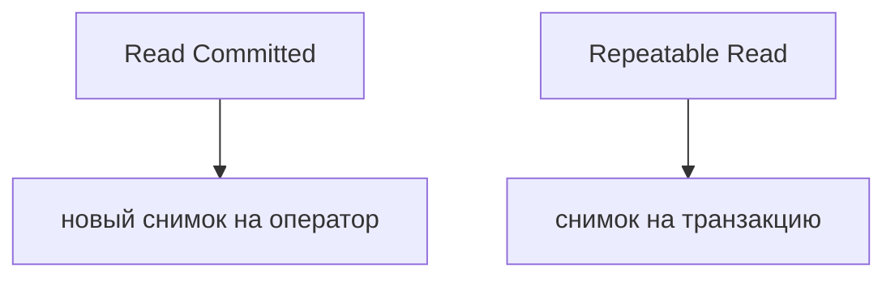
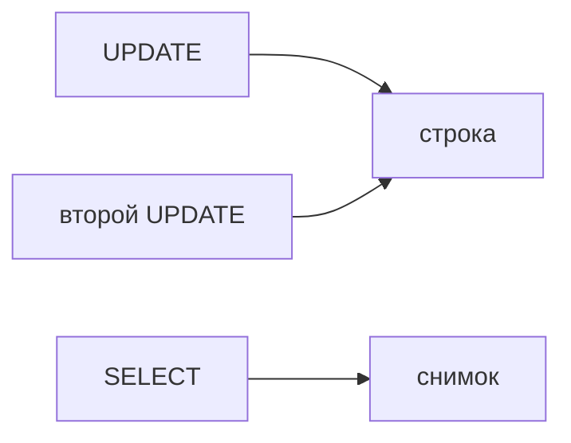
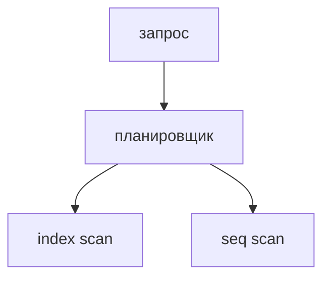
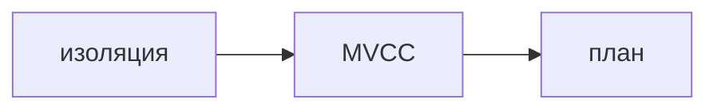

## Введение

ACID на собесе быстро сводят к слову «транзакция». Дальше спрашивают изоляцию: что видит параллельный запрос. В Postgres чтение по умолчанию — Read Committed, не Serializable.

**MVCC и блокировки.** Postgres хранит версии строк. Чтение идёт по снимку и обычно не блокирует запись. Блокировка появляется, когда два писателя хотят одну строку или когда вы явно попросили LOCK.

**Индекс молчит.** Индекс — не талисман. Планировщик выберет последовательное чтение, если так дешевле. На собесе ждут не «создайте индекс», а «почему он мог не использоваться».

**Разбор Postgres.** Если успеваете только три темы Postgres, берите их: уровень по умолчанию, кто кого блокирует, и почему индекс не в плане. Остальное — надстройка.

## Раздел: Как отвечать одним блоком

Этот выпуск собрал соседние короткие темы трека: «Изоляция», «MVCC и блокировки», «Индекс молчит», «Разбор Postgres». Раньше каждая занимала отдельную карточку на несколько минут, а на собеседовании их спрашивают одним блоком. Ниже у каждой темы свой раздел, затем общие лабы, один тест и одна колода карточек. В ответе сначала назовите, какую тему спросили, потом определение и один пример. Не проговаривайте все разделы, если спросили один. Лабы можно пройти по порядку исходного трека. Если времени мало, сделайте первую и последнюю: первая ставит язык, последняя проверяет, что соседние темы вы не перепутали.

## Раздел: Изоляция: Уровни

Read Committed видит уже закоммиченное на момент оператора. Повторный SELECT в той же транзакции может увидеть новую чужую фиксацию. Repeatable Read держит снимок транзакции. Serializable ловит больше пересечений и может отменить транзакцию с ошибкой сериализации — её надо повторять в приложении.

## Раздел: Изоляция: Ответ вслух

По умолчанию в Postgres Read Committed: каждый оператор видит свежие чужие коммиты. Если отчёт должен видеть один снимок, прошу Repeatable Read. Serializable не магия: при конфликте транзакция падает, и приложение повторяет её.

## Раздел: Изоляция: Плохой ответ

Плохой ответ: «у нас ACID, значит никто не видит чужие данные». Уровень по умолчанию как раз пускает чужой коммит к следующему оператору.

## Раздел: Изоляция: Термины

Изоляция — isolation level. Снимок — snapshot. Read Committed, Repeatable Read, Serializable — имена уровней.

## Раздел: MVCC и блокировки: Что блокируется

UPDATE одной строки вторым транзакцией ждёт коммит первого. SELECT без FOR UPDATE не стоит в этой очереди. SELECT FOR UPDATE как раз встаёт: вы собираетесь менять строку. Мёртвые версии убирает vacuum, не «сам по себе мгновенно».

## Раздел: MVCC и блокировки: Ответ вслух

Чтение у нас по версиям, поэтому отчёт не ждёт чужой UPDATE. Два UPDATE одной строки ждут друг друга. Если я читаю, чтобы тут же изменить, беру FOR UPDATE, иначе решение приму по старой версии и затру чужое.

## Раздел: MVCC и блокировки: Плохой ответ

Плохой ответ: «в Postgres нет блокировок, там MVCC». MVCC снимает блокировку чтения, не запись в одну строку.

## Раздел: MVCC и блокировки: Термины

Многоверсионность — MVCC. Блокировка строки — row lock. Уборка версий — vacuum.

## Раздел: Индекс молчит: Причины

Условие не совпадает с порядком индекса: функция на колонке, левый LIKE с процентом в начале, слишком много строк подходит — дешевле прочитать таблицу. Составной индекс работает слева направо. Устаревшая статистика после большой загрузки тоже уводит план.

## Раздел: Индекс молчит: Ответ вслух

Я смотрю EXPLAIN, не верю индексу на слово. Если в условии функция от колонки, индекс по самой колонке молчит. Если запрос забирает половину таблицы, последовательное чтение честнее. Составной индекс называю с левой колонки.

## Раздел: Индекс молчит: Плохой ответ

Плохой ответ: «добавим индекс на все колонки». Запись станет дороже, а запрос может его не взять.

## Раздел: Индекс молчит: Термины

План — EXPLAIN. Последовательное чтение — sequential scan. Составной индекс — composite index. Статистика — statistics, ANALYZE.

## Раздел: Разбор Postgres: Связка

Read Committed объясняет «прыгающий» повторный SELECT. MVCC объясняет, почему отчёт не ждёт UPDATE, а второй UPDATE ждёт. EXPLAIN объясняет seq scan. Вместе это уже middle, не список аббревиатур.

## Раздел: Разбор Postgres: Ответ вслух

Я начинаю с Read Committed. Потом говорю: чтение по снимку, писатели одной строки ждут. Если спрашивают про медленный запрос, прошу EXPLAIN и проверяю, не спрятана ли колонка функцией и не слишком ли много строк.

## Раздел: Разбор Postgres: Плохой ответ

Плохой ответ: перечислить пять уровней изоляции SQL Standard, не сказав, какой у Postgres и что видит второй SELECT.

## Раздел: Разбор Postgres: Термины

Снимок — snapshot. План — query plan. Блокировка строки — row-level lock.

## Раздел: Формулировки из исходных выпусков

Изоляция. Вопрос «Какой уровень у Postgres, если его не меняли?»: Read Committed. Это заводская настройка.

Изоляция. Вопрос «Два SELECT в одной транзакции увидели разное число строк. Это возможно в RC?»: да. Второй оператор видит новые коммиты.

Изоляция. Вопрос «Отчёт должен не прыгать посредине. Что просить?»: Repeatable Read. Один снимок на транзакцию.

Изоляция. Вопрос «Serializable вернул ошибку сериализации. Что делает приложение?»: повторяет транзакцию. Отказ здесь штатный, не «база сломалась».

Изоляция. Вопрос «Можно ли считать ACID заменой выбора уровня?»: нет. I в ACID как раз про этот выбор.

Изоляция. Карточка «Уровень Postgres по умолчанию?» — Read Committed..

Изоляция. Карточка «Что видит оператор в Read Committed?» — Уже закоммиченное к началу оператора..

Изоляция. Карточка «Зачем Repeatable Read?» — Один снимок на всю транзакцию..

Изоляция. Карточка «Что peculiar у Serializable?» — Конфликт может отменить транзакцию..

Изоляция. Карточка «Кто повторяет сериализацию?» — Приложение..

Изоляция. Карточка «ACID заменяет уровень?» — Нет, изоляцию выбирают отдельно..

MVCC и блокировки. Вопрос «Обычный SELECT ждёт чужой UPDATE той же строки?»: нет. Он читает версию из снимка.

MVCC и блокировки. Вопрос «Второй UPDATE той же строки. Ждёт?»: да, до коммита первого. Писатели одной строки выстраиваются.

MVCC и блокировки. Вопрос «Зачем SELECT FOR UPDATE?»: занять строку до своего изменения. Иначе решение будет по устаревшему взгляду.

MVCC и блокировки. Вопрос «Кто убирает старые версии строк?»: vacuum. Они не исчезают в момент коммита.

MVCC и блокировки. Вопрос «Можно ли сказать, что блокировок нет?»: нет. Нет блокировки читателя о писателя, писатели остаются.

MVCC и блокировки. Карточка «Что такое MVCC?» — Несколько версий строки, чтение по снимку..

MVCC и блокировки. Карточка «SELECT блокирует UPDATE?» — Обычный SELECT — нет..

MVCC и блокировки. Карточка «Два UPDATE одной строки?» — Второй ждёт коммит или откат первого..

MVCC и блокировки. Карточка «Зачем FOR UPDATE?» — Закрепить строку, которую собираетесь менять..

MVCC и блокировки. Карточка «Зачем vacuum?» — Убрать версии, которые уже никому не видны..

MVCC и блокировки. Карточка «MVCC отменяет блокировки?» — Только между обычным чтением и записью..

Индекс молчит. Вопрос «Индекс на email, запрос lower(email). Обязан ли взяться индекс?»: нет. Выражение не совпадает с ключом индекса.

Индекс молчит. Вопрос «Под условие подходит 80% таблицы. Seq scan — ошибка?»: не обязательно. Читать индекс и потом таблицу может быть дороже.

Индекс молчит. Вопрос «Индекс (a, b), условие только по b. Хороший доступ?»: обычно нет. Левая колонка не задана.

Индекс молчит. Вопрос «После загрузки миллиона строк план странный. Что обновить?»: статистику. ANALYZE, не новый индекс наугад.

Индекс молчит. Вопрос «Индекс на каждую колонку. Чем платите?»: записью и местом. Каждый INSERT обновляет все индексы.

Индекс молчит. Карточка «Индекс всегда используется?» — Нет, планировщик выбирает дешевле..

Индекс молчит. Карточка «Функция на колонке?» — Индекс по сырой колонке часто молчит..

Индекс молчит. Карточка «Почему seq scan бывает лучше?» — Когда выбирать почти всю таблицу..

Индекс молчит. Карточка «Составной индекс как читают?» — Слева направо, левый столбец нужен..

Индекс молчит. Карточка «Зачем ANALYZE?» — Обновить статистику для плана..

Индекс молчит. Карточка «Цена лишних индексов?» — Дороже запись и больше место..

Разбор Postgres. Вопрос «Повторный SELECT увидел новую строку. Это баг Repeatable Read?»: нет, если уровень RC. В RC снимок на оператор.

Разбор Postgres. Вопрос «Отчёт блокирует кассу, которая делает UPDATE. Так должно быть?»: обычный SELECT не должен. Если блокирует, ищите FOR UPDATE или другой замок.

Разбор Postgres. Вопрос «Индекс есть, EXPLAIN показывает seq scan. Первый вопрос?»: сколько строк и какое условие. Не «создать ещё индекс».

Разбор Postgres. Вопрос «Serializable упал. Повторять ли транзакцию?»: да. Это штатный конфликт.

Разбор Postgres. Вопрос «Vacuum игнорируют месяцами. Чем рискуете?»: раздуванием таблиц. Старые версии остаются.

Разбор Postgres. Карточка «Три темы Postgres middle?» — Изоляция, MVCC и блокировки, план индекса..

Разбор Postgres. Карточка «Уровень по умолчанию?» — Read Committed..

Разбор Postgres. Карточка «SELECT ждёт UPDATE?» — Обычный — нет..

Разбор Postgres. Карточка «Второй UPDATE ждёт?» — Да..

Разбор Postgres. Карточка «Индекс молчит, если?» — Условие не про ключ или строк слишком много..

Разбор Postgres. Карточка «Что сделать при ошибке сериализации?» — Повторить транзакцию..

## Лаба

**Изоляция.**

**25 минут.** В [/game/sql](/game/sql) откройте два сеанса мысленно: один фиксирует новую строку, второй в Read Committed читает дважды. Скажите, увидит ли второй сеанс новую строку на втором SELECT.

**MVCC и блокировки.**

**20 минут.** В [/game/sql](/game/sql) представьте два UPDATE баланса. Объясните, почему второй ждёт, а обычный SELECT нет.

**Индекс молчит.**

**25 минут.** В [/game/sql](/game/sql) или на бумаге сравните `WHERE status = 'new'` и `WHERE lower(status) = 'new'` при индексе на status. Скажите, какой запрос индекс не обязан использовать.

**Разбор Postgres.**

**20 минут.** В [/game/sql](/game/sql) вслух ответьте на три вопроса без подсказки: уровень по умолчанию, ждёт ли SELECT чужой UPDATE, когда индекс по колонке молчит.

## Схема: Изоляция: Снимок

## Схема: MVCC и блокировки: Кто ждёт

## Схема: Индекс молчит: План

## Схема: Разбор Postgres: Три вопроса

## Тест

### Какой уровень у Postgres, если его не меняли?

**Ответ:** Read Committed

**Пояснение:** Это заводская настройка.

### Обычный SELECT ждёт чужой UPDATE той же строки?

**Ответ:** нет

**Пояснение:** Он читает версию из снимка.

### Индекс на email, запрос lower(email). Обязан ли взяться индекс?

**Ответ:** нет

**Пояснение:** Выражение не совпадает с ключом индекса.

### Повторный SELECT увидел новую строку. Это баг Repeatable Read?

**Ответ:** нет, если уровень RC

**Пояснение:** В RC снимок на оператор.

### Два SELECT в одной транзакции увидели разное число строк. Это возможно в RC?

**Ответ:** да

**Пояснение:** Второй оператор видит новые коммиты.

## Шпаргалка

<ul><li>По умолчанию Read Committed</li><li>Снимок бывает на оператор или на транзакцию</li><li>Serializable надо уметь повторить</li><li>Чтение по снимку</li><li>Писатели одной строки ждут</li><li>FOR UPDATE — сознательная блокировка</li><li>Смотрите план</li><li>Выражение может спрятать колонку</li><li>Много индексов тормозят запись</li><li>Три темы закрывают middle</li><li>Называйте уровень Postgres</li><li>План важнее наличия индекса</li></ul>

## Anki

### Front: Уровень Postgres по умолчанию?

Back: Read Committed.

### Front: Что такое MVCC?

Back: Несколько версий строки, чтение по снимку.

### Front: Индекс всегда используется?

Back: Нет, планировщик выбирает дешевле.

### Front: Три темы Postgres middle?

Back: Изоляция, MVCC и блокировки, план индекса.

### Front: Что видит оператор в Read Committed?

Back: Уже закоммиченное к началу оператора.

### Front: SELECT блокирует UPDATE?

Back: Обычный SELECT — нет.

## Мнемоника

### acronym: Изоляция

**Задание:** Четыре аномалии и слова, которыми их закрывают.

**Элементы:**
- Грязное чтение
- Неповторяемое
- Фантом
- Сериализация

**Подсказка:** READ COMMITTED не обещает, что повторный SELECT увидит то же.

**Ответ:** dirty, nonrepeatable, phantom, serializable

## Итоги

- По умолчанию Read Committed
- Снимок бывает на оператор или на транзакцию
- Serializable надо уметь повторить
- Чтение по снимку
- Писатели одной строки ждут
- FOR UPDATE — сознательная блокировка
- Смотрите план
- Выражение может спрятать колонку

## Ссылки

- [ACID](/game/learn/sql-normalization)
- [EXPLAIN в серии SQL](/game/learn/sql-cte-window)
- [SQL drill](/game/learn/sql-interview-drill)
