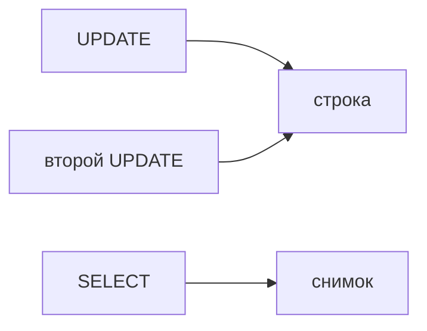

## Введение

Postgres хранит версии строк. Чтение идёт по снимку и обычно не блокирует запись. Блокировка появляется, когда два писателя хотят одну строку или когда вы явно попросили LOCK.

## Раздел: Что блокируется

UPDATE одной строки вторым транзакцией ждёт коммит первого. SELECT без FOR UPDATE не стоит в этой очереди. SELECT FOR UPDATE как раз встаёт: вы собираетесь менять строку. Мёртвые версии убирает vacuum, не «сам по себе мгновенно».

## Раздел: Ответ вслух

Чтение у нас по версиям, поэтому отчёт не ждёт чужой UPDATE. Два UPDATE одной строки ждут друг друга. Если я читаю, чтобы тут же изменить, беру FOR UPDATE, иначе решение приму по старой версии и затру чужое.

## Раздел: Плохой ответ

Плохой ответ: «в Postgres нет блокировок, там MVCC». MVCC снимает блокировку чтения, не запись в одну строку.

## Раздел: Термины

Многоверсионность — MVCC. Блокировка строки — row lock. Уборка версий — vacuum.

## Лаба

**20 минут.** В [/game/sql](/game/sql) представьте два UPDATE баланса. Объясните, почему второй ждёт, а обычный SELECT нет.

## Схема: Кто ждёт

## Тест

### Обычный SELECT ждёт чужой UPDATE той же строки?

**Ответ:** нет

**Пояснение:** Он читает версию из снимка.

### Второй UPDATE той же строки. Ждёт?

**Ответ:** да, до коммита первого

**Пояснение:** Писатели одной строки выстраиваются.

### Зачем SELECT FOR UPDATE?

**Ответ:** занять строку до своего изменения

**Пояснение:** Иначе решение будет по устаревшему взгляду.

### Кто убирает старые версии строк?

**Ответ:** vacuum

**Пояснение:** Они не исчезают в момент коммита.

### Можно ли сказать, что блокировок нет?

**Ответ:** нет

**Пояснение:** Нет блокировки читателя о писателя, писатели остаются.

## Шпаргалка

<ul><li>Чтение по снимку</li><li>Писатели одной строки ждут</li><li>FOR UPDATE — сознательная блокировка</li></ul>

## Anki

### Front: Что такое MVCC?

Back: Несколько версий строки, чтение по снимку.

### Front: SELECT блокирует UPDATE?

Back: Обычный SELECT — нет.

### Front: Два UPDATE одной строки?

Back: Второй ждёт коммит или откат первого.

### Front: Зачем FOR UPDATE?

Back: Закрепить строку, которую собираетесь менять.

### Front: Зачем vacuum?

Back: Убрать версии, которые уже никому не видны.

### Front: MVCC отменяет блокировки?

Back: Только между обычным чтением и записью.

## Итоги

- Чтение по снимку
- Писатели одной строки ждут
- FOR UPDATE — сознательная блокировка

## Ссылки

- [Изоляция](/game/learn/pg-isolation)
- [Индекс](/game/learn/pg-index-miss)
