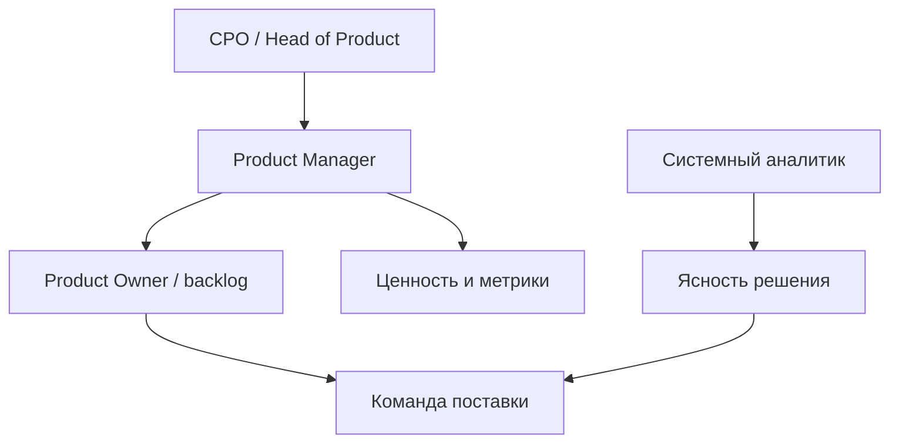

## Введение

На собеседовании и в команде часто путают Product Manager, Scrum Product Owner и системного аналитика. Этот выпуск фиксирует границы: кто отвечает за ценность и приоритет, кто — за ясность решения, где сидит CPO. Опора — публичные материалы SVPG о роли PM и Scrum Guide о Product Owner; текст ниже — оригинальная рабочая рамка, не пересказ книг.

**Приоритизация.** Приоритет — явный trade-off при ограниченных людях и времени, а не список «всем важно». На собесе ждут не название фреймворка, а умение разложить допущения и сравнить варианты. Ниже — практическое применение RICE (Intercom) и идеи WSJF (SAFe): оригинальные примеры и типичные ошибки, без копирования чужих глав.

## Раздел: Как отвечать одним блоком

Этот выпуск собрал соседние короткие темы трека: «Роль PM», «Приоритизация». Раньше каждая занимала отдельную карточку на несколько минут, а на собеседовании их спрашивают одним блоком. Ниже у каждой темы свой раздел, затем общие лабы, один тест и одна колода карточек. В ответе сначала назовите, какую тему спросили, потом определение и один пример. Не проговаривайте все разделы, если спросили один. Лабы можно пройти по порядку исходного трека. Если времени мало, сделайте первую и последнюю: первая ставит язык, последняя проверяет, что соседние темы вы не перепутали.

## Раздел: Роль PM: Цикл ценности и зона PM

Product Management — непрерывный цикл: понять проблему (discovery) → выбрать ставку → поставить инкремент (delivery) → измерить эффект → скорректировать бэклог. PM отвечает за исход для пользователя и бизнеса: какую проблему решаем, для кого, какой результат считаем успехом.

**Пример.** В B2B-сервисе подписок падает продление. PM формулирует гипотезу («онбординг админа длиннее 15 минут → отток»), выбирает эксперимент (укороченный чеклист + письмо на день 3), договаривается о метрике renewal rate за 30 дней. Команда пишет код; PM не «рисует кнопки вместо дизайнера», а держит критерий успеха и trade-off «скорость vs охват».

**Ошибка.** Считать PM «старшим постановщиком задач»: список фич без проблемы и метрики. Тогда команда закрывает тикеты, а продукт не двигается.

## Раздел: Роль PM: Scrum PO, CPO и стык с аналитиком

**Product Owner в Scrum** (по Scrum Guide) — один человек, владеющий Product Backlog: упорядочивает элементы, обеспечивает прозрачность и ценность. В маленькой команде PO = PM. В крупной компании PO часто «сужает» фокус до бэклога спринта, а PM/Group PM держит go-to-market, ценообразование, дорожную карту и P&L-разговор с бизнесом.

**CPO / Head of Product** задаёт портфель ставок, принципы приоритизации, найм и развитие PM, эскалации между продуктами. CPO не пишет каждую user story, но снимает конфликты «оба продукта хотят одни и те же инженеры».

**Системный аналитик** проясняет требования, интеграции, данные, критерии приёмки на уровне решения. СА не подменяет приоритет ценности: «как связать биллинг с CRM» — зона СА; «делаем ли биллинг раньше, чем мобильный кабинет» — зона PM/PO.

**Пример.** Фича «оплата по счёту для юрлиц»: PM решает, что это ставка квартала (рост ARPU); PO кладёт epic в бэклог и режет на sprint-ready items; СА описывает статусы счёта, идемпотентность webhook банка, поля для 1С. Если СА сам решает «сначала красивый PDF», ценность уезжает без явного решения продукта.

**Ошибка.** Два «владельца приоритета» (директор продаж и PO без мандата) — команда получает противоречивые «must have» и перестаёт верить бэклогу.

## Раздел: Роль PM: Как отвечать на собеседовании

Структура ответа на «чем PM отличается от PO / от аналитика»:

1. Ценность и outcome — PM/PO.
2. Backlog и Scrum-ответственность — PO (часто совмещена с PM).
3. Ясность решения и интеграции — СА / BA.
4. Портфель и стратегия компании — CPO.

Добавьте один живой пример из опыта или учебного кейса и назовите риск смешения ролей (двойной приоритет, «аналитик режет scope без бизнеса»).

## Раздел: Роль PM: Частые вопросы с собеседования

**Вопрос.** Когда RICE уместен, а когда вреден?

**Ответ.** RICE (Reach, Impact, Confidence, Effort) помогает сравнить фичи на одной шкале с явными допущениями. Вреден, когда подменяют цифры уверенностью «на глаз» или игнорируют стратегические ставки и технический долг. Хороший ответ включает Confidence и что проверите экспериментом.

**Вопрос.** Чем WSJF отличается от простого «impact / effort»?

**Ответ.** WSJF добавляет Cost of Delay и job size в потоке: что дороже отложить по времени и риску. Полезен при ограниченной capacity и нескольких командах; требует честной оценки задержки, не только «большая фича — делаем первой».

**Вопрос.** OKR и KPI — конкуренты?

**Ответ.** KPI — стабильный пульс здоровья (retention, uptime). OKR — амбициозный исход на период с 2–4 KR, часть может не выполниться на 100%. На собесе: KPI не выкручивать как OKR «на 120% каждый квартал», иначе команда перестаёт рисковать.

**Вопрос.** Зачем roadmap в формате Now / Next / Later без дат на всё?

**Ответ.** Now — commitment с ресурсом; Next — готовим, но дата плавает; Later — направления без обещания. Защищает от фальшивых дат на исследования. Даты оставляют там, где есть зависимость (регулятор, контракт, релиз платформы).

## Раздел: Приоритизация: RICE — считать и спорить о Confidence

**RICE** (Reach × Impact × Confidence ÷ Effort):

| Буква | Смысл | Практика оценки |
|-------|--------|-----------------|
| Reach | Сколько пользователей/событий за период | «12k активных продавцов / квартал» |
| Impact | Сила эффекта на цель | Шкала вроде 0.25 / 0.5 / 1 / 2 / 3 |
| Confidence | Насколько верим оценкам | 50–100%; интервью > «мне кажется» |
| Effort | Стоимость в person-months / t-shirt | Знаменатель: больше труд → ниже score |

**Пример.** Три идеи для маркетплейса: (A) фильтр по сроку доставки, (B) чат с продавцом, (C) реферальная скидка. Для A: Reach 8k/квартал, Impact 2, Confidence 80%, Effort 1 → score ≈ 12800. Для B: Reach выше, но Effort 4 и Confidence 50% из‑за неизвестной модерации — score падает. Команда спорит не о «красоте», а о Confidence и Effort.

**Ошибка.** Ставить Confidence = 100% на всё «из головы» — тогда RICE превращается в маскировку вкуса под цифры.

## Раздел: Приоритизация: WSJF — стоимость задержки

**WSJF** (Weighted Shortest Job First) в SAFe: приоритет ≈ Cost of Delay ÷ Job Size. Cost of Delay складывают из ценности для пользователя/бизнеса, срочности по времени и снижения риска/возможности enablement; Job Size — относительный размер работы.

**Пример.** Исправление расчёта НДС блокирует B2B-сделки (высокий CoD, размер S) обгоняет большой редизайн каталога (средний CoD, размер XL), даже если «редизайн красивее на демо».

**Когда что выбирать.** RICE удобен для продуктового бэклога фич с оценкой охвата. WSJF хорошо звучит, когда важна *задержка*: регуляторика, сезон, зависимость других команд. Можно использовать оба как «линзы», а не религию.

**Ошибка.** Путать severity бага (насколько больно) с product priority (когда чиним относительно других ставок) — у QA и продукта разные шкалы; согласование обязательно.

## Раздел: Приоритизация: Как показывать приоритизацию на собесе

1. Назовите цель квартала одной фразой.
2. Разложите 3 инициативы по RICE или CoD/Size с явными допущениями.
3. Скажите, что измените, если Confidence у лидера упадёт до 50%.
4. Отделите «обязательный compliance» (часто вне чистого score) от опциональных ставок.

## Раздел: Приоритизация: Частые вопросы с собеседования

**Вопрос.** PM и PO — одна роль на собеседовании?

**Ответ.** В agile-командах PO чаще владеет backlog и приоритетом инкремента; PM шире — discovery, стратегия, экономика, стейкholders вне спринта. На практике роли сливаются в маленьких командах — на собесе назовите границы: кто решает «что строим», кто «как измеряем успех».

**Вопрос.** OKR и KPI — конкуренты?

**Ответ.** KPI — стабильный пульс здоровья (retention, uptime). OKR — амбициозный исход на период с 2–4 KR, часть может не выполниться на 100%. На собесе: KPI не выкручивать как OKR «на 120% каждый квартал», иначе команда перестаёт рисковать.

**Вопрос.** Зачем roadmap в формате Now / Next / Later без дат на всё?

**Ответ.** Now — commitment с ресурсом; Next — готовим, но дата плавает; Later — направления без обещания. Защищает от фальшивых дат на исследования. Даты оставляют там, где есть зависимость (регулятор, контракт, релиз платформы).

**Вопрос.** Discovery и delivery — разные фазы или параллельные потоки?

**Ответ.** Discovery снижает неопределённость: проблема, сегмент, прототип, kill criteria. Delivery — строим и катим измеримый инкремент. На зрелых командах идут паралlельно: часть capacity на explore, часть на exploit; ошибка — «discovery закончили, теперь только код».

## Лаба

**Роль PM.**

**Цель.** Развести PM, PO, СА и CPO на одной фиче — «оплата по счёту для юрлиц».

**Шаги.**
1. Запишите проблему пользователя и бизнес-метрику успеха (1–2 предложения).
2. Назначьте: кто утверждает приоритет относительно других эпиков; кто упорядочивает sprint backlog; кто описывает интеграцию с банком/1С; где вмешивается CPO.
3. Опишите антипаттерн: директор продаж меняет порядок задач в середине спринта — кто и как отвечает.
4. Нарисуйте треугольник «ценность / ясность / исполнение» и подпишите роли.
5. Сформулируйте 30-секундный ответ для собеса «PM vs PO vs СА».

**В группу:** может ли один человек быть и PM, и PO, и частично СА? Где проходит красная линия?

**Готово, если…**
- [ ] Есть явный владелец приоритета ценности
- [ ] СА не назначает порядок эпиков
- [ ] Понятна зона CPO (портфель, а не тикеты)

**Приоритизация.**

**Цель.** Посчитать RICE для трёх фич и сравнить вывод с идеей WSJF.

**Шаги.**
1. Выберите продукт (учебный ок) и цель на квартал.
2. Оцените Reach, Impact, Confidence, Effort для фич A/B/C; посчитайте score.
3. Для каждой фичи одной фразой опишите Cost of Delay, если сдвинуть на квартал.
4. Отметьте, где score и CoD расходятся — и какое решение примете.
5. Запишите 2 допущения, которые проверите интервью/метрикой до большой разработки.

**В группу:** кто повысил Confidence без новых данных — оспорьте.

**Готово, если…**
- [ ] Есть таблица RICE с числами
- [ ] Confidence не везде 100%
- [ ] Понятна разница score vs стоимость задержки

## Схема: Роль PM: Роли вокруг ценности

## Схема: Приоритизация: От идей к порядку

## Тест

### Кто в первую очередь отвечает за ценность и outcome продукта?

**Ответ:** Product Manager / PO

**Пояснение:** Приоритет проблемы и критерий успеха — продуктовая зона; аналитик проясняет решение.

### Какова формула RICE?

**Ответ:** Reach×Impact×Confidence÷Effort

**Пояснение:** Effort в знаменателе: дорогая работа снижает приоритет при прочих равных.

### Чем Scrum Product Owner отличается от «широкого» PM?

**Ответ:** PO владеет backlog в Scrum

**Пояснение:** PM часто шире: стратегия, GTM, экономика; роли могут совмещаться в одном человеке.

### Что означает Confidence в RICE?

**Ответ:** степень веры в оценки

**Пояснение:** Низкий Confidence честно снижает score и требует discovery, а не «веры в слайды».

### За что отвечает системный аналитик относительно PM?

**Ответ:** ясность решения и интеграции

**Пояснение:** Как устроить поток данных и критерии приёмки — СА; что делать раньше — PM/PO.

## Шпаргалка

<ul><li><b>PM</b> — проблема, ставка, outcome, trade-off</li><li><b>PO (Scrum)</b> — Product Backlog, порядок, прозрачность ценности</li><li><b>СА</b> — требования, интеграции, ясность «как»</li><li><b>CPO</b> — портфель, стратегия, эскалации между продуктами</li><li>Reach — охват за период</li><li>Impact — сила эффекта</li><li>Confidence — % уверенности</li><li>Effort — person-months / размер</li></ul>

## Anki

### Front: В одном предложении — зона ответственности Product Manager?

Back: Выбрать проблему и ставку, довести до измеримого outcome для пользователя и бизнеса

### Front: Из каких четырёх факторов состоит оценка RICE?

Back: Reach (охват), Impact (сила эффекта), Confidence (уверенность), Effort (стоимость) — score = R×I×C / E

### Front: Что Scrum Guide закрепляет за Product Owner?

Back: Единственный владелец Product Backlog: порядок, прозрачность и максимизация ценности

### Front: Почему в RICE Effort стоит в знаменателе?

Back: Более дорогая работа при том же эффекте должна получать меньший приоритет

### Front: Чем системный аналитик не должен подменять PM?

Back: Решением «что важнее» — приоритет ценности остаётся у продукта

### Front: Что такое Cost of Delay простыми словами?

Back: Насколько больно или дорого отложить поставку ценности на период времени

## Итоги

- PM держит ценность и outcome; PO в Scrum — backlog; часто это один человек
- СА даёт ясность решения, но не назначает порядок эпиков
- CPO смотрит портфель и принципы, не каждый тикет
- На собесе держите пример и риск смешения ролей
- Приоритет = явные trade-off и допущения, не «всем важно»
- RICE помогает сравнить охват и стоимость; WSJF — стоимость задержки
- На собесе показывайте числа и что сломается, если Confidence упадёт
- Severity бага ≠ автоматический порядок всего бэклога

## Ссылки

- [SVPG — Articles](https://www.svpg.com/articles/)
- [Scrum Guide](https://scrumguides.org/)
- [Intercom — RICE](https://www.intercom.com/blog/rice-simple-prioritization-for-product-managers/)
- [SAFe — WSJF](https://framework.scaledagile.com/wsjf/)
- [Customer Journey Map](/game/learn/pm-cjm)
