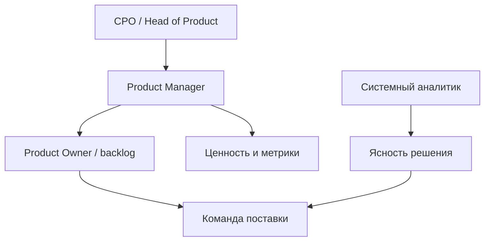

## Введение

На собеседовании и в команде часто путают Product Manager, Scrum Product Owner и системного аналитика. Этот выпуск фиксирует границы: кто отвечает за ценность и приоритет, кто — за ясность решения, где сидит CPO. Опора — публичные материалы SVPG о роли PM и Scrum Guide о Product Owner; текст ниже — оригинальная рабочая рамка, не пересказ книг.

## Раздел: Цикл ценности и зона PM

Product Management — непрерывный цикл: понять проблему (discovery) → выбрать ставку → поставить инкремент (delivery) → измерить эффект → скорректировать бэклог. PM отвечает за исход для пользователя и бизнеса: какую проблему решаем, для кого, какой результат считаем успехом.

**Пример.** В B2B-сервисе подписок падает продление. PM формулирует гипотезу («онбординг админа длиннее 15 минут → отток»), выбирает эксперимент (укороченный чеклист + письмо на день 3), договаривается о метрике renewal rate за 30 дней. Команда пишет код; PM не «рисует кнопки вместо дизайнера», а держит критерий успеха и trade-off «скорость vs охват».

**Ошибка.** Считать PM «старшим постановщиком задач»: список фич без проблемы и метрики. Тогда команда закрывает тикеты, а продукт не двигается.

## Раздел: Scrum PO, CPO и стык с аналитиком

**Product Owner в Scrum** (по Scrum Guide) — один человек, владеющий Product Backlog: упорядочивает элементы, обеспечивает прозрачность и ценность. В маленькой команде PO = PM. В крупной компании PO часто «сужает» фокус до бэклога спринта, а PM/Group PM держит go-to-market, ценообразование, дорожную карту и P&L-разговор с бизнесом.

**CPO / Head of Product** задаёт портфель ставок, принципы приоритизации, найм и развитие PM, эскалации между продуктами. CPO не пишет каждую user story, но снимает конфликты «оба продукта хотят одни и те же инженеры».

**Системный аналитик** проясняет требования, интеграции, данные, критерии приёмки на уровне решения. СА не подменяет приоритет ценности: «как связать биллинг с CRM» — зона СА; «делаем ли биллинг раньше, чем мобильный кабинет» — зона PM/PO.

**Пример.** Фича «оплата по счёту для юрлиц»: PM решает, что это ставка квартала (рост ARPU); PO кладёт epic в бэклог и режет на sprint-ready items; СА описывает статусы счёта, идемпотентность webhook банка, поля для 1С. Если СА сам решает «сначала красивый PDF», ценность уезжает без явного решения продукта.

**Ошибка.** Два «владельца приоритета» (директор продаж и PO без мандата) — команда получает противоречивые «must have» и перестаёт верить бэклогу.

## Раздел: Как отвечать на собеседовании

Структура ответа на «чем PM отличается от PO / от аналитика»:

1. Ценность и outcome — PM/PO.
2. Backlog и Scrum-ответственность — PO (часто совмещена с PM).
3. Ясность решения и интеграции — СА / BA.
4. Портфель и стратегия компании — CPO.

Добавьте один живой пример из опыта или учебного кейса и назовите риск смешения ролей (двойной приоритет, «аналитик режет scope без бизнеса»).

## Раздел: Частые вопросы с собеседования

**Вопрос.** Когда RICE уместен, а когда вреден?

**Ответ.** RICE (Reach, Impact, Confidence, Effort) помогает сравнить фичи на одной шкале с явными допущениями. Вреден, когда подменяют цифры уверенностью «на глаз» или игнорируют стратегические ставки и технический долг. Хороший ответ включает Confidence и что проверите экспериментом.

**Вопрос.** Чем WSJF отличается от простого «impact / effort»?

**Ответ.** WSJF добавляет Cost of Delay и job size в потоке: что дороже отложить по времени и риску. Полезен при ограниченной capacity и нескольких командах; требует честной оценки задержки, не только «большая фича — делаем первой».

**Вопрос.** OKR и KPI — конкуренты?

**Ответ.** KPI — стабильный пульс здоровья (retention, uptime). OKR — амбициозный исход на период с 2–4 KR, часть может не выполниться на 100%. На собесе: KPI не выкручивать как OKR «на 120% каждый квартал», иначе команда перестаёт рисковать.

**Вопрос.** Зачем roadmap в формате Now / Next / Later без дат на всё?

**Ответ.** Now — commitment с ресурсом; Next — готовим, но дата плавает; Later — направления без обещания. Защищает от фальшивых дат на исследования. Даты оставляют там, где есть зависимость (регулятор, контракт, релиз платформы).

## Лаба

**Цель.** Развести PM, PO, СА и CPO на одной фиче — «оплата по счёту для юрлиц».

**Шаги.**
1. Запишите проблему пользователя и бизнес-метрику успеха (1–2 предложения).
2. Назначьте: кто утверждает приоритет относительно других эпиков; кто упорядочивает sprint backlog; кто описывает интеграцию с банком/1С; где вмешивается CPO.
3. Опишите антипаттерн: директор продаж меняет порядок задач в середине спринта — кто и как отвечает.
4. Нарисуйте треугольник «ценность / ясность / исполнение» и подпишите роли.
5. Сформулируйте 30-секундный ответ для собеса «PM vs PO vs СА».

**В группу:** может ли один человек быть и PM, и PO, и частично СА? Где проходит красная линия?

**Готово, если…**
- [ ] Есть явный владелец приоритета ценности
- [ ] СА не назначает порядок эпиков
- [ ] Понятна зона CPO (портфель, а не тикеты)

## Схема: Роли вокруг ценности

## Тест

### Кто в первую очередь отвечает за ценность и outcome продукта?

**Ответ:** Product Manager / PO

**Пояснение:** Приоритет проблемы и критерий успеха — продуктовая зона; аналитик проясняет решение.

### Чем Scrum Product Owner отличается от «широкого» PM?

**Ответ:** PO владеет backlog в Scrum

**Пояснение:** PM часто шире: стратегия, GTM, экономика; роли могут совмещаться в одном человеке.

### За что отвечает системный аналитик относительно PM?

**Ответ:** ясность решения и интеграции

**Пояснение:** Как устроить поток данных и критерии приёмки — СА; что делать раньше — PM/PO.

### Что типично для зоны CPO?

**Ответ:** портфель ставок и принципы

**Пояснение:** CPO не ведёт каждый тикет, а выравнивает продукты и ресурсы.

### Какая ошибка ломает границы ролей быстрее всего?

**Ответ:** два владельца приоритета

**Пояснение:** Противоречивые must-have разрушают доверие к бэклогу и фокус команды.

## Шпаргалка

<h3>Роли</h3>
<ul>
<li><b>PM</b> — проблема, ставка, outcome, trade-off</li>
<li><b>PO (Scrum)</b> — Product Backlog, порядок, прозрачность ценности</li>
<li><b>СА</b> — требования, интеграции, ясность «как»</li>
<li><b>CPO</b> — портфель, стратегия, эскалации между продуктами</li>
</ul>
<h3>Цикл</h3>
<pre><code>discovery → ставка → delivery → measure → снова бэклог</code></pre>

## Anki

### Front: В одном предложении — зона ответственности Product Manager?

Back: Выбрать проблему и ставку, довести до измеримого outcome для пользователя и бизнеса

### Front: Что Scrum Guide закрепляет за Product Owner?

Back: Единственный владелец Product Backlog: порядок, прозрачность и максимизация ценности

### Front: Чем системный аналитик не должен подменять PM?

Back: Решением «что важнее» — приоритет ценности остаётся у продукта

### Front: Когда роли PM и PO обычно совпадают в одном человеке?

Back: В небольшой команде, где один человек и ведёт продукт, и упорядочивает backlog

### Front: Что делает CPO, чего обычно не делает линейный PM?

Back: Управляет портфелем продуктов/ставок и конфликтами за общие ресурсы

### Front: Назовите риск, если директор продаж и PO оба «владеют» приоритетом

Back: Противоречивые must-have, потеря фокуса спринта и недоверие команды к бэклогу

## Итоги

- PM держит ценность и outcome; PO в Scrum — backlog; часто это один человек
- СА даёт ясность решения, но не назначает порядок эпиков
- CPO смотрит портфель и принципы, не каждый тикет
- На собесе держите пример и риск смешения ролей

## Ссылки

- [SVPG — Articles](https://www.svpg.com/articles/)
- [Scrum Guide](https://scrumguides.org/)
- Далее: [Приоритизация — RICE и WSJF](/game/learn/pm-prioritization)
