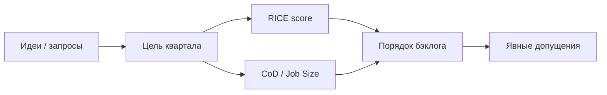

## Введение

Приоритет — явный trade-off при ограниченных людях и времени, а не список «всем важно». На собесе ждут не название фреймворка, а умение разложить допущения и сравнить варианты. Ниже — практическое применение RICE (Intercom) и идеи WSJF (SAFe): оригинальные примеры и типичные ошибки, без копирования чужих глав.

## Раздел: RICE — считать и спорить о Confidence

**RICE** (Reach × Impact × Confidence ÷ Effort):

| Буква | Смысл | Практика оценки |
|-------|--------|-----------------|
| Reach | Сколько пользователей/событий за период | «12k активных продавцов / квартал» |
| Impact | Сила эффекта на цель | Шкала вроде 0.25 / 0.5 / 1 / 2 / 3 |
| Confidence | Насколько верим оценкам | 50–100%; интервью > «мне кажется» |
| Effort | Стоимость в person-months / t-shirt | Знаменатель: больше труд → ниже score |

**Пример.** Три идеи для маркетплейса: (A) фильтр по сроку доставки, (B) чат с продавцом, (C) реферальная скидка. Для A: Reach 8k/квартал, Impact 2, Confidence 80%, Effort 1 → score ≈ 12800. Для B: Reach выше, но Effort 4 и Confidence 50% из‑за неизвестной модерации — score падает. Команда спорит не о «красоте», а о Confidence и Effort.

**Ошибка.** Ставить Confidence = 100% на всё «из головы» — тогда RICE превращается в маскировку вкуса под цифры.

## Раздел: WSJF — стоимость задержки

**WSJF** (Weighted Shortest Job First) в SAFe: приоритет ≈ Cost of Delay ÷ Job Size. Cost of Delay складывают из ценности для пользователя/бизнеса, срочности по времени и снижения риска/возможности enablement; Job Size — относительный размер работы.

**Пример.** Исправление расчёта НДС блокирует B2B-сделки (высокий CoD, размер S) обгоняет большой редизайн каталога (средний CoD, размер XL), даже если «редизайн красивее на демо».

**Когда что выбирать.** RICE удобен для продуктового бэклога фич с оценкой охвата. WSJF хорошо звучит, когда важна *задержка*: регуляторика, сезон, зависимость других команд. Можно использовать оба как «линзы», а не религию.

**Ошибка.** Путать severity бага (насколько больно) с product priority (когда чиним относительно других ставок) — у QA и продукта разные шкалы; согласование обязательно.

## Раздел: Как показывать приоритизацию на собесе

1. Назовите цель квартала одной фразой.
2. Разложите 3 инициативы по RICE или CoD/Size с явными допущениями.
3. Скажите, что измените, если Confidence у лидера упадёт до 50%.
4. Отделите «обязательный compliance» (часто вне чистого score) от опциональных ставок.

## Раздел: Частые вопросы с собеседования

**Вопрос.** PM и PO — одна роль на собеседовании?

**Ответ.** В agile-командах PO чаще владеет backlog и приоритетом инкремента; PM шире — discovery, стратегия, экономика, стейкholders вне спринта. На практике роли сливаются в маленьких командах — на собесе назовите границы: кто решает «что строим», кто «как измеряем успех».

**Вопрос.** OKR и KPI — конкуренты?

**Ответ.** KPI — стабильный пульс здоровья (retention, uptime). OKR — амбициозный исход на период с 2–4 KR, часть может не выполниться на 100%. На собесе: KPI не выкручивать как OKR «на 120% каждый квартал», иначе команда перестаёт рисковать.

**Вопрос.** Зачем roadmap в формате Now / Next / Later без дат на всё?

**Ответ.** Now — commitment с ресурсом; Next — готовим, но дата плавает; Later — направления без обещания. Защищает от фальшивых дат на исследования. Даты оставляют там, где есть зависимость (регулятор, контракт, релиз платформы).

**Вопрос.** Discovery и delivery — разные фазы или параллельные потоки?

**Ответ.** Discovery снижает неопределённость: проблема, сегмент, прототип, kill criteria. Delivery — строим и катим измеримый инкремент. На зрелых командах идут паралlельно: часть capacity на explore, часть на exploit; ошибка — «discovery закончили, теперь только код».

## Лаба

**Цель.** Посчитать RICE для трёх фич и сравнить вывод с идеей WSJF.

**Шаги.**
1. Выберите продукт (учебный ок) и цель на квартал.
2. Оцените Reach, Impact, Confidence, Effort для фич A/B/C; посчитайте score.
3. Для каждой фичи одной фразой опишите Cost of Delay, если сдвинуть на квартал.
4. Отметьте, где score и CoD расходятся — и какое решение примете.
5. Запишите 2 допущения, которые проверите интервью/метрикой до большой разработки.

**В группу:** кто повысил Confidence без новых данных — оспорьте.

**Готово, если…**
- [ ] Есть таблица RICE с числами
- [ ] Confidence не везде 100%
- [ ] Понятна разница score vs стоимость задержки

## Схема: От идей к порядку

## Тест

### Какова формула RICE?

**Ответ:** Reach×Impact×Confidence÷Effort

**Пояснение:** Effort в знаменателе: дорогая работа снижает приоритет при прочих равных.

### Что означает Confidence в RICE?

**Ответ:** степень веры в оценки

**Пояснение:** Низкий Confidence честно снижает score и требует discovery, а не «веры в слайды».

### Что такое WSJF в одном предложении?

**Ответ:** Cost of Delay делить на размер

**Пояснение:** Сначала то, что дорого откладывать и относительно дёшево сделать.

### Чем product priority отличается от severity бага?

**Ответ:** порядок ставок vs тяжесть дефекта

**Пояснение:** Критичный баг может быть срочным; severity сама по себе не расставляет весь бэклог продукта.

### Какая ошибка обесценивает RICE?

**Ответ:** Confidence всегда сто процентов

**Пояснение:** Без различия в уверенности фреймворк маскирует вкус под арифметику.

## Шпаргалка

<h3>RICE</h3>
<pre><code>score = (Reach × Impact × Confidence) / Effort</code></pre>
<ul>
<li>Reach — охват за период</li>
<li>Impact — сила эффекта</li>
<li>Confidence — % уверенности</li>
<li>Effort — person-months / размер</li>
</ul>
<h3>WSJF</h3>
<pre><code>WSJF ≈ Cost of Delay / Job Size</code></pre>

## Anki

### Front: Из каких четырёх факторов состоит оценка RICE?

Back: Reach (охват), Impact (сила эффекта), Confidence (уверенность), Effort (стоимость) — score = R×I×C / E

### Front: Почему в RICE Effort стоит в знаменателе?

Back: Более дорогая работа при том же эффекте должна получать меньший приоритет

### Front: Что такое Cost of Delay простыми словами?

Back: Насколько больно или дорого отложить поставку ценности на период времени

### Front: Как в WSJF получают приоритет инициативы?

Back: Делят стоимость задержки на относительный размер работы — выше отношение, выше приоритет

### Front: Когда удобнее думать через WSJF, а не только через RICE?

Back: Когда критична именно задержка: регуляторика, сезон, блокировка других команд

### Front: Почему нельзя ставить Confidence = 100% на все идеи «из головы»?

Back: Тогда цифры маскируют вкус; низкая уверенность должна требовать проверки гипотезы

## Итоги

- Приоритет = явные trade-off и допущения, не «всем важно»
- RICE помогает сравнить охват и стоимость; WSJF — стоимость задержки
- На собесе показывайте числа и что сломается, если Confidence упадёт
- Severity бага ≠ автоматический порядок всего бэклога

## Ссылки

- [Intercom — RICE](https://www.intercom.com/blog/rice-simple-prioritization-for-product-managers/)
- [SAFe — WSJF](https://framework.scaledagile.com/wsjf/)
- Далее: [Customer Journey Map](/game/learn/pm-cjm)
