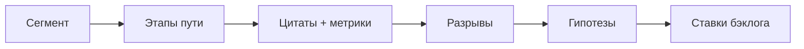
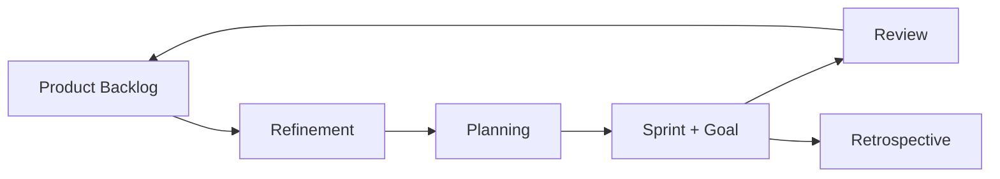

## Введение

Customer Journey Map (CJM) — способ увидеть продукт глазами человека во времени: этапы, действия, эмоции, точки контакта, боли и метрики. Карта нужна не «для красоты в Confluence», а чтобы найти разрывы между ожиданием и опытом и выбрать, что чинить первым. Ниже — практическая рамка (оригинальный разбор); полезные идеи continuous discovery можно углубить у Product Talk.

**Agile глазами Product Owner.** Для Product Owner Agile — не лозунг «мы гибкие», а ритм, в котором ценность попадает к пользователю маленькими инкрементами. Scrum Guide фиксирует ответственность PO за Product Backlog и ценность; ниже — практический взгляд: backlog, Sprint Goal, DoR/DoD, антипаттерны «PO как секретарь стейкхолдеров».

## Раздел: Как отвечать одним блоком

Этот выпуск собрал соседние короткие темы трека: «Путь клиента», «Agile глазами Product Owner». Раньше каждая занимала отдельную карточку на несколько минут, а на собеседовании их спрашивают одним блоком. Ниже у каждой темы свой раздел, затем общие лабы, один тест и одна колода карточек. В ответе сначала назовите, какую тему спросили, потом определение и один пример. Не проговаривайте все разделы, если спросили один. Лабы можно пройти по порядку исходного трека. Если времени мало, сделайте первую и последнюю: первая ставит язык, последняя проверяет, что соседние темы вы не перепутали.

## Раздел: Путь клиента: Каркас карты — этапы и доказательства

Минимальный каркас строки/колонки CJM:

1. **Этап** — например: узнаёт → регистрируется → активируется → платит → возвращается / уходит.
2. **Цель пользователя** на этапе («понять цену», «пригласить команду»).
3. **Действия и каналы** (сайт, письмо, поддержка, мобилка).
4. **Мысли / эмоции** — гипотезы, подтверждённые цитатами.
5. **Боли и барьеры** — где бросают.
6. **Метрика шага** — conversion, time-to-value, ticket rate.
7. **Возможности** — ставки продукта, не «улучшить UX вообще».

**Пример.** Онбординг B2B-инструмента: этап «пригласить коллег» имеет conversion 18%, медиана времени 4 дня; цитаты: «не понимаю, зачем звать, пока сам не разобрался». Возможность: отложить invite и сначала дать «aha» на одном сценарии.

**Ошибка.** Рисовать персону и эмодзи настроения без единой метрики и без источника (интервью, поддержка, аналитика) — это иллюстрация, не инструмент решения.

## Раздел: Путь клиента: Как собирать и резать scope карты

**Источники:** 5–8 интервью по критичному сегменту, тикеты поддержки, записи сессий, воронка продукта, теневой проход «день из жизни» у клиента. Не обязательно десятки респондентов на первую карту — важнее один чёткий сегмент (например, «админ команды 5–20 человек»).

**Сегмент важнее «всех пользователей».** Разные персоны = разные карты. Смешать «покупателя» и «ежедневного пользователя» в одну линию — классический провал.

**От карты к бэклогу.** Каждый «разрыв» → проблема → гипотеза → возможный эксперимент → оценка (см. RICE). CJM не заменяет приоритизацию, а питает её фактами о пути.

**Ошибка.** Карта на 40 этапов «от рождения бренда до NPS через год» — команда не может действовать. Лучше 5–7 этапов вокруг одной работы (job), которую улучшаете в квартале.

## Раздел: Путь клиента: CJM на собеседовании

Вас могут попросить «набросать journey для…». Алгоритм ответа за 5–7 минут:

1. Уточните сегмент и цель бизнеса.
2. Назовите 5–6 этапов.
3. Укажите 2 боли с метрикой или прокси.
4. Предложите одну ставку и как измерите эффект.
5. Скажите, какие данные ещё нужны (чего не знаете).

## Раздел: Путь клиента: Частые вопросы с собеседования

**Вопрос.** PM и PO — одна роль на собеседовании?

**Ответ.** В agile-командах PO чаще владеет backlog и приоритетом инкремента; PM шире — discovery, стратегия, экономика, стейкholders вне спринта. На практике роли сливаются в маленьких командах — на собесе назовите границы: кто решает «что строим», кто «как измеряем успех».

**Вопрос.** Чем WSJF отличается от простого «impact / effort»?

**Ответ.** WSJF добавляет Cost of Delay и job size в потоке: что дороже отложить по времени и риску. Полезен при ограниченной capacity и нескольких командах; требует честной оценки задержки, не только «большая фича — делаем первой».

**Вопрос.** OKR и KPI — конкуренты?

**Ответ.** KPI — стабильный пульс здоровья (retention, uptime). OKR — амбициозный исход на период с 2–4 KR, часть может не выполниться на 100%. На собесе: KPI не выкручивать как OKR «на 120% каждый квартал», иначе команда перестаёт рисковать.

**Вопрос.** Зачем roadmap в формате Now / Next / Later без дат на всё?

**Ответ.** Now — commitment с ресурсом; Next — готовим, но дата плавает; Later — направления без обещания. Защищает от фальшивых дат на исследования. Даты оставляют там, где есть зависимость (регулятор, контракт, релиз платформы).

**Вопрос.** Discovery и delivery — разные фазы или параллельные потоки?

**Ответ.** Discovery снижает неопределённость: проблема, сегмент, прототип, kill criteria. Delivery — строим и катим измеримый инкремент. На зрелых командах идут паралlельно: часть capacity на explore, часть на exploit; ошибка — «discovery закончили, теперь только код».

## Раздел: Agile глазами Product Owner: Backlog, Sprint Goal и прозрачность

**Product Backlog** — единственный источник работы: упорядочен, прозрачен, постоянно уточняется (refinement). PO отвечает за содержание и порядок; оценку размера делает команда.

**Sprint Goal** — зачем этот спринт одним предложением. Без цели спринт превращается в набор тикетов «что успели».

**Пример.** Цель: «Плательщик юрлица может выставить первый счёт без поддержки». В спринт входят 3 story, связанные с этой целью; «заодно покрасим лендинг» — вне цели, иначе фокус размывается.

**Ошибка.** Менять состав спринта каждый день по звонку продаж без пересборки цели и договорённости с командой — это не «Agile», а хаос с вывеской Scrum.

## Раздел: Agile глазами Product Owner: DoR, DoD и роль на ритуалах

**Definition of Ready (DoR)** — можно ли брать элемент в спринт: понятна ценность, AC, зависимости, тестовые данные, оценка.  
**Definition of Done (DoD)** — можно ли считать инкремент поставленным: код, проверки, документация по политике команды, отсутствие блокеров релиза.

PO активно на **refinement** (режет epic, проясняет AC), **planning** (цель и forecast), **review** (что получилось для пользователя), sparingly на daily (не статус-микроменеджмент). Scrum Master помогает процессу; PO не обязан быть SM.

**Пример.** Story «экспорт в Excel» не Ready: нет AC по лимиту строк и формату дат. PO возвращает на уточнение вместо «возьмём, там разберёмся» — иначе QA и разработка платят долг в конце спринта.

**Ошибка.** DoD = «разработчик сказал done» без приёмки по AC и без договорённости о качестве — leakage в прод и потеря доверия на review.

## Раздел: Agile глазами Product Owner: PO ≠ «переводчик хотелок»

PO защищает ценность: умеет сказать «нет / не сейчас» с альтернативой (дата, эксперимент, метрика). Стейкхолдеры влияют на входы бэклога; порядок — ответственность PO (см. позже RACI). На собесе ценится пример конфликта приоритетов и как вы удержали Sprint Goal.

## Раздел: Agile глазами Product Owner: Частые вопросы с собеседования

**Вопрос.** Когда RICE уместен, а когда вреден?

**Ответ.** RICE (Reach, Impact, Confidence, Effort) помогает сравнить фичи на одной шкале с явными допущениями. Вреден, когда подменяют цифры уверенностью «на глаз» или игнорируют стратегические ставки и технический долг. Хороший ответ включает Confidence и что проверите экспериментом.

**Вопрос.** Чем WSJF отличается от простого «impact / effort»?

**Ответ.** WSJF добавляет Cost of Delay и job size в потоке: что дороже отложить по времени и риску. Полезен при ограниченной capacity и нескольких командах; требует честной оценки задержки, не только «большая фича — делаем первой».

**Вопрос.** OKR и KPI — конкуренты?

**Ответ.** KPI — стабильный пульс здоровья (retention, uptime). OKR — амбициозный исход на период с 2–4 KR, часть может не выполниться на 100%. На собесе: KPI не выкручивать как OKR «на 120% каждый квартал», иначе команда перестаёт рисковать.

**Вопрос.** Зачем roadmap в формате Now / Next / Later без дат на всё?

**Ответ.** Now — commitment с ресурсом; Next — готовим, но дата плавает; Later — направления без обещания. Защищает от фальшивых дат на исследования. Даты оставляют там, где есть зависимость (регулятор, контракт, релиз платформы).

**Вопрос.** Discovery и delivery — разные фазы или параллельные потоки?

**Ответ.** Discovery снижает неопределённость: проблема, сегмент, прототип, kill criteria. Delivery — строим и катим измеримый инкремент. На зрелых командах идут паралlельно: часть capacity на explore, часть на exploit; ошибка — «discovery закончили, теперь только код».

## Лаба

**Путь клиента.**

**Цель.** Собрать CJM на 6 этапов для выбранного продукта и сегмента.

**Шаги.**
1. Выберите продукт и сегмент (кто именно путешествует).
2. Заполните таблицу: этап | цель | действие | боль | метрика | возможность.
3. Отметьте топ-2 разрыва: почему они болят бизнесу.
4. Для каждого разрыва напишите гипотезу и черновой эксперимент на 1–2 недели.
5. Список недостающих данных (что спросить у поддержки / в аналитике).

**В группу:** чья карта «шире» — сравните, не размыли ли сегмент.

**Готово, если…**
- [ ] Один сегмент, не «все»
- [ ] У болей есть метрики или явные прокси
- [ ] Есть мост от разрыва к ставке в бэклоге

**Agile глазами Product Owner.**

**Цель.** Оформить один sprint-ready срез эпика с целью спринта, DoR и DoD.

**Шаги.**
1. Возьмите эпик из CJM/приоритета (например, «счёт для юрлиц»).
2. Сформулируйте Sprint Goal на один спринт.
3. Разбейте на 3–5 backlog items с AC (Given/When/Then или чеклист).
4. Проверьте каждый item по DoR из 5 пунктов; отметьте, что доработать.
5. Запишите DoD команды из 6 пунктов, из них ≥2 про проверку качества.
6. Опишите, как откажете срочному запросу вне цели (скрипт на 4 предложения).

**В группу:** кто владеет оценкой story points — PO или Developers? Почему?

**Готово, если…**
- [ ] Есть Sprint Goal, а не только список задач
- [ ] DoR/DoD различимы
- [ ] Есть формулировка «нет / не сейчас» с альтернативой

## Схема: Путь клиента: От пути к ставке

## Схема: Agile глазами Product Owner: Ритм PO в Scrum

## Тест

### Зачем продукту Customer Journey Map?

**Ответ:** найти разрывы опыта с метриками

**Пояснение:** Карта связывает этапы пути с болями и возможными ставками, а не украшает wiki.

### Кто по Scrum Guide владеет Product Backlog?

**Ответ:** один Product Owner

**Пояснение:** Ответственность за порядок и ценность backlog не делится на комитет без делегирования.

### Почему нельзя мешать разные сегменты в одну карту?

**Ответ:** у них разные цели и боли

**Пояснение:** Покупатель и ежедневный пользователь часто идут разными путями.

### Зачем нужен Sprint Goal?

**Ответ:** фокус ценности спринта

**Пояснение:** Связывает набор items в один смысл для пользователя/бизнеса.

### Что обязательно besides эмоций на этапе?

**Ответ:** метрика или измеримый прокси

**Пояснение:** Без числа сложно выбрать, какой разрыв чинить первым.

## Шпаргалка

<ul><li>Этап → цель пользователя → действия/каналы</li><li>Эмоции/мысли (с цитатами)</li><li>Боли → метрика шага → возможности</li><li>Один владелец Product Backlog</li><li>Максимизация ценности, прозрачность порядка</li><li>Sprint Goal на каждую итерацию</li></ul>

## Anki

### Front: Какие минимальные колонки должны быть у рабочей Customer Journey Map?

Back: Этап, цель пользователя, действия/каналы, боли, метрика шага, возможности для продукта

### Front: Что Scrum Guide требует от Product Owner относительно backlog?

Back: Единственный владелец: упорядочивает элементы и отвечает за ценность содержимого

### Front: Почему сегмент важнее «карты для всех пользователей»?

Back: Разные роли идут разными путями; смешение размывает боли и ложные приоритеты

### Front: Что такое Sprint Goal и зачем он PO?

Back: Одна фраза «зачем этот спринт» — держит фокус и помогает говорить «нет» вне цели

### Front: Чем плоха CJM только с эмодзи настроения без данных?

Back: Это иллюстрация без доказательств — нельзя надёжно выбрать, что чинить

### Front: Definition of Ready — что проверяем?

Back: Можно ли брать элемент в спринт: ясность ценности, AC, зависимости, данные, оценка

## Мнемоника

### link: Путь клиента

**Задание:** Порядок карты, который просят нарисовать.

**Элементы:**
- этап
- действие
- барьер
- возможность

**Подсказка:** Барьер без этапа — абстрактная боль.

**Ответ:** этап → действие → барьер → возможность

## Итоги

- CJM — инструмент поиска разрывов с метриками, не декор
- Один сегмент, короткая карта, мост к гипотезам и бэклогу
- На собесе уточняйте сегмент и признавайте пробелы в данных
- Дальше — как PO проводит это через Scrum-ритм
- PO владеет backlog и ценностью; Sprint Goal держит фокус итерации
- DoR и DoD — разные ворота: начать vs поставить
- Оценка размера — у команды; порядок — у PO
- «Гибкость» без прозрачного порядка — просто хаос

## Ссылки

- [Product Talk](https://www.producttalk.org/)
- [SVPG — Articles](https://www.svpg.com/articles/)
- [Scrum Guide](https://scrumguides.org/)
- [Product Strategy — ставка и отказ](/game/learn/pm-product-strategy)
