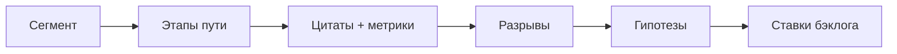

## Введение

Customer Journey Map (CJM) — способ увидеть продукт глазами человека во времени: этапы, действия, эмоции, точки контакта, боли и метрики. Карта нужна не «для красоты в Confluence», а чтобы найти разрывы между ожиданием и опытом и выбрать, что чинить первым. Ниже — практическая рамка (оригинальный разбор); полезные идеи continuous discovery можно углубить у Product Talk.

## Раздел: Каркас карты — этапы и доказательства

Минимальный каркас строки/колонки CJM:

1. **Этап** — например: узнаёт → регистрируется → активируется → платит → возвращается / уходит.
2. **Цель пользователя** на этапе («понять цену», «пригласить команду»).
3. **Действия и каналы** (сайт, письмо, поддержка, мобилка).
4. **Мысли / эмоции** — гипотезы, подтверждённые цитатами.
5. **Боли и барьеры** — где бросают.
6. **Метрика шага** — conversion, time-to-value, ticket rate.
7. **Возможности** — ставки продукта, не «улучшить UX вообще».

**Пример.** Онбординг B2B-инструмента: этап «пригласить коллег» имеет conversion 18%, медиана времени 4 дня; цитаты: «не понимаю, зачем звать, пока сам не разобрался». Возможность: отложить invite и сначала дать «aha» на одном сценарии.

**Ошибка.** Рисовать персону и эмодзи настроения без единой метрики и без источника (интервью, поддержка, аналитика) — это иллюстрация, не инструмент решения.

## Раздел: Как собирать и резать scope карты

**Источники:** 5–8 интервью по критичному сегменту, тикеты поддержки, записи сессий, воронка продукта, теневой проход «день из жизни» у клиента. Не обязательно десятки респондентов на первую карту — важнее один чёткий сегмент (например, «админ команды 5–20 человек»).

**Сегмент важнее «всех пользователей».** Разные персоны = разные карты. Смешать «покупателя» и «ежедневного пользователя» в одну линию — классический провал.

**От карты к бэклогу.** Каждый «разрыв» → проблема → гипотеза → возможный эксперимент → оценка (см. RICE). CJM не заменяет приоритизацию, а питает её фактами о пути.

**Ошибка.** Карта на 40 этапов «от рождения бренда до NPS через год» — команда не может действовать. Лучше 5–7 этапов вокруг одной работы (job), которую улучшаете в квартале.

## Раздел: CJM на собеседовании

Вас могут попросить «набросать journey для…». Алгоритм ответа за 5–7 минут:

1. Уточните сегмент и цель бизнеса.
2. Назовите 5–6 этапов.
3. Укажите 2 боли с метрикой или прокси.
4. Предложите одну ставку и как измерите эффект.
5. Скажите, какие данные ещё нужны (чего не знаете).

## Раздел: Частые вопросы с собеседования

**Вопрос.** PM и PO — одна роль на собеседовании?

**Ответ.** В agile-командах PO чаще владеет backlog и приоритетом инкремента; PM шире — discovery, стратегия, экономика, стейкholders вне спринта. На практике роли сливаются в маленьких командах — на собесе назовите границы: кто решает «что строим», кто «как измеряем успех».

**Вопрос.** Чем WSJF отличается от простого «impact / effort»?

**Ответ.** WSJF добавляет Cost of Delay и job size в потоке: что дороже отложить по времени и риску. Полезен при ограниченной capacity и нескольких командах; требует честной оценки задержки, не только «большая фича — делаем первой».

**Вопрос.** OKR и KPI — конкуренты?

**Ответ.** KPI — стабильный пульс здоровья (retention, uptime). OKR — амбициозный исход на период с 2–4 KR, часть может не выполниться на 100%. На собесе: KPI не выкручивать как OKR «на 120% каждый квартал», иначе команда перестаёт рисковать.

**Вопрос.** Зачем roadmap в формате Now / Next / Later без дат на всё?

**Ответ.** Now — commitment с ресурсом; Next — готовим, но дата плавает; Later — направления без обещания. Защищает от фальшивых дат на исследования. Даты оставляют там, где есть зависимость (регулятор, контракт, релиз платформы).

**Вопрос.** Discovery и delivery — разные фазы или параллельные потоки?

**Ответ.** Discovery снижает неопределённость: проблема, сегмент, прототип, kill criteria. Delivery — строим и катим измеримый инкремент. На зрелых командах идут паралlельно: часть capacity на explore, часть на exploit; ошибка — «discovery закончили, теперь только код».

## Лаба

**Цель.** Собрать CJM на 6 этапов для выбранного продукта и сегмента.

**Шаги.**
1. Выберите продукт и сегмент (кто именно путешествует).
2. Заполните таблицу: этап | цель | действие | боль | метрика | возможность.
3. Отметьте топ-2 разрыва: почему они болят бизнесу.
4. Для каждого разрыва напишите гипотезу и черновой эксперимент на 1–2 недели.
5. Список недостающих данных (что спросить у поддержки / в аналитике).

**В группу:** чья карта «шире» — сравните, не размыли ли сегмент.

**Готово, если…**
- [ ] Один сегмент, не «все»
- [ ] У болей есть метрики или явные прокси
- [ ] Есть мост от разрыва к ставке в бэклоге

## Схема: От пути к ставке

## Тест

### Зачем продукту Customer Journey Map?

**Ответ:** найти разрывы опыта с метриками

**Пояснение:** Карта связывает этапы пути с болями и возможными ставками, а не украшает wiki.

### Почему нельзя мешать разные сегменты в одну карту?

**Ответ:** у них разные цели и боли

**Пояснение:** Покупатель и ежедневный пользователь часто идут разными путями.

### Что обязательно besides эмоций на этапе?

**Ответ:** метрика или измеримый прокси

**Пояснение:** Без числа сложно выбрать, какой разрыв чинить первым.

### Как CJM связан с бэклогом?

**Ответ:** разрывы питают гипотезы и ставки

**Пояснение:** Карта не заменяет RICE/приоритет, а даёт входные факты.

### Какая типичная ошибка первой карты?

**Ответ:** слишком много этапов без фокуса

**Пояснение:** Рабочая карта — 5–7 этапов вокруг одной job на квартал.

## Шпаргалка

<h3>Колонки CJM</h3>
<ul>
<li>Этап → цель пользователя → действия/каналы</li>
<li>Эмоции/мысли (с цитатами)</li>
<li>Боли → метрика шага → возможности</li>
</ul>
<h3>Правила</h3>
<pre><code>1 сегмент = 1 карта
разрыв → гипотеза → эксперимент → приоритет</code></pre>

## Anki

### Front: Какие минимальные колонки должны быть у рабочей Customer Journey Map?

Back: Этап, цель пользователя, действия/каналы, боли, метрика шага, возможности для продукта

### Front: Почему сегмент важнее «карты для всех пользователей»?

Back: Разные роли идут разными путями; смешение размывает боли и ложные приоритеты

### Front: Чем плоха CJM только с эмодзи настроения без данных?

Back: Это иллюстрация без доказательств — нельзя надёжно выбрать, что чинить

### Front: Как перевести разрыв на карте в работу команды?

Back: Сформулировать проблему и гипотезу, предложить эксперимент и оценить приоритет

### Front: Сколько этапов разумно держать на карте для квартальной ставки?

Back: Обычно 5–7 этапов вокруг одной ключевой job, а не «вся жизнь бренда»

### Front: Какие источники доказательств использовать для первой CJM?

Back: Интервью сегмента, тикеты поддержки, воронка/аналитика, записи сессий

## Итоги

- CJM — инструмент поиска разрывов с метриками, не декор
- Один сегмент, короткая карта, мост к гипотезам и бэклогу
- На собесе уточняйте сегмент и признавайте пробелы в данных
- Дальше — как PO проводит это через Scrum-ритм

## Ссылки

- [Product Talk](https://www.producttalk.org/)
- [SVPG — Articles](https://www.svpg.com/articles/)
- Далее: [Agile глазами Product Owner](/game/learn/pm-agile-po)
