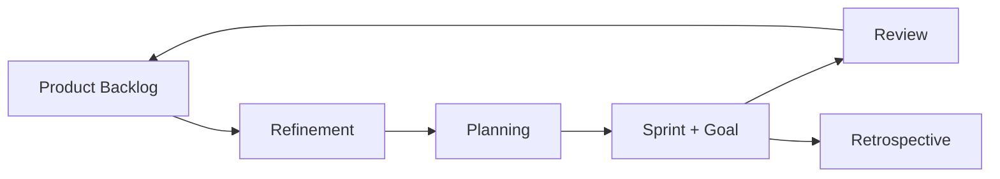

## Введение

Для Product Owner Agile — не лозунг «мы гибкие», а ритм, в котором ценность попадает к пользователю маленькими инкрементами. Scrum Guide фиксирует ответственность PO за Product Backlog и ценность; ниже — практический взгляд: backlog, Sprint Goal, DoR/DoD, антипаттерны «PO как секретарь стейкхолдеров».

## Раздел: Backlog, Sprint Goal и прозрачность

**Product Backlog** — единственный источник работы: упорядочен, прозрачен, постоянно уточняется (refinement). PO отвечает за содержание и порядок; оценку размера делает команда.

**Sprint Goal** — зачем этот спринт одним предложением. Без цели спринт превращается в набор тикетов «что успели».

**Пример.** Цель: «Плательщик юрлица может выставить первый счёт без поддержки». В спринт входят 3 story, связанные с этой целью; «заодно покрасим лендинг» — вне цели, иначе фокус размывается.

**Ошибка.** Менять состав спринта каждый день по звонку продаж без пересборки цели и договорённости с командой — это не «Agile», а хаос с вывеской Scrum.

## Раздел: DoR, DoD и роль на ритуалах

**Definition of Ready (DoR)** — можно ли брать элемент в спринт: понятна ценность, AC, зависимости, тестовые данные, оценка.  
**Definition of Done (DoD)** — можно ли считать инкремент поставленным: код, проверки, документация по политике команды, отсутствие блокеров релиза.

PO активно на **refinement** (режет epic, проясняет AC), **planning** (цель и forecast), **review** (что получилось для пользователя), sparingly на daily (не статус-микроменеджмент). Scrum Master помогает процессу; PO не обязан быть SM.

**Пример.** Story «экспорт в Excel» не Ready: нет AC по лимиту строк и формату дат. PO возвращает на уточнение вместо «возьмём, там разберёмся» — иначе QA и разработка платят долг в конце спринта.

**Ошибка.** DoD = «разработчик сказал done» без приёмки по AC и без договорённости о качестве — leakage в прод и потеря доверия на review.

## Раздел: PO ≠ «переводчик хотелок»

PO защищает ценность: умеет сказать «нет / не сейчас» с альтернативой (дата, эксперимент, метрика). Стейкхолдеры влияют на входы бэклога; порядок — ответственность PO (см. позже RACI). На собесе ценится пример конфликта приоритетов и как вы удержали Sprint Goal.

## Раздел: Частые вопросы с собеседования

**Вопрос.** Когда RICE уместен, а когда вреден?

**Ответ.** RICE (Reach, Impact, Confidence, Effort) помогает сравнить фичи на одной шкале с явными допущениями. Вреден, когда подменяют цифры уверенностью «на глаз» или игнорируют стратегические ставки и технический долг. Хороший ответ включает Confidence и что проверите экспериментом.

**Вопрос.** Чем WSJF отличается от простого «impact / effort»?

**Ответ.** WSJF добавляет Cost of Delay и job size в потоке: что дороже отложить по времени и риску. Полезен при ограниченной capacity и нескольких командах; требует честной оценки задержки, не только «большая фича — делаем первой».

**Вопрос.** OKR и KPI — конкуренты?

**Ответ.** KPI — стабильный пульс здоровья (retention, uptime). OKR — амбициозный исход на период с 2–4 KR, часть может не выполниться на 100%. На собесе: KPI не выкручивать как OKR «на 120% каждый квартал», иначе команда перестаёт рисковать.

**Вопрос.** Зачем roadmap в формате Now / Next / Later без дат на всё?

**Ответ.** Now — commitment с ресурсом; Next — готовим, но дата плавает; Later — направления без обещания. Защищает от фальшивых дат на исследования. Даты оставляют там, где есть зависимость (регулятор, контракт, релиз платформы).

**Вопрос.** Discovery и delivery — разные фазы или параллельные потоки?

**Ответ.** Discovery снижает неопределённость: проблема, сегмент, прототип, kill criteria. Delivery — строим и катим измеримый инкремент. На зрелых командах идут паралlельно: часть capacity на explore, часть на exploit; ошибка — «discovery закончили, теперь только код».

## Лаба

**Цель.** Оформить один sprint-ready срез эпика с целью спринта, DoR и DoD.

**Шаги.**
1. Возьмите эпик из CJM/приоритета (например, «счёт для юрлиц»).
2. Сформулируйте Sprint Goal на один спринт.
3. Разбейте на 3–5 backlog items с AC (Given/When/Then или чеклист).
4. Проверьте каждый item по DoR из 5 пунктов; отметьте, что доработать.
5. Запишите DoD команды из 6 пунктов, из них ≥2 про проверку качества.
6. Опишите, как откажете срочному запросу вне цели (скрипт на 4 предложения).

**В группу:** кто владеет оценкой story points — PO или Developers? Почему?

**Готово, если…**
- [ ] Есть Sprint Goal, а не только список задач
- [ ] DoR/DoD различимы
- [ ] Есть формулировка «нет / не сейчас» с альтернативой

## Схема: Ритм PO в Scrum

## Тест

### Кто по Scrum Guide владеет Product Backlog?

**Ответ:** один Product Owner

**Пояснение:** Ответственность за порядок и ценность backlog не делится на комитет без делегирования.

### Зачем нужен Sprint Goal?

**Ответ:** фокус ценности спринта

**Пояснение:** Связывает набор items в один смысл для пользователя/бизнеса.

### Чем DoR отличается от DoD?

**Ответ:** готовность начать vs готовность поставить

**Пояснение:** Ready — можно брать в работу; Done — можно считать инкремент поставленным.

### Кто оценивает размер элементов backlog?

**Ответ:** Developers / команда

**Пояснение:** PO упорядочивает и проясняет ценность; оценку трудоёмкости даёт те, кто делает работу.

### Какой антипаттерн разрушает спринт?

**Ответ:** хаотичная смена scope без цели

**Пояснение:** Постоянные «горящие» вставки без пересборки договорённостей ломают бурение ценности.

## Шпаргалка

<h3>PO в Scrum</h3>
<ul>
<li>Один владелец Product Backlog</li>
<li>Максимизация ценности, прозрачность порядка</li>
<li>Sprint Goal на каждую итерацию</li>
</ul>
<h3>DoR vs DoD</h3>
<pre><code>DoR = можно начинать (AC, зависимости, оценка)
DoD = можно считать поставленным (качество + договорённости)</code></pre>

## Anki

### Front: Что Scrum Guide требует от Product Owner относительно backlog?

Back: Единственный владелец: упорядочивает элементы и отвечает за ценность содержимого

### Front: Что такое Sprint Goal и зачем он PO?

Back: Одна фраза «зачем этот спринт» — держит фокус и помогает говорить «нет» вне цели

### Front: Definition of Ready — что проверяем?

Back: Можно ли брать элемент в спринт: ясность ценности, AC, зависимости, данные, оценка

### Front: Definition of Done — что проверяем?

Back: Можно ли считать инкремент поставленным по стандарту качества команды

### Front: Кто ставит story points / оценку размера и почему не PO в одиночку?

Back: Команда разработки — они выполняют работу и лучше калибруют трудоёмкость

### Front: Как PO отвечает на срочный запрос вне Sprint Goal?

Back: «Не сейчас» с альтернативой: в backlog с приоритетом, отдельный эксперимент или пересборка цели со стейкхолдерами

## Итоги

- PO владеет backlog и ценностью; Sprint Goal держит фокус итерации
- DoR и DoD — разные ворота: начать vs поставить
- Оценка размера — у команды; порядок — у PO
- «Гибкость» без прозрачного порядка — просто хаос

## Ссылки

- [Scrum Guide](https://scrumguides.org/)
- [SVPG — Articles](https://www.svpg.com/articles/)
- Далее: [Product Strategy — ставка и отказ](/game/learn/pm-product-strategy)
