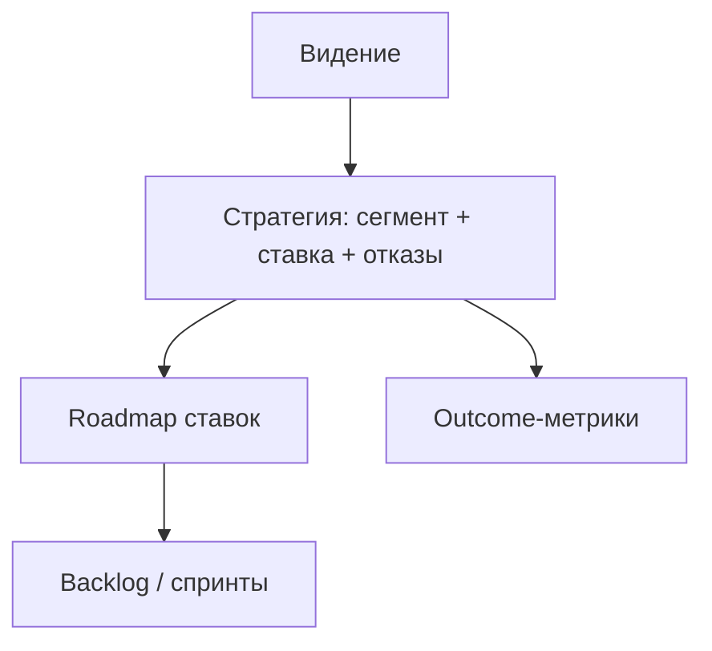

## Введение

Стратегия продукта — не толстый слайд «стать лидером рынка», а ясный выбор: для кого играем, какую проблему решаем лучше альтернатив, какие ставки делаем сейчас и от чего сознательно отказываемся. Материалы SVPG полезны как рамка мышления; ниже — оригинальная рабочая структура для middle-уровня и собеседований.

## Раздел: Сегмент, ценность, альтернативы

Хорошая стратегия отвечает на четыре вопроса:

1. **Кто** — целевой сегмент (и кто не целевой).
2. **Какая работа / боль** — job to be done одним абзацем.
3. **Почему мы** — отличие от альтернатив (включая «ничего не делать» и Excel).
4. **Как измерим** — 1–2 outcome-метрики на горизонт.

**Пример.** Сервис смен для общепита: сегмент — сети 10–50 точек; боль — хаос графиков и переработки; отличие — учёт опозданий + интеграция с зарплатой за день, а не «ещё один чат»; метрика — доля смен, закрытых без ручной правки в Excel.

**Ошибка.** Стратегия = список фич конкурента. Тогда вы догоняете чужую карту и не строите своё преимущество.

## Раздел: Ставка, отказ и связь с бэклогом

**Ставка (bet)** — концентрация ресурсов на исходе, который должен сдвинуть метрику. Стратегия сильна отказами: «не делаем мобильное приложение в этом полугодии», «не идём в enterprise >500 сотрудников».

**Горизонты.** Видение (куда), стратегия (выбор пути), roadmap (последовательность ставок), backlog (исполнение). Путать стратегию с roadmap — частая ловушка: даты фич без «почему эти, а не другие».

**Пример отказа.** Просят White-label для одного крупного клиента. Стратегия сегмента SMB → отказ или отдельный платный discovery с оценкой стоимости поддержки; иначе roadmap захватывает исключение.

**Ошибка.** «Стратегия» меняется каждый спринт под громкий запрос — это отсутствие стратегии, маскируемое под адаптивность.

## Раздел: Как рассказать стратегию за 3 минуты

1. Сегмент и проблема.
2. Одна ставка квартала/полугодия и метрика.
3. Два явных отказа.
4. Риск и что узнаем через эксперименты.
5. Как это ложится на Now/Next/Later (следующий выпуск).

## Раздел: Частые вопросы с собеседования

**Вопрос.** Когда RICE уместен, а когда вреден?

**Ответ.** RICE (Reach, Impact, Confidence, Effort) помогает сравнить фичи на одной шкале с явными допущениями. Вреден, когда подменяют цифры уверенностью «на глаз» или игнорируют стратегические ставки и технический долг. Хороший ответ включает Confidence и что проверите экспериментом.

**Вопрос.** Чем WSJF отличается от простого «impact / effort»?

**Ответ.** WSJF добавляет Cost of Delay и job size в потоке: что дороже отложить по времени и риску. Полезен при ограниченной capacity и нескольких командах; требует честной оценки задержки, не только «большая фича — делаем первой».

**Вопрос.** OKR и KPI — конкуренты?

**Ответ.** KPI — стабильный пульс здоровья (retention, uptime). OKR — амбициозный исход на период с 2–4 KR, часть может не выполниться на 100%. На собесе: KPI не выкручивать как OKR «на 120% каждый квартал», иначе команда перестаёт рисковать.

**Вопрос.** Discovery и delivery — разные фазы или параллельные потоки?

**Ответ.** Discovery снижает неопределённость: проблема, сегмент, прототип, kill criteria. Delivery — строим и катим измеримый инкремент. На зрелых командах идут паралlельно: часть capacity на explore, часть на exploit; ошибка — «discovery закончили, теперь только код».

## Лаба

**Цель.** Собрать одностраничную стратегию продукта на квартал.

**Шаги.**
1. Опишите сегмент «делаем» и сегмент «не делаем».
2. Сформулируйте ценность vs топ-2 альтернативы.
3. Выберите одну главную ставку и outcome-метрику.
4. Напишите 3 отказа (каналы, сегменты, типы фич).
5. Свяжите ставку с 3 эпиками бэклога — лишнее вычеркните.
6. Список рисков и по одному cheap test на каждый.

**В группу:** чьи отказы смелее — проверьте, не «отказались от того, чего и так не делали».

**Готово, если…**
- [ ] Есть явные «не делаем»
- [ ] Метрика outcome, не «выпустить 5 фич»
- [ ] Бэклог не противоречит ставке

## Схема: Слой выбора

## Тест

### Что делает продуктовую стратегию стратегией, а не списком фич?

**Ответ:** выбор сегмента, ставки и отказов

**Пояснение:** Сила в том, чего не делаем и почему мы выигрываем у альтернатив.

### Чем стратегия отличается от roadmap?

**Ответ:** выбор пути vs последовательность ставок

**Пояснение:** Roadmap показывает порядок; стратегия объясняет, почему этот путь.

### Какая метрика лучше для проверки ставки?

**Ответ:** outcome для пользователя или бизнеса

**Пояснение:** «Выпустили эпик» — output; нужен сдвиг поведения или экономики.

### Почему важен явный отказ от сегмента или канала?

**Ответ:** фокус ресурсов и ясность trade-off

**Пояснение:** Без отказа всё «важно», стратегия растворяется в чужих запросах.

### Какая ошибка убивает стратегию быстрее всего?

**Ответ:** смена курса каждый спринт

**Пояснение:** Адаптация нужна, но без горизонта выбора это реактивный хаос.

## Шпаргалка

<h3>Четыре вопроса</h3>
<ul>
<li>Кто (и кто нет)</li>
<li>Какая боль / job</li>
<li>Почему мы vs альтернативы</li>
<li>Как измерим outcome</li>
</ul>
<h3>Слои</h3>
<pre><code>видение → стратегия → roadmap → backlog</code></pre>

## Anki

### Front: Какие четыре вопроса должна закрывать стратегия продукта?

Back: Для кого; какую боль; почему мы лучше альтернатив; как измерим успех

### Front: Чем ставка (product bet) отличается от просто «ещё одна фича в бэклоге»?

Back: Это концентрация ресурсов на исходе с метрикой, а не пункт в списке хотелок

### Front: Почему отказы — обязательная часть стратегии?

Back: Они фиксируют trade-off и защищают фокус от захвата чужими запросами

### Front: Как связаны стратегия и roadmap?

Back: Стратегия выбирает путь и ставки; roadmap выстраивает их последовательность во времени

### Front: Почему копирование roadmap конкурента — слабая стратегия?

Back: Вы догоняете чужие выборы вместо своего преимущества для сегмента

### Front: Какой признак, что «стратегии» на самом деле нет?

Back: Приоритеты радикально меняются каждый спринт под самый громкий запрос

## Итоги

- Стратегия = сегмент + ценность + ставка + отказы + метрика
- Не путайте со списком фич и с датированным roadmap
- Отказ — навык middle PM, не грубость
- Дальше — как разложить ставки по Now/Next/Later

## Ссылки

- [SVPG — Articles](https://www.svpg.com/articles/)
- Далее: [Roadmapping — Now/Next/Later](/game/learn/pm-roadmapping)
