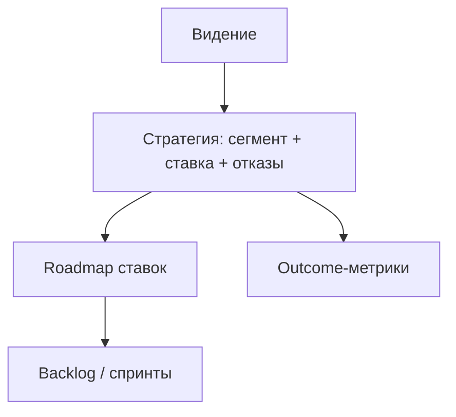
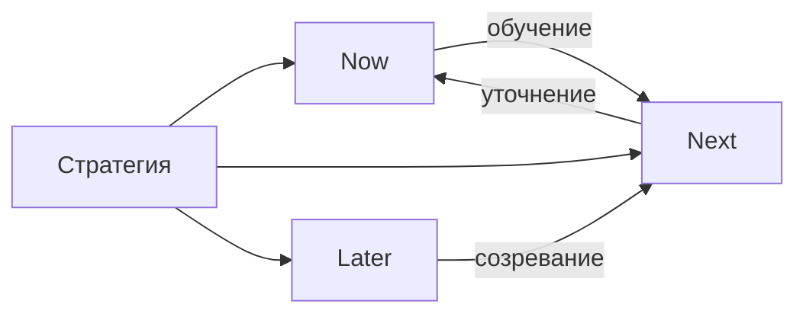

## Введение

Стратегия продукта — не толстый слайд «стать лидером рынка», а ясный выбор: для кого играем, какую проблему решаем лучше альтернатив, какие ставки делаем сейчас и от чего сознательно отказываемся. Материалы SVPG полезны как рамка мышления; ниже — оригинальная рабочая структура для middle-уровня и собеседований.

**Дорожная карта.** Roadmap отвечает на вопрос «в каком порядке идём к стратегии», а не «какие фичи в каком месяце точно выйдут». Формат **Now / Next / Later** снижает ложную точность датированных Gantt-обещаний и оставляет место для обучения. Ниже — оригинальное объяснение практики в духе продуктовых подходов SVPG: ставки и исходы, а не водопад фич.

## Раздел: Как отвечать одним блоком

Этот выпуск собрал соседние короткие темы трека: «Стратегия продукта», «Дорожная карта». Раньше каждая занимала отдельную карточку на несколько минут, а на собеседовании их спрашивают одним блоком. Ниже у каждой темы свой раздел, затем общие лабы, один тест и одна колода карточек. В ответе сначала назовите, какую тему спросили, потом определение и один пример. Не проговаривайте все разделы, если спросили один. Лабы можно пройти по порядку исходного трека. Если времени мало, сделайте первую и последнюю: первая ставит язык, последняя проверяет, что соседние темы вы не перепутали.

## Раздел: Стратегия продукта: Сегмент, ценность, альтернативы

Хорошая стратегия отвечает на четыре вопроса:

1. **Кто** — целевой сегмент (и кто не целевой).
2. **Какая работа / боль** — job to be done одним абзацем.
3. **Почему мы** — отличие от альтернатив (включая «ничего не делать» и Excel).
4. **Как измерим** — 1–2 outcome-метрики на горизонт.

**Пример.** Сервис смен для общепита: сегмент — сети 10–50 точек; боль — хаос графиков и переработки; отличие — учёт опозданий + интеграция с зарплатой за день, а не «ещё один чат»; метрика — доля смен, закрытых без ручной правки в Excel.

**Ошибка.** Стратегия = список фич конкурента. Тогда вы догоняете чужую карту и не строите своё преимущество.

## Раздел: Стратегия продукта: Ставка, отказ и связь с бэклогом

**Ставка (bet)** — концентрация ресурсов на исходе, который должен сдвинуть метрику. Стратегия сильна отказами: «не делаем мобильное приложение в этом полугодии», «не идём в enterprise >500 сотрудников».

**Горизонты.** Видение (куда), стратегия (выбор пути), roadmap (последовательность ставок), backlog (исполнение). Путать стратегию с roadmap — частая ловушка: даты фич без «почему эти, а не другие».

**Пример отказа.** Просят White-label для одного крупного клиента. Стратегия сегмента SMB → отказ или отдельный платный discovery с оценкой стоимости поддержки; иначе roadmap захватывает исключение.

**Ошибка.** «Стратегия» меняется каждый спринт под громкий запрос — это отсутствие стратегии, маскируемое под адаптивность.

## Раздел: Стратегия продукта: Как рассказать стратегию за 3 минуты

1. Сегмент и проблема.
2. Одна ставка квартала/полугодия и метрика.
3. Два явных отказа.
4. Риск и что узнаем через эксперименты.
5. Как это ложится на Now/Next/Later (следующий выпуск).

## Раздел: Стратегия продукта: Частые вопросы с собеседования

**Вопрос.** Когда RICE уместен, а когда вреден?

**Ответ.** RICE (Reach, Impact, Confidence, Effort) помогает сравнить фичи на одной шкале с явными допущениями. Вреден, когда подменяют цифры уверенностью «на глаз» или игнорируют стратегические ставки и технический долг. Хороший ответ включает Confidence и что проверите экспериментом.

**Вопрос.** Чем WSJF отличается от простого «impact / effort»?

**Ответ.** WSJF добавляет Cost of Delay и job size в потоке: что дороже отложить по времени и риску. Полезен при ограниченной capacity и нескольких командах; требует честной оценки задержки, не только «большая фича — делаем первой».

**Вопрос.** OKR и KPI — конкуренты?

**Ответ.** KPI — стабильный пульс здоровья (retention, uptime). OKR — амбициозный исход на период с 2–4 KR, часть может не выполниться на 100%. На собесе: KPI не выкручивать как OKR «на 120% каждый квартал», иначе команда перестаёт рисковать.

**Вопрос.** Discovery и delivery — разные фазы или параллельные потоки?

**Ответ.** Discovery снижает неопределённость: проблема, сегмент, прототип, kill criteria. Delivery — строим и катим измеримый инкремент. На зрелых командах идут паралlельно: часть capacity на explore, часть на exploit; ошибка — «discovery закончили, теперь только код».

## Раздел: Дорожная карта: Три колонки смысла

| Колонка | Смысл | Жёсткость |
|---------|--------|-----------|
| **Now** | То, что уже в работе / ближайший горизонт (недели) | Высокая: команда committed |
| **Next** | Следующие ставки после Now | Средняя: готовы уточнять |
| **Later** | Важно стратегически, но рано детализировать | Низкая: гипотезы и парковка |

В ячейках лучше писать **исходы / проблемы** («сократить time-to-first-invoice»), а не только названия экранов. Фичи появляются как варианты решения внутри ставки.

**Пример.** Now: «админ выставляет счёт без поддержки» (в спринтах). Next: «автонапоминания о просрочке». Later: «кредитный лимит по истории платежей». Продажи видят направление, инженерия не держит вымышленные даты на Later.

**Ошибка.** Later с детальными mockup и дедлайном «обязательно в сентябре» — это замаскированный waterfall; доверие падает при первом сдвиге.

## Раздел: Дорожная карта: Коммуникация со стейкхолдерами и обновление

**Ожидания.** Roadmap — снимок текущих ставок, пересматриваемый на каденции (например, раз в месяц). Изменение Next/Later — норма, если меняются данные; молчаливый сдвиг «обещанной» даты без разговора — нет.

**Связь со стратегией.** Если стратегия отказалась от enterprise, в Later не должно жить «кастомный SSO для холдинга» без явного исключения и цены.

**Дата vs горизонт.** Для внешних обязательств (контракт, регуляторика) дата допустима — но это исключение, помеченное как commitment, а не весь roadmap в виде календаря.

**Ошибка.** Отдельный «красивый» roadmap для совета директоров и «честный» для команды — рано или поздно врут оба; лучше один источник с разной глубиной zoom.

## Раздел: Дорожная карта: Ответ на собесе «покажите roadmap»

1. Назовите стратегию одной фразой.
2. Разложите 6–9 тем по Now/Next/Later.
3. Для Now укажите метрику успеха.
4. Объясните правило пересмотра и пример отказа.
5. Отделите commitments с датой от исследовательских ставок.

## Раздел: Дорожная карта: Частые вопросы с собеседования

**Вопрос.** PM и PO — одна роль на собеседовании?

**Ответ.** В agile-командах PO чаще владеет backlog и приоритетом инкремента; PM шире — discovery, стратегия, экономика, стейкholders вне спринта. На практике роли сливаются в маленьких командах — на собесе назовите границы: кто решает «что строим», кто «как измеряем успех».

**Вопрос.** Когда RICE уместен, а когда вреден?

**Ответ.** RICE (Reach, Impact, Confidence, Effort) помогает сравнить фичи на одной шкале с явными допущениями. Вреден, когда подменяют цифры уверенностью «на глаз» или игнорируют стратегические ставки и технический долг. Хороший ответ включает Confidence и что проверите экспериментом.

**Вопрос.** Чем WSJF отличается от простого «impact / effort»?

**Ответ.** WSJF добавляет Cost of Delay и job size в потоке: что дороже отложить по времени и риску. Полезен при ограниченной capacity и нескольких командах; требует честной оценки задержки, не только «большая фича — делаем первой».

**Вопрос.** OKR и KPI — конкуренты?

**Ответ.** KPI — стабильный пульс здоровья (retention, uptime). OKR — амбициозный исход на период с 2–4 KR, часть может не выполниться на 100%. На собесе: KPI не выкручивать как OKR «на 120% каждый квартал», иначе команда перестаёт рисковать.

**Вопрос.** Discovery и delivery — разные фазы или параллельные потоки?

**Ответ.** Discovery снижает неопределённость: проблема, сегмент, прототип, kill criteria. Delivery — строим и катим измеримый инкремент. На зрелых командах идут паралlельно: часть capacity на explore, часть на exploit; ошибка — «discovery закончили, теперь только код».

## Лаба

**Стратегия продукта.**

**Цель.** Собрать одностраничную стратегию продукта на квартал.

**Шаги.**
1. Опишите сегмент «делаем» и сегмент «не делаем».
2. Сформулируйте ценность vs топ-2 альтернативы.
3. Выберите одну главную ставку и outcome-метрику.
4. Напишите 3 отказа (каналы, сегменты, типы фич).
5. Свяжите ставку с 3 эпиками бэклога — лишнее вычеркните.
6. Список рисков и по одному cheap test на каждый.

**В группу:** чьи отказы смелее — проверьте, не «отказались от того, чего и так не делали».

**Готово, если…**
- [ ] Есть явные «не делаем»
- [ ] Метрика outcome, не «выпустить 5 фич»
- [ ] Бэклог не противоречит ставке

**Дорожная карта.**

**Цель.** Собрать Now/Next/Later на один продукт на горизонт квартала+.

**Шаги.**
1. Возьмите ставку из PM05 и 8 тем/эпиков.
2. Разложите по трём колонкам; в Now — не больше того, что реально потянуть.
3. Перепишите 3 пункта из «фича» в «исход/проблема».
4. Добавьте легенду: как часто обновляете и кто утверждает изменения Now.
5. Выберите один запрос стейкхолдера и покажите, в какую колонку он попадает и почему не в Now.
6. Отметьте 1 commitment с датой (если есть) отдельной меткой.

**В группу:** уберите из Now всё, что не имеет владельца и метрики — что осталось?

**Готово, если…**
- [ ] Now не перегружен
- [ ] Later без фальшивых дедлайнов
- [ ] Видна связь со стратегическими отказами

## Схема: Стратегия продукта: Слой выбора

## Схема: Дорожная карта: Now / Next / Later

## Тест

### Что делает продуктовую стратегию стратегией, а не списком фич?

**Ответ:** выбор сегмента, ставки и отказов

**Пояснение:** Сила в том, чего не делаем и почему мы выигрываем у альтернатив.

### Что означает колонка Now в roadmap?

**Ответ:** текущий фокус команды с высокой жёсткостью

**Пояснение:** То, что уже делается или вот-вот берётся; не склад желаний.

### Чем стратегия отличается от roadmap?

**Ответ:** выбор пути vs последовательность ставок

**Пояснение:** Roadmap показывает порядок; стратегия объясняет, почему этот путь.

### Почему Later не стоит наполнять жёсткими датами?

**Ответ:** рано для ложной точности

**Пояснение:** Детализация и дедлайны на сырых ставках создают waterfall-ожидания.

### Какая метрика лучше для проверки ставки?

**Ответ:** outcome для пользователя или бизнеса

**Пояснение:** «Выпустили эпик» — output; нужен сдвиг поведения или экономики.

## Шпаргалка

<ul><li>Кто (и кто нет)</li><li>Какая боль / job</li><li>Почему мы vs альтернативы</li><li>Как измерим outcome</li><li><b>Now</b> — committed фокус, метрика</li><li><b>Next</b> — следующие ставки, уточняем</li><li><b>Later</b> — важно, рано детализировать</li></ul>

## Anki

### Front: Какие четыре вопроса должна закрывать стратегия продукта?

Back: Для кого; какую боль; почему мы лучше альтернатив; как измерим успех

### Front: Что означает формат roadmap Now / Next / Later?

Back: Три горизонта жёсткости обязательств — текущий фокус, следующие ставки и парковка без ложных дат

### Front: Чем ставка (product bet) отличается от просто «ещё одна фича в бэклоге»?

Back: Это концентрация ресурсов на исходе с метрикой, а не пункт в списке хотелок

### Front: Почему в ячейках roadmap полезнее писать исходы, а не только названия фич?

Back: Исход связан со стратегией и метрикой; фича — лишь один способ достичь исхода

### Front: Почему отказы — обязательная часть стратегии?

Back: Они фиксируют trade-off и защищают фокус от захвата чужими запросами

### Front: Чем опасен детальный Later с дедлайном «обязательно к сентябрю»?

Back: Создаёт waterfall-ожидания и ломает доверие при неизбежном сдвиге

## Итоги

- Стратегия = сегмент + ценность + ставка + отказы + метрика
- Не путайте со списком фич и с датированным roadmap
- Отказ — навык middle PM, не грубость
- Дальше — как разложить ставки по Now/Next/Later
- Roadmap — порядок ставок, не гарантийный календарь всех фич
- Now/Next/Later снижает ложную точность и улучшает разговор со стейкхолдерами
- Пишите исходы; даты — исключение с меткой commitment
- Дальше — связать ставки с OKR

## Ссылки

- [SVPG — Articles](https://www.svpg.com/articles/)
- [OKR — цели и ключевые результаты](/game/learn/pm-okr)
