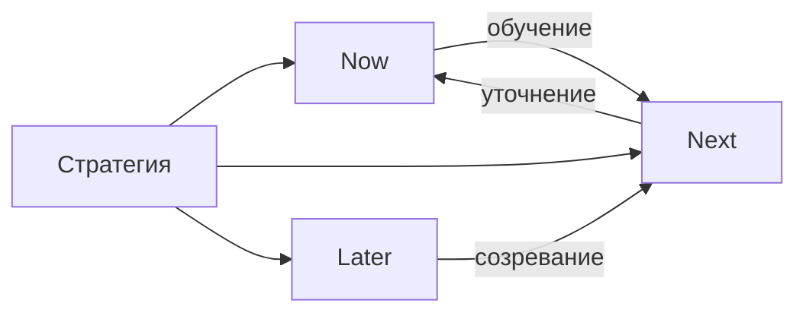

## Введение

Roadmap отвечает на вопрос «в каком порядке идём к стратегии», а не «какие фичи в каком месяце точно выйдут». Формат **Now / Next / Later** снижает ложную точность датированных Gantt-обещаний и оставляет место для обучения. Ниже — оригинальное объяснение практики в духе продуктовых подходов SVPG: ставки и исходы, а не водопад фич.

## Раздел: Три колонки смысла

| Колонка | Смысл | Жёсткость |
|---------|--------|-----------|
| **Now** | То, что уже в работе / ближайший горизонт (недели) | Высокая: команда committed |
| **Next** | Следующие ставки после Now | Средняя: готовы уточнять |
| **Later** | Важно стратегически, но рано детализировать | Низкая: гипотезы и парковка |

В ячейках лучше писать **исходы / проблемы** («сократить time-to-first-invoice»), а не только названия экранов. Фичи появляются как варианты решения внутри ставки.

**Пример.** Now: «админ выставляет счёт без поддержки» (в спринтах). Next: «автонапоминания о просрочке». Later: «кредитный лимит по истории платежей». Продажи видят направление, инженерия не держит вымышленные даты на Later.

**Ошибка.** Later с детальными mockup и дедлайном «обязательно в сентябре» — это замаскированный waterfall; доверие падает при первом сдвиге.

## Раздел: Коммуникация со стейкхолдерами и обновление

**Ожидания.** Roadmap — снимок текущих ставок, пересматриваемый на каденции (например, раз в месяц). Изменение Next/Later — норма, если меняются данные; молчаливый сдвиг «обещанной» даты без разговора — нет.

**Связь со стратегией.** Если стратегия отказалась от enterprise, в Later не должно жить «кастомный SSO для холдинга» без явного исключения и цены.

**Дата vs горизонт.** Для внешних обязательств (контракт, регуляторика) дата допустима — но это исключение, помеченное как commitment, а не весь roadmap в виде календаря.

**Ошибка.** Отдельный «красивый» roadmap для совета директоров и «честный» для команды — рано или поздно врут оба; лучше один источник с разной глубиной zoom.

## Раздел: Ответ на собесе «покажите roadmap»

1. Назовите стратегию одной фразой.
2. Разложите 6–9 тем по Now/Next/Later.
3. Для Now укажите метрику успеха.
4. Объясните правило пересмотра и пример отказа.
5. Отделите commitments с датой от исследовательских ставок.

## Раздел: Частые вопросы с собеседования

**Вопрос.** PM и PO — одна роль на собеседовании?

**Ответ.** В agile-командах PO чаще владеет backlog и приоритетом инкремента; PM шире — discovery, стратегия, экономика, стейкholders вне спринта. На практике роли сливаются в маленьких командах — на собесе назовите границы: кто решает «что строим», кто «как измеряем успех».

**Вопрос.** Когда RICE уместен, а когда вреден?

**Ответ.** RICE (Reach, Impact, Confidence, Effort) помогает сравнить фичи на одной шкале с явными допущениями. Вреден, когда подменяют цифры уверенностью «на глаз» или игнорируют стратегические ставки и технический долг. Хороший ответ включает Confidence и что проверите экспериментом.

**Вопрос.** Чем WSJF отличается от простого «impact / effort»?

**Ответ.** WSJF добавляет Cost of Delay и job size в потоке: что дороже отложить по времени и риску. Полезен при ограниченной capacity и нескольких командах; требует честной оценки задержки, не только «большая фича — делаем первой».

**Вопрос.** OKR и KPI — конкуренты?

**Ответ.** KPI — стабильный пульс здоровья (retention, uptime). OKR — амбициозный исход на период с 2–4 KR, часть может не выполниться на 100%. На собесе: KPI не выкручивать как OKR «на 120% каждый квартал», иначе команда перестаёт рисковать.

**Вопрос.** Discovery и delivery — разные фазы или параллельные потоки?

**Ответ.** Discovery снижает неопределённость: проблема, сегмент, прототип, kill criteria. Delivery — строим и катим измеримый инкремент. На зрелых командах идут паралlельно: часть capacity на explore, часть на exploit; ошибка — «discovery закончили, теперь только код».

## Лаба

**Цель.** Собрать Now/Next/Later на один продукт на горизонт квартала+.

**Шаги.**
1. Возьмите ставку из PM05 и 8 тем/эпиков.
2. Разложите по трём колонкам; в Now — не больше того, что реально потянуть.
3. Перепишите 3 пункта из «фича» в «исход/проблема».
4. Добавьте легенду: как часто обновляете и кто утверждает изменения Now.
5. Выберите один запрос стейкхолдера и покажите, в какую колонку он попадает и почему не в Now.
6. Отметьте 1 commitment с датой (если есть) отдельной меткой.

**В группу:** уберите из Now всё, что не имеет владельца и метрики — что осталось?

**Готово, если…**
- [ ] Now не перегружен
- [ ] Later без фальшивых дедлайнов
- [ ] Видна связь со стратегическими отказами

## Схема: Now / Next / Later

## Тест

### Что означает колонка Now в roadmap?

**Ответ:** текущий фокус команды с высокой жёсткостью

**Пояснение:** То, что уже делается или вот-вот берётся; не склад желаний.

### Почему Later не стоит наполнять жёсткими датами?

**Ответ:** рано для ложной точности

**Пояснение:** Детализация и дедлайны на сырых ставках создают waterfall-ожидания.

### Что лучше писать в ячейках roadmap?

**Ответ:** исходы и проблемы, не только фичи

**Пояснение:** Фича — вариант решения; исход привязан к стратегии и метрике.

### Когда дата на roadmap уместна?

**Ответ:** внешний commitment или регуляторика

**Пояснение:** Исключения помечают явно; весь план не превращают в Gantt-обещания.

### Какая ошибка разрушает доверие к roadmap?

**Ответ:** разные «правды» для команды и бизнеса

**Пояснение:** Расхождение версий приводит к сюрпризам и потере кредита доверия.

## Шпаргалка

<h3>Now / Next / Later</h3>
<ul>
<li><b>Now</b> — committed фокус, метрика</li>
<li><b>Next</b> — следующие ставки, уточняем</li>
<li><b>Later</b> — важно, рано детализировать</li>
</ul>
<h3>Правило</h3>
<pre><code>исход > список экранов
один источник правды, разный zoom</code></pre>

## Anki

### Front: Что означает формат roadmap Now / Next / Later?

Back: Три горизонта жёсткости обязательств — текущий фокус, следующие ставки и парковка без ложных дат

### Front: Почему в ячейках roadmap полезнее писать исходы, а не только названия фич?

Back: Исход связан со стратегией и метрикой; фича — лишь один способ достичь исхода

### Front: Чем опасен детальный Later с дедлайном «обязательно к сентябрю»?

Back: Создаёт waterfall-ожидания и ломает доверие при неизбежном сдвиге

### Front: Как roadmap связан со стратегией продукта?

Back: Колонки должны отражать выбранные ставки и отказы, а не противоречить им

### Front: Когда на roadmap допустима календарная дата?

Back: Когда есть внешний commitment или регуляторное обязательство — и это явно помечено

### Front: Как часто и зачем обновлять Now/Next/Later?

Back: На договорённой каденции по новым данным, чтобы снимок ставок оставался честным

## Итоги

- Roadmap — порядок ставок, не гарантийный календарь всех фич
- Now/Next/Later снижает ложную точность и улучшает разговор со стейкхолдерами
- Пишите исходы; даты — исключение с меткой commitment
- Дальше — связать ставки с OKR

## Ссылки

- [SVPG — Articles](https://www.svpg.com/articles/)
- Далее: [OKR — цели и ключевые результаты](/game/learn/pm-okr)
