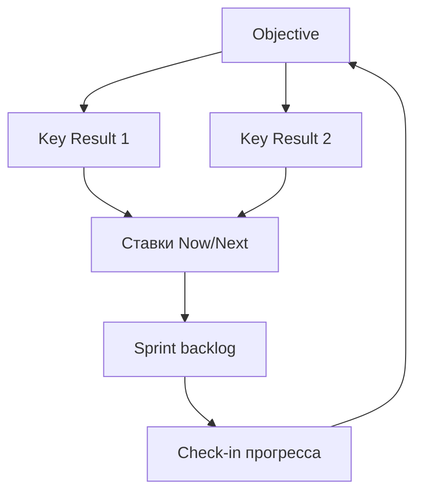

## Введение

OKR (Objectives and Key Results) помогают выровнять команду на амбициозный исход и измеримые результаты. Публичная рамка Google re:Work — хороший первоисточник; ниже — практические правила для продуктовой команды: чем Objective отличается от KR, как не превратить KR в список задач и как связать OKR с roadmap.

## Раздел: Objective и Key Results

**Objective** — качественная, вдохновляющая цель на период («Стать способом №1 выставлять счета для SMB-админов»).  
**Key Results** — 2–5 измеримых результатов, по которым видно прогресс (числа, доли, пороги). KR описывают *результат*, не *работу*.

**Пример.**

- O: Админы команд активируются без помощи поддержки.
- KR1: Доля команд с time-to-value ≤ 1 день выросла с 35% до 60%.
- KR2: Тикеты «как начать» на 1000 новых команд снизились с 40 до 15.
- KR3: Week-1 retention команд 45% → 60%.

Задачи «сделать туториал» и «добавить чеклист» — инициативы в backlog/roadmap, а не KR.

**Ошибка.** KR = «запустить 3 фичи» / «провести 10 встреч» — это output и активность; можно закрыть KR, не сдвинув ценность.

## Раздел: Каденция, выравнивание и антипаттерны

**Каденция.** Обычно квартал для команды; прогресс — на коротких check-in (например, bi-weekly): уверенность, блокеры, нужна ли пересборка ставок.

**Выравнивание.** OKR продукта поддерживают компанию, но не копируют слово в слово KPI продаж. Продукт отвечает за рычаги, которыми владеет (активация, retention, конверсия в ценность), а не за «выручку любой ценой» без влияния.

**Амбиция.** Классическая идея: цели натяжные; 70% достижение может быть успехом — если так договорились. Важно не смешивать OKR с премиальными KPI без правил (иначе все ставят песок).

**Ошибка.** 15 OKR на команду на квартал — нет фокуса. Другая крайность: один KR, который команда не контролирует (макроэкономика).

## Раздел: OKR ↔ roadmap ↔ бэклог

Связка: Objective задаёт смысл → KR задают «что сдвинуть» → Now/Next наполняются ставками, которые *могут* сдвинуть KR → sprint backlog исполняет. Если roadmap полный, а KR не двигаются — пересмотрите ставки, а не только velocity.

На собесе покажите один плохой KR (задача) и перепишите в измеримый исход.

## Раздел: Частые вопросы с собеседования

**Вопрос.** PM и PO — одна роль на собеседовании?

**Ответ.** В agile-командах PO чаще владеет backlog и приоритетом инкремента; PM шире — discovery, стратегия, экономика, стейкholders вне спринта. На практике роли сливаются в маленьких командах — на собесе назовите границы: кто решает «что строим», кто «как измеряем успех».

**Вопрос.** Когда RICE уместен, а когда вреден?

**Ответ.** RICE (Reach, Impact, Confidence, Effort) помогает сравнить фичи на одной шкале с явными допущениями. Вреден, когда подменяют цифры уверенностью «на глаз» или игнорируют стратегические ставки и технический долг. Хороший ответ включает Confidence и что проверите экспериментом.

**Вопрос.** Чем WSJF отличается от простого «impact / effort»?

**Ответ.** WSJF добавляет Cost of Delay и job size в потоке: что дороже отложить по времени и риску. Полезен при ограниченной capacity и нескольких командах; требует честной оценки задержки, не только «большая фича — делаем первой».

**Вопрос.** Discovery и delivery — разные фазы или параллельные потоки?

**Ответ.** Discovery снижает неопределённость: проблема, сегмент, прототип, kill criteria. Delivery — строим и катим измеримый инкремент. На зрелых командах идут паралlельно: часть capacity на explore, часть на exploit; ошибка — «discovery закончили, теперь только код».

## Лаба

**Цель.** Написать продуктовый OKR на квартал и связать с Now.

**Шаги.**
1. Сформулируйте 1 Objective (без чисел, но конкретный).
2. Добавьте 3 KR с базой и целью (от → до / порог).
3. Вычеркните любые KR, которые являются задачами; замените на исходы.
4. Привяжите к каждому KR 1–2 ставки из Now/Next.
5. Напишите правило check-in: как часто и что решаете на встрече.
6. Укажите 1 метрику, которой *не* владеете единолично — и как учтёте зависимость.

**В группу:** найдите у соседа «скрытую задачу» в формулировке KR.

**Готово, если…**
- [ ] KR измеримы и про результат
- [ ] Не больше одного O на фокус команды (или явно ранжированы)
- [ ] Есть мост к roadmap

## Схема: От цели к работе

## Тест

### Чем Objective отличается от Key Result?

**Ответ:** качественная цель vs измеримый результат

**Пояснение:** O задаёт направление; KR показывают числовой прогресс.

### Почему нельзя писать KR как «запустить фичу X»?

**Ответ:** это output, не исход

**Пояснение:** Фичу можно выпустить без сдвига поведения пользователя или бизнеса.

### Сколько Key Results разумно держать на одну цель?

**Ответ:** обычно от двух до пяти

**Пояснение:** Меньше — узко; больше — теряется фокус и ясность успеха.

### Как OKR связаны с roadmap?

**Ответ:** ставки roadmap должны двигать KR

**Пояснение:** Если план полный, а KR стоят — меняют ставки, не только скорость задач.

### Какой антипаттерн размывает OKR?

**Ответ:** слишком много целей сразу

**Пояснение:** Десяток OKR на команду превращает систему в список желаний без приоритета.

## Шпаргалка

<h3>Формула</h3>
<pre><code>O = вдохновляющая цель периода
KR = измеримый исход (база → цель)
инициативы ≠ KR</code></pre>
<h3>Связка</h3>
<ul>
<li>OKR → ставки roadmap → sprint items</li>
<li>Check-in: прогресс, уверенность, блокеры</li>
</ul>

## Anki

### Front: Что такое Objective в системе OKR?

Back: Качественная амбициозная цель на период, задающая направление без обязательных чисел в формулировке

### Front: Что такое Key Result и чем он отличается от задачи в Jira?

Back: Измеримый исход (метрика с базой и целью); задача — работа, которая лишь может помочь исходу

### Front: Почему KR «выпустить три фичи» считается антипаттерном?

Back: Это output: можно закрыть список релизов и не изменить поведение пользователя

### Front: Как продуктовые OKR должны стыковаться с Now/Next/Later?

Back: Ставки в колонках выбирают так, чтобы с высокой вероятностью двигать ключевые результаты

### Front: Зачем нужны регулярные check-in по OKR внутри квартала?

Back: Чтобы рано увидеть, что ставки не двигают метрики, и скорректировать курс

### Front: Почему опасно смешивать OKR с премией без явных правил?

Back: Люди ставят заниженные цели («песок»), и амбиция системы умирает

## Итоги

- O — направление; KR — измеримые исходы, не список задач
- Мало целей, явная связь со ставками roadmap
- Check-in важнее красивого kickoff-слайда
- Дальше — как проводить решения со стейкхолдерами через RACI

## Ссылки

- [Google re:Work — OKRs](https://rework.withgoogle.com/intl/en/guides/set-goals-with-okrs)
- [SVPG — Articles](https://www.svpg.com/articles/)
- Далее: [Стейкхолдеры и RACI](/game/learn/pm-stakeholders)
