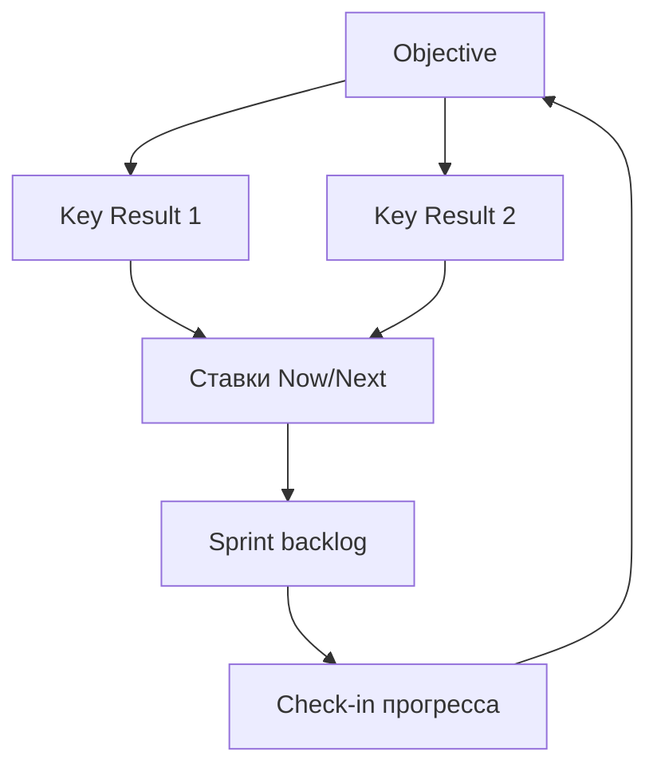
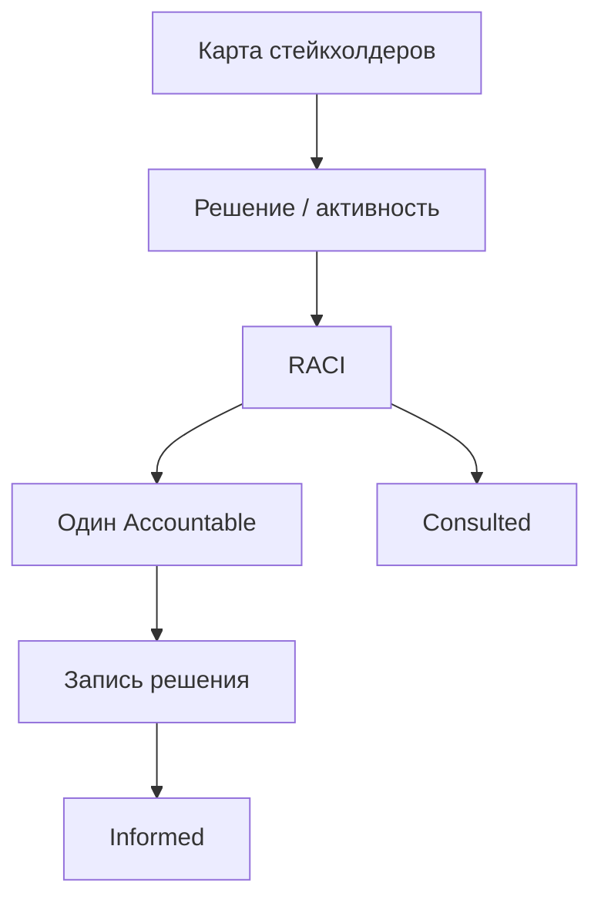

## Введение

OKR (Objectives and Key Results) помогают выровнять команду на амбициозный исход и измеримые результаты. Публичная рамка Google re:Work — хороший первоисточник; ниже — практические правила для продуктовой команды: чем Objective отличается от KR, как не превратить KR в список задач и как связать OKR с roadmap.

**Стейкхолдеры и RACI.** Стейкхолдеры влияют на продукт даже когда не пишут код: продажи, поддержка, юристы, финансы, смежные команды, руководство. Задача PM/PO — сделать влияние прозрачным: кто решает, кто делает, кого держать в курсе. RACI — простой язык для этого; ниже — оригинальная практика применения, без бюрократии ради матрицы.

## Раздел: Как отвечать одним блоком

Этот выпуск собрал соседние короткие темы трека: «Цели OKR», «Стейкхолдеры и RACI». Раньше каждая занимала отдельную карточку на несколько минут, а на собеседовании их спрашивают одним блоком. Ниже у каждой темы свой раздел, затем общие лабы, один тест и одна колода карточек. В ответе сначала назовите, какую тему спросили, потом определение и один пример. Не проговаривайте все разделы, если спросили один. Лабы можно пройти по порядку исходного трека. Если времени мало, сделайте первую и последнюю: первая ставит язык, последняя проверяет, что соседние темы вы не перепутали.

## Раздел: Цели OKR: Objective и Key Results

**Objective** — качественная, вдохновляющая цель на период («Стать способом №1 выставлять счета для SMB-админов»).  
**Key Results** — 2–5 измеримых результатов, по которым видно прогресс (числа, доли, пороги). KR описывают *результат*, не *работу*.

**Пример.**

- O: Админы команд активируются без помощи поддержки.
- KR1: Доля команд с time-to-value ≤ 1 день выросла с 35% до 60%.
- KR2: Тикеты «как начать» на 1000 новых команд снизились с 40 до 15.
- KR3: Week-1 retention команд 45% → 60%.

Задачи «сделать туториал» и «добавить чеклист» — инициативы в backlog/roadmap, а не KR.

**Ошибка.** KR = «запустить 3 фичи» / «провести 10 встреч» — это output и активность; можно закрыть KR, не сдвинув ценность.

## Раздел: Цели OKR: Каденция, выравнивание и антипаттерны

**Каденция.** Обычно квартал для команды; прогресс — на коротких check-in (например, bi-weekly): уверенность, блокеры, нужна ли пересборка ставок.

**Выравнивание.** OKR продукта поддерживают компанию, но не копируют слово в слово KPI продаж. Продукт отвечает за рычаги, которыми владеет (активация, retention, конверсия в ценность), а не за «выручку любой ценой» без влияния.

**Амбиция.** Классическая идея: цели натяжные; 70% достижение может быть успехом — если так договорились. Важно не смешивать OKR с премиальными KPI без правил (иначе все ставят песок).

**Ошибка.** 15 OKR на команду на квартал — нет фокуса. Другая крайность: один KR, который команда не контролирует (макроэкономика).

## Раздел: Цели OKR: OKR ↔ roadmap ↔ бэклог

Связка: Objective задаёт смысл → KR задают «что сдвинуть» → Now/Next наполняются ставками, которые *могут* сдвинуть KR → sprint backlog исполняет. Если roadmap полный, а KR не двигаются — пересмотрите ставки, а не только velocity.

На собесе покажите один плохой KR (задача) и перепишите в измеримый исход.

## Раздел: Цели OKR: Частые вопросы с собеседования

**Вопрос.** PM и PO — одна роль на собеседовании?

**Ответ.** В agile-командах PO чаще владеет backlog и приоритетом инкремента; PM шире — discovery, стратегия, экономика, стейкholders вне спринта. На практике роли сливаются в маленьких командах — на собесе назовите границы: кто решает «что строим», кто «как измеряем успех».

**Вопрос.** Когда RICE уместен, а когда вреден?

**Ответ.** RICE (Reach, Impact, Confidence, Effort) помогает сравнить фичи на одной шкале с явными допущениями. Вреден, когда подменяют цифры уверенностью «на глаз» или игнорируют стратегические ставки и технический долг. Хороший ответ включает Confidence и что проверите экспериментом.

**Вопрос.** Чем WSJF отличается от простого «impact / effort»?

**Ответ.** WSJF добавляет Cost of Delay и job size в потоке: что дороже отложить по времени и риску. Полезен при ограниченной capacity и нескольких командах; требует честной оценки задержки, не только «большая фича — делаем первой».

**Вопрос.** Discovery и delivery — разные фазы или параллельные потоки?

**Ответ.** Discovery снижает неопределённость: проблема, сегмент, прототип, kill criteria. Delivery — строим и катим измеримый инкремент. На зрелых командах идут паралlельно: часть capacity на explore, часть на exploit; ошибка — «discovery закончили, теперь только код».

## Раздел: Стейкхолдеры и RACI: Карта интересов и конфликты

Сначала карта, потом RACI:

1. **Кто** заинтересован (роль, не только ФИО).
2. **Интерес** — что для них успех.
3. **Влияние** — могут ли заблокировать/ускорить.
4. **Отношение** — союзник / нейтрал / риск.
5. **Канал** — как и как часто синхронизируетесь.

**Пример.** Запуск тарифа: продажи хотят скидки «на месте», финансы — маржу, поддержка — простые правила, юристы — оферту. Конфликт интересов нормален; плохо — решать его в Slack в thrade на 80 сообщений без решения.

**Ошибка.** Игнорировать «тихих» владельцев (безопасность, комплаенс) до поздней стадии — veto в конце квартала дороже раннего Involved.

## Раздел: Стейкхолдеры и RACI: RACI на решениях продукта

**RACI** для ключевой активности или решения:

| Буква | Роль | Смысл |
|-------|------|--------|
| **R** | Responsible | Делает работу |
| **A** | Accountable | Один итоговый ответственный; «останавливает мяч» |
| **C** | Consulted | Спрашиваем до решения (двусторонне) |
| **I** | Informed | Сообщаем после (односторонне) |

**Пример.** Приоритет квартального backlog: **A** = PO/PM продукта; **R** = PM (+ команда на оценке); **C** = продажи, поддержка, tech lead; **I** = смежные продукты, CS-лиды. Продажи не получают вторую букву A «потому что квота».

**Правило одного A.** Два Accountable = нет Accountable. Если директор настаивает на A вместе с PO — явно эскалируйте мандат, иначе RACI врёт.

**Ошибка.** Раздать всем C «чтобы не обидеть» — решения бесконечно согласовываются; Consultees должны быть ограниченным списком.

## Раздел: Стейкхолдеры и RACI: Коммуникация и «нет» без войны

- Разделяйте **входы** (инсайты продаж) и **решение** (порядок backlog).
- Фиксируйте решение: что, почему, какие отказы, дата пересмотра.
- Для конфликта метрик (OKR продукта vs план продаж) поднимите на уровень, где есть общий A (иногда Head of Product / GM).

На собесе расскажите кейс: кто был A, как собрали C, чем закончилось.

## Раздел: Стейкхолдеры и RACI: Частые вопросы с собеседования

**Вопрос.** Когда RICE уместен, а когда вреден?

**Ответ.** RICE (Reach, Impact, Confidence, Effort) помогает сравнить фичи на одной шкале с явными допущениями. Вреден, когда подменяют цифры уверенностью «на глаз» или игнорируют стратегические ставки и технический долг. Хороший ответ включает Confidence и что проверите экспериментом.

**Вопрос.** Чем WSJF отличается от простого «impact / effort»?

**Ответ.** WSJF добавляет Cost of Delay и job size в потоке: что дороже отложить по времени и риску. Полезен при ограниченной capacity и нескольких командах; требует честной оценки задержки, не только «большая фича — делаем первой».

**Вопрос.** Зачем roadmap в формате Now / Next / Later без дат на всё?

**Ответ.** Now — commitment с ресурсом; Next — готовим, но дата плавает; Later — направления без обещания. Защищает от фальшивых дат на исследования. Даты оставляют там, где есть зависимость (регулятор, контракт, релиз платформы).

**Вопрос.** Discovery и delivery — разные фазы или параллельные потоки?

**Ответ.** Discovery снижает неопределённость: проблема, сегмент, прототип, kill criteria. Delivery — строим и катим измеримый инкремент. На зрелых командах идут паралlельно: часть capacity на explore, часть на exploit; ошибка — «discovery закончили, теперь только код».

## Лаба

**Цели OKR.**

**Цель.** Написать продуктовый OKR на квартал и связать с Now.

**Шаги.**
1. Сформулируйте 1 Objective (без чисел, но конкретный).
2. Добавьте 3 KR с базой и целью (от → до / порог).
3. Вычеркните любые KR, которые являются задачами; замените на исходы.
4. Привяжите к каждому KR 1–2 ставки из Now/Next.
5. Напишите правило check-in: как часто и что решаете на встрече.
6. Укажите 1 метрику, которой *не* владеете единолично — и как учтёте зависимость.

**В группу:** найдите у соседа «скрытую задачу» в формулировке KR.

**Готово, если…**
- [ ] KR измеримы и про результат
- [ ] Не больше одного O на фокус команды (или явно ранжированы)
- [ ] Есть мост к roadmap

**Стейкхолдеры и RACI.**

**Цель.** Построить карту стейкхолдеров и RACI на одно решение.

**Шаги.**
1. Выберите решение: «порядок Now на квартал» или «запуск тарифа».
2. Заполните таблицу: роль | интерес | влияние | канал.
3. Постройте RACI на 4 активности: приоритет backlog, текст оферты, цена, дата анонса.
4. Проверьте: ровно один A на строку; C не длиннее 4 ролей.
5. Напишите шаблон сообщения Informed на 5 предложений.
6. Опишите эскалацию, если Sales требует стать вторым A.

**В группу:** найдите лишних C — кого хватит Informed?

**Готово, если…**
- [ ] Один A на каждое решение
- [ ] Интересы конфликтов названы вслух
- [ ] Есть канал и каденция, не только «по ситуации»

## Схема: Цели OKR: От цели к работе

## Схема: Стейкхолдеры и RACI: От интереса к решению

## Тест

### Чем Objective отличается от Key Result?

**Ответ:** качественная цель vs измеримый результат

**Пояснение:** O задаёт направление; KR показывают числовой прогресс.

### Что означает буква A в RACI?

**Ответ:** единственный итоговый ответственный

**Пояснение:** Accountable принимает или утверждает решение; двух A быть не должно.

### Почему нельзя писать KR как «запустить фичу X»?

**Ответ:** это output, не исход

**Пояснение:** Фичу можно выпустить без сдвига поведения пользователя или бизнеса.

### Чем Consulted отличается от Informed?

**Ответ:** диалог до решения vs уведомление после

**Пояснение:** C участвует в обсуждении; I узнаёт о результате.

### Сколько Key Results разумно держать на одну цель?

**Ответ:** обычно от двух до пяти

**Пояснение:** Меньше — узко; больше — теряется фокус и ясность успеха.

## Шпаргалка

<ul><li>OKR → ставки roadmap → sprint items</li><li>Check-in: прогресс, уверенность, блокеры</li><li><b>R</b> — делает</li><li><b>A</b> — один отвечает за итог</li><li><b>C</b> — консультируем до</li><li><b>I</b> — информируем после</li></ul>

## Anki

### Front: Что такое Objective в системе OKR?

Back: Качественная амбициозная цель на период, задающая направление без обязательных чисел в формулировке

### Front: Расшифруйте буквы R, A, C, I в матрице RACI

Back: Responsible делает; Accountable один отвечает за итог; Consulted спрашивают до решения; Informed уведомляют после

### Front: Что такое Key Result и чем он отличается от задачи в Jira?

Back: Измеримый исход (метрика с базой и целью); задача — работа, которая лишь может помочь исходу

### Front: Почему в RACI на одно решение должен быть только один Accountable?

Back: Два итоговых ответственных означают, что при конфликте никто не обязан остановить решение

### Front: Почему KR «выпустить три фичи» считается антипаттерном?

Back: Это output: можно закрыть список релизов и не изменить поведение пользователя

### Front: Чем вклад продаж в бэклог отличается от права назначать приоритет?

Back: Продажи дают входы и инсайты; порядок ценности утверждает Accountable продукта (PO/PM)

## Мнемоника

### acronym: OKR

**Задание:** Цель и ключевой результат — разные вещи.

**Элементы:**
- Objective качественно
- Key result число
- не задача

**Подсказка:** «Запустить фичу» — задача. «Доля повторных 20%» — результат.

**Ответ:** O качественно, KR число, не task

## Итоги

- O — направление; KR — измеримые исходы, не список задач
- Мало целей, явная связь со ставками roadmap
- Check-in важнее красивого kickoff-слайда
- Дальше — как проводить решения со стейкхолдерами через RACI
- Сначала интересы и влияние, потом RACI
- Один Accountable; C ограничен; решение записывается
- Входы стейкхолдеров питают бэклог, но не отменяют мандат PO/PM
- Дальше — говорить о деньгах: P&L и unit-экономика

## Ссылки

- [Google re:Work — OKRs](https://rework.withgoogle.com/intl/en/guides/set-goals-with-okrs)
- [SVPG — Articles](https://www.svpg.com/articles/)
- [Scrum Guide](https://scrumguides.org/)
- [P&L и unit-экономика](/game/learn/pm-pnl-unit-econ)
