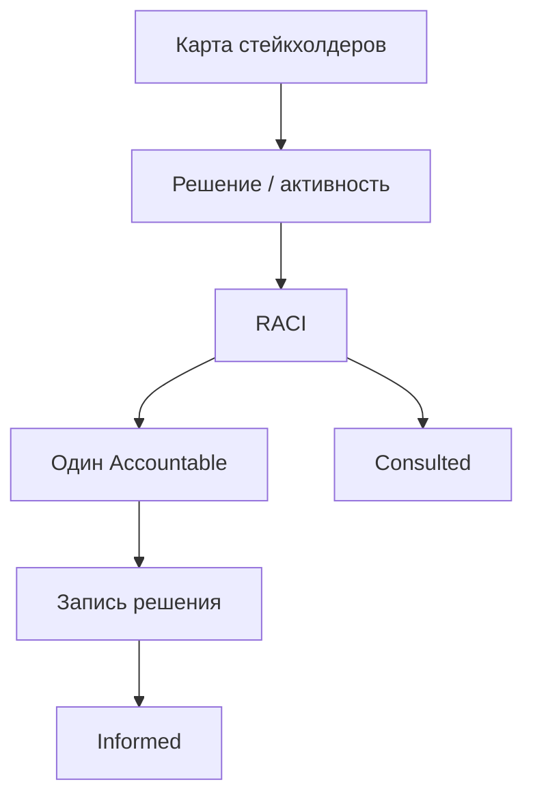

## Введение

Стейкхолдеры влияют на продукт даже когда не пишут код: продажи, поддержка, юристы, финансы, смежные команды, руководство. Задача PM/PO — сделать влияние прозрачным: кто решает, кто делает, кого держать в курсе. RACI — простой язык для этого; ниже — оригинальная практика применения, без бюрократии ради матрицы.

## Раздел: Карта интересов и конфликты

Сначала карта, потом RACI:

1. **Кто** заинтересован (роль, не только ФИО).
2. **Интерес** — что для них успех.
3. **Влияние** — могут ли заблокировать/ускорить.
4. **Отношение** — союзник / нейтрал / риск.
5. **Канал** — как и как часто синхронизируетесь.

**Пример.** Запуск тарифа: продажи хотят скидки «на месте», финансы — маржу, поддержка — простые правила, юристы — оферту. Конфликт интересов нормален; плохо — решать его в Slack в thrade на 80 сообщений без решения.

**Ошибка.** Игнорировать «тихих» владельцев (безопасность, комплаенс) до поздней стадии — veto в конце квартала дороже раннего Involved.

## Раздел: RACI на решениях продукта

**RACI** для ключевой активности или решения:

| Буква | Роль | Смысл |
|-------|------|--------|
| **R** | Responsible | Делает работу |
| **A** | Accountable | Один итоговый ответственный; «останавливает мяч» |
| **C** | Consulted | Спрашиваем до решения (двусторонне) |
| **I** | Informed | Сообщаем после (односторонне) |

**Пример.** Приоритет квартального backlog: **A** = PO/PM продукта; **R** = PM (+ команда на оценке); **C** = продажи, поддержка, tech lead; **I** = смежные продукты, CS-лиды. Продажи не получают вторую букву A «потому что квота».

**Правило одного A.** Два Accountable = нет Accountable. Если директор настаивает на A вместе с PO — явно эскалируйте мандат, иначе RACI врёт.

**Ошибка.** Раздать всем C «чтобы не обидеть» — решения бесконечно согласовываются; Consultees должны быть ограниченным списком.

## Раздел: Коммуникация и «нет» без войны

- Разделяйте **входы** (инсайты продаж) и **решение** (порядок backlog).
- Фиксируйте решение: что, почему, какие отказы, дата пересмотра.
- Для конфликта метрик (OKR продукта vs план продаж) поднимите на уровень, где есть общий A (иногда Head of Product / GM).

На собесе расскажите кейс: кто был A, как собрали C, чем закончилось.

## Раздел: Частые вопросы с собеседования

**Вопрос.** Когда RICE уместен, а когда вреден?

**Ответ.** RICE (Reach, Impact, Confidence, Effort) помогает сравнить фичи на одной шкале с явными допущениями. Вреден, когда подменяют цифры уверенностью «на глаз» или игнорируют стратегические ставки и технический долг. Хороший ответ включает Confidence и что проверите экспериментом.

**Вопрос.** Чем WSJF отличается от простого «impact / effort»?

**Ответ.** WSJF добавляет Cost of Delay и job size в потоке: что дороже отложить по времени и риску. Полезен при ограниченной capacity и нескольких командах; требует честной оценки задержки, не только «большая фича — делаем первой».

**Вопрос.** Зачем roadmap в формате Now / Next / Later без дат на всё?

**Ответ.** Now — commitment с ресурсом; Next — готовим, но дата плавает; Later — направления без обещания. Защищает от фальшивых дат на исследования. Даты оставляют там, где есть зависимость (регулятор, контракт, релиз платформы).

**Вопрос.** Discovery и delivery — разные фазы или параллельные потоки?

**Ответ.** Discovery снижает неопределённость: проблема, сегмент, прототип, kill criteria. Delivery — строим и катим измеримый инкремент. На зрелых командах идут паралlельно: часть capacity на explore, часть на exploit; ошибка — «discovery закончили, теперь только код».

## Лаба

**Цель.** Построить карту стейкхолдеров и RACI на одно решение.

**Шаги.**
1. Выберите решение: «порядок Now на квартал» или «запуск тарифа».
2. Заполните таблицу: роль | интерес | влияние | канал.
3. Постройте RACI на 4 активности: приоритет backlog, текст оферты, цена, дата анонса.
4. Проверьте: ровно один A на строку; C не длиннее 4 ролей.
5. Напишите шаблон сообщения Informed на 5 предложений.
6. Опишите эскалацию, если Sales требует стать вторым A.

**В группу:** найдите лишних C — кого хватит Informed?

**Готово, если…**
- [ ] Один A на каждое решение
- [ ] Интересы конфликтов названы вслух
- [ ] Есть канал и каденция, не только «по ситуации»

## Схема: От интереса к решению

## Тест

### Что означает буква A в RACI?

**Ответ:** единственный итоговый ответственный

**Пояснение:** Accountable принимает или утверждает решение; двух A быть не должно.

### Чем Consulted отличается от Informed?

**Ответ:** диалог до решения vs уведомление после

**Пояснение:** C участвует в обсуждении; I узнаёт о результате.

### Кто обычно Accountable за порядок продуктового backlog?

**Ответ:** Product Owner / PM продукта

**Пояснение:** Стейкхолдеры дают входы, но не делят мандат приоритета без эскалации.

### Зачем сначала карта интересов, а не сразу матрица?

**Ответ:** понять конфликты и влияние

**Пояснение:** Иначе RACI формален и игнорирует реальных блокеров.

### Какая ошибка раздувает согласования?

**Ответ:** слишком много Consulted

**Пояснение:** «Всех спросить» превращает решение в вечный комитет.

## Шпаргалка

<h3>RACI</h3>
<ul>
<li><b>R</b> — делает</li>
<li><b>A</b> — один отвечает за итог</li>
<li><b>C</b> — консультируем до</li>
<li><b>I</b> — информируем после</li>
</ul>
<h3>Правила</h3>
<pre><code>ровно один A на решение
входы стейкхолдеров ≠ право вето на каждый тикет
решение фиксируем письменно</code></pre>

## Anki

### Front: Расшифруйте буквы R, A, C, I в матрице RACI

Back: Responsible делает; Accountable один отвечает за итог; Consulted спрашивают до решения; Informed уведомляют после

### Front: Почему в RACI на одно решение должен быть только один Accountable?

Back: Два итоговых ответственных означают, что при конфликте никто не обязан остановить решение

### Front: Чем вклад продаж в бэклог отличается от права назначать приоритет?

Back: Продажи дают входы и инсайты; порядок ценности утверждает Accountable продукта (PO/PM)

### Front: Что такое карта стейкхолдеров до построения RACI?

Back: Список ролей с интересом, влиянием, отношением и каналом коммуникации

### Front: Почему опасно делать Consulted из всех «на всякий случай»?

Back: Согласования раздуваются, решения тормозятся, ответственность размывается

### Front: Что зафиксировать после трудного решения со стейкхолдерами?

Back: Суть решения, почему, какие отказы и когда пересмотрим — затем разослать Informed

## Итоги

- Сначала интересы и влияние, потом RACI
- Один Accountable; C ограничен; решение записывается
- Входы стейкхолдеров питают бэклог, но не отменяют мандат PO/PM
- Дальше — говорить о деньгах: P&L и unit-экономика

## Ссылки

- [Scrum Guide](https://scrumguides.org/) (мандат PO на backlog)
- [SVPG — Articles](https://www.svpg.com/articles/)
- Далее: [P&L и unit-экономика](/game/learn/pm-pnl-unit-econ)
