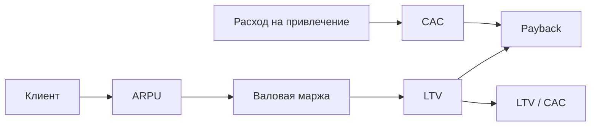
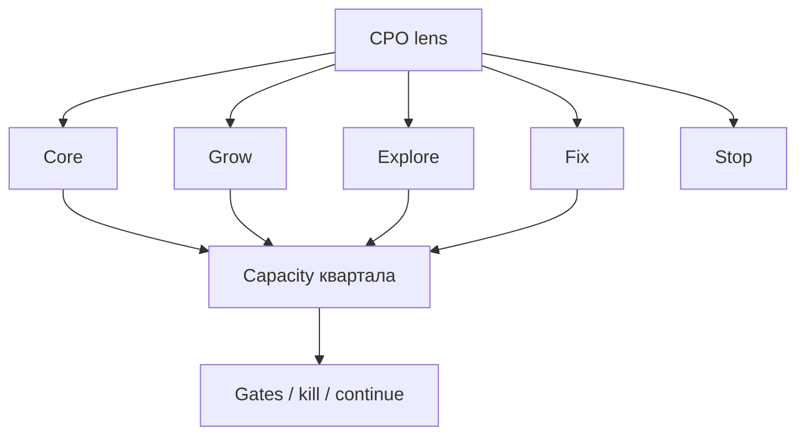

## Введение

Senior PM обязан читать продукт через деньги: как устроена выручка, где маржа, сходится ли unit-экономика. Это не замена CFO, а общий язык с бизнесом. Ниже — рабочие формулы LTV, CAC, payback и вклад (contribution) на пальцах; оригинальные примеры, без претензии на полный курс финансов.

**Портфель продуктов и ставок.** На уровне CPO / Head of Product решения редко про «одну фичу»: нужно распределить ограниченных людей и внимание между продуктами и ставками. Портфель — явная карта: что кормит сегодня, что растёт, что исследуем, что останавливаем. Ниже — оригинальная рамка «линзы CPO»; без копирования чужих глав про портфельный менеджмент.

## Раздел: Как отвечать одним блоком

Этот выпуск собрал соседние короткие темы трека: «P&L и unit-экономика на», «Портфель продуктов и ставок». Раньше каждая занимала отдельную карточку на несколько минут, а на собеседовании их спрашивают одним блоком. Ниже у каждой темы свой раздел, затем общие лабы, один тест и одна колода карточек. В ответе сначала назовите, какую тему спросили, потом определение и один пример. Не проговаривайте все разделы, если спросили один. Лабы можно пройти по порядку исходного трека. Если времени мало, сделайте первую и последнюю: первая ставит язык, последняя проверяет, что соседние темы вы не перепутали.

## Раздел: P&L и unit-экономика на: P&L-взгляд продукта

Упрощённая лестница:

1. **Выручка (Revenue)** — что клиенты платят.
2. **Себестоимость / COGS** — прямые затраты на оказание услуги (хостинг на клиента, платежи эквайринга, лицензии per seat — по модели).
3. **Gross profit / валовая маржа** — выручка минус COGS.
4. **Contribution** после переменных затрат маркетинга/продаж на привлечение — смотрите в связке с CAC.
5. Ниже — операционные расходы (команда, R&D); продукт влияет через приоритеты, но не «рисует» весь P&L.

**Пример.** SaaS 2000 ₽/мес, COGS 200 ₽ → валовая маржа 90%. Если «бесплатно» раздуваете SMS-уведомления, COGS растёт и маржа тихо тает — продуктовое решение.

**Ошибка.** Путать валовую маржу с «прибылью компании» — ниже ещё зарплаты, аренда, налоги; оптимизм на слайде опасен.

## Раздел: P&L и unit-экономика на: LTV, CAC, payback

Определения (учебные; в компании уточняйте методику):

- **CAC (Customer Acquisition Cost)** ≈ расходы на привлечение / число новых клиентов за период.
- **LTV (Lifetime Value)** ≈ средняя валовая прибыль с клиента за жизнь (часто: ARPU × валовая маржа × срок жизни; или сумма дисконтированных contribution — зависит от политики).
- **Payback** ≈ CAC / (месячная contribution с клиента) — за сколько месяцев отбиваем привлечение.
- Ориентир здравого смысла (не догма): LTV/CAC заметно > 1 (часто говорят про 3× в здоровых SaaS — как *разговорная* эвристика, не закон).

**Пример.** CAC = 6000 ₽. Клиент платит 2000 ₽/мес, валовая маржа 80% → contribution ≈ 1600 ₽/мес. Payback ≈ 6000/1600 ≈ 3,8 месяца. Если churn высокий и средний срок жизни 4 месяца, LTV ≈ 1600×4 = 6400 ≈ CAC — экономика «на грани», масштабировать платный маркетинг рано.

**Ошибка.** Считать LTV по выручке без маржи и без churn — получится сказка, одобренная только слайдом.

## Раздел: P&L и unit-экономика на: Что меняет продукт

Рычаги PM: цена/упаковка, активация (быстрее до ценности → ниже early churn), retention, расширение (paid seats), снижение COGS (эффективность), качество лида вместе с маркетингом (не только «больше трафика»). На собесе разложите один рычаг → метрика → эффект на LTV или payback.

## Раздел: P&L и unit-экономика на: Частые вопросы с собеседования

**Вопрос.** PM и PO — одна роль на собеседовании?

**Ответ.** В agile-командах PO чаще владеет backlog и приоритетом инкремента; PM шире — discovery, стратегия, экономика, стейкholders вне спринта. На практике роли сливаются в маленьких командах — на собесе назовите границы: кто решает «что строим», кто «как измеряем успех».

**Вопрос.** Когда RICE уместен, а когда вреден?

**Ответ.** RICE (Reach, Impact, Confidence, Effort) помогает сравнить фичи на одной шкале с явными допущениями. Вреден, когда подменяют цифры уверенностью «на глаз» или игнорируют стратегические ставки и технический долг. Хороший ответ включает Confidence и что проверите экспериментом.

**Вопрос.** Чем WSJF отличается от простого «impact / effort»?

**Ответ.** WSJF добавляет Cost of Delay и job size в потоке: что дороже отложить по времени и риску. Полезен при ограниченной capacity и нескольких командах; требует честной оценки задержки, не только «большая фича — делаем первой».

**Вопрос.** OKR и KPI — конкуренты?

**Ответ.** KPI — стабильный пульс здоровья (retention, uptime). OKR — амбициозный исход на период с 2–4 KR, часть может не выполниться на 100%. На собесе: KPI не выкручивать как OKR «на 120% каждый квартал», иначе команда перестаёт рисковать.

**Вопрос.** Зачем roadmap в формате Now / Next / Later без дат на всё?

**Ответ.** Now — commitment с ресурсом; Next — готовим, но дата плавает; Later — направления без обещания. Защищает от фальшивых дат на исследования. Даты оставляют там, где есть зависимость (регулятор, контракт, релиз платформы).

## Раздел: Портфель продуктов и ставок: Линза CPO — типы ставок

Разметьте инициативы (продукты или крупные ставки внутри продукта):

| Тип | Роль в портфеле | Вопрос CPO |
|-----|-----------------|------------|
| **Core / Cash** | Кормит сейчас | Не угрожаем марже и надёжности? |
| **Grow** | Масштаб и доля | Unit-экономика уже сходится? |
| **Explore** | Опцион на будущее | Дешёвый тест или дорогая игрушка? |
| **Fix / Risk** | Долг, безопасность, регуляторика | Стоимость задержки vs размер? |
| **Stop / Sunset** | Сознательно гасим | Есть план миграции клиентов? |

**Пример.** У компании: биллинг (core), новый AI-ассистент (explore), мобильное приложение (grow), замена устаревшего антифрода (fix). CPO запрещает забирать 70% платформы в explore, пока payback grow-ставки не ясен.

**Ошибка.** Все инициативы помечены как Grow — тогда нет честного разговора о поддержке core и стоимости риска.

## Раздел: Портфель продуктов и ставок: Ресурсы, kill-критерии и синергия

**Распределение.** Не в процентах «для красоты», а в capacity команд (человек-спринты) на квартал. Прозрачный потолок: например, Explore ≤ 15% capacity, пока не пройден gate.

**Kill / continue.** У explore заранее: метрика, срок, порог «продолжаем / режем». Без kill-критерия опционы живут вечно и едят core.

**Синергия и конфликты.** Общие платформенные команды — узкое горлышко. Портфель обязан показывать зависимости: два «P0» на одну платформу = ложь. Иногда CPO объединяет ставки или сдвигает Next.

**Связь с экономикой.** Grow без приемлемого LTV/CAC — маркетинг сожжёт деньги; Fix с огромным CoD может бить WSJF-логикой выше «красивого» Grow.

**Ошибка.** Sunset annонсируют инженерам, но не клиентам и поддержке — churn и репутационный удар.

## Раздел: Портфель продуктов и ставок: Портфель на собеседовании CPO/Head

Структура ответа:

1. Перечислите 4–6 ставок и тип каждой.
2. Покажите грубое % capacity.
3. Назовите один kill и один sunset-кандидат.
4. Укажите главный ресурсный конфликт и решение.
5. Свяжите с OKR компании / unit-экономикой.

## Раздел: Портфель продуктов и ставок: Частые вопросы с собеседования

**Вопрос.** Когда RICE уместен, а когда вреден?

**Ответ.** RICE (Reach, Impact, Confidence, Effort) помогает сравнить фичи на одной шкале с явными допущениями. Вреден, когда подменяют цифры уверенностью «на глаз» или игнорируют стратегические ставки и технический долг. Хороший ответ включает Confidence и что проверите экспериментом.

**Вопрос.** Зачем roadmap в формате Now / Next / Later без дат на всё?

**Ответ.** Now — commitment с ресурсом; Next — готовим, но дата плавает; Later — направления без обещания. Защищает от фальшивых дат на исследования. Даты оставляют там, где есть зависимость (регулятор, контракт, релиз платформы).

**Вопрос.** Discovery и delivery — разные фазы или параллельные потоки?

**Ответ.** Discovery снижает неопределённость: проблема, сегмент, прототип, kill criteria. Delivery — строим и катим измеримый инкремент. На зрелых командах идут паралlельно: часть capacity на explore, часть на exploit; ошибка — «discovery закончили, теперь только код».

## Лаба

**P&L и unit-экономика на.**

**Цель.** Посчитать учебную unit-экономику и предложить продуктовый рычаг.

**Шаги.**
1. Задайте ARPU, валовую маржу %, месячный churn (или срок жизни ≈ 1/churn).
2. Посчитайте приблизительный LTV по маржинальной прибыли.
3. Задайте CAC и посчитайте payback и LTV/CAC.
4. Сценарий «−20% churn» — как меняются LTV и payback.
5. Сценарий «+30% CAC при том же LTV» — вывод для масштабирования.
6. Предложите одну продуктовую ставку, которая бьёт в churn или ARPU; напишите, какую метрику смотрите через 6 недель.

**В группу:** сравните, кто забыл вычесть COGS из LTV.

**Готово, если…**
- [ ] LTV на марже, не на «грязной» выручке
- [ ] Есть payback и интерпретация
- [ ] Есть продуктовый рычаг, не только «увеличьте бюджет на рекламу»

**Портфель продуктов и ставок.**

**Цель.** Собрать портфель на один квартал для учебной компании с 3 продуктами или 5 ставками.

**Шаги.**
1. Список ставок с типом (core/grow/explore/fix/stop).
2. Оцените capacity (условные 100%) и разложите по типам.
3. Для каждой explore-ставки: метрика, срок, kill-порог.
4. Найдите зависимость от общей платформы — разрешите конфликт.
5. Предложите один sunset: триггер, план коммуникации, риск.
6. Напишите 8–10 предложений «письмо совету» с логикой портфеля.

**В группу:** атакуйте чужой explore — достоин ли он capacity?

**Готово, если…**
- [ ] Не все ставки одного типа
- [ ] Есть kill-критерии
- [ ] Конфликт ресурсов назван и разрешён на бумаге

## Схема: P&L и unit-экономика на: От клиента к экономике

## Схема: Портфель продуктов и ставок: Портфель и capacity

## Тест

### Что такое CAC простыми словами?

**Ответ:** стоимость привлечения одного клиента

**Пояснение:** Расходы на привлечение делят на число новых клиентов за период.

### Зачем CPO размечает ставки по типам в портфеле?

**Ответ:** явно распределить риск и ресурсы

**Пояснение:** Core, grow, explore и fix требуют разной доли capacity и разных критериев успеха.

### Почему LTV считают лучше по марже, а не по выручке?

**Ответ:** иначе игнорируем себестоимость

**Пояснение:** Выручка без COGS завышает ценность клиента и маскирует дырявую экономику.

### Что обязательно заранее определить для explore-ставки?

**Ответ:** метрику, срок и kill-порог

**Пояснение:** Иначе опцион живёт вечно и отъедает ресурсы у core.

### Что показывает payback period?

**Ответ:** месяцы до отбития CAC

**Пояснение:** За сколько вклад клиента возвращает стоимость привлечения.

## Шпаргалка

<ul><li>activation, retention, pricing, COGS, качество лида</li><li>Core — кормит сейчас</li><li>Grow — масштаб при живой экономике</li><li>Explore — дешёвый опцион + kill</li><li>Fix — риск / долг / регуляторика</li><li>Stop — sunset с планом</li></ul>

## Anki

### Front: Как приблизительно посчитать CAC за период?

Back: Разделить расходы на привлечение на число новых клиентов за тот же период

### Front: Какие типы ставок полезно различать в продуктовом портфеле CPO?

Back: Core (кормит), Grow (масштаб), Explore (опцион), Fix/Risk (долг и угрозы), Stop/Sunset (остановка)

### Front: Что такое LTV в unit-экономике продукта?

Back: Ожидаемая валовая прибыль (contribution) с одного клиента за всё время жизни

### Front: Что такое kill-критерий для explore-инициативы?

Back: Заранее заданные метрика, срок и порог, при провале которых ставку останавливают

### Front: Как оценить payback period привлечения клиента?

Back: Разделить CAC на месячную маржинальную вкладку (contribution) с клиента

### Front: Почему нельзя помечать все инициативы портфеля как Grow?

Back: Исчезает честный разговор о поддержке core, стоимости риска и лимитах capacity

## Итоги

- PM читает выручку, маржу и unit-экономику на уровне решений, не MBA-диссертации
- LTV/CAC/payback — язык разговора о масштабировании
- Считайте маржу и churn; предлагайте продуктовый рычаг
- Дальше — портфель ставок глазами CPO
- Портфель CPO — типы ставок, capacity, kill и sunset
- Explore без порога остановки — налог на core
- Конфликты платформы решают явно
- Дальше — тренировка ответов на собеседовании

## Ссылки

- [SVPG — Articles](https://www.svpg.com/articles/)
- [Google re:Work — OKRs](https://rework.withgoogle.com/intl/en/guides/set-goals-with-okrs)
- [SAFe — WSJF](https://framework.scaledagile.com/wsjf/)
- [Interview drill Product](/game/learn/pm-interview-drill)
