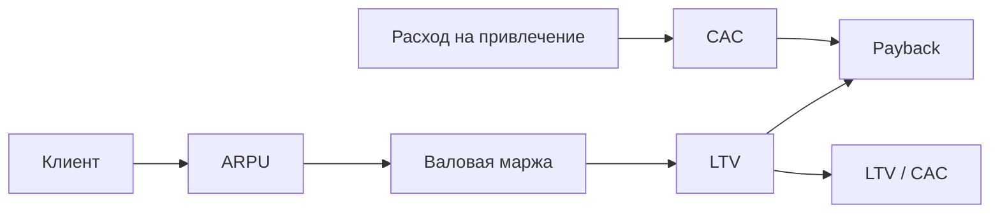

## Введение

Senior PM обязан читать продукт через деньги: как устроена выручка, где маржа, сходится ли unit-экономика. Это не замена CFO, а общий язык с бизнесом. Ниже — рабочие формулы LTV, CAC, payback и вклад (contribution) на пальцах; оригинальные примеры, без претензии на полный курс финансов.

## Раздел: P&L-взгляд продукта

Упрощённая лестница:

1. **Выручка (Revenue)** — что клиенты платят.
2. **Себестоимость / COGS** — прямые затраты на оказание услуги (хостинг на клиента, платежи эквайринга, лицензии per seat — по модели).
3. **Gross profit / валовая маржа** — выручка минус COGS.
4. **Contribution** после переменных затрат маркетинга/продаж на привлечение — смотрите в связке с CAC.
5. Ниже — операционные расходы (команда, R&D); продукт влияет через приоритеты, но не «рисует» весь P&L.

**Пример.** SaaS 2000 ₽/мес, COGS 200 ₽ → валовая маржа 90%. Если «бесплатно» раздуваете SMS-уведомления, COGS растёт и маржа тихо тает — продуктовое решение.

**Ошибка.** Путать валовую маржу с «прибылью компании» — ниже ещё зарплаты, аренда, налоги; оптимизм на слайде опасен.

## Раздел: LTV, CAC, payback

Определения (учебные; в компании уточняйте методику):

- **CAC (Customer Acquisition Cost)** ≈ расходы на привлечение / число новых клиентов за период.
- **LTV (Lifetime Value)** ≈ средняя валовая прибыль с клиента за жизнь (часто: ARPU × валовая маржа × срок жизни; или сумма дисконтированных contribution — зависит от политики).
- **Payback** ≈ CAC / (месячная contribution с клиента) — за сколько месяцев отбиваем привлечение.
- Ориентир здравого смысла (не догма): LTV/CAC заметно > 1 (часто говорят про 3× в здоровых SaaS — как *разговорная* эвристика, не закон).

**Пример.** CAC = 6000 ₽. Клиент платит 2000 ₽/мес, валовая маржа 80% → contribution ≈ 1600 ₽/мес. Payback ≈ 6000/1600 ≈ 3,8 месяца. Если churn высокий и средний срок жизни 4 месяца, LTV ≈ 1600×4 = 6400 ≈ CAC — экономика «на грани», масштабировать платный маркетинг рано.

**Ошибка.** Считать LTV по выручке без маржи и без churn — получится сказка, одобренная только слайдом.

## Раздел: Что меняет продукт

Рычаги PM: цена/упаковка, активация (быстрее до ценности → ниже early churn), retention, расширение (paid seats), снижение COGS (эффективность), качество лида вместе с маркетингом (не только «больше трафика»). На собесе разложите один рычаг → метрика → эффект на LTV или payback.

## Раздел: Частые вопросы с собеседования

**Вопрос.** PM и PO — одна роль на собеседовании?

**Ответ.** В agile-командах PO чаще владеет backlog и приоритетом инкремента; PM шире — discovery, стратегия, экономика, стейкholders вне спринта. На практике роли сливаются в маленьких командах — на собесе назовите границы: кто решает «что строим», кто «как измеряем успех».

**Вопрос.** Когда RICE уместен, а когда вреден?

**Ответ.** RICE (Reach, Impact, Confidence, Effort) помогает сравнить фичи на одной шкале с явными допущениями. Вреден, когда подменяют цифры уверенностью «на глаз» или игнорируют стратегические ставки и технический долг. Хороший ответ включает Confidence и что проверите экспериментом.

**Вопрос.** Чем WSJF отличается от простого «impact / effort»?

**Ответ.** WSJF добавляет Cost of Delay и job size в потоке: что дороже отложить по времени и риску. Полезен при ограниченной capacity и нескольких командах; требует честной оценки задержки, не только «большая фича — делаем первой».

**Вопрос.** OKR и KPI — конкуренты?

**Ответ.** KPI — стабильный пульс здоровья (retention, uptime). OKR — амбициозный исход на период с 2–4 KR, часть может не выполниться на 100%. На собесе: KPI не выкручивать как OKR «на 120% каждый квартал», иначе команда перестаёт рисковать.

**Вопрос.** Зачем roadmap в формате Now / Next / Later без дат на всё?

**Ответ.** Now — commitment с ресурсом; Next — готовим, но дата плавает; Later — направления без обещания. Защищает от фальшивых дат на исследования. Даты оставляют там, где есть зависимость (регулятор, контракт, релиз платформы).

## Лаба

**Цель.** Посчитать учебную unit-экономику и предложить продуктовый рычаг.

**Шаги.**
1. Задайте ARPU, валовую маржу %, месячный churn (или срок жизни ≈ 1/churn).
2. Посчитайте приблизительный LTV по маржинальной прибыли.
3. Задайте CAC и посчитайте payback и LTV/CAC.
4. Сценарий «−20% churn» — как меняются LTV и payback.
5. Сценарий «+30% CAC при том же LTV» — вывод для масштабирования.
6. Предложите одну продуктовую ставку, которая бьёт в churn или ARPU; напишите, какую метрику смотрите через 6 недель.

**В группу:** сравните, кто забыл вычесть COGS из LTV.

**Готово, если…**
- [ ] LTV на марже, не на «грязной» выручке
- [ ] Есть payback и интерпретация
- [ ] Есть продуктовый рычаг, не только «увеличьте бюджет на рекламу»

## Схема: От клиента к экономике

## Тест

### Что такое CAC простыми словами?

**Ответ:** стоимость привлечения одного клиента

**Пояснение:** Расходы на привлечение делят на число новых клиентов за период.

### Почему LTV считают лучше по марже, а не по выручке?

**Ответ:** иначе игнорируем себестоимость

**Пояснение:** Выручка без COGS завышает ценность клиента и маскирует дырявую экономику.

### Что показывает payback period?

**Ответ:** месяцы до отбития CAC

**Пояснение:** За сколько вклад клиента возвращает стоимость привлечения.

### Какой продуктовый рычаг чаще всего улучшает LTV?

**Ответ:** снижение churn / рост retention

**Пояснение:** Дольше жизнь клиента при той же марже увеличивает LTV; также работают ARPU и COGS.

### Чем опасна путаница валовой маржи и прибыли компании?

**Ответ:** завышенный оптимизм по P&L

**Пояснение:** Ниже валовой прибыли ещё операционные расходы — продукт видит лишь часть картины.

## Шпаргалка

<h3>Формулы (учебные)</h3>
<pre><code>CAC ≈ spend_acquisition / new_customers
contribution_month ≈ ARPU × gross_margin
LTV ≈ contribution_month × lifetime_months
payback ≈ CAC / contribution_month
lifetime_months ≈ 1 / monthly_churn  (грубо)</code></pre>
<h3>Рычаги PM</h3>
<ul>
<li>activation, retention, pricing, COGS, качество лида</li>
</ul>

## Anki

### Front: Как приблизительно посчитать CAC за период?

Back: Разделить расходы на привлечение на число новых клиентов за тот же период

### Front: Что такое LTV в unit-экономике продукта?

Back: Ожидаемая валовая прибыль (contribution) с одного клиента за всё время жизни

### Front: Как оценить payback period привлечения клиента?

Back: Разделить CAC на месячную маржинальную вкладку (contribution) с клиента

### Front: Почему в оценку LTV нужно включать валовую маржу, а не только ARPU?

Back: Часть выручки съедает себестоимость — без маржи ценность клиента завышена

### Front: Как грубо связать месячный churn со сроком жизни клиента?

Back: Средний lifetime в месяцах ≈ 1 / месячный churn (при стабильном churn)

### Front: Назовите два продуктовых рычага, которые улучшают unit-экономику без роста рекламного бюджета

Back: Снижение churn через ценность/активацию и рост ARPU через упаковку или расширение использования

## Итоги

- PM читает выручку, маржу и unit-экономику на уровне решений, не MBA-диссертации
- LTV/CAC/payback — язык разговора о масштабировании
- Считайте маржу и churn; предлагайте продуктовый рычаг
- Дальше — портфель ставок глазами CPO

## Ссылки

- [SVPG — Articles](https://www.svpg.com/articles/)
- [Google re:Work — OKRs](https://rework.withgoogle.com/intl/en/guides/set-goals-with-okrs) (связь целей с измеримыми исходами)
- Далее: [Портфель продуктов и ставок](/game/learn/pm-portfolio)
