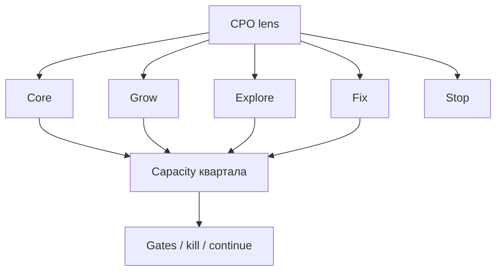

## Введение

На уровне CPO / Head of Product решения редко про «одну фичу»: нужно распределить ограниченных людей и внимание между продуктами и ставками. Портфель — явная карта: что кормит сегодня, что растёт, что исследуем, что останавливаем. Ниже — оригинальная рамка «линзы CPO»; без копирования чужих глав про портфельный менеджмент.

## Раздел: Линза CPO — типы ставок

Разметьте инициативы (продукты или крупные ставки внутри продукта):

| Тип | Роль в портфеле | Вопрос CPO |
|-----|-----------------|------------|
| **Core / Cash** | Кормит сейчас | Не угрожаем марже и надёжности? |
| **Grow** | Масштаб и доля | Unit-экономика уже сходится? |
| **Explore** | Опцион на будущее | Дешёвый тест или дорогая игрушка? |
| **Fix / Risk** | Долг, безопасность, регуляторика | Стоимость задержки vs размер? |
| **Stop / Sunset** | Сознательно гасим | Есть план миграции клиентов? |

**Пример.** У компании: биллинг (core), новый AI-ассистент (explore), мобильное приложение (grow), замена устаревшего антифрода (fix). CPO запрещает забирать 70% платформы в explore, пока payback grow-ставки не ясен.

**Ошибка.** Все инициативы помечены как Grow — тогда нет честного разговора о поддержке core и стоимости риска.

## Раздел: Ресурсы, kill-критерии и синергия

**Распределение.** Не в процентах «для красоты», а в capacity команд (человек-спринты) на квартал. Прозрачный потолок: например, Explore ≤ 15% capacity, пока не пройден gate.

**Kill / continue.** У explore заранее: метрика, срок, порог «продолжаем / режем». Без kill-критерия опционы живут вечно и едят core.

**Синергия и конфликты.** Общие платформенные команды — узкое горлышко. Портфель обязан показывать зависимости: два «P0» на одну платформу = ложь. Иногда CPO объединяет ставки или сдвигает Next.

**Связь с экономикой.** Grow без приемлемого LTV/CAC — маркетинг сожжёт деньги; Fix с огромным CoD может бить WSJF-логикой выше «красивого» Grow.

**Ошибка.** Sunset annонсируют инженерам, но не клиентам и поддержке — churn и репутационный удар.

## Раздел: Портфель на собеседовании CPO/Head

Структура ответа:

1. Перечислите 4–6 ставок и тип каждой.
2. Покажите грубое % capacity.
3. Назовите один kill и один sunset-кандидат.
4. Укажите главный ресурсный конфликт и решение.
5. Свяжите с OKR компании / unit-экономикой.

## Раздел: Частые вопросы с собеседования

**Вопрос.** Когда RICE уместен, а когда вреден?

**Ответ.** RICE (Reach, Impact, Confidence, Effort) помогает сравнить фичи на одной шкале с явными допущениями. Вреден, когда подменяют цифры уверенностью «на глаз» или игнорируют стратегические ставки и технический долг. Хороший ответ включает Confidence и что проверите экспериментом.

**Вопрос.** Зачем roadmap в формате Now / Next / Later без дат на всё?

**Ответ.** Now — commitment с ресурсом; Next — готовим, но дата плавает; Later — направления без обещания. Защищает от фальшивых дат на исследования. Даты оставляют там, где есть зависимость (регулятор, контракт, релиз платформы).

**Вопрос.** Discovery и delivery — разные фазы или параллельные потоки?

**Ответ.** Discovery снижает неопределённость: проблема, сегмент, прототип, kill criteria. Delivery — строим и катим измеримый инкремент. На зрелых командах идут паралlельно: часть capacity на explore, часть на exploit; ошибка — «discovery закончили, теперь только код».

## Лаба

**Цель.** Собрать портфель на один квартал для учебной компании с 3 продуктами или 5 ставками.

**Шаги.**
1. Список ставок с типом (core/grow/explore/fix/stop).
2. Оцените capacity (условные 100%) и разложите по типам.
3. Для каждой explore-ставки: метрика, срок, kill-порог.
4. Найдите зависимость от общей платформы — разрешите конфликт.
5. Предложите один sunset: триггер, план коммуникации, риск.
6. Напишите 8–10 предложений «письмо совету» с логикой портфеля.

**В группу:** атакуйте чужой explore — достоин ли он capacity?

**Готово, если…**
- [ ] Не все ставки одного типа
- [ ] Есть kill-критерии
- [ ] Конфликт ресурсов назван и разрешён на бумаге

## Схема: Портфель и capacity

## Тест

### Зачем CPO размечает ставки по типам в портфеле?

**Ответ:** явно распределить риск и ресурсы

**Пояснение:** Core, grow, explore и fix требуют разной доли capacity и разных критериев успеха.

### Что обязательно заранее определить для explore-ставки?

**Ответ:** метрику, срок и kill-порог

**Пояснение:** Иначе опцион живёт вечно и отъедает ресурсы у core.

### Почему два P0 на одну платформенную команду — проблема портфеля?

**Ответ:** скрытый конфликт за capacity

**Пояснение:** Без разрешения зависимости roadmap врёт о сроках обеих ставок.

### Когда уместен sunset продукта?

**Ответ:** ставка не окупает поддержку

**Пояснение:** Сознательная остановка с планом миграции лучше медленного гниения.

### Как unit-экономика связана с grow в портфеле?

**Ответ:** масштабировать после сходимости

**Пояснение:** Лить бюджет в grow при плохом LTV/CAC усиливает убыток.

## Шпаргалка

<h3>Типы ставок</h3>
<ul>
<li>Core — кормит сейчас</li>
<li>Grow — масштаб при живой экономике</li>
<li>Explore — дешёвый опцион + kill</li>
<li>Fix — риск / долг / регуляторика</li>
<li>Stop — sunset с планом</li>
</ul>
<h3>Правило</h3>
<pre><code>capacity явна → конфликты видимы
explore без kill = скрытый core-tax</code></pre>

## Anki

### Front: Какие типы ставок полезно различать в продуктовом портфеле CPO?

Back: Core (кормит), Grow (масштаб), Explore (опцион), Fix/Risk (долг и угрозы), Stop/Sunset (остановка)

### Front: Что такое kill-критерий для explore-инициативы?

Back: Заранее заданные метрика, срок и порог, при провале которых ставку останавливают

### Front: Почему нельзя помечать все инициативы портфеля как Grow?

Back: Исчезает честный разговор о поддержке core, стоимости риска и лимитах capacity

### Front: Как портфель должен учитывать общие платформенные команды?

Back: Явно показывать зависимости и не назначать два взаимоисключающих P0 на одну capacity

### Front: Когда масштабирование grow-ставки опасно с точки зрения unit-экономики?

Back: Когда LTV/CAC или payback ещё не сходятся — рост усиливает убыток

### Front: Что кроме решения инженеров нужно при sunset продукта?

Back: План миграции клиентов, коммуникация поддержке и стейкхолдерам, оценка репутационного риска

## Итоги

- Портфель CPO — типы ставок, capacity, kill и sunset
- Explore без порога остановки — налог на core
- Конфликты платформы решают явно
- Дальше — тренировка ответов на собеседовании

## Ссылки

- [SVPG — Articles](https://www.svpg.com/articles/)
- [SAFe — WSJF](https://framework.scaledagile.com/wsjf/) (стоимость задержки для fix/risk)
- Далее: [Interview drill Product](/game/learn/pm-interview-drill)
