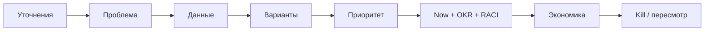

## Введение

Этот выпуск — тренажёр: сценарии, собранные из тем PM01–PM10. На senior-собесе ждут структуру, цифры-допущения и умение сказать «не знаю, проверю так». Ниже — каркас ответа и набор кейсов; тренируйтесь вслух по таймеру, а не только глазами.

## Раздел: Каркас ответа на кейс

Универсальный скелет (6–8 минут):

1. **Уточнения** — сегмент, цель, ограничения (люди, срок, метрика успеха).
2. **Проблема** — чья боль и почему сейчас.
3. **Данные** — что уже есть / что соберёте (CJM, интервью, воронка, unit-экономика).
4. **Варианты** — 2–3 ставки, не одна «идея мечты».
5. **Приоритет** — RICE или CoD/Size + явные допущения Confidence.
6. **План** — Now/Next, OKR на квартал, риски и стейкхолдеры (кто A).
7. **Экономика** — хотя бы качественно LTV/CAC/payback, если кейс про рост.
8. **Как узнаем, что ошиблись** — kill/пересмотр.

**Ошибка.** Сразу прыгать в UI-решения без сегмента и метрики — сигнал junior-мышления на senior-слоте.

## Раздел: Сценарии для прогона

Проговорите каждый сценарий 2 раза: один «идеальный», второй — с жёстким вопросом интервьюера «а если продажи против?».

**S1. Роли.** «Чем ваш PM отличается от PO и от аналитика на проекте оплаты?» — границы ценности / backlog / ясности (PM01).

**S2. Приоритет.** Три фичи, одна команда на квартал — разложите RICE, затем скажите, где WSJF изменит порядок (PM02).

**S3. CJM.** «Пользователи бросают онбординг» — этапы, метрики шага, одна ставка (PM03).

**S4. Scrum.** Стейкхолдер ломает спринт каждый день — как защитите Sprint Goal и DoR (PM04).

**S5. Стратегия.** «Конкурент скопировал roadmap» — сегмент, отказы, ставка (PM05).

**S6. Roadmap.** Покажите Now/Next/Later без фальшивых дат; где commitment с датой (PM06).

**S7. OKR.** Перепишите плохой KR «запустить лендинг» в исход (PM07).

**S8. RACI.** Запуск тарифа — кто A на цену и на дату анонса (PM08).

**S9. Экономика.** Даны ARPU, margin, churn, CAC — вывод: масштабировать платную закупку или чинить retention (PM09).

**S10. Портфель.** Пять ставок, одна платформа — capacity и kill для explore (PM10).

**Ошибка.** Ответ только лозунгами («нужно быть data-driven») без чисел, допущений и следующего шага эксперимента.

## Раздел: Вопросы, которыми вас будут бить

- Что *не* будете делать и почему?
- Какое допущение самое хрупкое?
- Как поймёте через 4 недели, что ставка мёртвая?
- Кто Accountable, если Sales и Product спорят?
- Где вы лично ошибались в похожем кейсе?

Готовьте честный мини-провал: ситуация → ошибка → что изменили в процессе.

## Раздел: Частые вопросы с собеседования

**Вопрос.** Чем PM отличается от Scrum PO?
**Ответ.** PO владеет бэклогом внутри Scrum. PM шире: проблема, ставка, рынок, экономика. Роли часто совмещают, но вопросы разные.

**Вопрос.** Как устроен RICE?
**Ответ.** (Reach × Impact × Confidence) / Effort. Это сравнение инициатив, не истина. Допущения нужно проговорить вслух.

**Вопрос.** Чем OKR отличается от списка фич?
**Ответ.** Objective — качественная цель, Key Result — измеримый исход. Фича — гипотеза, как этот исход получить.

## Лаба

**Цель.** Записать и прогнать 4 сценария по таймеру.

**Шаги.**
1. Выберите S2, S3, S7, S9 (или любые 4).
2. На каждый — 7 минут вслух + 3 минуты на «жёсткий вопрос».
3. Запишите на диктофон или текст: структура из 8 пунктов.
4. Выпишите 5 уточняющих вопросов, которые зададите интервьюеру *до* решения.
5. Для S9 посчитайте payback на бумаге и произнесите вывод одной фразой.
6. Попросите партнёра отметить, где вы ушли в фичи раньше метрики.

**В группу:** взаимный «жёсткий вопрос» после каждого ответа.

**Готово, если…**
- [ ] В каждом ответе есть метрика и отказ
- [ ] Есть допущения Confidence / данных
- [ ] Есть kill или критерий пересмотра

## Схема: Поток ответа на кейс

## Тест

### С чего начинать ответ на продуктовый кейс на собесе?

**Ответ:** уточнить сегмент, цель, ограничения

**Пояснение:** Без рамки любое решение выглядит случайным набором фич.

### Что показать при выборе между тремя фичами?

**Ответ:** допущения и метод приоритета

**Пояснение:** RICE/WSJF ценны явным Confidence и trade-off, не «магическим score».

### Как отличить сильный OKR-ответ от слабого?

**Ответ:** KR про исход, не про задачу

**Пояснение:** «Запустить лендинг» — работа; нужна измеримая смена поведения или экономики.

### Что спросить себя про ставку через месяц?

**Ответ:** жив ли критерий продолжения

**Пояснение:** Kill/пересмотр показывает взрослый риск-менеджмент, не упрямство.

### Какой сигнал junior-подхода на senior-интервью?

**Ответ:** сразу UI без метрики

**Пояснение:** Senior сначала фиксирует проблему, сегмент и способ проверки успеха.

## Шпаргалка

<h3>Скелет 8 шагов</h3>
<ol>
<li>Уточнения</li>
<li>Проблема</li>
<li>Данные</li>
<li>Варианты</li>
<li>Приоритет</li>
<li>План (Now/OKR/RACI)</li>
<li>Экономика</li>
<li>Kill / пересмотр</li>
</ol>
<h3>Фразы</h3>
<pre><code>«Допущение: … Проверю так: …»
«Не делаем … потому что …»
«Accountable — …, Consulted — …»</code></pre>

## Anki

### Front: Назовите первые три шага каркаса ответа на продуктовый кейс

Back: Уточнить сегмент/цель/ограничения; сформулировать проблему; сказать, какими данными опереться или что собрать

### Front: Что обязательно произнести вслух при RICE на собеседовании кроме итогового score?

Back: Допущения по Reach/Impact/Effort и уровень Confidence — что изменит порядок, если уверенность упадёт

### Front: Как переписать плохой ключевой результат «запустить лендинг»?

Back: В измеримый исход, например рост активации или конверсии в целевое действие с базой и целью

### Front: Какой вопрос о ставке показывает зрелость риска на интервью?

Back: Как через несколько недель поймём, что ставку нужно убить или пересобрать

### Front: Что ответить на конфликт Sales vs Product о приоритете backlog?

Back: Входы Sales учитываем; Accountable за порядок ценности — PO/PM; при тупике эскалация к общему A

### Front: Какую ошибку в структуре ответа чаще всего читают как junior-уровень?

Back: Прыжок к экранам и фичам до сегмента, метрики успеха и альтернатив

## Итоги

- Кейс = структура, допущения, отказы, проверка ошибки
- Прогоняйте сценарии из всей серии вслух по таймеру
- Держите связку приоритет → roadmap/OKR → RACI → экономика
- Финал серии — capstone-чеклист

## Ссылки

- [SVPG — Articles](https://www.svpg.com/articles/)
- [Intercom — RICE](https://www.intercom.com/blog/rice-simple-prioritization-for-product-managers/)
- [Scrum Guide](https://scrumguides.org/)
- [Google re:Work — OKRs](https://rework.withgoogle.com/intl/en/guides/set-goals-with-okrs)
- Далее: [Capstone Product — чеклист](/game/learn/pm-capstone)
