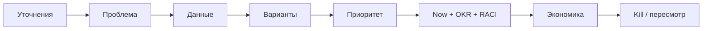
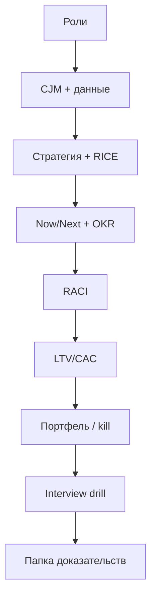

## Введение

Этот выпуск — тренажёр: сценарии, собранные из тем PM01–PM10. На senior-собесе ждут структуру, цифры-допущения и умение сказать «не знаю, проверю так». Ниже — каркас ответа и набор кейсов; тренируйтесь вслух по таймеру, а не только глазами.

**Чеклист продукта.** Capstone собирает серию Product Learn в один проверяемый пакет: артефакты, которые можно положить в «папку доказательств» к собеседованию или взять как шаблон старта на новом продукте. Пройдите чеклист честно — пробелы важнее галочек «всё знаю».

## Раздел: Как отвечать одним блоком

Этот выпуск собрал соседние короткие темы трека: «Drill продукта», «Чеклист продукта». Раньше каждая занимала отдельную карточку на несколько минут, а на собеседовании их спрашивают одним блоком. Ниже у каждой темы свой раздел, затем общие лабы, один тест и одна колода карточек. В ответе сначала назовите, какую тему спросили, потом определение и один пример. Не проговаривайте все разделы, если спросили один. Лабы можно пройти по порядку исходного трека. Если времени мало, сделайте первую и последнюю: первая ставит язык, последняя проверяет, что соседние темы вы не перепутали.

## Раздел: Drill продукта: Ответ вслух

Я беру одну метрику, которая просела, и говорю: кого спросил, от какой инициативы отказался, как пойму, что ставка сработала. Метод приоритета называю вместе с его дырой.

## Раздел: Drill продукта: Плохой ответ

Определить RICE и замолчать. Вопрос был про решение, не про аббревиатуру.

## Раздел: Drill продукта: Термины

Ставка — bet. Отказ — tradeoff. Метрика — metric.

## Раздел: Drill продукта: Каркас ответа на кейс

Универсальный скелет (6–8 минут):

1. **Уточнения** — сегмент, цель, ограничения (люди, срок, метрика успеха).
2. **Проблема** — чья боль и почему сейчас.
3. **Данные** — что уже есть / что соберёте (CJM, интервью, воронка, unit-экономика).
4. **Варианты** — 2–3 ставки, не одна «идея мечты».
5. **Приоритет** — RICE или CoD/Size + явные допущения Confidence.
6. **План** — Now/Next, OKR на квартал, риски и стейкхолдеры (кто A).
7. **Экономика** — хотя бы качественно LTV/CAC/payback, если кейс про рост.
8. **Как узнаем, что ошиблись** — kill/пересмотр.

**Ошибка.** Сразу прыгать в UI-решения без сегмента и метрики — сигнал junior-мышления на senior-слоте.

## Раздел: Drill продукта: Сценарии для прогона

Проговорите каждый сценарий 2 раза: один «идеальный», второй — с жёстким вопросом интервьюера «а если продажи против?».

**S1. Роли.** «Чем ваш PM отличается от PO и от аналитика на проекте оплаты?» — границы ценности / backlog / ясности (PM01).

**S2. Приоритет.** Три фичи, одна команда на квартал — разложите RICE, затем скажите, где WSJF изменит порядок (PM02).

**S3. CJM.** «Пользователи бросают онбординг» — этапы, метрики шага, одна ставка (PM03).

**S4. Scrum.** Стейкхолдер ломает спринт каждый день — как защитите Sprint Goal и DoR (PM04).

**S5. Стратегия.** «Конкурент скопировал roadmap» — сегмент, отказы, ставка (PM05).

**S6. Roadmap.** Покажите Now/Next/Later без фальшивых дат; где commitment с датой (PM06).

**S7. OKR.** Перепишите плохой KR «запустить лендинг» в исход (PM07).

**S8. RACI.** Запуск тарифа — кто A на цену и на дату анонса (PM08).

**S9. Экономика.** Даны ARPU, margin, churn, CAC — вывод: масштабировать платную закупку или чинить retention (PM09).

**S10. Портфель.** Пять ставок, одна платформа — capacity и kill для explore (PM10).

**Ошибка.** Ответ только лозунгами («нужно быть data-driven») без чисел, допущений и следующего шага эксперимента.

## Раздел: Drill продукта: Вопросы, которыми вас будут бить

- Что *не* будете делать и почему?
- Какое допущение самое хрупкое?
- Как поймёте через 4 недели, что ставка мёртвая?
- Кто Accountable, если Sales и Product спорят?
- Где вы лично ошибались в похожем кейсе?

Готовьте честный мини-провал: ситуация → ошибка → что изменили в процессе.

## Раздел: Drill продукта: Частые вопросы с собеседования

**Вопрос.** Чем PM отличается от Scrum PO?
**Ответ.** PO владеет бэклогом внутри Scrum. PM шире: проблема, ставка, рынок, экономика. Роли часто совмещают, но вопросы разные.

**Вопрос.** Как устроен RICE?
**Ответ.** (Reach × Impact × Confidence) / Effort. Это сравнение инициатив, не истина. Допущения нужно проговорить вслух.

**Вопрос.** Чем OKR отличается от списка фич?
**Ответ.** Objective — качественная цель, Key Result — измеримый исход. Фича — гипотеза, как этот исход получить.

## Раздел: Чеклист продукта: Ответ вслух

Чеклист продукта я закрываю историей, а не терминами: роль, приоритет, путь клиента, цель, кого убеждал. Без истории, где я от чего-то отказался, senior не складывается.

## Раздел: Чеклист продукта: Плохой ответ

Повторить двенадцать заголовков серии. Слышно только, что вы их читали.

## Раздел: Чеклист продукта: Термины

Дорожная карта — roadmap. Цель — objective. Владелец — owner.

## Раздел: Чеклист продукта: Чеклист артефактов PM01–PM10

Отметьте только то, что существует у вас на бумаге/в Notion (не «мог бы сделать»):

| Ep | Артефакт | Готово |
|----|----------|--------|
| PM01 | Треугольник ролей PM / PO / СА / CPO на вашем кейсе | ☐ |
| PM02 | Таблица RICE на 3 ставки + комментарий через Cost of Delay | ☐ |
| PM03 | CJM на 1 сегмент, 5–7 этапов, метрики шагов | ☐ |
| PM04 | Sprint Goal + DoR/DoD + скрипт «нет / не сейчас» | ☐ |
| PM05 | Одностраничная стратегия: сегмент, ставка, 3 отказа, метрика | ☐ |
| PM06 | Now/Next/Later без фальшивых дат на Later | ☐ |
| PM07 | 1 Objective и 3 KR (без задач в формулировках) | ☐ |
| PM08 | Карта стейкхолдеров + RACI на 2 решения (один A) | ☐ |
| PM09 | Расчёт LTV / CAC / payback + один продуктовый рычаг | ☐ |
| PM10 | Портфель ставок с типами, % capacity и kill для explore | ☐ |

**Ошибка.** Считать серию пройденной после чтения без артефактов — на собесе пустая уверенность видна с первого кейса.

## Раздел: Чеклист продукта: Чеклист навыка ответа и папка доказательств

**Навык (PM11):**

- [ ] 4 сценария прогнаны вслух по таймеру
- [ ] В каждом ответе есть отказ и критерий пересмотра
- [ ] Есть мини-история собственной ошибки и вывода
- [ ] Можете за 60 секунд объяснить PM vs PO vs СА

**Папка доказательств (рекомендуемый состав):**

1. PDF/страница стратегии + Now/Next/Later.
2. CJM (даже учебная) с источником данных.
3. Таблица приоритета с допущениями.
4. OKR квартала и 2 строки «чему научились на check-in».
5. Юнит-экономика на одной странице.
6. Запись или конспект одного drill (S2/S9).

**Ошибка.** Нести на интервью только чужие фреймворки без своего числового примера — звучит как курс, не как практика.

## Раздел: Чеклист продукта: Критерий «серия закрыта»

Серия закрыта, если вы можете за один час собрать для *нового* учебного продукта: стратегию → CJM-разрыв → RICE → Now → OKR → RACI анонса → грубый payback. Если спотыкаетесь на шаге — вернитесь к соответствующему выпуску, не к «ещё одним статьям подряд».

## Раздел: Чеклист продукта: Частые вопросы с собеседования

**Вопрос.** Что такое discovery против delivery?
**Ответ.** Discovery проверяет, какую проблему решать. Delivery делает решение. Собес ломает тех, кто сразу рисует роадмап фич.

**Вопрос.** Зачем Now / Next / Later вместо дат на год?
**Ответ.** Даты врут при неопределённости. Горизонты показывают обязательство: сейчас делаем, дальше исследуем, позже только направление.

**Вопрос.** Какой артефакт показать вместо «я приоритизировал»?
**Ответ.** Короткий расчёт RICE или WSJF с допущениями и тем, от чего отказались.

## Лаба

**Drill продукта.**

**Цель.** Записать и прогнать 4 сценария по таймеру.

**Шаги.**
1. Выберите S2, S3, S7, S9 (или любые 4).
2. На каждый — 7 минут вслух + 3 минуты на «жёсткий вопрос».
3. Запишите на диктофон или текст: структура из 8 пунктов.
4. Выпишите 5 уточняющих вопросов, которые зададите интервьюеру *до* решения.
5. Для S9 посчитайте payback на бумаге и произнесите вывод одной фразой.
6. Попросите партнёра отметить, где вы ушли в фичи раньше метрики.

**В группу:** взаимный «жёсткий вопрос» после каждого ответа.

**Готово, если…**
- [ ] В каждом ответе есть метрика и отказ
- [ ] Есть допущения Confidence / данных
- [ ] Есть kill или критерий пересмотра

**Чеклист продукта.**

**Цель.** Собрать capstone-пакет и провести самопроверку за 90 минут.

**Шаги.**
1. Выберите один продукт (учебный ок) на всю лабу.
2. Заполните артефакты из таблицы PM01–PM10 (короткие версии допустимы).
3. Прогоните один полный кейс по каркасу PM11 на 8 минут.
4. Попросите ревьюера (или себя завтра) вычеркнуть всё без метрики/отказа.
5. Список пробелов → номер выпуска для повторения (не больше трёх).
6. Упакуйте папку доказательств в один каталог/документ с оглавлением.

**В группу:** обмен папками — найдите у партнёра отсутствующий kill-критерий или второй A в RACI.

**Готово, если…**
- [ ] ≥8/10 артефактов таблицы существуют
- [ ] Один полный устный кейс записан
- [ ] Список пробелов с планом повтора

## Схема: Drill продукта: Поток ответа на кейс

## Схема: Чеклист продукта: Сборка capstone

## Тест

### С чего начинать ответ на продуктовый кейс на собесе?

**Ответ:** уточнить сегмент, цель, ограничения

**Пояснение:** Без рамки любое решение выглядит случайным набором фич.

### Что главное отличие «прочитал серию» от «закрыл capstone»?

**Ответ:** наличие своих артефактов

**Пояснение:** Чеклист проверяет документы и устный прогон, не чувство знакомства с терминами.

### Что показать при выборе между тремя фичами?

**Ответ:** допущения и метод приоритета

**Пояснение:** RICE/WSJF ценны явным Confidence и trade-off, не «магическим score».

### Какой артефакт закрывает тему приоритизации?

**Ответ:** таблица RICE с допущениями

**Пояснение:** Желательно плюс комментарий через стоимость задержки для спорных мест.

### Как отличить сильный OKR-ответ от слабого?

**Ответ:** KR про исход, не про задачу

**Пояснение:** «Запустить лендинг» — работа; нужна измеримая смена поведения или экономики.

## Шпаргалка

<ul><li>Уточнения</li><li>Проблема</li><li>Данные</li><li>Варианты</li><li>Приоритет</li><li>План (Now/OKR/RACI)</li><li>Экономика</li><li>Kill / пересмотр</li><li>стратегия + roadmap</li><li>CJM + приоритет</li><li>OKR + экономика</li><li>конспект drill</li></ul>

## Anki

### Front: Назовите первые три шага каркаса ответа на продуктовый кейс

Back: Уточнить сегмент/цель/ограничения; сформулировать проблему; сказать, какими данными опереться или что собрать

### Front: Какие артефакты минимально подтверждают навык приоритизации после серии Product Learn?

Back: Таблица RICE на несколько ставок с явными допущениями и комментарием про стоимость задержки

### Front: Что обязательно произнести вслух при RICE на собеседовании кроме итогового score?

Back: Допущения по Reach/Impact/Effort и уровень Confidence — что изменит порядок, если уверенность упадёт

### Front: Что должно входить в одностраничную стратегию в capstone-чеклисте?

Back: Сегмент, главная ставка, явные отказы и outcome-метрика

### Front: Как переписать плохой ключевой результат «запустить лендинг»?

Back: В измеримый исход, например рост активации или конверсии в целевое действие с базой и целью

### Front: Какие три числа unit-экономики стоит иметь в папке доказательств?

Back: LTV, CAC и payback — с кратким выводом, масштабировать привлечение или чинить продукт

## Мнемоника

### loci: Ответ PO

**Задание:** Комнаты устного ответа.

**Элементы:**
- боль
- выбор
- метрика
- что не делали

**Подсказка:** «Что не делали» отличает владельца от исполнителя бэклога.

**Ответ:** боль → выбор → метрика → отказ

## Итоги

- Кейс = структура, допущения, отказы, проверка ошибки
- Прогоняйте сценарии из всей серии вслух по таймеру
- Держите связку приоритет → roadmap/OKR → RACI → экономика
- Финал серии — capstone-чеклист
- Capstone = артефакты + устный drill + честные пробелы
- Цепочка от ролей до портфеля должна сходиться на одном продукте
- Папка доказательств полезнее стопки непрогнанных статей
- Источники серии — публичные первоисточники ниже; тексты выпусков оригинальны

## Ссылки

- [SVPG — Articles](https://www.svpg.com/articles/)
- [Intercom — RICE](https://www.intercom.com/blog/rice-simple-prioritization-for-product-managers/)
- [Scrum Guide](https://scrumguides.org/)
- [Google re:Work — OKRs](https://rework.withgoogle.com/intl/en/guides/set-goals-with-okrs)
- [SAFe — WSJF](https://framework.scaledagile.com/wsjf/)
- [Product Talk](https://www.producttalk.org/)
