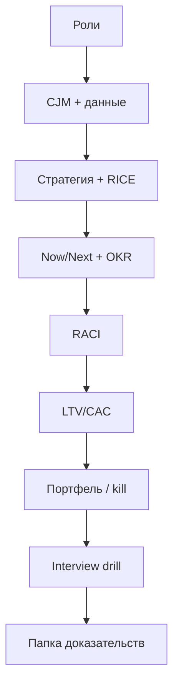

## Введение

Capstone собирает серию Product Learn в один проверяемый пакет: артефакты, которые можно положить в «папку доказательств» к собеседованию или взять как шаблон старта на новом продукте. Пройдите чеклист честно — пробелы важнее галочек «всё знаю».

## Раздел: Ответ вслух

Чеклист продукта я закрываю историей, а не терминами: роль, приоритет, путь клиента, цель, кого убеждал. Без истории, где я от чего-то отказался, senior не складывается.

## Раздел: Плохой ответ

Повторить двенадцать заголовков серии. Слышно только, что вы их читали.

## Раздел: Термины

Дорожная карта — roadmap. Цель — objective. Владелец — owner.

## Раздел: Чеклист артефактов PM01–PM10

Отметьте только то, что существует у вас на бумаге/в Notion (не «мог бы сделать»):

| Ep | Артефакт | Готово |
|----|----------|--------|
| PM01 | Треугольник ролей PM / PO / СА / CPO на вашем кейсе | ☐ |
| PM02 | Таблица RICE на 3 ставки + комментарий через Cost of Delay | ☐ |
| PM03 | CJM на 1 сегмент, 5–7 этапов, метрики шагов | ☐ |
| PM04 | Sprint Goal + DoR/DoD + скрипт «нет / не сейчас» | ☐ |
| PM05 | Одностраничная стратегия: сегмент, ставка, 3 отказа, метрика | ☐ |
| PM06 | Now/Next/Later без фальшивых дат на Later | ☐ |
| PM07 | 1 Objective и 3 KR (без задач в формулировках) | ☐ |
| PM08 | Карта стейкхолдеров + RACI на 2 решения (один A) | ☐ |
| PM09 | Расчёт LTV / CAC / payback + один продуктовый рычаг | ☐ |
| PM10 | Портфель ставок с типами, % capacity и kill для explore | ☐ |

**Ошибка.** Считать серию пройденной после чтения без артефактов — на собесе пустая уверенность видна с первого кейса.

## Раздел: Чеклист навыка ответа и папка доказательств

**Навык (PM11):**

- [ ] 4 сценария прогнаны вслух по таймеру
- [ ] В каждом ответе есть отказ и критерий пересмотра
- [ ] Есть мини-история собственной ошибки и вывода
- [ ] Можете за 60 секунд объяснить PM vs PO vs СА

**Папка доказательств (рекомендуемый состав):**

1. PDF/страница стратегии + Now/Next/Later.
2. CJM (даже учебная) с источником данных.
3. Таблица приоритета с допущениями.
4. OKR квартала и 2 строки «чему научились на check-in».
5. Юнит-экономика на одной странице.
6. Запись или конспект одного drill (S2/S9).

**Ошибка.** Нести на интервью только чужие фреймворки без своего числового примера — звучит как курс, не как практика.

## Раздел: Критерий «серия закрыта»

Серия закрыта, если вы можете за один час собрать для *нового* учебного продукта: стратегию → CJM-разрыв → RICE → Now → OKR → RACI анонса → грубый payback. Если спотыкаетесь на шаге — вернитесь к соответствующему выпуску, не к «ещё одним статьям подряд».

## Раздел: Частые вопросы с собеседования

**Вопрос.** Что такое discovery против delivery?
**Ответ.** Discovery проверяет, какую проблему решать. Delivery делает решение. Собес ломает тех, кто сразу рисует роадмап фич.

**Вопрос.** Зачем Now / Next / Later вместо дат на год?
**Ответ.** Даты врут при неопределённости. Горизонты показывают обязательство: сейчас делаем, дальше исследуем, позже только направление.

**Вопрос.** Какой артефакт показать вместо «я приоритизировал»?
**Ответ.** Короткий расчёт RICE или WSJF с допущениями и тем, от чего отказались.

## Лаба

**Цель.** Собрать capstone-пакет и провести самопроверку за 90 минут.

**Шаги.**
1. Выберите один продукт (учебный ок) на всю лабу.
2. Заполните артефакты из таблицы PM01–PM10 (короткие версии допустимы).
3. Прогоните один полный кейс по каркасу PM11 на 8 минут.
4. Попросите ревьюера (или себя завтра) вычеркнуть всё без метрики/отказа.
5. Список пробелов → номер выпуска для повторения (не больше трёх).
6. Упакуйте папку доказательств в один каталог/документ с оглавлением.

**В группу:** обмен папками — найдите у партнёра отсутствующий kill-критерий или второй A в RACI.

**Готово, если…**
- [ ] ≥8/10 артефактов таблицы существуют
- [ ] Один полный устный кейс записан
- [ ] Список пробелов с планом повтора

## Схема: Сборка capstone

## Тест

### Что главное отличие «прочитал серию» от «закрыл capstone»?

**Ответ:** наличие своих артефактов

**Пояснение:** Чеклист проверяет документы и устный прогон, не чувство знакомства с терминами.

### Какой артефакт закрывает тему приоритизации?

**Ответ:** таблица RICE с допущениями

**Пояснение:** Желательно плюс комментарий через стоимость задержки для спорных мест.

### Что должно быть в папке доказательств про экономику?

**Ответ:** LTV, CAC и payback на странице

**Пояснение:** С числами и одним продуктовым рычагом улучшения.

### Зачем в capstone устный drill по таймеру?

**Ответ:** проверить структуру ответа под давлением

**Пояснение:** На собесе нет времени «ещё почитать»; нужна мышцы формулировок.

### Когда серию можно считать закрытой?

**Ответ:** час на сборку цепочки артефактов

**Пояснение:** От стратегии до экономики и RACI на новом учебном продукте без подсматривания в текст.

## Шпаргалка

<h3>Цепочка capstone</h3>
<pre><code>роли → CJM → стратегия/RICE → Now/OKR → RACI → unit-экон → портфель → drill</code></pre>
<h3>Папка</h3>
<ul>
<li>стратегия + roadmap</li>
<li>CJM + приоритет</li>
<li>OKR + экономика</li>
<li>конспект drill</li>
</ul>

## Anki

### Front: Какие артефакты минимально подтверждают навык приоритизации после серии Product Learn?

Back: Таблица RICE на несколько ставок с явными допущениями и комментарием про стоимость задержки

### Front: Что должно входить в одностраничную стратегию в capstone-чеклисте?

Back: Сегмент, главная ставка, явные отказы и outcome-метрика

### Front: Какие три числа unit-экономики стоит иметь в папке доказательств?

Back: LTV, CAC и payback — с кратким выводом, масштабировать привлечение или чинить продукт

### Front: Что проверить в RACI перед тем как считать стейкхолдерский блок закрытым?

Back: На каждом ключевом решении ровно один Accountable и ограниченный список Consulted

### Front: Какой критерий показывает, что серия Product Learn действительно закрыта?

Back: За около часа собираете цепочку артефактов на новом учебном продукте без подглядывания в конспекты

### Front: Зачем в capstone нужен устный прогон кейса по таймеру, а не только документы?

Back: Собеседование проверяет структуру речи под давлением: уточнения, trade-off, отказы и критерий пересмотра

## Итоги

- Capstone = артефакты + устный drill + честные пробелы
- Цепочка от ролей до портфеля должна сходиться на одном продукте
- Папка доказательств полезнее стопки непрогнанных статей
- Источники серии — публичные первоисточники ниже; тексты выпусков оригинальны

## Ссылки

- [SVPG — Articles](https://www.svpg.com/articles/)
- [Intercom — RICE](https://www.intercom.com/blog/rice-simple-prioritization-for-product-managers/)
- [SAFe — WSJF](https://framework.scaledagile.com/wsjf/)
- [Scrum Guide](https://scrumguides.org/)
- [Product Talk](https://www.producttalk.org/)
- [Google re:Work — OKRs](https://rework.withgoogle.com/intl/en/guides/set-goals-with-okrs)
