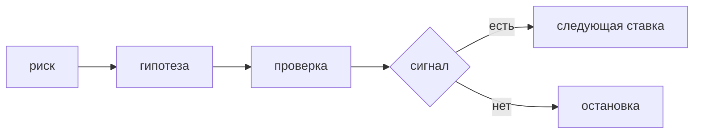

## Введение

Вакансии владельца продукта требуют discovery, исследования пользователей и границу MVP. Это один контур, а не три ритуала. Сначала называют самое дорогое незнание: что, если окажется ложным, сделает всю поставку пустой. Потом выбирают самый маленький шаг, который это незнание снимает. В бэклог и в дату попадает только то, что пережило шаг, плюс явные обязательства поддержки уже выпущенного. Остальное остаётся списком гипотез, а не обещанием roadmap.

«Пользователям нужен кабинет» — тема. Её нельзя опровергнуть: любой отказ объяснят тем, что кабинет был недостаточно большой. Гипотеза называется так, чтобы по сигналу можно было сказать «мы не угадали» и остановиться. MVP — срез, после которого меняют решение: продолжать, изменить или закрыть. Урезанный список всех идей без вопроса, который он закрывает, — первая очередь фич. Её стыдно называть экспериментом.

Выпуск разбирает идею «уведомление о просроченной заявке»: кто, ситуация, поведение, сигнал провала, что сознательно не входит в первый срез и какой сигнал виден без новой аналитической платформы.

## Раздел: Гипотеза и срез

Гипотеза собирается из четырёх частей. Кто именно, не «пользователи». В какой ситуации, которую можно вспомнить, а не в абстрактном «было бы удобно». Какое поведение вы считаете успехом: открыл, закрыл, не позвонил, оплатил. По какому сигналу поймёте, что не угадали: за две недели долю просроченных не сдвинули, или люди отключили канал в первый день. Без сигнала это тема для бэклога. С сигналом это ставка, которую можно проиграть честно.

Интервью ищет прошлый случай. «Расскажите, когда заявка в последний раз просрочилась и что вы сделали» даёт факт: куда смотрели, кому писали, сколько это заняло. «Пользовались бы вы уведомлением» почти не предсказывает поведение. Человек вежлив и представляет идеальный день. Прошлый вторник врёт меньше. Пять таких разговоров не заменяют статистику, но часто убивают решение строить кабинет, если боль решается строкой в существующем письме.

Прототип проверяет путь дешевле разработки. Это может быть письмо руками, кнопка в чате, макет, по которому человек показывает, куда нажмёт. Если неясен сам путь, писать сервис рано: спринт сгорит на экранах, а вопрос «надо ли» останется. Если путь ясен и неясно только, сдвинется ли число, прототип уже не поможет — нужен узкий запуск на реальных заявках.

В срез кладут только то, без чего сигнал не собрать. Для уведомления о просрочке это может быть одно письмо на один тип заявки и отметка «письмо ушло / заявку закрыли в срок». Не кладут второй канал «на всякий случай», личный кабинет настроек, отчёт для руководителя и красивый конструктор правил. Всё это может понадобиться, если сигнал подтвердится. До подтверждения это гипотезы без даты.

MVP после выкладки обязан оставлять решение. Что смотрим, в какой день, какой порог считаем провалом, кто имеет право остановить. Если после выкладки нечего измерить и нечего остановить, вы просто начали строить. Поддержка уже выпущенного в срез входит: сломанный текущий путь не прячут за экспериментом. Новая идея не обязана тащить за собой весь список желаний поддержки, только то, без чего эксперимент неотличим от аварии.

Дорожная карта с датами начинается после проверки, не до неё. Обещать квартал конструктора уведомлений, пока не знаете, читают ли письмо, — способ потом объяснять срыв. В roadmap честно стоит «проверка канала», а не список экранов.

## Раздел: Разбор на примере

Идея пришла как «давайте пушить просрочки». Тема широкая. Гипотеза уже: куратор, у которого больше десяти открытых заявок, получит одно письмо утром по тем, что просрочены вчера; успех — доля таких заявок, закрытых в тот же день, вырастет; провал — за две недели доля не сдвинется или кураторы попросят отключить письма. Сигнал считается по уже существующему статусу заявки и журналу отправки. Новая платформа аналитики не нужна.

Интервью с тремя кураторами про последний вторник. Выясняется, что они и так видят просрочку в фильтре, но открывают его после планёрки, а письмо читают в дороге. Это не доказательство успеха, это повод не строить новый экран, а проверить канал. Если бы они сказали «я не закрываю, потому что не понимаю текст заявки», письмо о факте просрочки гипотезу не лечит, и срез был бы другим.

Первый срез: один тип заявки, одно письмо, без настроек частоты, без мобильного приложения, без дашборда руководителя. В письме ссылка на уже существующую карточку. Срок две недели, порог назван до разработки. Если доля не сдвинулась, письма выключают, идею конструктора не ставят в квартальный план. Если сдвинулась, следующая гипотеза отдельная: поможет ли второй тип заявок или это везение одного типа. Её не приклеивают «заодно» к первому срезу.

Что обещают команде. Не «кабинет уведомлений к концу квартала». Обещают проверку: письмо, измерение, решение. Оценка маленькая. Риск, что зря построили платформу, снят ещё до дизайна платформы.

## Раздел: Где это ломается

MVP определяют как «без красивого дизайна». Сценарий тот же, вопрос не задан, просто отложили полировку. Это экономия на виде, не эксперимент. Эксперимент режет объём по вопросу.

В срез кладут отчётность и вторую роль, «чтобы уж сразу нормально». Сигнал тонет в объёме, дата уезжает, остановить страшно, потому что уже дорого. Лишнее вынимают до оценки.

Интервью про будущее. Десять человек сказали «удобно», построили, не пользуются. Спрашивают прошлый случай и смотрят поведение на срезе, не оценку кнопки.

Нет порога остановки. Метрика чуть шевелится, срез тихо становится постоянной функцией без решения. День решения и порог написаны заранее.

Непроверенную идею ставят датой в roadmap, чтобы «стейкхолдер видел прогресс». Потом дату защищают объёмом. Идея живёт в списке гипотез, дата появляется после сигнала.

Discovery не кончается. Исследуют месяцами без среза, потому что «ещё не все сегменты». Самое дорогое незнание можно снять узким запуском раньше, чем картой всех сегментов. Карта нужна, когда первый сигнал есть и неясно, на кого он не распространяется.

Путают обязательства поддержки и новые ставки. Слом текущего входа чинят без гипотезы. Новый канал без сигнала не чинят «как долг».

## Раздел: Ответ вслух

Я формулирую риск и сигнал, по которому признаю гипотезу неверной. Говорю с людьми про последний раз, когда проблема случилась, а не про оценку будущей кнопки. Прототип или узкий запуск ставлю раньше полного набора экранов. В поставку берём только то, без чего сигнал не собрать. Порог и день решения называю до разработки. Остальное остаётся гипотезами без даты. Если после среза сигнал пустой, я останавливаю направление, а не добавляю ещё экран в ту же сторону.

## Раздел: Плохой ответ

Плохой ответ: «MVP — это версия без красивого дизайна». Объём тот же, вопрос эксперимента не задан. Второй плохой ответ: «пользователи на интервью сказали, что им нужно, значит делаем весь кабинет». Вежливая оценка будущего — слабый сигнал. Поведение на маленьком срезе сильнее.

## Раздел: Термины

Исследование продукта — discovery, снятие незнания до большой поставки. Гипотеза — hypothesis, ставка с сигналом провала. Опровержение — falsification, заранее названный признак «не угадали». Минимальный срез — MVP, объём, после которого меняют решение. Прототип — дешёвая проверка пути, не урезанный прод. Дорожная карта — roadmap; даты на ней стоят у проверенного, не у всех идей из списка.

## Лаба

**Цель.** Превратить тему уведомления в гипотезу с порогом и границей среза.

**Шаги.**

1. Перепишите «уведомление о просроченной заявке» в гипотезу: кто, ситуация, поведение, сигнал провала за конкретный срок.
2. Сигнал должен считаться по уже существующим данным: статус заявки и факт отправки. Не предлагайте новую аналитическую платформу.
3. Выпишите три вещи, которые сознательно не входят в первый срез. Хотя бы одна — соблазнительная «на всякий случай».
4. Назначьте день решения и что делаете при провале: выключаете канал, не ставите конструктор в квартал.
5. Одной фразой напишите вопрос для интервью про прошлый случай, не «вам было бы удобно».
6. Отделите, если нужно, баг текущего фильтра от новой ставки. Баг не прячьте внутрь MVP.

**Готово, если…**

- [ ] Гипотезу можно признать неверной по числу
- [ ] В срезе нет второй роли и конструктора
- [ ] День решения назван до поставки
- [ ] Непроверенный остаток не получил дату

## Схема: От риска к срезу

## Тест

### Чем гипотеза отличается от темы бэклога?

**Ответ:** в ней есть сигнал провала

**Пояснение:** Тему нельзя опровергнуть, гипотезу можно.

### Что спрашивать на интервью?

**Ответ:** последний реальный случай

**Пояснение:** Оценка «пользовались бы вы» почти не предсказывает поведение.

### Когда прототип уместнее сразу писать сервис?

**Ответ:** когда неясен путь

**Пояснение:** Дорогой код до проверки пути сжигает спринт.

### Какой срез ещё не MVP?

**Ответ:** урезанный список без вопроса

**Пояснение:** После выкладки должно быть решение: продолжать, изменить или остановить.

### Куда деть идею, которая не вошла в срез?

**Ответ:** оставить гипотезой

**Пояснение:** Не обещать её датой на roadmap, пока нет сигнала.

## Шпаргалка

<ul><li>Кто, ситуация, поведение, сигнал</li><li>Интервью про прошлое</li><li>Срез отвечает на один риск</li><li>Порог остановки до разработки</li><li>Лишнее не обещают датой</li></ul>

## Anki

### Front: Что делает фразу гипотезой?

Back: Назван сигнал, по которому её признают неверной.

### Front: Что такое MVP?

Back: Минимальный срез, после которого меняют решение.

### Front: Почему «без дизайна» — слабый MVP?

Back: Объём тот же, вопрос эксперимента не задан.

### Front: Какой вопрос на интервью слабый?

Back: «Вам было бы удобно», без последнего реального случая.

### Front: Что не кладут в первый срез?

Back: Роли и отчёты, без которых сигнал всё равно виден.

### Front: Куда писать непроверенную идею?

Back: В список гипотез, не в обязательство даты.

## Итоги

- Дорогое незнание снимают маленьким шагом
- Сигнал и день решения названы до разработки
- Прошлое поведение сильнее оценки будущей кнопки
- Обещание даты начинается после проверки
- Остановка при пустом сигнале — успешный исход исследования

## Ссылки

- [Стратегия](/game/learn/pm-product-strategy)
- [Приоритизация](/game/learn/pm-prioritization)
