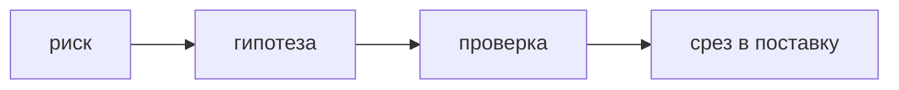

## Введение

Вакансии владельца продукта требуют discovery, исследования и границу MVP. Это один контур: какое незнание самое дорогое и какой самый маленький шаг его снимает.

## Раздел: Гипотеза и срез

Гипотеза называется так: кто, в какой ситуации, какое поведение, по какому сигналу поймёте, что не угадали. «Пользователям нужен кабинет» — тема, не гипотеза.

Интервью ищет прошлый случай, не оценку будущей кнопки. Прототип проверяет путь дешевле разработки. В бэклог попадает то, что пережило этот фильтр, плюс явные обязательства поддержки.

MVP — срез, после которого вы меняете решение. Если после выкладки нечего измерить и нечего остановить, это просто первая очередь фич. В срез не кладут отчётность «на всякий случай» и вторую роль пользователя без вопроса, который она закрывает.

## Раздел: Ответ вслух

Я формулирую риск и сигнал опровержения. Говорю с людьми про последний раз, когда проблема случилась. Прототип или узкий запуск ставлю раньше полного набора экранов. В поставку берём только то, без чего сигнал не собрать. Остальное остаётся гипотезами, а не обещанием roadmap.

## Раздел: Плохой ответ

Плохой ответ: «MVP — это версия без красивого дизайна». Если сценарий тот же и вопрос тот же не задан, вы просто отложили полировку.

## Раздел: Термины

Исследование продукта — discovery. Гипотеза — hypothesis. Минимальный срез — MVP. Опровержение — falsification. Прототип — prototype.

## Лаба

**25 минут.** Для идеи «уведомление о просроченной заявке» напишите гипотезу, сигнал провала и что вы сознательно не делаете в первом срезе. Один пункт должен быть измерим без новой аналитической платформы.

## Схема: От риска к срезу

## Тест

### Чем гипотеза отличается от темы бэклога?

**Ответ:** в ней есть сигнал провала

**Пояснение:** Тему нельзя опровергнуть, гипотезу можно.

### Что спрашивать на интервью?

**Ответ:** последний реальный случай

**Пояснение:** Оценка «пользовались бы вы» почти не предсказывает поведение.

### Когда прототип уместнее сразу писать сервис?

**Ответ:** когда неясен путь

**Пояснение:** Дорогой код до проверки пути сжигает спринт.

### Какой срез ещё не MVP?

**Ответ:** урезанный список без вопроса

**Пояснение:** После выкладки должно быть решение: продолжать, изменить или остановить.

### Куда деть идею, которая не вошла в срез?

**Ответ:** оставить гипотезой

**Пояснение:** Не обещать её датой на roadmap, пока нет сигнала.

## Шпаргалка

<ul><li>Кто, ситуация, поведение, сигнал</li><li>Интервью про прошлое</li><li>Срез отвечает на один риск</li><li>Лишнее не обещают датой</li></ul>

## Anki

### Front: Что делает фразу гипотезой?

Back: Назван сигнал, по которому её признают неверной.

### Front: Что такое MVP?

Back: Минимальный срез, после которого меняют решение.

### Front: Почему «без дизайна» — слабый MVP?

Back: Объём тот же, вопрос эксперимента не задан.

### Front: Какой вопрос на интервью слабый?

Back: «Вам было бы удобно», без последнего реального случая.

### Front: Что не кладут в первый срез?

Back: Роли и отчёты, без которых сигнал всё равно виден.

### Front: Куда писать непроверенную идею?

Back: В список гипотез, не в обязательство даты.

## Итоги

- Дорогое незнание снимают маленьким шагом
- Сигнал назван до разработки
- Обещание даты начинается после проверки

## Ссылки

- [Стратегия](/game/learn/pm-product-strategy)
- [Приоритизация](/game/learn/pm-prioritization)
