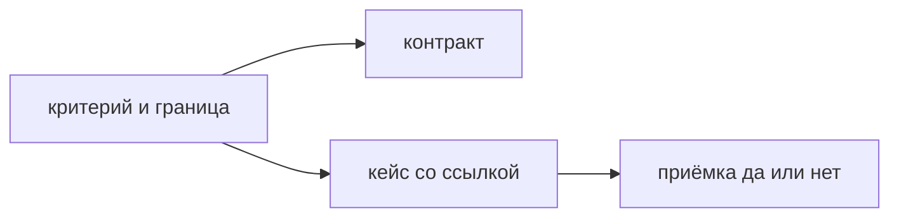

## Введение

Владелец продукта пишет истории и критерии приёмки. Системный аналитик уводит наблюдаемый результат в контракт и поля. Тестировщик превращает пункт в шаги кейса. Если критерий нельзя проверить, история ещё не готова к спринту: оценку спорят вкусом, демо кончается фразой «я не это имел в виду», а тест не знает, заводить ли дефект. Готовый критерий бинарный. На стенде есть один факт, и заказчик, разработчик и тест говорят про него «да» или «нет» одинаково.

Рабочая форма короткая: дано состояние, когда действие, тогда наблюдаемый результат. Результат — статус, сообщение, запись, отказ, отсутствие чужих данных. Не «работает быстро» и не «понятный интерфейс», пока нет порога, с которым все согласны. Порог времени, если он правда нужен, тоже можно сделать критерием, но это уже число, а не ощущение.

Выпуск пишет историю «куратор закрывает заявку»: три критерия, включая отказ, и одну границу того, что в эту историю не входит. Этого достаточно, чтобы увидеть разницу между критерием, тест-кейсом и пожеланием.

## Раздел: Форма

Дано — состояние мира до действия. Заявка в статусе «в работе», куратор имеет право её вести, заголовок заполнен. Когда — что делает человек или система. Куратор нажимает «Закрыть». Тогда — что можно показать. Статус становится «закрыта», автор видит это на карточке, повторное закрытие не создаёт вторую запись истории. Если «тогда» нельзя показать на стенде, пункт переписывают до планирования, а не после спора на демо.

В критерии входит отказ. Пустое обязательное поле, чужая заявка, повторная отправка, просроченное право. Отказ — тоже поведение продукта. Если его нет в истории, API вернёт один код, экран покажет другое, а приёмка решит «и так сойдёт». Один отказ в истории дешевле, чем отдельный сюрприз в проде. Не нужно описывать все мыслимые ошибки мира: только те, которые меняют результат этой истории.

Граница «не делаем в этой истории» написана рядом. Закрытие не включает массовое закрытие, не включает переоткрытие, не включает отчёт руководителю. Иначе в неё принесут соседний сценарий в середине спринта, оценка станет ложью, а приёмка не закончится. Соседний сценарий может быть важным. Он живёт своей историей со своими критериями, а не абзацем «заодно».

Критериев мало. Пять проверяемых лучше двадцати, из которых половина про вкус шрифта и порядок полей, не влияющий на результат. Подробные шаги кликов живут в тест-кейсе. В истории — результат, который продукт принимает. Если владелец пишет двадцать шагов, он забирает у теста работу и застревает в вёрстке. Если он не пишет ни одного наблюдаемого факта, тест начинает выдумывать цель.

Аналитик может добавить поля, коды и схему, не подменяя пользовательский результат. «Статус closed в ответе» уточняет критерий «на карточке видно, что заявка закрыта», а не заменяет его техническим жаргоном, который заказчик не может принять. Тест ссылается на пункт критерия. Пересказ другими словами в отрыве от истории плодит второй источник. Ссылка на пункт «критерий 2» в кейсе как раз связывает проверку и цель.

Историю рано брать в спринт, когда по ней нельзя решить, принята она или нет. «Сделать закрытие» без критериев — тема. Её возвращают владельцу до оценки, а не «уточним по ходу». Уточнение по ходу — это новые критерии в середине, то есть другая история.

## Раздел: Разбор на примере

История: куратор закрывает свою заявку, чтобы автор увидел, что работа закончена. Граница: массовое закрытие списка и переоткрытие не входят. Право назначать другого куратора не входит.

Критерий один. Дана заявка в статусе «в работе», которую ведёт этот куратор. Когда он подтверждает закрытие, тогда статус на карточке «закрыта», и автор заявки видит тот же статус. Критерий два, отказ. Дана заявка другого куратора. Когда текущий пользователь пытается её закрыть, тогда статус не меняется и пользователь видит отказ. Чужой объект не становится закрытым. Критерий три, повтор. Дана уже закрытая заявка. Когда куратор отправляет закрытие снова, тогда остаётся одна запись о закрытии, а не две, и статус не прыгает.

Этого достаточно для приёмки. Не написано «удобная кнопка» и не написано «быстро». Если скорость закрытия правда ограничена договором, это отдельный пункт с числом, и его лучше не смешивать с функциональным результатом, чтобы спор о миллисекундах не заблокировал спор о чужой заявке.

Аналитик рядом пишет, какой код получит клиент на чужую заявку, и ссылается на критерий два. Тест пишет шаги: каким пользователем войти, какую заявку открыть, что прочитать на экране. Шаги не заменяют формулировку владельца. Если на демо статус не сменился у автора, это не «мелочь UI», это провал критерия один.

Сценарий «закрыть все просроченные разом» просят добавить в четверг. Он за границей. Его оценивают отдельно. В эту историю не втаскивают, даже если «кнопка рядом».

## Раздел: Где это ломается

Критерии пишет только тестировщик после разработки. Тогда владелец не зафиксировал, какую ценность принимает, и любое поведение можно объявить задуманным. Тест проверяет, а не выбирает цель. Владелец формулирует результат, тест делает пункт исполнимым.

«Удобно, понятно, современно». Общего «да» нет. На демо побеждает самый громкий голос. Переписывают в наблюдаемый факт или выкидывают из приёмки в отдельный список пожеланий, который не блокирует историю.

Нет отказа. Счастливый путь зелёный, чужую заявку закрывает любой, кто знает id. Дыру находят снаружи. Один негативный критерий обязателен, если у действия есть право или валидация.

Нет границы. История растёт каждую планёрку. Оценка, данная в понедельник, к среде не про эту работу. Граница строкой в тексте истории.

Двадцать шагов вместо результата. История ломается от переименования кнопки, хотя статус всё тот же. Шаги переезжают в кейс.

Критерий и кейс разошлись словами. В истории «автор видит статус», в кейсе «пришло письмо». Письмо никто не заказывал, либо его забыли внести в историю. Источник один, второй ссылается.

Критерий добавили на демо. Это новая работа или дефект относительно старого текста. Не меняют ожидание задним числом, чтобы принять как есть, если факт для владельца важен. Либо принимают по старому тексту и заводят следующую историю, либо честно расширяют и двигают срок.

## Раздел: Ответ вслух

Я пишу критерий так, чтобы на приёмке был один наблюдаемый факт: дано состояние, когда действие, тогда результат. Отдельно указываю, чего в истории нет. Ошибку ввода и чужой объект кладу в критерии, не оставляю их на здравый смысл. Пять таких пунктов лучше двадцати шагов. Шаги кейса пишет тест и ссылается на пункт. Если пункт нельзя показать на стенде, переписываю его до планирования. Цель формулирую я: тест и аналитик делают её исполнимой, но не подменяют, какую ценность продукт принимает.

## Раздел: Плохой ответ

Плохой ответ: «критерии напишет тестировщик». Тогда неизвестно, что владелец принимает, и спор переносится на демо. Второй плохой ответ: «критерии — это подробная инструкция кликов». Инструкция хрупкая и прячет результат. Результат — статус, отказ, запись. Клики — способ до него дойти в кейсе.

## Раздел: Термины

Критерии приёмки — acceptance criteria. История — user story. Дано, когда, тогда — Given, When, Then. Граница — out of scope. Приёмка — acceptance, решение «да, этот результат мы берём». Кейс — шаги проверки. Пожелание — формулировка без общего способа сказать «да»; в приёмку истории оно не входит.

## Лаба

**Цель.** Написать историю, по которой можно сказать «принята» без спора о вкусе.

**Шаги.**

1. Сформулируйте историю: куратор закрывает заявку, чтобы автор увидел завершение. Одна фраза ценности, без списка всех идей очереди.
2. Напишите три критерия в форме дано-когда-тогда. Один из них — отказ на чужой заявке. Один — повторное закрытие не плодит вторую запись.
3. Одной строкой вынесите сценарий, который не входит: массовое закрытие или переоткрытие.
4. Отметьте, какой пункт нельзя принять, если на экране автора статус не изменился.
5. Напишите, что останется тестировщику: шаги входа и ссылка на номер критерия, не новая цель.
6. Вычеркните из черновика слово «удобно», если оно не превратилось в наблюдаемый факт.

**Готово, если…**

- [ ] Каждый критерий можно показать
- [ ] Есть отказ
- [ ] Есть граница истории
- [ ] Шаги кликов не подменяют результат
- [ ] Цель сформулирована владельцем, не отложена «тесту»

## Схема: Кто подхватывает критерий

## Тест

### Какой критерий можно сдать?

**Ответ:** с наблюдаемым результатом

**Пояснение:** «Удобно» не имеет общего «да» для заказчика и теста.

### Куда деть чужой сценарий, который просят «заодно»?

**Ответ:** за границу истории

**Пояснение:** Иначе приёмка расползается и оценка врёт.

### Кто формулирует, что продукт принимает?

**Ответ:** владелец продукта

**Пояснение:** Тест и аналитик делают пункт проверяемым, но не подменяют цель.

### Зачем критерий на ошибку ввода?

**Ответ:** отказ тоже поведение

**Пояснение:** Иначе его сделают по-разному в API и на экране.

### Пять критериев или двадцать подробных шагов?

**Ответ:** пять проверяемых

**Пояснение:** Шаги кейса живут у теста. В истории — результат.

## Шпаргалка

<ul><li>Дано, когда, тогда</li><li>Факт можно показать</li><li>Есть отказ</li><li>Есть граница истории</li><li>Шаги живут в кейсе</li></ul>

## Anki

### Front: Форма критерия приёмки?

Back: Дано состояние, когда действие, тогда наблюдаемый результат.

### Front: Почему «быстро и удобно» не критерий?

Back: Нет порога и нет общего способа сказать «да».

### Front: Что такое out of scope у истории?

Back: Сценарий, который сознательно не входит в эту поставку.

### Front: Кто пишет критерии?

Back: Владелец продукта. Аналитик и тест делают их исполнимыми.

### Front: Чем критерий отличается от тест-кейса?

Back: Критерий — какой результат принимаем. Кейс — какими шагами проверяем.

### Front: Когда историю рано брать в спринт?

Back: Когда по ней нельзя решить, принята она или нет.

## Мнемоника

### acronym: Критерий приёмки

**Задание:** Три части одного критерия.

**Элементы:**
- Дано
- Когда
- Тогда

**Подсказка:** «Удобная форма» не критерий: нет наблюдаемого тогда.

**Ответ:** Given When Then

## Итоги

- Приёмка бинарная и до спринта, не на демо
- Отказ описан заранее
- Граница истории защищает срок и оценку
- Владелец держит цель, тест держит шаги
- Пожелание без факта не блокирует и не принимается как критерий

## Ссылки

- [Agile глазами PO](/game/learn/pm-cjm)
- [User story для аналитика](/game/learn/sa-requirements-basics)
