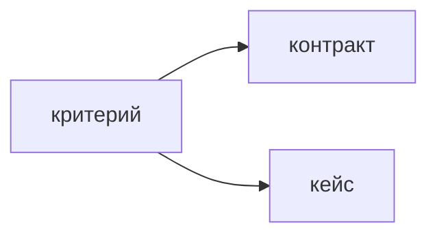

## Введение

Владелец продукта пишет истории и критерии приёмки. Системный аналитик уводит их в контракт, тестировщик — в кейс. Если критерий нельзя проверить, история ещё не готова к спринту.

## Раздел: Форма

Рабочая форма: дано состояние, когда действие, тогда наблюдаемый результат. Результат — статус, сообщение, запись, отказ. Не «работает быстро» и не «понятный интерфейс» без порога.

В критерии входит отказ: пустое поле, чужая заявка, повторная отправка. Граница «не делаем в этой истории» написана рядом, иначе в неё принесут соседний сценарий.

Критериев мало. Пять проверяемых лучше двадцати, из которых половина про вкус. Аналитик может добавить поля и коды, не подменяя пользовательский результат. Тест ссылается на пункт критерия, а не пересказывает его другими словами в отрыве от истории.

## Раздел: Ответ вслух

Я пишу критерий так, чтобы на приёмке был один наблюдаемый факт. Отдельно указываю, чего в истории нет. Ошибки ввода кладу в критерии, не оставляю их «на здравый смысл». Если пункт нельзя показать на стенде, я переписываю его до планирования, а не после спора на демо.

## Раздел: Плохой ответ

Плохой ответ: «критерии напишет тестировщик». Тогда владелец не зафиксировал, какую ценность принимает. Тест проверяет, а не выдумывает цель.

## Раздел: Термины

Критерии приёмки — acceptance criteria. История — user story. Дано / когда / тогда — Given / When / Then. Граница — out of scope. Приёмка — acceptance.

## Лаба

**20 минут.** История: «куратор закрывает заявку». Напишите три критерия в форме дано-когда-тогда, включая один отказ. Одной строкой вынесите сценарий, который в эту историю не входит.

## Схема: Кто подхватывает критерий

## Тест

### Какой критерий можно сдать?

**Ответ:** с наблюдаемым результатом

**Пояснение:** «Удобно» не имеет общего «да» для заказчика и теста.

### Куда деть чужой сценарий, который просят «заодно»?

**Ответ:** за границу истории

**Пояснение:** Иначе приёмка расползается и оценка врёт.

### Кто формулирует, что продукт принимает?

**Ответ:** владелец продукта

**Пояснение:** Тест и аналитик делают пункт проверяемым, но не подменяют цель.

### Зачем критерий на ошибку ввода?

**Ответ:** отказ тоже поведение

**Пояснение:** Иначе его сделают по-разному в API и на экране.

### Пять критериев или двадцать подробных шагов?

**Ответ:** пять проверяемых

**Пояснение:** Шаги кейса живут у теста. В истории — результат.

## Шпаргалка

<ul><li>Дано, когда, тогда</li><li>Факт можно показать</li><li>Есть отказ</li><li>Есть граница истории</li></ul>

## Anki

### Front: Форма критерия приёмки?

Back: Дано состояние, когда действие, тогда наблюдаемый результат.

### Front: Почему «быстро и удобно» не критерий?

Back: Нет порога и нет общего способа сказать «да».

### Front: Что такое out of scope у истории?

Back: Сценарий, который сознательно не входит в эту поставку.

### Front: Кто пишет критерии?

Back: Владелец продукта. Аналитик и тест делают их исполнимыми.

### Front: Чем критерий отличается от тест-кейса?

Back: Критерий — какой результат принимаем. Кейс — какими шагами проверяем.

### Front: Когда историю рано брать в спринт?

Back: Когда по ней нельзя решить, принята она или нет.

## Итоги

- Приёмка бинарная
- Отказ описан заранее
- Граница истории защищает срок

## Ссылки

- [Agile глазами PO](/game/learn/pm-agile-po)
- [User story для аналитика](/game/learn/sa-user-stories-use-cases)
