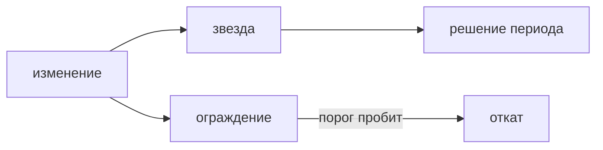

## Введение

Вакансии отделяют умение смотреть метрики от знания церемоний. OKR отвечает, чего команда добивается в цикле: цель и ключевые результаты на квартал или на другой выбранный срок. Набор метрик отвечает на другой вопрос: не сломали ли ценность продукта по дороге и не выросла ли цена. Северная звезда может пережить смену OKR. Ключевой результат живёт, пока живёт цель периода, и потом его заменяют. Путать их значит либо бросать наблюдение в конце квартала, либо тащить в OKR вечное «число заявок» без решения, что с ним делать.

Одной цифры мало. Её можно накрутить вредным способом: закрывать заявки отказом, резать шаги так, что ошибки растут, покупать визиты, которые не становятся целевым действием. Поэтому рядом со звездой стоят ограждения. Для решения внутри спринта нужен опережающий сигнал. Квартальная выручка на маленькое изменение не успеет ответить. Десять равных графиков на демо означают, что решения нет.

Выпуск выбирает для сервиса заявок одну звезду, одно ограждение, один опережающий сигнал на две недели и порог, при котором изменение откатывают, даже если звезда чуть выросла.

## Раздел: Набор, а не дашборд ради дашборда

Северная звезда — одно число, которое растёт, когда пользователь получает ценность. Для сервиса заявок это скорее число заявок, доведённых до полезного исхода, а не число открытых экранов и не число зарегистрированных учеток. Исход договаривают: заявка закрыта с решением, а не заявка создана и брошена. Создание — активность. Закрытие с результатом — ближе к ценности, если результат и есть обещание продукта. Если продукт обещает скорость первого ответа, звезда может быть другой. Важно, что она одна на продукт в данный период наблюдения и что её нельзя честно растить, ломая путь.

Ограждение не даёт этой подмены. Доля ошибок сохранения, время до первого ответа, жалобы, доля закрытий без комментария, стоимость операции. Ограждение не обязано расти. Оно обязано не пробивать порог. Рост звезды при всплеске ошибок — не победа. Изменение откатывают, даже если основная цифра чуть лучше. Порог пишут до выкладки, иначе после выкладки всегда найдётся объяснение «подождём ещё».

Опережающий показатель двигается раньше денег и раньше квартального удержания. Для уведомления о просрочке это может быть доля просроченных, закрытых в тот же день, или доля писем, после которых открыли карточку на этой неделе. Запаздывающий — выручка, удержание за квартал, отток платящих. Для решения в спринте берут опережающий: он успевает ответить на маленькое изменение. Запаздывающий оставляют для разбора итога периода, чтобы не объявить успех по раннему сигналу, который не доехал до денег, если деньги и есть цель компании. Ранний сигнал не отменяют из-за того, что он не равен выручке. Им пользуются по назначению: быстро решить, продолжать ли эту ставку.

У одного изменения одна главная метрика и названные ограждения. Вторая «тоже главная» превращает спор в выбор графика, который сегодня красивее. Десять равных линий на демо — симптом, что гипотеза не назвала вопрос. Лишние графики можно оставить в рабочей тетради. В решение выносят один вопрос и порог.

Срез аудитории пишут рядом с числом. «Все пользователи» прячет, что кураторам стало лучше, а авторам хуже. Если гипотеза про куратора, смотрят куратора и отдельно проверяют ограждение на авторе. Среднее по больнице легко растёт за счёт одного сегмента.

Качество числа тоже часть решения. Если событие «закрыл» шлётся дважды из-за бага клиента, звезда врёт. Рядом с метрикой коротко сказано, откуда событие и что считается дублем. Владелец не обязан строить пайплайн, но обязан не управлять по числу, которому не верит, и не требовать от аналитика данных «любую цифру к утру», если события ещё нет.

## Раздел: Разбор на примере

Сервис заявок. Звезда: число заявок, закрытых с текстовым итогом, за неделю. Не DAU. Визит растёт и от лишних шагов входа, и от ошибок, и от рассылки «зайдите». Он не доказывает, что работа сделана. Создание заявки тоже слабое: его раздувают дубли.

Ограждение: доля ошибок сохранения и доля закрытий без текста итога. Второе ловит накрутку «закрыть пустым, чтобы звезда росла». Порог: ошибки сохранения не выше уровня прошлой недели плюс оговорённый запас, пустые закрытия не растут. Если команда не знает базу, первые две недели только меряют, не объявляют победу. Порог без базы — гадание. Это честнее, чем выдумать 0,3 процента.

Опережающий сигнал на изменение «письмо о просрочке»: доля просроченных заявок выбранного типа, которые закрыли в день письма. Смотрят две недели. Запаздывающий, выручка поддержки или отток, на эти две недели не отвечает. Его не тащат в решение спринта. Если ранний сигнал пустой и ограждение цело, гипотезу закрывают. Если ранний сигнал вырос, а пустые закрытия тоже выросли, откатывают: звезду или сигнал накрутили вредным способом.

OKR квартала может звучать «сократить долю просрочек на столько-то». Это цель цикла. Звезда «закрытые с итогом» останется и в следующем квартале, когда OKR сменят на онбординг. Ключевой результат не копируют в вечный дашборд как единственную истину, и звезду не переписывают каждый понедельник под новый слайд.

На демо одно изменение — один слайд: что сдвинули, что стало со звездой или с опережающим сигналом, цело ли ограждение, какое решение. Не десять графиков «для контекста», после которых непонятно, откатывать или нет.

## Раздел: Где это ломается

Смотрят DAU как звезду внутреннего инструмента. Активность без целевого действия хвалят, пока путь становится длиннее. Считают исход, который обещали пользователю.

Нет ограждения. Команда закрывает заявки массовой кнопкой без текста, звезда растёт, качество падает, жалобы приходят запаздывающим сюрпризом. Ограждение на пустое закрытие ставится до массовой кнопки, не после инцидента.

Десять главных метрик. Каждая инициатива находит себе зелёную. Решение не принимается. Одна на вопрос гипотезы.

Ждут квартальную выручку, чтобы оценить текст письма. Решение опаздывает на месяцы. Для спринта назван опережающий сигнал.

Порог придумывают после просмотра графика. Любой результат объявляют приемлемым. Порог пишут до выкладки.

Метрику путают с OKR и бросают считать в конце квартала. Продукт между целями слеп. Звезда и ограждения живут дольше цикла цели.

Верят числу с двойным событием. Сначала договариваются, что считается фактом, потом оптимизируют. Иначе оптимизируют баг учёта.

Смотрят только среднее. Один сегмент страдает, среднее зелёное. Сегмент гипотезы назван отдельно.

## Раздел: Ответ вслух

Я называю целевое действие и одно число на него. Рядом ставлю ограждение, которое нельзя уронить ради роста звезды, и порог отката до выкладки. На период эксперимента беру опережающий сигнал, запаздывающий оставляю для разбора итога. OKR задаёт цель цикла, звезда остаётся, когда цель сменят. Если после выкладки сигнал не двинулся и ограждение цело, гипотезу закрываю. Если звезда выросла ценой ошибок или пустых закрытий, откатываю. DAU внутренним успехом не называю.

## Раздел: Плохой ответ

Плохой ответ: «смотрим DAU». Визит не доказывает целевое действие. Второй плохой ответ: «метрик много не бывает, выведем все на один экран». Бывает. Без одного вопроса и порога дашборд не приводит к решению продолжать, менять или остановить.

## Раздел: Термины

Северная звезда — North Star metric, одно число ценности. Ограждение — guardrail, порог, который нельзя пробивать ради звезды. Опережающий показатель — leading indicator. Запаздывающий — lagging indicator. Порог отката — rollback threshold, заранее названное условие вернуть изменение. OKR — цель и ключевые результаты периода, не замена постоянного наблюдения. Сегмент — кто именно входит в число, без которого среднее врёт.

## Лаба

**Цель.** Собрать минимальный набор для одного изменения и не подменить его визитами.

**Шаги.**

1. Для сервиса заявок выберите звезду как целевое действие, не DAU и не голое создание.
2. Выберите одно ограждение, которое ловит вредный способ растить это число. Назначьте порог словами «не хуже базы», если базы ещё нет — первые две недели только измерение.
3. Для изменения «письмо о просрочке» выберите опережающий сигнал на две недели. Напишите, почему выручка за квартал на это решение не годится.
4. Напишите правило отката: даже если звезда чуть выросла, пробитое ограждение возвращает изменение назад.
5. Отделите это от OKR: какая формулировка могла бы быть целью квартала и почему она не заменяет звезду в следующем квартале.
6. Назовите сегмент, на котором смотрите сигнал, и кого проверяете ограждением, чтобы среднее не спрятало вред.

**Готово, если…**

- [ ] Звезда — одно целевое действие
- [ ] Ограждение и порог названы до выкладки
- [ ] Для спринта выбран опережающий сигнал
- [ ] Откат не отменён ростом звезды
- [ ] OKR и постоянная метрика не склеены

## Схема: Звезда и ограждение

## Тест

### Чем северная звезда отличается от ключевого результата OKR?

**Ответ:** она про постоянную ценность

**Пояснение:** OKR живёт цикл. Звезда остаётся, когда цели периода сменят.

### Почему одной звезды мало?

**Ответ:** её можно накрутить вредным способом

**Пояснение:** Ограждение ловит ошибку, жалобу или цену.

### Какой показатель нужен, чтобы решить в этом спринте?

**Ответ:** опережающий

**Пояснение:** Квартальная выручка не успеет ответить на маленькое изменение.

### DAU вырос, целевых заявок нет. Что с метрикой?

**Ответ:** она не про ценность

**Пояснение:** Считают завершённое целевое действие, не визит.

### Когда изменение откатывают?

**Ответ:** когда пробит порог ограждения

**Пояснение:** Рост звезды не оправдывает сломанный путь или всплеск ошибок.

## Шпаргалка

<ul><li>Одно число ценности</li><li>Рядом ограждение и порог</li><li>В спринте — опережающий сигнал</li><li>Порог отката назван заранее</li><li>Сегмент написан рядом с числом</li></ul>

## Anki

### Front: Что такое North Star?

Back: Одно число, которое растёт вместе с ценностью для пользователя.

### Front: Зачем guardrail?

Back: Чтобы звезду не растили за счёт ошибок, жалоб или цены.

### Front: Leading и lagging?

Back: Опережающий сигнал раньше, запаздывающий фиксирует итог.

### Front: Почему DAU слабая звезда?

Back: Визит не доказывает, что целевое действие случилось.

### Front: Сколько главных метрик у одного изменения?

Back: Одна на вопрос гипотезы плюс названные ограждения.

### Front: Чем метрика отличается от OKR?

Back: Метрика наблюдает продукт постоянно, OKR задаёт цель цикла.

## Итоги

- Ценность считают целевым действием, не визитом
- Ограждение и порог защищают от накрутки
- Порог отката известен до выкладки
- В спринте решают по опережающему сигналу
- Звезда переживает смену целей периода

## Ссылки

- [OKR](/game/learn/pm-okr)
- [Discovery](/game/learn/pm-discovery)
