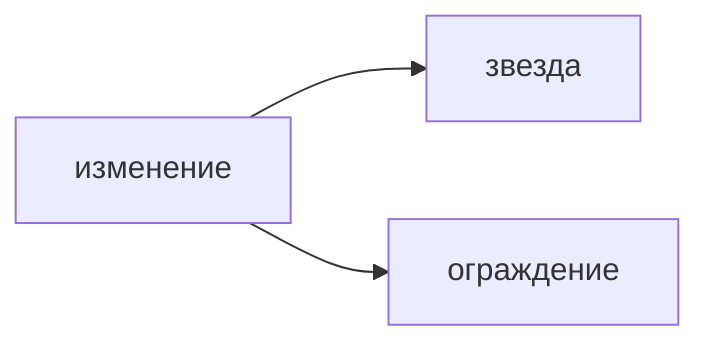

## Введение

Вакансии отделяют умение смотреть метрики от знания церемоний. OKR отвечает, чего добиваемся в цикле. Набор метрик отвечает, не сломали ли ценность и не выросла ли цена по дороге.

## Раздел: Набор, а не дашборд ради дашборда

Северная звезда — одно число, которое растёт, когда пользователь получает ценность: завершённые заявки, а не открытые экраны. Её легко подделать, если оптимизировать в одиночку: можно закрывать заявки отказом.

Ограждения не дают этой подмены: доля ошибок, время до ответа, жалобы, стоимость операции. Опережающий показатель двигается раньше выручки: активация, повтор на этой неделе. Запаздывающий — деньги и удержание за квартал. Для решения в спринте нужен опережающий, иначе вы управляете прошлым.

У изменения одна главная метрика и порог, после которого его откатывают. Десять равных графиков на демо означают, что решения нет.

## Раздел: Ответ вслух

Я называю, какое действие пользователя считаю ценностью, и одно число на это действие. Рядом ставлю ограждение, которое нельзя уронить ради роста звезды. На период беру опережающий сигнал, а запаздывающий оставляю для разбора итога. Если после выкладки звезда не двинулась и ограждение цело, гипотезу закрываю, а не добавляю ещё экран в ту же сторону.

## Раздел: Плохой ответ

Плохой ответ: «смотрим DAU». Активность без целевого действия растёт и от лишних шагов, и от ошибок входа.

## Раздел: Термины

Северная звезда — North Star metric. Ограждение — guardrail. Опережающий показатель — leading indicator. Запаздывающий — lagging indicator. Порог отката — rollback threshold.

## Лаба

**25 минут.** Для сервиса заявок выберите северную звезду, одно ограждение и один опережающий сигнал на ближайшие две недели. Напишите порог, при котором изменение откатывают, даже если звезда чуть выросла.

## Схема: Звезда и ограждение

## Тест

### Чем северная звезда отличается от ключевого результата OKR?

**Ответ:** она про постоянную ценность

**Пояснение:** OKR живёт цикл. Звезда остаётся, когда цели периода сменят.

### Почему одной звезды мало?

**Ответ:** её можно накрутить вредным способом

**Пояснение:** Ограждение ловит ошибку, жалобу или цену.

### Какой показатель нужен, чтобы решить в этом спринте?

**Ответ:** опережающий

**Пояснение:** Квартальная выручка не успеет ответить на маленькое изменение.

### DAU вырос, целевых заявок нет. Что с метрикой?

**Ответ:** она не про ценность

**Пояснение:** Считают завершённое целевое действие, не визит.

### Когда изменение откатывают?

**Ответ:** когда пробит порог ограждения

**Пояснение:** Рост звезды не оправдывает сломанный путь или всплеск ошибок.

## Шпаргалка

<ul><li>Одно число ценности</li><li>Рядом ограждение</li><li>В спринте — опережающий сигнал</li><li>Порог отката назван заранее</li></ul>

## Anki

### Front: Что такое North Star?

Back: Одно число, которое растёт вместе с ценностью для пользователя.

### Front: Зачем guardrail?

Back: Чтобы звезду не растили за счёт ошибок, жалоб или цены.

### Front: Leading и lagging?

Back: Опережающий сигнал раньше, запаздывающий фиксирует итог.

### Front: Почему DAU слабая звезда?

Back: Визит не доказывает, что целевое действие случилось.

### Front: Сколько главных метрик у одного изменения?

Back: Одна на вопрос гипотезы плюс названные ограждения.

### Front: Чем метрика отличается от OKR?

Back: Метрика наблюдает продукт постоянно, OKR задаёт цель цикла.

## Итоги

- Ценность считают целевым действием
- Ограждение защищает от накрутки
- Порог отката известен до выкладки

## Ссылки

- [OKR](/game/learn/pm-okr)
- [Discovery](/game/learn/pm-discovery)
