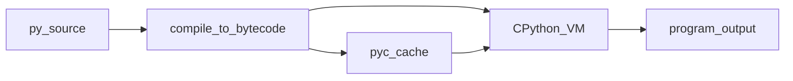
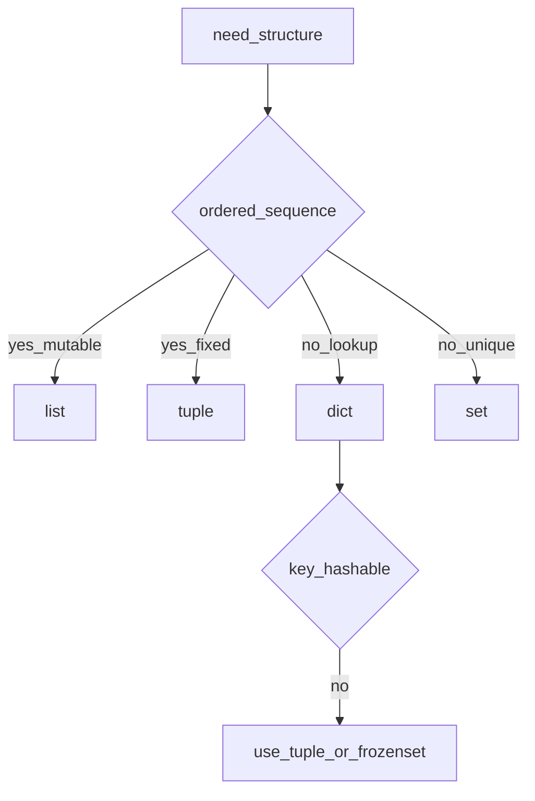

## Введение

На junior-собесе почти всегда спрашивают не «синтаксис print», а картину: что такое Python, как он запускает код и где его сильные/слабые стороны. Этот выпуск закрывает вводный блок вопросов (язык, интерпретатор, типизация, выбор стека) своими формулировками — без копипаста чужих ответов.

**Коллекции.** После «что такое Python» собес уходит в коллекции: в чём разница list и tuple, что может быть ключом dict, когда брать set. Этот выпуск собирает junior-базу по типам и структурам данных — с акцентом на выбор структуры, а не заучивание всех методов.

## Раздел: Как отвечать одним блоком

Этот выпуск собрал соседние короткие темы трека: «Python на собесе», «Коллекции». Раньше каждая занимала отдельную карточку на несколько минут, а на собеседовании их спрашивают одним блоком. Ниже у каждой темы свой раздел, затем общие лабы, один тест и одна колода карточек. В ответе сначала назовите, какую тему спросили, потом определение и один пример. Не проговаривайте все разделы, если спросили один. Лабы можно пройти по порядку исходного трека. Если времени мало, сделайте первую и последнюю: первая ставит язык, последняя проверяет, что соседние темы вы не перепутали.

## Раздел: Python на собесе: Язык и цикл исполнения

Python — высокоуровневый язык с динамической типизацией и автоматическим управлением памятью. Исходник компилируется в bytecode (часто в `__pycache__/*.pyc`), затем его выполняет виртуальная машина CPython. Поэтому корректнее говорить: «интерпретируемый с шагом компиляции в bytecode», а не «чисто интерпретируемый построчно».

Ключевые свойства, которые ждут на собесе:
- читаемость и быстрый цикл разработки;
- богатая стандартная библиотека и экосистема;
- «всё есть объект» — функции, классы, модули тоже объекты;
- императивный стиль по умолчанию, плюс средства FP (map, comprehensions) и полноценное ООП.

Исторически язык спроектировал Guido van Rossum (конец 1980-х, влияние ABC). Для практики важно отличие Python 3 от 2: Unicode по умолчанию, `print` как функция, иное целочисленное деление — Python 2 считать мёртвым для нового кода.

## Раздел: Python на собесе: Когда брать Python и когда нет

**Уместен:** веб-API и бэкенд, автоматизация/скрипты, data/ML-пайплайны, прототипы, glue-код вокруг сервисов.

**Слабые места:** CPU-bound параллелизм упирается в GIL (подробнее в PY15); мобильные/жёсткий realtime; места, где нужен минимальный cold-start и жёсткий контроль памяти.

Фраза «Python лёгкий» на собесе — ловушка: синтаксис дружелюбный, но продакшен (типизация, async, упаковка, отладка утечек) требует глубины. Честный ответ: порог входа низкий, потолок — высокий.

Сравнение с Java кратко: меньше церемонии и статической проверки «из коробки», больше динамики и скорости итераций; взамен — другие компромиссы по перфу и tooling.

## Раздел: Python на собесе: Частые вопросы с собеседования

**Вопрос.** Чем `is` отличается от `==`?

**Ответ.** `==` сравнивает значения (вызывает `__eq__`); `is` проверяет, один ли это объект в памяти (одинаковый `id`). Для проверки на `None` идиоматично `x is None`. На маленьких закешированных int/str `is` может случайно совпасть с `==` — в коде так не полагаются.

**Вопрос.** Что такое GIL в двух предложениях?

**Ответ.** Global Interpreter Lock в CPython не даёт нескольким потокам одновременно исполнять байткод Python в одном процессе. Для CPU-bound параллелизма берут процессы или нативный код; потоки остаются уместны для I/O, пока поток ждёт сеть или диск.

**Вопрос.** Python интерпретируемый или компилируемый?

**Ответ.** Исходник компилируется в bytecode (`.pyc`), затем его выполняет VM CPython — «интерпретируемый с шагом компиляции», а не построчный интерпретатор без кеша. На собесе полезно упомянуть `__pycache__` и что это не JIT как у PyPy.

**Вопрос.** Зачем на собесе спрашивают «всё ли в Python объект»?

**Ответ.** Функции, классы, модули и типы — объекты с identity и атрибутами; это объясняет first-class functions, декораторы и динамическую модель типов. Исключение уровня языка — примитивы в CPython реализованы как объекты-обёртки, но идея «ссылка на объект» сохраняется.

## Раздел: Коллекции: Встроенные типы и последовательности

Числовые: `int`, `float`, `complex`. Логический `bool` — подкласс `int`. Текст — `str` (Unicode). Последовательности: `list` (изменяемая), `tuple` (неизменяемая), `str`, `range`.

Индексация с нуля; отрицательный индекс считает с конца (`a[-1]` — последний). Срез `a[start:stop:step]` возвращает новый объект того же «семейства» (для list — новый list), не включая `stop`.

`list` vs `tuple`:
- list — для набора, который меняете (append, sort);
- tuple — для фиксированной записи/ключа/распаковки; чуть дешевле по смыслу «контракта неизменности».

`append` добавляет один элемент; `extend` добавляет элементы из итерируемого. Путать на собесе — классика.

## Раздел: Коллекции: dict, set и выбор структуры

`dict` — отображение ключ → значение. Ключ должен быть **hashable** (неизменяемый по смыслу хеша): `str`, `int`, `tuple` из hashable, `frozenset`. `list` и обычный `set` ключами быть не могут.

`set` / `frozenset` — уникальные элементы, проверка принадлежности в среднем O(1). `frozenset` можно класть в другой set или использовать как ключ dict.

`collections.namedtuple` — tuple с именами полей: удобно для лёгких DTO без полного класса.

Когда что брать (кратко):
- упорядоченный изменяемый ряд → `list`;
- фиксированная запись / ключ составной → `tuple`;
- поиск по ключу → `dict`;
- уникальность / пересечения → `set`.

## Раздел: Коллекции: Частые вопросы с собеседования

**Вопрос.** Чем `is` отличается от `==` для списков и чисел?

**Ответ.** `==` сравнивает содержимое (элементы списка, значение числа); `is` — один ли объект. Два списка с одинаковыми элементами почти всегда `==`, но не `is`. Для `None` используйте только `is`.

**Вопрос.** Почему нельзя положить список ключом в `dict`?

**Ответ.** Ключ должен быть hashable: неизменяемый и с стабильным хешом. Список изменяем — его хеш нельзя гарантировать; tuple из hashable элементов ключом может быть. На собесе связывают с `set`/`dict` внутренностями.

**Вопрос.** Когда на собесе выберете `tuple` вместо `list`?

**Ответ.** Когда нужен неизменяемый контракт: ключ dict/set, возврат фиксированной записи из функции, защита от случайной мутации. Производительность и память — вторичный аргумент; главное — семантика неизменности.

**Вопрос.** Что такое shallow copy для вложенного списка?

**Ответ.** Копируется только верхний контейнер; вложенные объекты остаются общими. Мутация `copy[0].append(1)` видна и в оригинале. Для полной изоляции нужен `copy.deepcopy` (тема stdlib, PY08).

## Лаба

**Python на собесе.**

**Цель.** Сформулировать устный ответ на 60–90 секунд: «Что такое Python и когда вы его выберете?»

**Шаги.**
1. Запустите `python -c "import sys; print(sys.version)"` и запишите версию.
2. Создайте файл `hello.py` с функцией и вызовом под `if __name__ == "__main__":`.
3. Запустите файл; затем удалите guard и импортируйте модуль из REPL — сравните поведение.
4. Напишите 5 буллетов: 3 плюса и 2 минуса Python для вашего целевого стека (API / data / scripts).

**В группу:** зачитайте ответ на таймер 90 секунд; коллега задаёт один уточняющий вопрос («а GIL?», «а async?»).

**Готово, если…**
- [ ] Можете объяснить bytecode → CPython без шпаргалки
- [ ] Называете ≥2 сценария «не брать Python»
- [ ] Понимаете роль `__name__ == "__main__"`

**Коллекции.**

**Цель.** На практике почувствовать mutable vs immutable и hashable-ограничение.

**Шаги.**
1. Создайте `coords = (10, 20)` и dict `points = {coords: "A"}`.
2. Попробуйте ключ `[10, 20]` — поймайте `TypeError` и объясните почему.
3. Напишите функцию, которая из списка строк возвращает (а) уникальные в set, (б) частоты в dict.
4. Сравните `lst.append([1])` и `lst.extend([1])` на одном и том же стартовом списке.

Заготовка для шага 1–2 (запустите в браузере или откройте в [Code](/game/code)):

```python
coords = (10, 20)
points = {coords: "A"}
print("tuple key ok:", points)

try:
    points[[10, 20]] = "B"
except TypeError as exc:
    print("list key TypeError:", type(exc).__name__, "—", exc)

words = ["a", "b", "a", "c", "b"]
print("unique set:", set(words))
freq: dict[str, int] = {}
for word in words:
    freq[word] = freq.get(word, 0) + 1
print("freq:", freq)

lst = [0]
lst.append([1])
print("after append:", lst)
lst = [0]
lst.extend([1])
print("after extend:", lst)
```

**В группу:** нарисуйте таблицу «тип → mutable? → hashable? → типичный кейс» на 6 типов.

**Готово, если…**
- [ ] Объясняете list vs tuple без «tuple быстрее всегда»
- [ ] Называете правило ключей dict
- [ ] Не путаете append и extend

## Схема: Python на собесе: От .py до результата



## Схема: Коллекции: Выбор коллекции



## Тест

### Python компилируется или только интерпретируется?

**Ответ:** оба шага — bytecode, затем VM

**Пояснение:** исходник становится bytecode; исполняет его интерпретатор CPython (или другой рантайм).

### Чем list отличается от tuple?

**Ответ:** list изменяемый, tuple — нет

**Пояснение:** оба последовательности; tuple ещё годится как hashable-ключ, если элементы hashable.

### Что значит «динамическая типизация»?

**Ответ:** тип у значения, не у имени переменной

**Пояснение:** одна и та же переменная может ссылаться на объекты разных типов в разные моменты; проверка в основном в runtime.

### Что может быть ключом словаря?

**Ответ:** только hashable объекты

**Пояснение:** str/int/tuple из hashable/frozenset — да; list/dict/set — нет.

### Когда Python — плохой выбор?

**Ответ:** жёсткий CPU-parallel / realtime / mobile

**Пояснение:** GIL, GC и модель исполнения хуже подходят к низколатентному realtime и нативной мобилке; для I/O-bound API часто ок.

## Шпаргалка

<ul><li>Высокоуровневый, динамический, GC, «всё объект»</li><li>Исходник → bytecode → CPython VM</li><li>Силён в скорости разработки и экосистеме; слаб в чистом CPU-parallel без обходов</li><li>list — mutable sequence; tuple — immutable</li><li>dict/set — hash-таблицы; ключ/элемент set должен быть hashable</li><li>slice: start включительно, stop исключительно</li></ul>

## Anki

### Front: Чем Python «исполняется» на практике?

Back: компиляция в bytecode и выполнение виртуальной машиной (обычно CPython)

### Front: Почему list нельзя сделать ключом dict?

Back: list изменяемый и неhashable — хеш должен быть стабилен

### Front: «Всё в Python — объект» — что это значит?

Back: функции, классы, модули и значения — объекты с типом и атрибутами; переменная — имя-ссылка

### Front: append vs extend?

Back: append добавляет один объект; extend — все элементы из итерируемого

### Front: Назовите два минуса Python на собесе

Back: GIL ограничивает CPU-threads; слабее для realtime/mobile; типы по умолчанию не статические (без mypy)

### Front: Когда выбрать set, а не list?

Back: нужна уникальность или быстрая проверка «есть ли элемент», порядок/дубликаты не важны

## Итоги

- Python = язык + рантайм (bytecode → VM), не «магия print»
- Динамическая типизация и объекты — база следующих выпусков
- Умейте честно сказать, где язык уместен, а где нет
- Коллекции — про контракт (mutable/hashable), не про «все методы наизусть»
- Срезы и отрицательные индексы — must-have junior
- Выбор list/tuple/dict/set — частый практический вопрос

## Ссылки

- [Документация Python — Tutorial](https://docs.python.org/3/tutorial/)
- [DEBAGanov — индекс вопросов серии](https://github.com/DEBAGanov/interview_questions/blob/main/400%20вопросов%20с%20ответами%2C%20которые%20должен%20знать%20Python-разработчик.md)
- [Learn](/game/learn)
- [Data model — стандартные типы](https://docs.python.org/3/library/stdtypes.html)
