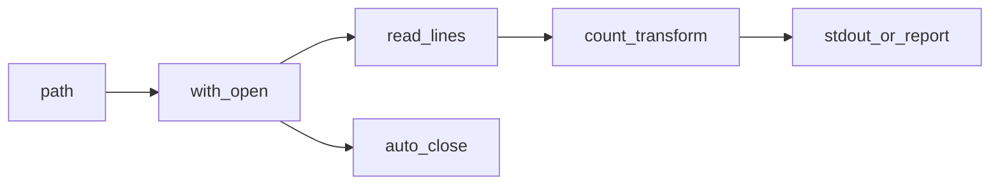
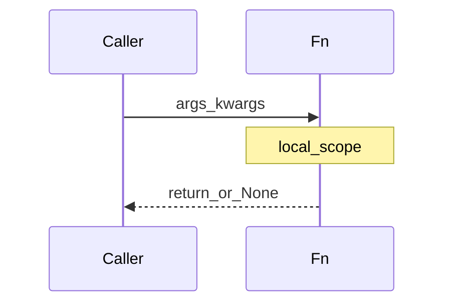
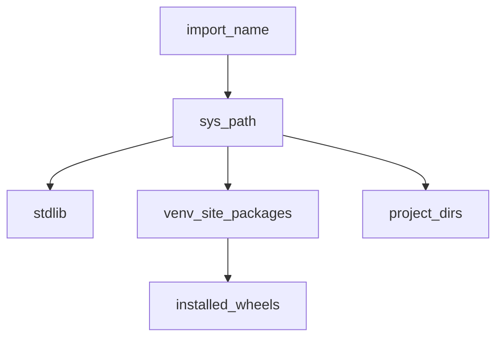

## Введение

Junior-собес часто смешивает операторы, строки и файлы в одну кучу мелких вопросов. Этот выпуск даёт карту: какие операторы есть, как устроен `str`, как безопасно читать/писать файлы и откуда берётся ввод.

**Функции.** Функции и циклы — ядро junior-собеса: `*args/**kwargs`, опасный дефолт `[]`, lambda, comprehensions, `enumerate`/`zip`. Здесь собираем рабочую модель без «магии».

**Модули и venv.** «Как вы организуете код и зависимости?» — стандарт junior/middle. Нужно чётко разделять модуль и пакет, понимать `venv`, `pip`, wheels и зачем `__name__ == "__main__"`.

## Раздел: Как отвечать одним блоком

Этот выпуск собрал соседние короткие темы трека: «Строки и I/O», «Функции», «Модули и venv». Раньше каждая занимала отдельную карточку на несколько минут, а на собеседовании их спрашивают одним блоком. Ниже у каждой темы свой раздел, затем общие лабы, один тест и одна колода карточек. В ответе сначала назовите, какую тему спросили, потом определение и один пример. Не проговаривайте все разделы, если спросили один. Лабы можно пройти по порядку исходного трека. Если времени мало, сделайте первую и последнюю: первая ставит язык, последняя проверяет, что соседние темы вы не перепутали.

## Раздел: Строки и I/O: Операторы и строки

Арифметика: `+ - * / // % **`. Сравнения возвращают `bool`. Логика: `and` / `or` / `not` (короткое замыкание). Membership: `in` / `not in`. Identity: `is` / `is not` (сравнивает объект, не значение — для `None` и синглтонов). Bitwise: `& | ^ ~ << >>`.

Строки неизменяемы (Unicode). Полезное: `split`/`join`, `strip`, `replace`, срезы, `f"..."` / `format`. `ord`/`chr` — код символа и обратно. `str` vs `repr`: человекочитаемо vs однозначное представление для отладки. Конкатенация в цикле через `+` плоха по стилю — лучше `join` или список кусков.

Регистр важен: Python case-sensitive. Проверки вроде `isalnum`, `isdigit` — частые мини-вопросы.

## Раздел: Строки и I/O: Файлы, os и ввод

`open(path, mode, encoding="utf-8")` + `with` (закрытие гарантировано). Режимы: `r`/`w`/`a`/`b`. Читать целиком / построчно; писать `write`/`writelines`. Обратный вывод файла — читать строки в список и развернуть (или итерировать аккуратно по размеру).

Модуль `os`: `getcwd`, `listdir`, `remove`/`unlink`, пути. Для новых проектов чаще `pathlib.Path`. CLI: `sys.argv` или `argparse`. Ввод: `input()`. Случайность: `random.random` / `randint` / `choice` / `shuffle` (in-place).

Числа в других системах: `int("ff", 16)`, `bin`/`hex`/`oct`.

## Раздел: Строки и I/O: Частые вопросы с собеседования

**Вопрос.** Когда на собесе говорят про `is` для строк?

**Ответ.** Интернирование коротких строк и некоторых литералов может дать `a is b` при `a == b`, но это оптимизация CPython, не правило языка. Сравнивайте текст через `==`; `is` оставьте для `None` и редких проверок identity.

**Вопрос.** Зачем `with open(...)` вместо голого `open`?

**Ответ.** Контекстный менеджер гарантирует закрытие файла и сброс буфера даже при исключении — через `__enter__`/`__exit__`. Без `with` легко утекает дескриптор при ошибке между open и close.

**Вопрос.** `str` vs `repr` — что ответить?

**Ответ.** `str` — человекочитаемое представление для пользователя; `repr` — однозначное для отладки, часто с кавычками и экранированием. В REPL `print(repr(x))` помогает увидеть скрытые пробелы и тип.

**Вопрос.** Почему конкатенация строк в цикле через `+` критикуют?

**Ответ.** Каждый `+` создаёт новую неизменяемую строку — квадратичная стоимость на длинных циклах. Идиоматично собирать куски в список и один раз `"".join(parts)` или использовать `io.StringIO`.

## Раздел: Функции: Поток управления

`if` / `elif` / `else`. Циклы `for` (по итерируемому) и `while`. `break` выходит, `continue` к следующей итерации. У `for`/`while` есть `else`: выполняется, если цикл **не** прерван `break` — частая ловушка.

`pass` — пустой оператор «заглушка». Отдельного `switch` в старом стиле не было; в 3.10+ есть `match`/`case`. Тернарный: `a if cond else b`.

`range(start, stop, step)` — ленивая последовательность индексов. Бесконечный цикл прерывают `break` или сигнал/исключение.

## Раздел: Функции: Функции, lambda, comprehensions

`def` создаёт функцию; без `return` возвращается `None`. Можно вернуть несколько значений кортежем. `*args` собирает позиционные, `**kwargs` — именованные; проброс: `other(*args, **kwargs)`.

Опасность: `def f(x=[])` — дефолт создаётся **один раз**; мутации копятся. Пишите `None` и создавайте список внутри.

Lambda — одно выражение без имени, удобно для `key=` / коротких колбэков. `map`/`filter`/`reduce` (reduce из `functools`) — FP-стиль; часто читаемее comprehension. `enumerate`, `zip` — индексы и параллельный обход.

List/dict comprehensions: компактно и быстро для простых преобразований; избегайте, если логика с побочными эффектами или длиннее пары условий.

## Раздел: Функции: Частые вопросы с собеседования

**Вопрос.** Когда потоки, а когда процессы в Python?

**Ответ.** Потоки делят память и подходят для I/O-bound, пока GIL отпускается на ожидании. Процессы обходят GIL для CPU-bound, но дороже по старту и обмену данными. Чистый Python-цикл на threads не ускорится.

**Вопрос.** Чем генератор лучше списка для большого потока данных?

**Ответ.** Генератор выдаёт элементы лениво и держит O(1) памяти относительно размера потока; list материализует всё сразу. Если нужен повторный обход или индексация — list или сохранение в файл/БД.

**Вопрос.** Зачем на собесе спрашивают про `for`/`else`?

**Ответ.** Ветка `else` у цикла выполняется, если цикл завершился без `break`. Это не «if else к for», а отдельная семантика — частая ловушка в задачах «найти элемент».

**Вопрос.** Что такое декоратор одной фразой?

**Ответ.** Callable, который принимает функцию и возвращает обёртку с дополнительным поведением до/после вызова. Синтаксис `@dec` эквивалентен присваиванию `fn = dec(fn)`; подробности в PY10.

## Раздел: Модули и venv: Модули и пакеты

Модуль — файл `.py` (или скомпилированное расширение). Пакет — каталог с модулями (исторически с `__init__.py`; namespace packages — без него). Импорт ищет по `sys.path`; `.pth` файлы могут дополнять пути. Stdlib лежит в установке Python (`sys.prefix` / `Lib`).

`__name__`: при прямом запуске равен `"__main__"`, при импорте — имя модуля. Паттерн:

```python
def main():
    ...

if __name__ == "__main__":
    main()
```

Перезагрузка: `importlib.reload` (осторожно в проде). `__pycache__` / `.pyc` — кеш bytecode. Импортировать «весь модуль» vs `from x import y` — вкус и риск загрязнения namespace; круговые импорты лечат рефакторингом.

## Раздел: Модули и venv: venv, pip, wheels

Виртуальное окружение изолирует зависимости проекта (`python -m venv .venv`). Менеджеры: `pip`, иногда poetry/uv/pipenv — идея одна: зафиксировать версии. **Wheel** (`.whl`) — современный бинарный/готовый дистрибутив; **egg** — устаревший формат.

Транзитивные зависимости тянет resolver pip; конфликты версий — через constraints/`pip check`. Упаковка своего кода: `pyproject.toml` / setuptools, сборка wheel. Переменные окружения интерпретатора (`PYTHONPATH`, `PYTHONOPTIMIZE`) влияют на поиск модулей и `-O`.

## Раздел: Модули и venv: Частые вопросы с собеседования

**Вопрос.** Зачем `venv`, если Python уже установлен?

**Ответ.** Изолирует версии зависимостей проекта от системного Python и других проектов. Без venv `pip install` ломает глобальное окружение; в CI и проде фиксируют requirements/lock и собирают образ с тем же набором пакетов.

**Вопрос.** Wheel против sdist — в чём разница?

**Ответ.** Wheel — готовый бинарный или platform-specific дистрибутив, быстрая установка без компиляции на машине. sdist — архив исходников, pip может собрать на месте. Для продакшена предпочитают wheel там, где доступен.

**Вопрос.** Что такое `if __name__ == "__main__"`?

**Ответ.** Модуль при прямом запуске получает `__name__ == "__main__"`, при импорте — имя модуля. Блок под guard запускает CLI/демо только при исполнении файла, а не при импорте как библиотеки.

**Вопрос.** Как бороться с circular import на собесе?

**Ответ.** Рефакторинг: вынести общее в третий модуль, отложенный импорт внутри функции, или перестроить зависимости. «Перезагрузить importlib» — не решение для прода, только для REPL.

## Лаба

**Строки и I/O.**

**Цель.** Скрипт: прочитать текстовый файл, посчитать строки и слова, записать отчёт.

**Шаги.**
1. Создайте `notes.txt` на 5+ строк.
2. Скрипт с `argparse`: путь к файлу → печатает число строк/слов и пишет `report.txt`.
3. Добавьте режим «перевернуть строки» в новый файл.
4. Сравните `is` и `==` на маленьких int и на больших числах / строках.

Заготовка для шага 4 и `join` (в [Code](/game/code) нет настоящего диска — файл на ПК сделайте отдельно):

```python
a = 256
b = 256
print("small int is:", a is b, "eq:", a == b)

x = 10**6
y = 10**6
print("big int is:", x is y, "eq:", x == y)

parts = ["alpha", "beta", "gamma"]
# плохо в горячем цикле: s = ""; s += p
print("join:", "-".join(parts))

text = "  one\n\n two \n"
lines = [ln.strip() for ln in text.splitlines() if ln.strip()]
print("normalized:", lines)
```

**В группу:** объясните, почему `with open` предпочтительнее голого `open/close`.

**Готово, если…**
- [ ] Отличаете `is` от `==`
- [ ] Читаете файл в `with` с encoding
- [ ] Собираете строку через `join`, не через `+=` в горячем цикле

**Функции.**

**Цель.** Утилиты без mutable-default и с красивыми comprehensions.

**Шаги.**
1. Функция `group_by_len(*words, **flags)` → dict длина→список слов; флаг `upper=True` нормализует регистр.
2. Намеренно сломайте версию с `def f(acc=[])` и покажите баг двумя вызовами.
3. Перепишите filter чётных через comprehension и через `filter`+lambda.
4. Разберите `for`/`else`: найдите простое число проверкой делителей с `else`.

Заготовка для шагов 2–4:

```python
def broken_append(value, acc=[]):
    acc.append(value)
    return acc

print("broken 1:", broken_append(1))
print("broken 2:", broken_append(2), "← общий список")

def safe_append(value, acc=None):
    if acc is None:
        acc = []
    acc.append(value)
    return acc

print("safe 1:", safe_append(1))
print("safe 2:", safe_append(2))

nums = [1, 2, 3, 4, 5, 6]
print("comp:", [n for n in nums if n % 2 == 0])
print("filter:", list(filter(lambda n: n % 2 == 0, nums)))

n = 11
for d in range(2, int(n**0.5) + 1):
    if n % d == 0:
        print(n, "составное")
        break
else:
    print(n, "простое (for/else)")
```

**В группу:** объясните, когда lambda хуже `def`.

**Готово, если…**
- [ ] Не используете mutable default
- [ ] Объясняете *args/**kwargs
- [ ] Знаете for/else

**Модули и venv.**

**Цель.** Мини-пакет с venv и точкой входа.

**Шаги.**
1. `python -m venv .venv`, активируйте, `pip install requests` (или любой лёгкий пакет).
2. Структура `mylib/__init__.py`, `mylib/util.py`, скрипт `run.py` с guard `__main__`.
3. Запустите как скрипт и как `python -c "import mylib"`.
4. `pip freeze > requirements.txt`; объясните, чем freeze отличается от «прямых» зависимостей.

Модель `__all__` / публичных имён (venv делайте локально; в [Code](/game/code) — только идея экспорта):

```python
fake_module = {
    "helper": lambda: "ok",
    "_private": 1,
    "__dunder__": 2,
    "util": "public",
}

def public_names(mapping: dict[str, object]) -> list[str]:
    return sorted(name for name in mapping if not name.startswith("_"))

print("public:", public_names(fake_module))
print("__name__ in this run:", __name__)
```

**В группу:** назовите 3 модуля stdlib, которыми пользуетесь ежедневно.

**Готово, если…**
- [ ] Отличаете module и package
- [ ] Поднимаете venv без путаницы с системным Python
- [ ] Объясняете wheel vs «поставить из исходников»

## Схема: Строки и I/O: Чтение файла



## Схема: Функции: Вызов функции



## Схема: Модули и venv: Поиск импорта



## Тест

### Чем // отличается от /?

**Ответ:** // — floor division, / — float

**Пояснение:** `/` всегда float-деление в Python 3; `//` округляет вниз к целому.

### Почему нельзя def f(items=[])?

**Ответ:** список-дефолт общий между вызовами

**Пояснение:** объект по умолчанию создаётся при определении функции один раз.

### Чем пакет отличается от модуля?

**Ответ:** пакет — каталог модулей; модуль — единица import

**Пояснение:** пакет группирует API; модуль — конкретный `.py` или extension.

### Зачем encoding в open?

**Ответ:** явно задать кодировку текста

**Пояснение:** иначе зависят платформа и сюрпризы с кириллицей.

### Что возвращает функция без return?

**Ответ:** None

**Пояснение:** любое def неявно возвращает None, если не указан return.

## Шпаргалка

<ul><li>Операторы: арифметика, логика, in, is, bitwise</li><li>str неизменяем; split/join/strip/f-strings</li><li>файлы через with + encoding; os/pathlib для путей</li><li>for/while + break/continue; for-else без break</li><li>*args/**kwargs; без mutable defaults</li><li>lambda для коротких выражений; comprehensions для простых map/filter</li><li>module = единица импорта; package = набор модулей</li><li>venv + pip + requirements/lock</li><li>__name__ == "__main__" для CLI-точки входа</li></ul>

## Anki

### Front: Когда использовать is, а не ==?

Back: сравнение идентичности объекта (часто с None), не равенства значений

### Front: Что такое *args?

Back: кортеж лишних позиционных аргументов

### Front: Где Python ищет модули?

Back: по элементам sys.path (stdlib, site-packages, cwd/PYTHONPATH)

### Front: Что делает strip у строки?

Back: убирает пробельные символы по краям (или заданные символы)

### Front: zip([1,2], ['a','b']) даст?

Back: итератор пар (1,'a'), (2,'b')

### Front: Что в __pycache__?

Back: скомпилированный bytecode (.pyc) для ускорения последующих импортов

## Итоги

- Операторы и строки — «мелочь», которой сыплют на junior
- Файлы почти всегда с `with` и явной кодировкой
- Дальше — функции и управление потоком (PY04)
- Поток управления + функции — фундамент следующих тем
- Mutable default и for/else — любимые ловушки
- Дальше — модули и окружение (PY05)
- Организация кода и окружения — база любого проекта
- venv обязателен в ответе junior

## Ссылки

- [str methods](https://docs.python.org/3/library/stdtypes.html#string-methods)
- [Reading and Writing Files](https://docs.python.org/3/tutorial/inputoutput.html#reading-and-writing-files)
- [DEBAGanov — индекс вопросов серии](https://github.com/DEBAGanov/interview_questions/blob/main/400%20вопросов%20с%20ответами%2C%20которые%20должен%20знать%20Python-разработчик.md)
- [Learn](/game/learn)
- [Defining Functions](https://docs.python.org/3/tutorial/controlflow.html#defining-functions)
- [Modules](https://docs.python.org/3/tutorial/modules.html)
- [Installing Packages — packaging.python.org](https://packaging.python.org/en/latest/tutorials/installing-packages/)
- [venv](https://docs.python.org/3/library/venv.html)
- [ООП база](/game/learn/py-oop-basics)
