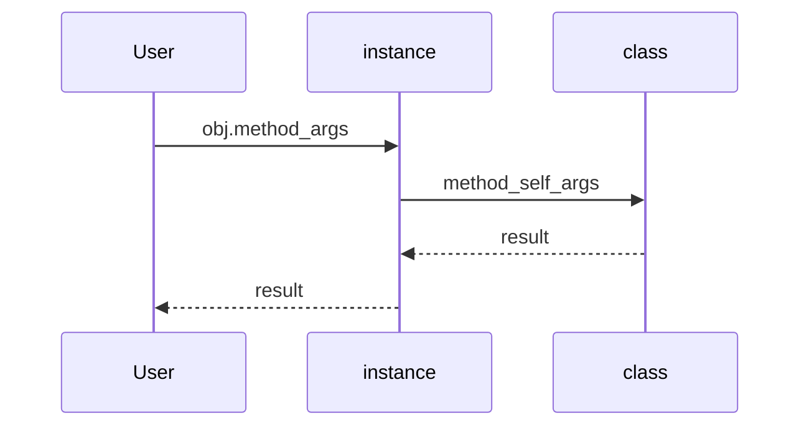

## Введение

Python — ООП-язык с множественным наследованием, но без Java-интерфейсов «как тип контракта». На junior ждут `self`, `__init__`, разницу class/instance attributes, `super`, `@property` / `@classmethod` / `@staticmethod`.

## Раздел: Класс, экземпляр, self

`class` создаёт тип; вызов класса — экземпляр. `self` — соглашенное имя первого аргумента метода: ссылка на экземпляр. `__init__` инициализирует уже созданный объект (не «конструктор» в узком C++ смысле; создание делает `__new__`).

Атрибуты класса общие для экземпляров; атрибуты экземпляра — в `obj.__dict__`. Ошибка в `__init__` прерывает инициализацию — объект может остаться в полусобранном состоянии, если вы его поймали снаружи неаккуратно.

Инкапсуляция мягкая: `_private` — соглашение, `__name` — name mangling. «Интерфейсы» — через протоколы/ABC (`abc.ABC`), duck typing, не через отдельный keyword.

## Раздел: Наследование и property

Наследование: `class Child(Parent)`. Вызов метода родителя — `super().method(...)`. `isinstance` / `issubclass` проверяют тип и иерархию. Множественное наследование есть (MRO — в PY12). Полиморфизм: один интерфейс метода — разное поведение в подклассах (переопределение).

`@property` — getter без скобок; `.setter` — мутатор. `@classmethod` получает `cls` (фабрики, альтернативные конструкторы). `@staticmethod` — функция в namespace класса без `self`/`cls`.

## Раздел: Частые вопросы с собеседования
**Вопрос.** Чем `@staticmethod` отличается от `@classmethod`?

**Ответ.** `classmethod` получает класс (`cls`) — фабрики и альтернативные конструкторы. `staticmethod` не получает ни `self`, ни `cls` — просто функция в namespace класса. Выбор: нужен ли доступ к классу или это чистая утилита.

**Вопрос.** Что такое MRO и когда его спросят?

**Ответ.** Method Resolution Order — порядок поиска методов при множественном наследовании (C3). `super()` идёт по MRO, не «только к первому родителю в скобках». Детали и diamond — в PY12.

**Вопрос.** `__init__` — это конструктор?

**Ответ.** Объект уже создан `__new__`; `__init__` инициализирует атрибуты. На собесе уточняют: ошибка в `__init__` не откатывает создание объекта, если ссылка уже утекла наружу.

**Вопрос.** Duck typing — как объяснить?

**Ответ.** Важны методы и поведение, а не явное наследование от интерфейса. `hasattr`/`protocol`/`ABC` дополняют, но идиома Python — «если ходит как утка».

## Лаба

**Цель.** Модель `Shape` → `Rectangle` / `Circle` с area property.

**Шаги.**
1. Базовый класс с методом `area` → `NotImplementedError` или ABC.
2. Подклассы считают площадь; `isinstance` проверки в тестах.
3. `@classmethod from_str` для Rectangle из строки `"3x4"`.
4. Property `width` с валидацией > 0.

Заготовка `Rectangle` + `from_str`:

```python
class Rectangle:
    def __init__(self, width: float, height: float) -> None:
        self.width = width
        self.height = height

    @property
    def width(self) -> float:
        return self._width

    @width.setter
    def width(self, value: float) -> None:
        if value <= 0:
            raise ValueError("width must be > 0")
        self._width = value

    @property
    def height(self) -> float:
        return self._height

    @height.setter
    def height(self, value: float) -> None:
        if value <= 0:
            raise ValueError("height must be > 0")
        self._height = value

    def area(self) -> float:
        return self.width * self.height

    @classmethod
    def from_str(cls, text: str) -> "Rectangle":
        w, h = text.lower().split("x", 1)
        return cls(float(w), float(h))

r = Rectangle.from_str("3x4")
print("area:", r.area(), "isinstance:", isinstance(r, Rectangle))
```

**В группу:** когда staticmethod лучше вынести в модульную функцию?

**Готово, если…**
- [ ] Объясняете self и __init__
- [ ] Используете super
- [ ] Пишете property с setter

## Схема: Вызов метода



## Тест

### Зачем self в методах?

**Ответ:** ссылка на конкретный экземпляр

**Пояснение:** без self метод не знает, чей state читать/менять.

### Чем classmethod отличается от staticmethod?

**Ответ:** classmethod получает cls; staticmethod — обычная функция в классе

**Пояснение:** classmethod удобен для фабрик; staticmethod не видит класс/экземпляр.

### Есть ли в Python интерфейсы как в Java?

**Ответ:** нет keyword interface; ABC и duck typing

**Пояснение:** контракт задаётся поведением/абстрактными классами.

### class attr vs instance attr?

**Ответ:** class — общий для типа; instance — в obj.__dict__

**Пояснение:** изменение class attr через экземпляр может создать shadow instance attr.

### @property без setter — что даёт?

**Ответ:** read-only доступ как к атрибуту

**Пояснение:** вычисление при чтении; запись без setter — AttributeError.

## Шпаргалка

<h3>Суть</h3>
<ul>
<li>class → type; instance → объект с self</li>
<li>__init__ инициализирует; super для родителя</li>
<li>property / classmethod / staticmethod</li>
</ul>
<h3>Код</h3>
<pre><code>class A:
    def __init__(self, x): self.x = x
    @property
    def x_doubled(self): return self.x * 2
class B(A):
    def __init__(self, x, y):
        super().__init__(x)
        self.y = y
</code></pre>

## Anki

### Front: Где хранятся обычные атрибуты экземпляра?

Back: в obj.__dict__ (если нет slots)

### Front: Как вызвать метод родителя из наследника?

Back: super().method(...)

### Front: Что делает @property?

Back: позволяет читать метод как атрибут; можно добавить setter

### Front: isinstance vs type(x) is T?

Back: isinstance учитывает наследование; type is — точное совпадение типа

### Front: Полиморфизм в Python одной фразой?

Back: один интерфейс вызова — разное поведение методов у подтипов

### Front: __init__ создаёт объект?

Back: нет — __new__ создаёт; __init__ инициализирует уже созданный экземпляр

## Итоги

- ООП-база закрывает большой кусок junior-вопросов
- Интерфейсы = ABC + утиная типизация
- Дальше — исключения (PY07)

## Ссылки

- [Classes](https://docs.python.org/3/tutorial/classes.html)
- [DEBAGanov — индекс вопросов серии](https://github.com/DEBAGanov/interview_questions/blob/main/400%20вопросов%20с%20ответами%2C%20которые%20должен%20знать%20Python-разработчик.md)
- Learn | /game/learn
- Далее: [Исключения](/game/learn/py-exceptions)
