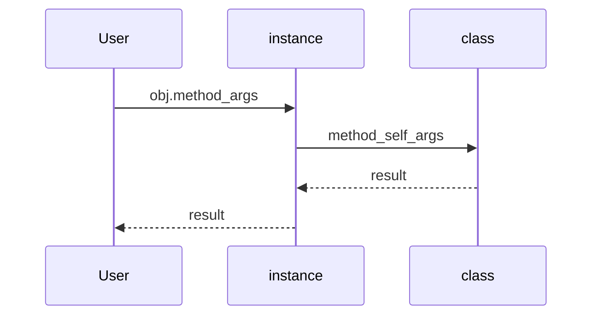
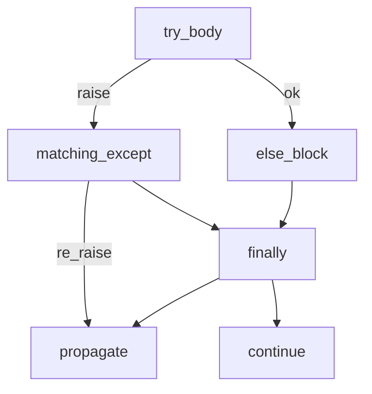
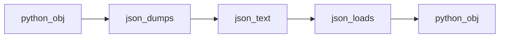

## Введение

Python — ООП-язык с множественным наследованием, но без Java-интерфейсов «как тип контракта». На junior ждут `self`, `__init__`, разницу class/instance attributes, `super`, `@property` / `@classmethod` / `@staticmethod`.

**Исключения.** Ошибки на собесе проверяют не только синтаксис `try`, но понимание `else`/`finally`, иерархии и того, что будет, если исключение не поймали. Собираем аккуратную модель обработки сбоев.

**Stdlib на собесе.** Закрываем junior-блок практичным stdlib: регулярные выражения, JSON, копирование объектов. Это частые «инструментальные» вопросы рядом с файлами из PY03.

## Раздел: Как отвечать одним блоком

Этот выпуск собрал соседние короткие темы трека: «ООП база», «Исключения», «Stdlib на собесе». Раньше каждая занимала отдельную карточку на несколько минут, а на собеседовании их спрашивают одним блоком. Ниже у каждой темы свой раздел, затем общие лабы, один тест и одна колода карточек. В ответе сначала назовите, какую тему спросили, потом определение и один пример. Не проговаривайте все разделы, если спросили один. Лабы можно пройти по порядку исходного трека. Если времени мало, сделайте первую и последнюю: первая ставит язык, последняя проверяет, что соседние темы вы не перепутали.

## Раздел: ООП база: Класс, экземпляр, self

`class` создаёт тип; вызов класса — экземпляр. `self` — соглашенное имя первого аргумента метода: ссылка на экземпляр. `__init__` инициализирует уже созданный объект (не «конструктор» в узком C++ смысле; создание делает `__new__`).

Атрибуты класса общие для экземпляров; атрибуты экземпляра — в `obj.__dict__`. Ошибка в `__init__` прерывает инициализацию — объект может остаться в полусобранном состоянии, если вы его поймали снаружи неаккуратно.

Инкапсуляция мягкая: `_private` — соглашение, `__name` — name mangling. «Интерфейсы» — через протоколы/ABC (`abc.ABC`), duck typing, не через отдельный keyword.

## Раздел: ООП база: Наследование и property

Наследование: `class Child(Parent)`. Вызов метода родителя — `super().method(...)`. `isinstance` / `issubclass` проверяют тип и иерархию. Множественное наследование есть (MRO — в PY12). Полиморфизм: один интерфейс метода — разное поведение в подклассах (переопределение).

`@property` — getter без скобок; `.setter` — мутатор. `@classmethod` получает `cls` (фабрики, альтернативные конструкторы). `@staticmethod` — функция в namespace класса без `self`/`cls`.

## Раздел: ООП база: Частые вопросы с собеседования

**Вопрос.** Чем `@staticmethod` отличается от `@classmethod`?

**Ответ.** `classmethod` получает класс (`cls`) — фабрики и альтернативные конструкторы. `staticmethod` не получает ни `self`, ни `cls` — просто функция в namespace класса. Выбор: нужен ли доступ к классу или это чистая утилита.

**Вопрос.** Что такое MRO и когда его спросят?

**Ответ.** Method Resolution Order — порядок поиска методов при множественном наследовании (C3). `super()` идёт по MRO, не «только к первому родителю в скобках». Детали и diamond — в PY12.

**Вопрос.** `__init__` — это конструктор?

**Ответ.** Объект уже создан `__new__`; `__init__` инициализирует атрибуты. На собесе уточняют: ошибка в `__init__` не откатывает создание объекта, если ссылка уже утекла наружу.

**Вопрос.** Duck typing — как объяснить?

**Ответ.** Важны методы и поведение, а не явное наследование от интерфейса. `hasattr`/`protocol`/`ABC` дополняют, но идиома Python — «если ходит как утка».

## Раздел: Исключения: try / except / else / finally

```python
try:
    risky()
except ValueError as exc:
    handle(exc)
else:
    # только если исключения не было
    after_success()
finally:
    # всегда: освободить ресурс / залогировать завершение
    cleanup()
```

`raise` пробрасывает или создаёт исключение. `raise ... from exc` сохраняет цепочку причин. Ловите **конкретные** типы, не голый `except:` (он перехватит и `KeyboardInterrupt` в плохих вариантах со `BaseException`).

`NotImplementedError` — маркер «метод должен реализовать подкласс», не путать с `NotImplemented` (для операторов).

## Раздел: Исключения: Иерархия и свои классы

База пользовательских ошибок — обычно `Exception` (не `BaseException`). Деление на ноль → `ZeroDivisionError` (под `ArithmeticError`). Runtime errors — ошибки во время исполнения vs SyntaxError на этапе разбора.

Свой тип:

```python
class DomainError(Exception):
    """Бизнес-ошибка домена."""
```

Если исключение не обработано, оно летит вверх по стеку и завершает поток/программу с traceback. `finally` выполняется даже при пробросе дальше — поэтому его любят для закрытия ресурсов (рядом с `with`).

## Раздел: Исключения: Частые вопросы с собеседования

**Вопрос.** Чем `with` лучше `try/finally` для файла?

**Ответ.** Оба могут закрыть ресурс, но `with` инкапсулирует протокол `__enter__`/`__exit__` и короче. Для нескольких ресурсов — `with open(...) as f, open(...) as g`. Обработку доменных ошибок всё равно проектируют через `except`.

**Вопрос.** Почему не ловить голый `except:`?

**Ответ.** Перехватывается слишком много, включая `KeyboardInterrupt` и `SystemExit` в плохих вариантах. Ловите конкретные типы или `Exception`, если осознанно; логируйте и пробрасывайте неожиданное.

**Вопрос.** Зачем `raise ... from exc`?

**Ответ.** Сохраняет цепочку причин в traceback (`__cause__`), полезно при обёртке низкоуровневой ошибки в доменную. Без `from` в Python 3 есть implicit context (`__context__`), но явное `from` яснее для читателя.

**Вопрос.** `else` в блоке `try` — когда выполняется?

**Ответ.** Только если в `try` не было исключения — удобно для кода, который должен идти после успешного risky, но не смешиваться с cleanup в `finally`.

## Раздел: Stdlib на собесе: re и json

Модуль `re`: `search` (первое вхождение), `match` (с начала строки / с `re.fullmatch`), `findall`, `sub` / `subn`, `split`. Паттерны компилируйте через `re.compile` при многократном использовании. Email-пример на собесе — иллюстрация, не production-валидация RFC.

`json.loads` / `dumps` — текст JSON ↔ структуры Python (`dict`/`list`/…). `load`/`dump` — из/в файл. Для сложных объектов Python (set, datetime) нужен custom encoder или другой формат.

Сериализация шире: `pickle` — Python-специфичный бинарный формат (**небезопасен** на недоверенных данных). JSON — межъязыковой текст для API.

## Раздел: Stdlib на собесе: copy и утилиты

`copy.copy` — поверхностная копия: вложенные объекты разделяются. `copy.deepcopy` — рекурсивная независимая копия. Для списка `l[:]` / `list(l)` — shallow.

Рядом по собесу: `random.shuffle` (in-place), `os.remove` для удаления файла, чтение случайной строки из файла (прочитать все / reservoir sampling для больших).

## Раздел: Stdlib на собесе: Частые вопросы с собеседования

**Вопрос.** Когда `deepcopy`, а когда достаточно `copy.copy`?

**Ответ.** Shallow копирует только верхний уровень; вложенные list/dict общие. Deepcopy рекурсивно дублирует граф объектов — нужен перед мутацией вложенности, если оригинал должен остаться нетронутым.

**Вопрос.** Почему `pickle` опасен на недоверенных данных?

**Ответ.** Unpickle может выполнить произвольный код через классы с `__reduce__`. Для API и файлов от пользователя — JSON или явные схемы; pickle только между доверенными процессами одной версии Python.

**Вопрос.** `json.dumps` не сериализует `set` — что сказать?

**Ответ.** JSON поддерживает ограниченный набор типов; set/datetime/custom классы требуют `default=` в encoder или промежуточного dict/list. Это осознанное ограничение обмена, не баг json-модуля.

**Вопрос.** `re.match` vs `re.search` на собесе?

**Ответ.** `match` проверяет с начала строки (или используйте `fullmatch` для всей строки); `search` ищет первое вхождение где угодно. Для валидации «вся строка — email» нужен `fullmatch`, не `search`.

## Лаба

**ООП база.**

**Цель.** Модель `Shape` → `Rectangle` / `Circle` с area property.

**Шаги.**
1. Базовый класс с методом `area` → `NotImplementedError` или ABC.
2. Подклассы считают площадь; `isinstance` проверки в тестах.
3. `@classmethod from_str` для Rectangle из строки `"3x4"`.
4. Property `width` с валидацией > 0.

Заготовка `Rectangle` + `from_str`:

```python
class Rectangle:
    def __init__(self, width: float, height: float) -> None:
        self.width = width
        self.height = height

    @property
    def width(self) -> float:
        return self._width

    @width.setter
    def width(self, value: float) -> None:
        if value <= 0:
            raise ValueError("width must be > 0")
        self._width = value

    @property
    def height(self) -> float:
        return self._height

    @height.setter
    def height(self, value: float) -> None:
        if value <= 0:
            raise ValueError("height must be > 0")
        self._height = value

    def area(self) -> float:
        return self.width * self.height

    @classmethod
    def from_str(cls, text: str) -> "Rectangle":
        w, h = text.lower().split("x", 1)
        return cls(float(w), float(h))

r = Rectangle.from_str("3x4")
print("area:", r.area(), "isinstance:", isinstance(r, Rectangle))
```

**В группу:** когда staticmethod лучше вынести в модульную функцию?

**Готово, если…**
- [ ] Объясняете self и __init__
- [ ] Используете super
- [ ] Пишете property с setter

**Исключения.**

**Цель.** Парсер числа с доменными ошибками и корректным finally.

**Шаги.**
1. `parse_positive(text)` → int > 0 или `ValueError` / свой `ParseError`.
2. Оберните вызов: except → сообщение, else → print ok, finally → print done.
3. Покажите разницу: поймали ошибку vs не поймали (traceback).
4. Добавьте `raise ParseError(...) from exc` при обёртке низкоуровневой ошибки.

Заготовка try / else / finally:

```python
class ParseError(ValueError):
    pass

def parse_positive(text: str) -> int:
    try:
        value = int(text)
    except ValueError as exc:
        raise ParseError(f"not an int: {text!r}") from exc
    if value <= 0:
        raise ParseError(f"need > 0, got {value}")
    return value

for sample in ("12", "0", "x"):
    try:
        n = parse_positive(sample)
    except ParseError as exc:
        print(f"{sample!r}: caught", exc)
    else:
        print(f"{sample!r}: ok", n)
    finally:
        print(f"{sample!r}: done")
```

**В группу:** когда лучше вернуть `None`/Result, а когда raise?

**Готово, если…**
- [ ] Объясняете else и finally
- [ ] Ловите конкретные типы
- [ ] Пишете свой Exception-класс

**Stdlib на собесе.**

**Цель.** Мини-пайплайн: JSON-файл → фильтр regex → deep copy для мутаций.

**Шаги.**
1. Файл `users.json` со списком объектов `{name, email}`.
2. Отфильтруйте email простым regex; невалидные сложите отдельно.
3. Сделайте shallow и deep copy одного пользователя с вложенным `meta={}`; измените `meta` и сравните оригинал.
4. `json.dump` результата с `ensure_ascii=False`, indent=2.

Заготовка regex + deepcopy (файл на диске — отдельно на ПК):

```python
import copy
import json
import re

EMAIL = re.compile(r"[A-Za-z0-9._+]+@[A-Za-z0-9.-]+\.[A-Za-z]{2,}")
raw = [
    {"name": "Ada", "email": "ada@example.com", "meta": {"role": "dev"}},
    {"name": "Bad", "email": "not-an-email", "meta": {"role": "x"}},
]
valid = [u for u in raw if EMAIL.fullmatch(u["email"])]
invalid = [u for u in raw if not EMAIL.fullmatch(u["email"])]
print("valid:", [u["email"] for u in valid])
print("invalid:", [u["email"] for u in invalid])

user = valid[0]
shallow = copy.copy(user)
deep = copy.deepcopy(user)
shallow["meta"]["role"] = "shallow"
print("after shallow edit original:", user["meta"]["role"])
deep["meta"]["role"] = "deep"
print("original after deep edit:", user["meta"]["role"], "deep:", deep["meta"]["role"])
print(json.dumps(valid, ensure_ascii=False, indent=2))
```

**В группу:** когда pickle уместен, а когда опасен?

**Готово, если…**
- [ ] Отличаете search/match/fullmatch
- [ ] Грузите/пишите JSON
- [ ] Объясняете shallow vs deep copy

## Схема: ООП база: Вызов метода



## Схема: Исключения: Поток исключения



## Схема: Stdlib на собесе: JSON round-trip



## Тест

### Зачем self в методах?

**Ответ:** ссылка на конкретный экземпляр

**Пояснение:** без self метод не знает, чей state читать/менять.

### Когда выполняется else в try?

**Ответ:** если в try не было исключения

**Пояснение:** else не связан с except как «иначе ошибка»; это «успешный try».

### Чем search отличается от match?

**Ответ:** search ищет везде; match — с начала строки

**Пояснение:** для «целой строки» надёжнее fullmatch.

### Чем classmethod отличается от staticmethod?

**Ответ:** classmethod получает cls; staticmethod — обычная функция в классе

**Пояснение:** classmethod удобен для фабрик; staticmethod не видит класс/экземпляр.

### Зачем finally?

**Ответ:** код очистки, который выполнится всегда

**Пояснение:** и при успехе, и при ошибке, и при return из try.

## Шпаргалка

<ul><li>class → type; instance → объект с self</li><li>__init__ инициализирует; super для родителя</li><li>property / classmethod / staticmethod</li><li>try/except/else/finally + raise</li><li>ловить конкретно; свои ошибки от Exception</li><li>finally ≈ гарантия cleanup (with ещё лучше для ресурсов)</li><li>re: search/match/sub/split/compile</li><li>json: loads/dumps, load/dump</li><li>copy vs deepcopy; pickle ≠ json</li></ul>

## Anki

### Front: Где хранятся обычные атрибуты экземпляра?

Back: в obj.__dict__ (если нет slots)

### Front: BaseException vs Exception?

Back: BaseException включает SystemExit/KeyboardInterrupt; прикладной код обычно ловит Exception

### Front: json.dumps что возвращает?

Back: строку JSON

### Front: Как вызвать метод родителя из наследника?

Back: super().method(...)

### Front: NotImplementedError — когда?

Back: абстрактный/нереализованный метод в базовом классе

### Front: shallow copy списка с вложенным dict — что общее?

Back: вложенный dict — тот же объект в оригинале и копии

## Мнемоника

### acronym: Класс на собесе

**Задание:** Четыре слова про класс, без которых ответ про ООП пустой.

**Элементы:**
- Класс
- Экземпляр
- self
- Наследование

**Подсказка:** КЭСН.

**Ответ:** класс, экземпляр, self, наследование

## Итоги

- ООП-база закрывает большой кусок junior-вопросов
- Интерфейсы = ABC + утиная типизация
- Дальше — исключения (PY07)
- Корректная обработка ошибок — признак зрелого junior
- else/finally часто путают — закрепите схемой
- Дальше — stdlib re/json/copy (PY08)
- Stdlib-инструменты закрывают «бытовые» вопросы junior
- JSON для API; pickle только для доверенных данных

## Ссылки

- [Classes](https://docs.python.org/3/tutorial/classes.html)
- [DEBAGanov — индекс вопросов серии](https://github.com/DEBAGanov/interview_questions/blob/main/400%20вопросов%20с%20ответами%2C%20которые%20должен%20знать%20Python-разработчик.md)
- [Learn](/game/learn)
- [Errors and Exceptions](https://docs.python.org/3/tutorial/errors.html)
- [re](https://docs.python.org/3/library/re.html)
- [json](https://docs.python.org/3/library/json.html)
- [copy](https://docs.python.org/3/library/copy.html)
- [Итераторы](/game/learn/py-iterators-generators)
