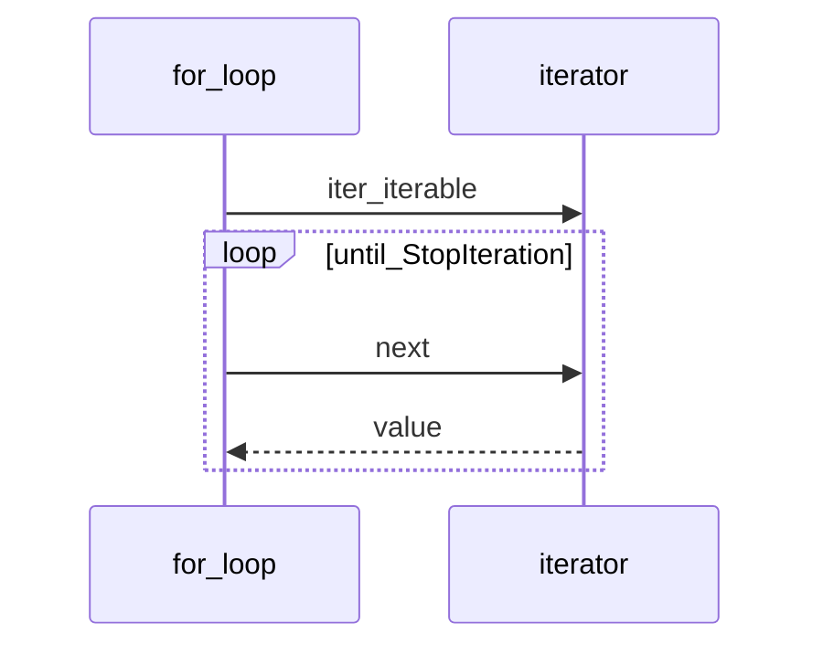
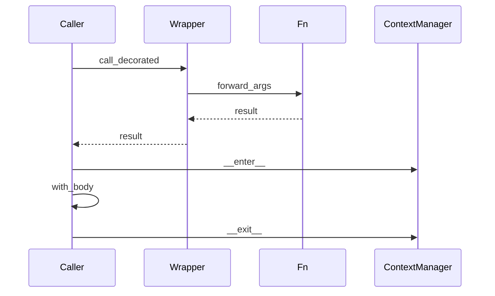
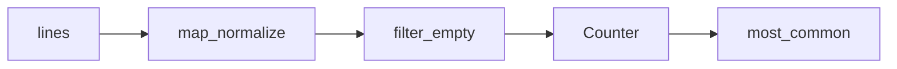

## Введение

Итераторы и генераторы — обязательный middle-блок: протокол `__iter__`/`__next__`, `yield`, отличие generator expression от list comprehension, почему генератор «одноразовый».

**Декораторы.** На middle ждут умение не только вызвать `@something`, но и объяснить механизм: замыкание, обёртка, `functools.wraps`, зачем `with`. Этот выпуск — про декораторы и контекстные менеджеры как инструменты API-слоя (логирование, retry, транзакции, таймеры).

**FP и itertools.** Middle-собес любит `map`/`filter`/`reduce`, `collections.Counter` и пару приёмов `itertools`. Цель — показать, когда FP-стиль читаемее цикла и какие готовые структуры брать вместо самописных.

## Раздел: Как отвечать одним блоком

Этот выпуск собрал соседние короткие темы трека: «Итераторы», «Декораторы», «FP и itertools». Раньше каждая занимала отдельную карточку на несколько минут, а на собеседовании их спрашивают одним блоком. Ниже у каждой темы свой раздел, затем общие лабы, один тест и одна колода карточек. В ответе сначала назовите, какую тему спросили, потом определение и один пример. Не проговаривайте все разделы, если спросили один. Лабы можно пройти по порядку исходного трека. Если времени мало, сделайте первую и последнюю: первая ставит язык, последняя проверяет, что соседние темы вы не перепутали.

## Раздел: Итераторы: Протокол итератора

Итерируемое (`iterable`) даёт итератор через `iter(obj)` → вызывает `__iter__`. Итератор реализует `__next__` (и обычно `__iter__` возвращает self). `for` — сахар над этим протоколом до `StopIteration`.

Свой итератор — класс с состоянием. Генератор — функция с `yield`: при вызове возвращает generator object (итератор), при каждом `next` выполняется до следующего `yield`.

Генератор *является* итератором; обратное неверно: не каждый итератор — генератор. «Перевернуть генератор» напрямую нельзя — он однопроходный; соберите в list или пишите алгоритм иначе.

## Раздел: Итераторы: Comprehensions и выражения

List comprehension строит список сразу. Generator expression `(x for x in xs)` — лениво. Dict/set comprehensions — по аналогии. Используйте comprehension для простых преобразований; сложная логика с side effects лучше в явном цикле/генератор-функции.

`yield` приостанавливает функцию и отдаёт значение; можно `yield from` делегировать другому итерируемому. После исчерпания повторный обход пуст.

## Раздел: Итераторы: Частые вопросы с собеседования

**Вопрос.** Генератор или list comprehension — как выбрать?

**Ответ.** List строит весь результат в памяти; generator expression `(x for x in xs)` — лениво, одноразово. Для больших потоков, пайплайнов и когда не нужен random access — генератор; для многократного обхода — list или новый генератор.

**Вопрос.** Почему второй `for` по генератору пустой?

**Ответ.** Генератор однопроходный: после исчерпания `StopIteration`. Нужен новый вызов функции-генератора или материализация в list, если обход повторяется.

**Вопрос.** Чем итератор отличается от iterable?

**Ответ.** Iterable реализует `__iter__` и может выдать итератор; итератор дополнительно реализует `__next__` и исчерпывается. List — iterable; объект `iter(list)` — итератор.

**Вопрос.** Зачем `yield from`?

**Ответ.** Делегирует генерацию другому iterable/генератору, прозрачно пробрасывая send/throw. Упрощает рекурсивные обходы деревьев и композицию генераторов без ручного цикла.

## Раздел: Декораторы: Замыкания и декораторы

Замыкание — функция, которая помнит переменные из enclosing scope после выхода из внешней функции. На этом держатся декораторы с параметрами и счётчики без глобалов (`nonlocal`).

Декоратор — функция (или callable), которая принимает функцию и возвращает другую (обычно обёртку) с доп. поведением:

```python
from functools import wraps

def trace(fn):
    @wraps(fn)
    def wrapper(*args, **kwargs):
        print("call", fn.__name__)
        return fn(*args, **kwargs)
    return wrapper

@trace
def add(a, b):
    return a + b
```

`@trace` над `add` эквивалентно `add = trace(add)`. `wraps` копирует `__name__`/`__doc__`, иначе отладка и OpenAPI ломаются.

Типичный учебный кейс: retry N раз при исключении — декоратор с аргументами (фабрика декораторов).

## Раздел: Декораторы: with и контекстные менеджеры

`with obj:` вызывает `obj.__enter__()` на входе и `obj.__exit__(exc_type, exc, tb)` на выходе — даже при исключении. Это безопасное освобождение ресурса (файл, lock, сессия БД).

Протокол можно собрать классом или через `contextlib.contextmanager` (генератор с `yield` посередине). `with` не заменяет все try/except: он про lifespan ресурса; обработку ошибок всё равно проектируете явно.

Связь с декораторами: оба — про «обернуть поведение»; декоратор — вокруг вызова функции, context manager — вокруг блока кода.

## Раздел: Декораторы: Частые вопросы с собеседования

**Вопрос.** Зачем `functools.wraps` в декораторе?

**Ответ.** Копирует `__name__`, `__doc__`, `__module__` обёрнутой функции на wrapper. Без wraps отладка, логи и OpenAPI видят `wrapper` вместо реального имени — путаница в проде.

**Вопрос.** Декоратор с аргументами — как устроен?

**Ответ.** Внешняя функция принимает параметры декоратора и возвращает настоящий декоратор, который принимает функцию. Три уровня вложенности: `@retry(times=3)` → factory → decorator → wrapper.

**Вопрос.** `contextlib.contextmanager` vs класс с `__enter__`?

**Ответ.** Generator-based manager пишет `try/finally` вокруг `yield` — меньше бойлерплейта для простых ресурсов. Класс уместен, когда нужен сложный `__exit__` с подавлением исключений или переиспользуемое состояние.

**Вопрос.** Можно ли `@staticmethod` «задекорировать»?

**Ответ.** Да, декораторы применяются к объекту функции до binding в descriptor protocol. Порядок: сначала `staticmethod`, потом пользовательский декоратор — или наоборот, в зависимости от желаемого API; на собесе достаточно знать, что декоратор — синтаксический сахар вызова.

## Раздел: FP и itertools: map, filter, reduce и HOF

Функции высшего порядка принимают/возвращают функции. `map(fn, xs)` применяет fn; `filter(pred, xs)` отбирает; `functools.reduce(fn, xs[, init])` сворачивает. В Python 3 map/filter ленивы (итераторы). Часто comprehension читаемее map+lambda.

`zip` склеивает потоки. Lambda уместна для короткого ключа; длинную логику выносите в `def`. FP хорошо стыкуется с неизменяемыми преобразованиями данных; для сложного state лучше явный цикл или ООП.

## Раздел: FP и itertools: collections и itertools

Из `collections` на собесе чаще всего: `Counter`, `defaultdict`, `deque`, `namedtuple`/`deque`. `Counter` — частоты; удобные `most_common`.

`itertools`: `chain`, `islice`, `groupby`, `product`, `combinations`, `count`/`cycle`/`repeat` — строительные блоки ленивых пайплайнов без лишней памяти.

## Раздел: FP и itertools: Частые вопросы с собеседования

**Вопрос.** `map`/`filter` или comprehension — что предпочесть?

**Ответ.** Comprehension обычно читаемее для простых преобразований и фильтров. `map`/`filter` уместны, когда функция уже именована или нужна ленивая цепочка без промежуточного list. `reduce` — для свёрток, но часто явный цикл яснее.

**Вопрос.** Зачем `Counter` на собесе?

**Ответ.** Подсчёт частот элементов за один проход, `most_common(n)` для топ-N. Альтернатива — dict с ручным инкрементом; Counter документирует намерение и даёт удобные операции (сложение счётчиков).

**Вопрос.** Чем `deque` лучше list для очереди?

**Ответ.** `append`/`popleft` у deque O(1); у list `pop(0)` O(n). Для FIFO, BFS и скользящих окон — deque; для индексирования и срезов — list.

**Вопрос.** `itertools.groupby` — частая ошибка?

**Ответ.** Требует предварительной сортировки по тому же ключу, иначе группы разорваны. На собесе говорят: «сначала sort, потом groupby» — не путать с SQL GROUP BY, который агрегирует.

## Лаба

**Итераторы.**

**Цель.** Свой range-подобный итератор и генератор батчей.

**Шаги.**
1. Класс `CountDown(n)` с `__iter__`/`__next__`.
2. Генератор `batches(iterable, size)` через yield списков.
3. Сравните память: list comprehension vs generator expression на большом range ( qualitatively).
4. Покажите исчерпание: два `for` по одному generator.

**В группу:** где в API-слое уместны генераторы (стриминг ответов, чтение файлов)?

**Готово, если…**
- [ ] Рисуете iterable vs iterator
- [ ] Пишете функцию с yield
- [ ] Не ожидаете повторного обхода генератора

**Декораторы.**

**Цель.** Написать декоратор retry и простой context manager таймера.

**Шаги.**
1. Реализуйте `@retry(times=3)`: при исключении повторяет вызов, иначе пробрасывает последнюю ошибку.
2. Добавьте `@wraps`.
3. Напишите `class Timer` с `__enter__`/`__exit__`, печатающий elapsed seconds.
4. Альтернатива: тот же Timer через `@contextmanager`.

**В группу:** разберите, что будет, если забыть `return wrapper` в декораторе.

**Готово, если…**
- [ ] Объясняете `@f` как `f = deco(f)`
- [ ] Знаете зачем `wraps`
- [ ] Можете нарисовать enter/exit на схеме

**FP и itertools.**

**Цель.** Пайплайн частот слов без лишних списков.

**Шаги.**
1. Прочитайте текст; нормализуйте слова генератором.
2. Посчитайте через `Counter`; top-5 `most_common`.
3. То же через `reduce` (учебно) и через один comprehension — сравните читаемость.
4. С помощью `itertools.islice` возьмите первые 10 уникальных слов из потока.

**В группу:** где map+lambda проиграет list comprehension в code review?

**Готово, если…**
- [ ] Пишете map/filter/reduce без шпаргалки
- [ ] Используете Counter
- [ ] Называете 3 инструмента itertools

## Схема: Итераторы: for под капотом



## Схема: Декораторы: with и декоратор



## Схема: FP и itertools: Ленивый пайплайн



## Тест

### Чем генератор отличается от итератора?

**Ответ:** генератор — итератор через yield

**Пояснение:** генератор всегда итератор; итератор может быть классом.

### Что делает @decorator над функцией?

**Ответ:** fn = decorator(fn)

**Пояснение:** сахар сразу после определения функции.

### map в Python 3 возвращает?

**Ответ:** итератор (лениво)

**Пояснение:** list(map(...)) или comprehension для материализации.

### Что делает yield?

**Ответ:** отдаёт значение и замораживает функцию

**Пояснение:** при следующем next выполнение продолжается после yield.

### Зачем functools.wraps?

**Ответ:** сохранить __name__ и __doc__

**Пояснение:** без wraps wrapper маскирует метаданные — ломает docs/отладку.

## Шпаргалка

<ul><li>iterable → iter → iterator → next</li><li>yield создаёт generator-iterator</li><li>[] eager; () lazy generator expression</li><li>Декоратор = callable вокруг функции</li><li>Замыкание держит состояние без global</li><li>with = __enter__ / __exit__ (или contextmanager)</li><li>HOF: map/filter/reduce/zip</li><li>collections: Counter, defaultdict, deque</li><li>itertools для ленивых комбинаций</li></ul>

## Anki

### Front: Кто бросает StopIteration?

Back: итератор при исчерпании (for перехватывает)

### Front: Эквивалент @deco над def f?

Back: f = deco(f)

### Front: Чем filter отличается от map?

Back: filter отбирает элементы по предикату; map преобразует каждый

### Front: __iter__ у типичного итератора возвращает?

Back: self

### Front: Что такое замыкание?

Back: внутренняя функция + сохранённые переменные внешней области

### Front: defaultdict(list) удобен когда?

Back: нужно append в словарь без проверки ключа

## Итоги

- Протокол итерации — основа for, comprehensions, распаковки
- Генераторы экономят память на потоках данных
- Далее: декораторы и with (PY10)
- Декораторы и with — разные оси «обёртки», обе часты на middle
- wraps и корректный return wrapper — маркеры зрелости ответа
- Retry/timer — хорошие лайв-кодинг мини-задачи
- FP-инструменты — про композицию преобразований данных
- collections/itertools экономят самописный код

## Ссылки

- [Iterators](https://docs.python.org/3/tutorial/classes.html#iterators)
- [Generators](https://docs.python.org/3/tutorial/classes.html#generators)
- [DEBAGanov — индекс вопросов серии](https://github.com/DEBAGanov/interview_questions/blob/main/400%20вопросов%20с%20ответами%2C%20которые%20должен%20знать%20Python-разработчик.md)
- [Learn](/game/learn)
- [functools.wraps](https://docs.python.org/3/library/functools.html#functools.wraps)
- [contextlib](https://docs.python.org/3/library/contextlib.html)
- [functools.reduce](https://docs.python.org/3/library/functools.html#functools.reduce)
- [collections](https://docs.python.org/3/library/collections.html)
- [itertools](https://docs.python.org/3/library/itertools.html)
- [MRO и dunder](/game/learn/py-oop-advanced-mro)
