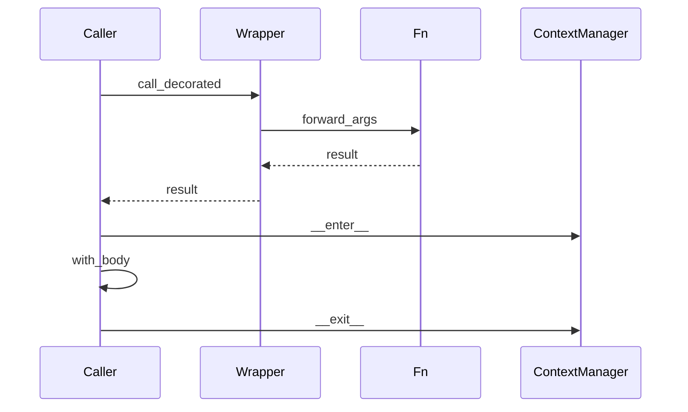

## Введение

На middle ждут умение не только вызвать `@something`, но и объяснить механизм: замыкание, обёртка, `functools.wraps`, зачем `with`. Этот выпуск — про декораторы и контекстные менеджеры как инструменты API-слоя (логирование, retry, транзакции, таймеры).

## Раздел: Замыкания и декораторы

Замыкание — функция, которая помнит переменные из enclosing scope после выхода из внешней функции. На этом держатся декораторы с параметрами и счётчики без глобалов (`nonlocal`).

Декоратор — функция (или callable), которая принимает функцию и возвращает другую (обычно обёртку) с доп. поведением:

```python
from functools import wraps

def trace(fn):
    @wraps(fn)
    def wrapper(*args, **kwargs):
        print("call", fn.__name__)
        return fn(*args, **kwargs)
    return wrapper

@trace
def add(a, b):
    return a + b
```

`@trace` над `add` эквивалентно `add = trace(add)`. `wraps` копирует `__name__`/`__doc__`, иначе отладка и OpenAPI ломаются.

Типичный учебный кейс: retry N раз при исключении — декоратор с аргументами (фабрика декораторов).

## Раздел: with и контекстные менеджеры

`with obj:` вызывает `obj.__enter__()` на входе и `obj.__exit__(exc_type, exc, tb)` на выходе — даже при исключении. Это безопасное освобождение ресурса (файл, lock, сессия БД).

Протокол можно собрать классом или через `contextlib.contextmanager` (генератор с `yield` посередине). `with` не заменяет все try/except: он про lifespan ресурса; обработку ошибок всё равно проектируете явно.

Связь с декораторами: оба — про «обернуть поведение»; декоратор — вокруг вызова функции, context manager — вокруг блока кода.

## Раздел: Частые вопросы с собеседования
**Вопрос.** Зачем `functools.wraps` в декораторе?

**Ответ.** Копирует `__name__`, `__doc__`, `__module__` обёрнутой функции на wrapper. Без wraps отладка, логи и OpenAPI видят `wrapper` вместо реального имени — путаница в проде.

**Вопрос.** Декоратор с аргументами — как устроен?

**Ответ.** Внешняя функция принимает параметры декоратора и возвращает настоящий декоратор, который принимает функцию. Три уровня вложенности: `@retry(times=3)` → factory → decorator → wrapper.

**Вопрос.** `contextlib.contextmanager` vs класс с `__enter__`?

**Ответ.** Generator-based manager пишет `try/finally` вокруг `yield` — меньше бойлерплейта для простых ресурсов. Класс уместен, когда нужен сложный `__exit__` с подавлением исключений или переиспользуемое состояние.

**Вопрос.** Можно ли `@staticmethod` «задекорировать»?

**Ответ.** Да, декораторы применяются к объекту функции до binding в descriptor protocol. Порядок: сначала `staticmethod`, потом пользовательский декоратор — или наоборот, в зависимости от желаемого API; на собесе достаточно знать, что декоратор — синтаксический сахар вызова.

## Лаба

**Цель.** Написать декоратор retry и простой context manager таймера.

**Шаги.**
1. Реализуйте `@retry(times=3)`: при исключении повторяет вызов, иначе пробрасывает последнюю ошибку.
2. Добавьте `@wraps`.
3. Напишите `class Timer` с `__enter__`/`__exit__`, печатающий elapsed seconds.
4. Альтернатива: тот же Timer через `@contextmanager`.

**В группу:** разберите, что будет, если забыть `return wrapper` в декораторе.

**Готово, если…**
- [ ] Объясняете `@f` как `f = deco(f)`
- [ ] Знаете зачем `wraps`
- [ ] Можете нарисовать enter/exit на схеме

## Схема: with и декоратор



## Тест

### Что делает @decorator над функцией?

**Ответ:** fn = decorator(fn)

**Пояснение:** сахар сразу после определения функции.

### Зачем functools.wraps?

**Ответ:** сохранить __name__ и __doc__

**Пояснение:** без wraps wrapper маскирует метаданные — ломает docs/отладку.

### Чем полезен with для файлов?

**Ответ:** гарантированно закрывает ресурс

**Пояснение:** __exit__ при успехе и при исключении.

### nonlocal vs global?

**Ответ:** nonlocal — внешняя enclosing; global — модуль

**Пояснение:** nonlocal для замыканий без мутации global.

### contextlib.contextmanager vs class with __enter__?

**Ответ:** генераторный декоратор — меньше бойлерплейта

**Пояснение:** yield разделяет setup/teardown; класс — явный протокол.

## Шпаргалка

<h3>Суть</h3>
<ul>
<li>Декоратор = callable вокруг функции</li>
<li>Замыкание держит состояние без global</li>
<li>with = __enter__ / __exit__ (или contextmanager)</li>
</ul>
<h3>Каркас</h3>
<pre><code>def deco(fn):
    @wraps(fn)
    def wrapper(*a, **k):
        return fn(*a, **k)
    return wrapper

with open(path) as f:
    data = f.read()
</code></pre>

## Anki

### Front: Эквивалент @deco над def f?

Back: f = deco(f)

### Front: Что такое замыкание?

Back: внутренняя функция + сохранённые переменные внешней области

### Front: Методы протокола контекстного менеджера?

Back: __enter__ и __exit__

### Front: Декоратор с аргументами — паттерн?

Back: def deco(arg): def inner(fn): ... return inner return inner

### Front: __exit__ получает exc_info когда?

Back: при исключении в блоке with; иначе None

### Front: Зачем декоратор retry на собесе?

Back: cross-cutting повтор при transient ошибках без дублирования в каждой функции

## Итоги

- Декораторы и with — разные оси «обёртки», обе часты на middle
- wraps и корректный return wrapper — маркеры зрелости ответа
- Retry/timer — хорошие лайв-кодинг мини-задачи

## Ссылки

- [functools.wraps](https://docs.python.org/3/library/functools.html#functools.wraps)
- [contextlib](https://docs.python.org/3/library/contextlib.html)
- [DEBAGanov — индекс вопросов серии](https://github.com/DEBAGanov/interview_questions/blob/main/400%20вопросов%20с%20ответами%2C%20которые%20должен%20знать%20Python-разработчик.md)
- Learn | /game/learn
- Далее по треку: [FP / collections](/game/learn/py-fp-collections-itertools)
