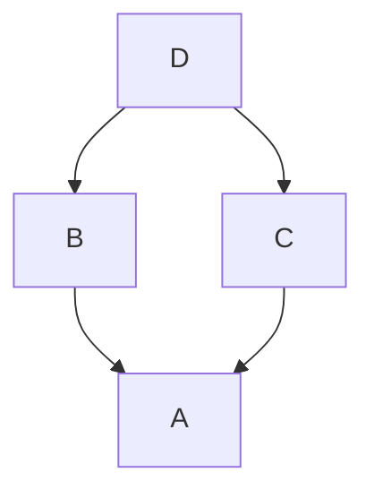

## Введение

После базового ООП middle спрашивают MRO, dunder-методы, `__slots__` и пространства имён. Нужна точная картина lookup и когда multiple inheritance оправдан.

**PEP 8 и typing.** Middle ожидают не только «работающий скрипт», но стиль (PEP 8), docstring и type hints. Статический анализ (ruff/flake8/mypy) — норма команды; на собесе важно объяснить зачем.

**Asyncio.** В источнике вопросов async затронут коротко — на реальном middle/senior собесе это центр бэкенд-разговора. Разберём sync vs async, event loop и типичные ошибки (блокировка в coroutine).

## Раздел: Как отвечать одним блоком

Этот выпуск собрал соседние короткие темы трека: «MRO и dunder», «PEP 8 и typing», «Asyncio». Раньше каждая занимала отдельную карточку на несколько минут, а на собеседовании их спрашивают одним блоком. Ниже у каждой темы свой раздел, затем общие лабы, один тест и одна колода карточек. В ответе сначала назовите, какую тему спросили, потом определение и один пример. Не проговаривайте все разделы, если спросили один. Лабы можно пройти по порядку исходного трека. Если времени мало, сделайте первую и последнюю: первая ставит язык, последняя проверяет, что соседние темы вы не перепутали.

## Раздел: MRO и dunder: MRO и namespaces

При множественном наследовании Python строит **MRO** (Method Resolution Order, C3 linearization): `Class.__mro__` / `Class.mro()`. `super()` идёт по MRO, не «только родитель в скобках».

Пространства имён: builtins → module global → enclosing (nonlocal) → local (LEGB при чтении имён). `globals()`/`locals()` показывают словари контекста. Атрибуты экземпляра обычно в `__dict__`.

Соглашения: `_single` — internal; `__double` без хвоста — name mangling в классе; `__dunder__` — протоколы языка.

## Раздел: MRO и dunder: Dunder и slots

Магические методы задают поведение: `__str__`/`__repr__`, `__eq__`, `__len__`, арифметика, контекст, итерация. Не вызывайте их руками без нужды — используйте `str(x)`, `len(x)`.

`__slots__` фиксирует набор атрибутов, убирает per-instance `__dict__` (экономия памяти, запрет случайных полей). Ограничения: наследование slots нужно проектировать аккуратно.

Old-style classes — история Python 2; в Python 3 все classes new-style (наследники object).

## Раздел: MRO и dunder: Частые вопросы с собеседования

**Вопрос.** Зачем diamond inheritance и как Python его разрешает?

**Ответ.** Ромб: общий предок через две ветки. C3 linearization строит MRO без конфликтов: каждый класс появляется один раз, порядок сохраняет локальный порядок баз. `D.__mro__` показывает цепочку для `super()`.

**Вопрос.** Куда смотрит `super()` в множественном наследовании?

**Ответ.** На следующий класс в MRO текущего типа, не обязательно на «родителя в скобках». Кооперативные миксины строят цепочку вызовов через `super()`, а не прямой `Parent.method(self)`.

**Вопрос.** Зачем `__slots__`?

**Ответ.** Ограничивает набор атрибутов экземпляра, убирает per-instance `__dict__` — экономия памяти на миллионах однотипных объектов. Минус: нельзя добавить произвольный атрибут, наследование требует аккуратности.

**Вопрос.** `__dict__` класса vs экземпляра?

**Ответ.** У класса — атрибуты, общие для типа (методы, дескрипторы). У экземпляра — собственные данные; lookup идёт по правилам дескрипторов и MRO, не только в instance dict.

## Раздел: PEP 8 и typing: PEP 8 и docstring

PEP 8 — соглашения: отступы 4 пробела, длина строк, `snake_case` функций/переменных, `CapWords` классов, импорты группами, пробелы вокруг операторов. Это не компилятор, а читаемость; линтер автоматизирует споры.

Docstring — строка документации сразу под `def`/`class`/`module`; доступна как `__doc__`, через `help()`. Хороший docstring: что делает, аргументы, возврат, исключения. `dir(obj)` — список атрибутов; не замена документации.

Проверка синтаксиса без запуска: `python -m py_compile file.py`.

## Раздел: PEP 8 и typing: Typing и линтеры

Аннотации: `def f(x: int) -> str: ...`. Модуль `typing` / встроенные generics (3.9+): `list[int]`, `dict[str, Any]`. Проверка не в runtime CPython по умолчанию — её делают **mypy**/pyright. Для middle это must-have в ответе, даже если в «400 вопросах» typing мало.

Линтеры/форматтеры: ruff, flake8, pylint, black/ruff format. Статический анализ ловит неиспользуемое, тени имён, грубые баги до прода.

## Раздел: PEP 8 и typing: Частые вопросы с собеседования

**Вопрос.** Зачем typing, если Python динамический?

**Ответ.** Аннотации документируют контракт и дают mypy/pyright ловить ошибки до runtime. Они не меняют исполнение CPython по умолчанию — проверка отдельным инструментом в CI.

**Вопрос.** `list[int]` vs `List[int]` из typing?

**Ответ.** В 3.9+ встроенные generics (`list`, `dict`) предпочтительны; `List` из typing — legacy для старых версий. На новых проектах пишут `list[str] | None` вместо `Optional[List[str]]` где стиль команды позволяет.

**Вопрос.** Что такое `Any` и когда его избегать?

**Ответ.** «Любой тип» — отключает проверку для этого места. Уместен на границах (JSON, plugin API); в доменной логике лучше конкретные типы или `Protocol` для структурной типизации.

**Вопрос.** PEP 8 — это требование интерпретатора?

**Ответ.** Нет, это руководство по стилю; соблюдение проверяют ruff/flake8/black в CI. На собесе показывает культуру команды и читаемость diff'ов.

## Раздел: Asyncio: Синхронный и асинхронный код

Синхронный код выполняется последовательно: пока `time.sleep` или сетевой вызов блокирует поток, он ничего полезного параллельно в этом потоке не делает.

Асинхронный стиль (`async def` / `await`) позволяет в одном потоке переключаться между задачами на ожидании I/O. Планирует это **event loop** (`asyncio`). `await` отдаёт управление loop, пока ждём будущий результат.

```python
import asyncio

async def fetch(url: str) -> str:
    await asyncio.sleep(0.1)  # placeholder I/O
    return url

async def main():
    return await asyncio.gather(fetch("a"), fetch("b"))

asyncio.run(main())
```

## Раздел: Asyncio: Non-blocking I/O и ловушки

Non-blocking I/O — операции, которые не держат поток на ожидании готовности данных: loop регистрирует сокет и будит coroutine позже. Это ускоряет **много одновременных I/O**, не CPU-задачи (там снова GIL/процессы — PY15).

Типичные ошибки:
- вызвать блокирующий `requests`/`time.sleep` внутри `async def`;
- забыть `await`;
- создать «fire-and-forget» Task без обработки исключений;
- смешивать потоки и loop без `to_thread` / очередей.

Для CPU-bound куска из async-кода — `asyncio.to_thread` или отдельный процесс.

## Раздел: Asyncio: Частые вопросы с собеседования

**Вопрос.** Asyncio или threads для HTTP-клиента к 100 API?

**Ответ.** Asyncio в одном потоке держит много ожидающих I/O без стека на поток — меньше overhead, если драйверы truly async. Threads проще с блокирующими библиотеками; смешивать блокирующий код в loop без `to_thread` нельзя.

**Вопрос.** Обходит ли asyncio GIL?

**Ответ.** Нет: один поток, один интерпретатор, GIL как у обычного кода. Выигрыш — не параллельный CPU, а конкурентное ожидание I/O без тысяч потоков. CPU-bound — processes или `to_thread` с ограниченным пулом.

**Вопрос.** Что такое event loop одной фразой?

**Ответ.** Цикл, который планирует coroutine: на `await` снимает задачу с CPU и будит, когда I/O готов. `asyncio.run` создаёт loop, выполняет main coroutine и закрывает ресурсы.

**Вопрос.** Почему `time.sleep` в async-функции плох?

**Ответ.** Блокирует весь event loop — все coroutine стоят. В async-коде `await asyncio.sleep`; для реального блокирующего вызова — `asyncio.to_thread` или отдельный worker pool.

## Лаба

**MRO и dunder.**

**Цель.** Ромб наследования и слоты.

**Шаги.**
1. Классы A, B(A), C(A), D(B,C) с методом `ping`; напечатайте `D.__mro__` и кто отвечает на `ping` через super-цепочку.
2. Класс с `__slots__ = ("x", "y")`; попробуйте присвоить `z` — поймайте AttributeError.
3. Реализуйте `__repr__` и `__eq__` для точки.
4. Покажите LEGB на вложенной функции с `nonlocal`.

**В группу:** когда multiple inheritance — запах, а когда mixin уместен?

**Готово, если…**
- [ ] Читаете __mro__
- [ ] Объясняете super при diamond
- [ ] Знаете зачем slots

**PEP 8 и typing.**

**Цель.** Модуль с аннотациями, docstring и чистым ruff/mypy.

**Шаги.**
1. Функции с type hints и Google/Numpy-style docstring.
2. Намеренная ошибка типа; покажите, что CPython молчит, mypy — нет.
3. Прогоните ruff check (или flake8) и исправьте замечания.
4. `python -m py_compile` на файле с синтаксической ошибкой.

**В группу:** какие правила PEP 8 вы готовы нарушить осознанно?

**Готово, если…**
- [ ] Пишете осмысленный docstring
- [ ] Добавляете аннотации к публичным функциям
- [ ] Называете роль mypy vs runtime

**Asyncio.**

**Цель.** Сравнить sync и async на «имитации» I/O.

**Шаги.**
1. Три `time.sleep(0.2)` подряд vs три `await asyncio.sleep(0.2)` через `gather` — замерьте wall time.
2. Намеренно поставьте `time.sleep` внутрь async и покажите деградацию.
3. Оберните блокирующую функцию через `asyncio.to_thread`.
4. Напишите короткое объяснение: когда async не нужен.

**В группу:** FastAPI/aiohttp — где в вашем стеке уже async?

**Готово, если…**
- [ ] Объясняете event loop
- [ ] Не блокируете loop sleep/sync HTTP
- [ ] Отличаете I/O-bound выигрыш от CPU

## Схема: MRO и dunder: MRO diamond



## Схема: PEP 8 и typing: Качество кода


## Схема: Asyncio: Event loop

```mermaid
sequenceDiagram
  participant Loop as event_loop
  participant T1 as task1
  participant T2 as task2
  Loop->>T1: run_until_await
  T1-->>Loop: await_IO
  Loop->>T2: run_until_await
  T2-->>Loop: await_IO
  Loop->>T1: IO_ready_resume
```

## Тест

### Что такое MRO?

**Ответ:** порядок поиска методов при наследовании

**Пояснение:** C3-линеаризация; Class.__mro__.

### Что такое PEP 8?

**Ответ:** руководство по стилю кода Python

**Пояснение:** имена, отступы, импорты для читаемости.

### Чем async def отличается от def?

**Ответ:** возвращает coroutine; нужен await

**Пояснение:** вызов async def не выполняет тело сразу.

### Зачем __slots__?

**Ответ:** ограничить атрибуты, экономия памяти

**Пояснение:** без __dict__ у каждого экземпляра.

### Где берётся help(f)?

**Ответ:** из docstring и метаданных

**Пояснение:** help форматирует __doc__ и сигнатуру.

## Шпаргалка

<ul><li>MRO / super() при множественном наследовании</li><li>dunder = протоколы языка</li><li>slots против произвольного __dict__</li><li>PEP 8 = стиль; docstring = документация</li><li>type hints + mypy</li><li>ruff/flake8 до ревью человека</li><li>async/await + event loop для concurrent I/O</li><li>не блокировать loop</li><li>CPU → to_thread / processes</li></ul>

## Anki

### Front: super() ищет метод где?

Back: в следующем классе по MRO текущего типа

### Front: Как проверить синтаксис без выполнения кода?

Back: python -m py_compile file.py

### Front: asyncio.run зачем?

Back: создать loop, выполнить coroutine, закрыть loop

### Front: __repr__ vs __str__?

Back: repr для отладки/однозначности; str для пользователя

### Front: snake_case vs CapWords?

Back: функции/переменные vs классы (PEP 8)

### Front: gather делает что?

Back: concurrently запускает awaitables и собирает результаты

## Мнемоника

### link: Поиск атрибута

**Задание:** Куда CPython смотрит, когда пишут obj.attr.

**Элементы:**
- экземпляр
- класс
- MRO
- object

**Подсказка:** MRO — линеаризация баз, не «кто первый написан».

**Ответ:** экземпляр → класс → MRO → object

## Итоги

- MRO и dunder — язык «под капотом» ООП
- slots — точечная оптимизация, не default
- Далее: стиль и typing (PY13)
- Стиль и типы — часть middle-планки
- Линтер и mypy закрывают класс ошибок раньше прода
- Далее: asyncio (PY14)
- Async — про конкурентность I/O, не про магический параллелизм CPU
- Ошибки блокировки loop — частый fail на собесе

## Ссылки

- [Data model](https://docs.python.org/3/reference/datamodel.html)
- [DEBAGanov — индекс вопросов серии](https://github.com/DEBAGanov/interview_questions/blob/main/400%20вопросов%20с%20ответами%2C%20которые%20должен%20знать%20Python-разработчик.md)
- [Learn](/game/learn)
- [PEP 8](https://peps.python.org/pep-0008/)
- [typing](https://docs.python.org/3/library/typing.html)
- [PEP 492 — async/await](https://peps.python.org/pep-0492/)
- [asyncio](https://docs.python.org/3/library/asyncio.html)
- [GIL и GC](/game/learn/py-threading-gil-gc)
