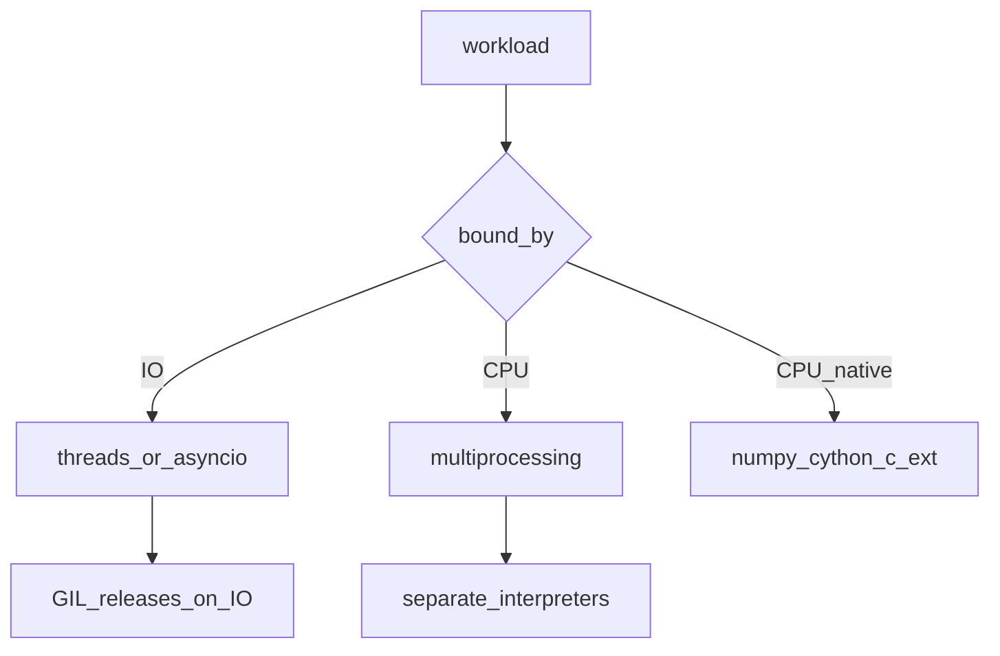
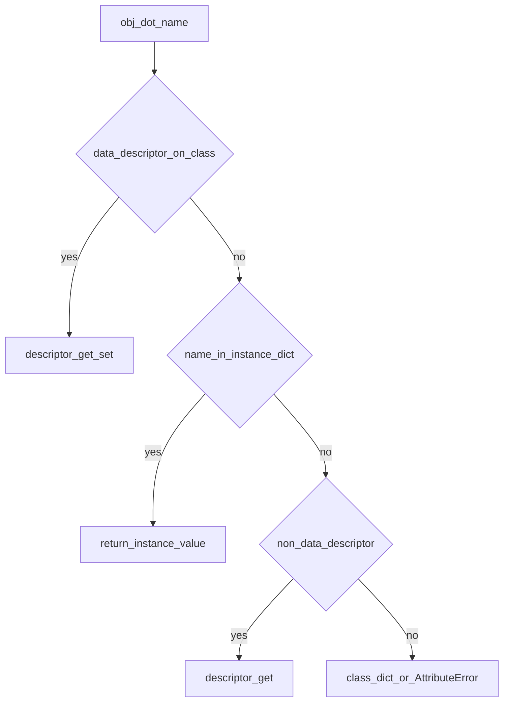

## Введение

Вопросы про GIL, потоки и память отделяют middle от «синтаксического» junior. Нужна связная модель: зачем GIL, когда threads помогают, как устроены refcount и GC, с чего начать при утечке. Этот выпуск собирает блок concurrency/memory без воды.

**Тесты и pdb.** Тесты и отладка на middle — про процесс: arrange-act-assert, фикстуры, когда брать pdb. В источнике сильнее unittest/pdb; в реальных командах чаще pytest — оба должны быть в ответе.

**Метаклассы.** Senior-вопросы про дескрипторы и метаклассы проверяют, понимаете ли вы модель атрибутов и создание классов — и умеете ли **не** тащить метакласс в каждый сервис. Разберём механизмы, связь с `@property` и здравые границы применения.

## Раздел: Как отвечать одним блоком

Этот выпуск собрал соседние короткие темы трека: «GIL и GC», «Тесты и pdb», «Метаклассы». Раньше каждая занимала отдельную карточку на несколько минут, а на собеседовании их спрашивают одним блоком. Ниже у каждой темы свой раздел, затем общие лабы, один тест и одна колода карточек. В ответе сначала назовите, какую тему спросили, потом определение и один пример. Не проговаривайте все разделы, если спросили один. Лабы можно пройти по порядку исходного трека. Если времени мало, сделайте первую и последнюю: первая ставит язык, последняя проверяет, что соседние темы вы не перепутали.

## Раздел: GIL и GC: Threads, processes и GIL

**Threading** делит память процесса: удобно для I/O-bound (сеть, диск), пока поток ждёт. **Multiprocessing** — отдельные процессы и память: обход GIL для CPU-bound ценой IPC и старта процессов.

**GIL** (Global Interpreter Lock) в CPython позволяет в каждый момент исполнять bytecode Python только одному потоку в процессе. Поэтому чистый Python CPU-код на threads почти не ускоряется. GIL всё ещё упрощает безопасность refcount и совместимость C-расширений; для параллелизма CPU берут processes, нативный код (NumPy/Cython), или другой рантайм.

Жизненный цикл потока: create → start → running → join/terminate. Планирует ОС; в Python API — `threading.Thread`, пулы `concurrent.futures`.

Аргументы в функции передаются **по ссылке на объект** (call by object sharing): имя параметра — локальная ссылка на тот же объект; переприсвоение параметра снаружи не видно, мутация mutable — видна.

## Раздел: GIL и GC: Память, GC и отладка утечек

CPython считает ссылки (`sys.getrefcount` / `id` объекта). Когда счётчик достигает нуля — объект освобождается. Циклические ссылки ловит generational GC (`gc` module). Не вся память обязательно возвращается ОС сразу при выходе — аллокатор и фрагментация.

`dict`/`set` внутри — хеш-таблицы: средний lookup O(1), память с запасом под load factor. Интернирование маленьких строк/ints — деталь оптимизации, не контракт для бизнес-логики.

Утечка в проде — чеклист:
1. воспроизвести рост RSS под нагрузкой;
2. `tracemalloc` / `objgraph` / `gc.garbage` (осторожно);
3. искать кэши без лимита, циклы с `__del__`, неосвобождённые ресурсы;
4. отделить «утечку Python-объектов» от роста нативной памяти расширений.

## Раздел: GIL и GC: Частые вопросы с собеседования

**Вопрос.** Почему NumPy на threads может ускоряться при GIL?

**Ответ.** Тяжёлая работа в C-расширениях может отпускать GIL на время вычислений в нативном коде. Чистый Python bytecode в threads по CPU не масштабируется — это не «GIL не существует».

**Вопрос.** Как передаются аргументы в функцию Python?

**Ответ.** Call by object sharing: параметр — новая локальная ссылка на тот же объект. Переприсвоение параметра внутри не меняет внешнее имя; мутация mutable-объекта видна снаружи.

**Вопрос.** Когда `multiprocessing` хуже threads?

**Ответ.** Много мелких задач, большие объекты для сериализации между процессами, Windows spawn overhead. Для лёгкого I/O threads или asyncio часто дешевле; для CPU — processes или вынести hot path в C/Rust.

**Вопрос.** Что делает generational GC?

**Ответ.** Делит объекты на поколения; молодые собираются чаще. Ловит циклические ссылки, которые refcount alone не освобождает. Не заменяет дисциплину закрытия ресурсов и weakref для кэшей.

## Раздел: Тесты и pdb: unittest и подход к тестам

`unittest.TestCase`: методы `test_*`, `assertEqual`/`assertRaises`, `setUp`/`tearDown`. Запуск: `python -m unittest`. Хороший unit-тест: быстрый, изолированный, детерминированный, проверяет одно поведение.

Пирамида: много unit, меньше integration, мало e2e. Моки (`unittest.mock`) — для границ (сеть, время), не для всего подряд.

## Раздел: Тесты и pdb: pytest и pdb

pytest: меньше бойлерплейта, `assert` с интроспекцией, **fixtures**, `@pytest.mark.parametrize`. Фикстуры собирают данные/ресурсы; parametrize гоняет один тест на наборе входов — must-have для middle.

Отладка: `pdb` / `breakpoint()` (3.7+). Команды: `n` next, `s` step, `c` continue, `l` list, `p` print, `b` breakpoint. Альтернативы: IDE debugger, логирование вместо print-спама.

Цикл: падение → минимальный воспроизводящий тест → фикс → зелёный прогон.

## Раздел: Тесты и pdb: Частые вопросы с собеседования

**Вопрос.** Unit vs integration test — граница?

**Ответ.** Unit изолирует модуль (моки на границах I/O); integration проверяет связку (БД, HTTP) с реальными или testcontainers. Пирамида: много быстрых unit, меньше integration, мало e2e.

**Вопрос.** Зачем `@pytest.mark.parametrize`?

**Ответ.** Один тест гоняется на наборе входов/ожиданий — меньше копипасты и явная таблица кейсов. На собесе показывает зрелость pytest против голого unittest.

**Вопрос.** Когда мокать, а когда нет?

**Ответ.** Мокайте внешние границы (время, HTTP, SMTP), не внутреннюю логику, которую вы сами тестируете — иначе тест дублирует реализацию. Интеграционный тест без мока ловит контракт с реальным сервисом.

**Вопрос.** `breakpoint()` vs print в отладке?

**Ответ.** `breakpoint()` входит в pdb с контекстом стека, можно шагать и смотреть locals. Print-отладка не масштабируется и остаётся в коде; pdb/IDE debugger — стандарт для middle.

## Раздел: Метаклассы: Дескрипторы

Дескриптор — объект с `__get__` / `__set__` / `__delete__`, лежащий в атрибуте **класса**. При доступе `obj.x` интерпретатор может делегировать в дескриптор вместо обычного lookup в `__dict__` экземпляра.

- **Data descriptor** (`__set__` или `__delete__`) сильнее instance dict.
- **Non-data** (только `__get__`, как функции/методы) слабее: значение в `obj.__dict__` перекрывает.

`@property`, `@classmethod`, `@staticmethod` — дескрипторы из коробки. Декоратор функции ≠ дескриптор: декоратор оборачивает callable; дескриптор управляет протоколом доступа к атрибуту. Часто property реализуют через дескриптор, а «синтаксический сахар» декоратора лишь удобная форма.

Зачем писать свои: валидация полей, lazy attributes, ORM-колонки, typed slots-подобные поля.

## Раздел: Метаклассы: Метаклассы и type()

Класс — тоже объект; его тип обычно `type`. Метакласс — «класс класса»: контролирует создание класса (`__new__` / `__init__` метакласса). Большинство задач закрываются декораторами класса, `__init_subclass__` и дескрипторами — метакласс оставляйте для фреймворков (регистрация моделей, API DSL).

Создать класс без слова `class`:

```python
MyClass = type("MyClass", (Base,), {"x": 1, "hello": lambda self: "hi"})
```

Это тот же путь, что использует синтаксис `class`. Кастомный метакласс:

```python
class Meta(type):
    def __new__(mcls, name, bases, namespace, **kw):
        namespace.setdefault("registry_name", name.lower())
        return super().__new__(mcls, name, bases, namespace)

class Model(metaclass=Meta):
    pass
```

На собесе ценится фраза: «метакласс меняет, *как* создаётся класс; дескриптор — *как* читается/пишется атрибут».

## Раздел: Метаклассы: Частые вопросы с собеседования

**Вопрос.** Дескриптор vs декоратор функции?

**Ответ.** Декоратор оборачивает вызов функции. Дескриптор управляет доступом к атрибуту через `__get__`/`__set__` на классе. `@property` — data descriptor; функция метода — non-data descriptor.

**Вопрос.** Когда метакласс оправдан?

**Ответ.** Редко: фреймворки (ORM, регистрация моделей, DSL). Большинство задач закрывают class decorator, `__init_subclass__`, дескрипторы. Метакласс меняет создание класса, не экземпляра.

**Вопрос.** Data vs non-data descriptor — приоритет?

**Ответ.** Data descriptor (есть `__set__` или `__delete__`) сильнее instance `__dict__`. Non-data (только `__get__`) слабее: значение в instance dict перекрывает. Отсюда поведение методов и `@property`.

**Вопрос.** `type(name, bases, dict)` — зачем знать?

**Ответ.** То же, что делает statement `class` под капотом. Понимание помогает на собесах про метаклассы и динамическое создание классов в плагинах.

## Лаба

**GIL и GC.**

**Цель.** Наблюдаемо сравнить threads vs processes на CPU-задаче и потрогать gc.

**Шаги.**
1. Напишите CPU-bound функцию (например, суммирование больших range в цикле).
2. Замерьте время: 4× ThreadPoolExecutor vs 4× ProcessPoolExecutor.
3. Создайте два объекта с циклическими ссылками; вызовите `gc.collect()` и проверьте, что цикл собирается.
4. Включите `tracemalloc.start()`, сделайте N аллокаций, снимите top статистику.

**В группу:** объясните вслух, почему для HTTP-клиента threads часто ок, а для тяжёлого JSON-парсинга CPU — нет.

**Готово, если…**
- [ ] Формулируете GIL без мифа «Python не многопоточный»
- [ ] Отличаете I/O-bound и CPU-bound выбор
- [ ] Знаете роль refcount и зачем gc

**Тесты и pdb.**

**Цель.** Покрыть функцию pytest + поймать баг в pdb.

**Шаги.**
1. Функция `clamp(x, lo, hi)` с намеренным багом на границе.
2. unittest-тест и pytest-тест с parametrize.
3. Фикстура с временным путём файла (`tmp_path`).
4. Поставьте `breakpoint()` и пройдите баг шагами `n`/`p`.

**В группу:** что вы не мокаете принципиально?

**Готово, если…**
- [ ] Пишете pytest с parametrize
- [ ] Знаете 4 команды pdb
- [ ] Чините через failing test first

**Метаклассы.**

**Цель.** Свой data descriptor и крошечный метакласс-регистр.

**Шаги.**
1. Напишите `PositiveInt` дескриптор: в `__set__` отвергайте значения ≤ 0.
2. Встройте его в класс `Account` с полем `balance`.
3. Метакласс `PluginMeta` добавляет каждый новый класс в `PluginMeta.registry`.
4. Сравните тот же registry через `__init_subclass__` — короче ли код?

**В группу:** решите, где в вашем стеке (Django ORM / pydantic / FastAPI) уже спрятаны дескрипторы/метаклассы.

**Готово, если…**
- [ ] Отличаете data vs non-data descriptor
- [ ] Можете создать класс через `type(...)`
- [ ] Называете альтернативы метаклассу

## Схема: GIL и GC: Выбор параллелизма



## Схема: Тесты и pdb: Красный-зелёный


## Схема: Метаклассы: Lookup атрибута



## Тест

### Почему threads плохо ускоряют CPU в CPython?

**Ответ:** GIL — один bytecode-поток

**Пояснение:** потоки полезны при I/O; CPU — processes/native.

### Чем pytest удобнее unittest?

**Ответ:** меньше бойлерплейта, fixtures

**Пояснение:** assert обычный; parametrize масштабируется.

### data vs non-data descriptor?

**Ответ:** __set__/__delete__ у data; приоритет над instance dict

**Пояснение:** property с setter — data.

### Как передаются аргументы в функцию?

**Ответ:** по ссылке на объект

**Пояснение:** параметр — новое имя на тот же объект; мутации mutable видны.

### Зачем parametrize?

**Ответ:** один тест — много вход/ожидание

**Пояснение:** таблица кейсов без копипаста.

## Шпаргалка

<ul><li>I/O → threads/asyncio; CPU → processes / native</li><li>GIL = один Python-bytecode поток в процессе CPython</li><li>refcount + cyclic GC; утечки искать с tracemalloc</li><li>unit = быстро и изолированно</li><li>pytest fixtures + parametrize</li><li>pdb: n/s/c/p/l/b</li><li>Дескриптор = протокол атрибута (__get__/__set__)</li><li>property/classmethod — встроенные дескрипторы</li><li>Метакласс = контроль создания класса; чаще overkill</li></ul>

## Anki

### Front: Когда брать multiprocessing вместо threading?

Back: CPU-bound задачи в CPython, где GIL мешает ускорению

### Front: setUp в unittest — когда вызывается?

Back: перед каждым test-методом

### Front: Почему функции на классе — методы?

Back: non-data descriptors с __get__ → bound method

### Front: Что такое GIL одной фразой?

Back: блокировка, из-за которой bytecode Python в процессе исполняет один поток

### Front: Что такое fixture в pytest?

Back: переиспользуемая подготовка данных/ресурсов для тестов

### Front: type(name, bases, dict) — что возвращает?

Back: новый объект класса

## Мнемоника

### acronym: Память и GIL

**Задание:** Три механизма, которые путают в одном ответе.

**Элементы:**
- GIL
- refcount
- GC циклов

**Подсказка:** GIL — про потоки и байткод. refcount — про жизнь объекта. GC — про циклы.

**Ответ:** GIL, refcount, GC

## Итоги

- GIL не отменяет многопоточность — меняет профиль ускорения
- Память = refcount + GC; «утечка» требует метода, не гадания
- Этот блок — мост к senior-темам perf и prod-диагностики
- Тесты — часть дизайна, не послесловие
- pytest — де-факто стандарт; unittest знать для собеса/легаси
- Далее senior: дескрипторы (PY17)
- Дескрипторы объясняют property и магию ORM-полей
- Метаклассы — редкий инструмент; знание важнее привычки применять

## Ссылки

- [Glossary — global interpreter lock](https://docs.python.org/3/glossary.html#term-global-interpreter-lock)
- [threading — docs](https://docs.python.org/3/library/threading.html)
- [gc — docs](https://docs.python.org/3/library/gc.html)
- [DEBAGanov — индекс вопросов серии](https://github.com/DEBAGanov/interview_questions/blob/main/400%20вопросов%20с%20ответами%2C%20которые%20должен%20знать%20Python-разработчик.md)
- [Learn](/game/learn)
- [Asyncio](/game/learn/py-oop-advanced-mro)
- [unittest](https://docs.python.org/3/library/unittest.html)
- [pytest](https://docs.pytest.org/)
- [pdb](https://docs.python.org/3/library/pdb.html)
- [pytest CI Git для QA](/game/learn/qa-pytest-ci-git)
- [Descriptor HowTo Guide](https://docs.python.org/3/howto/descriptor.html)
- [Metaclasses — data model](https://docs.python.org/3/reference/datamodel.html#metaclasses)
