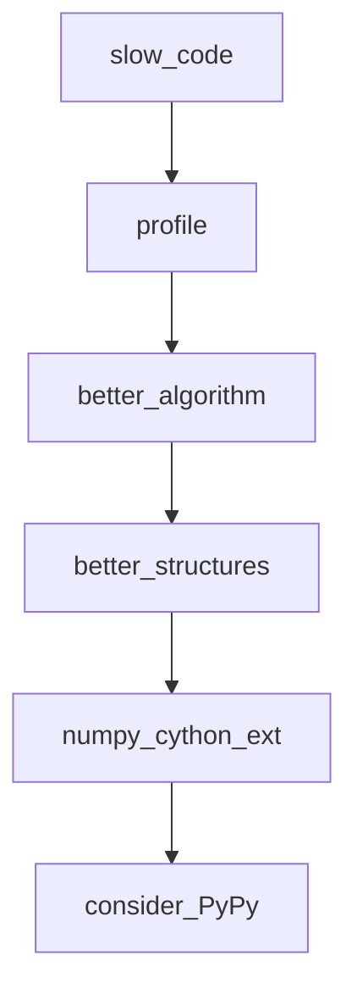
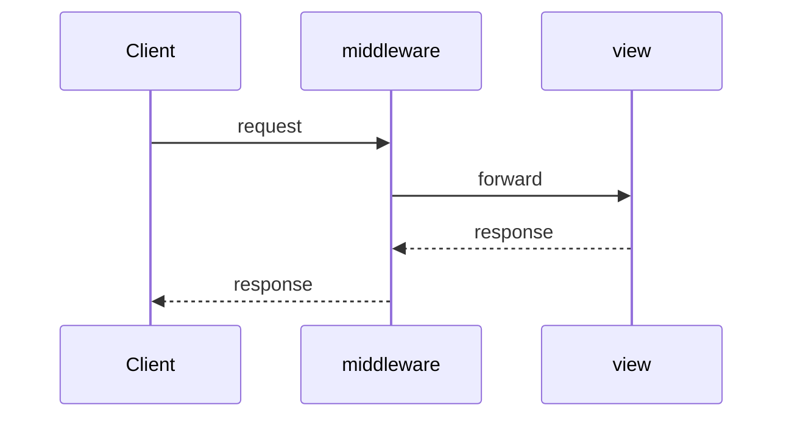
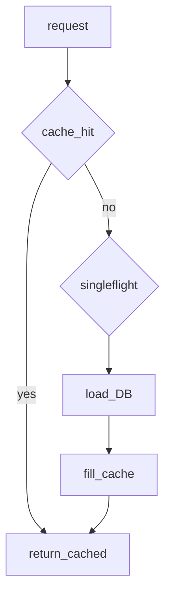

## Введение

Senior-блок про скорость и доставку: профилирование, NumPy vs list, wheels, C-API/ctypes, альтернативы CPython (PyPy, Cython). Важно говорить метриками и границами, не лозунгами.

**Веб-фреймворки.** Источник вопросов сильно про Flask/Django/Pyramid. Senior должен сравнить framework vs library, батареи Django против микро Flask, роль middleware — и упомянуть FastAPI как современный соседний стек (как в CopyParse), не уходя от темы.

**БД и Memcached.** Senior-вопросы из источника: выборка SQL/MySQL из Python, DML и особенно **Memcached** — downtime, dogpile, когда кеш вреден. Разберём безопасный доступ к БД и антипаттерны кеша.

## Раздел: Как отвечать одним блоком

Этот выпуск собрал соседние короткие темы трека: «Perf и PyPy», «Веб-фреймворки», «БД и Memcached». Раньше каждая занимала отдельную карточку на несколько минут, а на собеседовании их спрашивают одним блоком. Ниже у каждой темы свой раздел, затем общие лабы, один тест и одна колода карточек. В ответе сначала назовите, какую тему спросили, потом определение и один пример. Не проговаривайте все разделы, если спросили один. Лабы можно пройти по порядку исходного трека. Если времени мало, сделайте первую и последнюю: первая ставит язык, последняя проверяет, что соседние темы вы не перепутали.

## Раздел: Perf и PyPy: Ускорение существующего кода

Порядок: измерить → найти hot path → менять алгоритм/структуры → только потом микрооптимизации/натив. Инструменты: `cProfile`, `py-spy`, `timeit`, tracemalloc.

Типичные выигрыши: меньше аллокаций, локальные переменные в горячем цикле, batch I/O, векторные операции NumPy вместо чистых Python-циклов по числам. Хвостовая рекурсия в CPython не оптимизируется — итерация/явный стек. `PYTHONOPTIMIZE`/`-O` убирает assert и часть debug — не «ускоритель алгоритма».

## Раздел: Perf и PyPy: Упаковка и альтернативные рантаймы

Дистрибуция: sdist vs **wheel**, бинарные зависимости, manylinux. Упаковка проекта — `pyproject.toml`, сборка wheel, версионирование. `__pycache__` — локальный кеш bytecode, не способ поставки.

Альтернативы CPython: **PyPy** (JIT, хорошо на долгоживущих pure-Python нагрузках), **Cython** (типизированный Python→C), IronPython/иные ниши. **ctypes**/C-API — вызов нативных библиотек; цена — сложность и безопасность памяти.

Выбор: совместимость расширений часто держит на CPython; perf-критичные куски — Cython/Rust extension/NumPy; иногда отдельный сервис на другом языке.

## Раздел: Perf и PyPy: Частые вопросы с собеседования

**Вопрос.** Первый шаг при «Python тормозит»?

**Ответ.** Измерить профилем (`cProfile`, py-spy), найти hot path, улучшить алгоритм/структуры данных. Микрооптимизации и `-O` — последними; смена языка — после доказанного узкого места.

**Вопрос.** PyPy vs CPython — когда упомянуть?

**Ответ.** PyPy с JIT может ускорить долгоживущий pure Python; совместимость C-расширений ограничена. Многие прод-сервисы остаются на CPython + нативные libs (NumPy) или выносят hot path.

**Вопрос.** Зачем wheel manylinux?

**Ответ.** Бинарный wheel собран под ABI Linux, pip ставит без компилятора на сервере. Без wheel на exotic platform сборка из sdist может падать на отсутствии gcc/headers.

**Вопрос.** venv в Docker — нужен ли?

**Ответ.** В образе часто один app — зависимости ставят в system site или отдельный prefix; venv внутри контейнера опционален, но изоляция версий в multi-stage build всё равно фиксируется requirements.lock.

## Раздел: Веб-фреймворки: Framework vs Flask/Django/Pyramid

**Библиотека** — вы вызываете код. **Фреймворк** — он вызывает ваш (IoC): роутинг, lifecycle запроса.

- **Django**: batteries included — ORM, admin, auth, templates; «конвенции»; хорошо для классических CRUD/CMS.
- **Flask**: микрофреймворк — ядро + расширения (Flask-WTF формы/CSRF, сессии); гибкость ценой выбора стека самому.
- **Pyramid**: явная конфигурация, гибкость от small до large.

Типичный Flask request: WSGI environ → app → view → response. Сессии — подписанные cookie / server-side store через extensions. MVC в вебе условен: model (данные), template/view (представление), controller ≈ view-функции/роуты.

## Раздел: Веб-фреймворки: Middleware и контекст

Middleware — слой вокруг запроса/ответа (логирование, auth, CORS, транзакции). В Django — middleware classes; во Flask — `before_request`/`after_request`/WSGI middleware. Context processors в Django добавляют переменные в шаблоны.

Подключение БД: через ORM (Django/SQLAlchemy) или драйвер; в Flask часто SQLAlchemy/extension, конфиг URI, сессия на запрос. Современный ASGI-сосед: **FastAPI** (типы, OpenAPI, async) — уместно кратко сравнить на собесе, если вакансия API-heavy.

## Раздел: Веб-фреймворки: Частые вопросы с собеседования

**Вопрос.** Flask vs Django на собесе?

**Ответ.** Django — batteries included (ORM, admin, auth), конвенции, быстрый CRUD. Flask — минимальное ядро, стек выбираете сами через extensions. Выбор: скорость старта vs полнота vs команда знакома с экосистемой.

**Вопрос.** WSGI vs ASGI в двух словах?

**Ответ.** WSGI — синхронный интерфейс app(environ, start_response); ASGI — async, WebSocket, long-lived. FastAPI/Starlette на ASGI; классический Flask — WSGI, async views ограничены моделью.

**Вопрос.** Где жить SQL injection защите?

**Ответ.** Параметризованные запросы / ORM bind parameters — никогда конкатенация user input в SQL. На собесе связывают с PY20 и placeholder `%s`.

**Вопрос.** Middleware — что делает?

**Ответ.** Оборачивает request/response: auth, logging, CORS, timing. В Django — классы middleware; во Flask — hooks или WSGI middleware. Порядок в цепочке важен для корректности.

## Раздел: БД и Memcached: БД из Python

Паттерн: драйвер (или ORM) → соединение/пул → cursor/execute → fetch → закрытие. Параметры **только** через placeholders (`%s` / `?`), никогда через f-string в SQL (SQL injection).

```python
# pseudocode
cur.execute("SELECT id, name FROM users WHERE id = %s", (user_id,))
row = cur.fetchone()
```

DML (`INSERT/UPDATE/DELETE`) — в транзакции; commit/rollback явно или через context manager. ORM ускоряет CRUD, но senior обязан читать SQL и индексы. JSON рядом: часто обмен API↔БД через сериализацию (см. PY08).

## Раздел: БД и Memcached: Memcached pitfalls

Memcached — распределённый in-memory key-value кеш. Полезен для горячих чтений; **не** source of truth и не для данных, которые нельзя потерять.

Риски на собесе:
- **Dogpile (cache stampede):** ключ истёк — толпа запросов бьёт в БД; лечится lock/soft TTL/singleflight.
- Падение ноды: клиент не должен бесконечно долбить мёртвый сервер; failover/rebalance по политике клиента; данные на упавшей ноде считайте потерянными.
- Когда не брать: крупные объекты, необходимость сложных запросов, строгая консистентность, персистентность.

Минимизация downtime: несколько нод, health checks, таймауты, graceful degradation (идти в БД при недоступности кеша).

## Раздел: БД и Memcached: Частые вопросы с собеседования

**Вопрос.** ORM или сырой SQL — что сказать senior-ожиданию?

**Ответ.** ORM ускоряет CRUD и миграции; senior читает SQL, индексы и планы. Сырой SQL — hot paths, отчёты, bulk. Компромисс: ORM + `text()`/raw там, где profiler показал проблему.

**Вопрос.** Что такое N+1 в контексте Python ORM?

**Ответ.** Один запрос за список родителей и N запросов за детей в цикле. Лечится eager loading (`selectinload`, `prefetch`), JOIN или одним запросом с агрегатом — тема пересекается с SQL EXPLAIN.

**Вопрос.** Memcached vs Redis на собесе?

**Ответ.** Memcached — простой RAM cache без персистентности и богатых структур. Redis — структуры данных, persistence опционально, pub/sub. Cache stampede (dogpile) актуален для обоих.

**Вопрос.** Транзакция в Python с psycopg2/asyncpg?

**Ответ.** `with conn:` или явный begin/commit/rollback; при исключении rollback. Не держите транзакцию открытой во время HTTP-вызова — блокируете строки и connection pool.

## Лаба

**Perf и PyPy.**

**Цель.** Профиль медленной функции и сравнение list vs NumPy.

**Шаги.**
1. Напишите сумму квадратов на чистом Python и через NumPy.
2. Снимите cProfile на чистой версии.
3. Соберите тривиальный wheel (`python -m build`) или опишите шаги, если нет сети.
4. Кратко сравните: когда попробовали бы PyPy.

**В группу:** какой hot path в вашем сервисе уже выносили в native?

**Готово, если…**
- [ ] Начинаете с профиля, не с Cython
- [ ] Объясняете wheel
- [ ] Знаете нишу PyPy/Cython/ctypes

**Веб-фреймворки.**

**Цель.** Минимальный Flask `/health` и middleware-логер времени.

**Шаги.**
1. Flask app с `/health` → `{"status":"ok"}`.
2. `before_request`/`after_request` логируют duration.
3. Добавьте простую форму Flask-WTF (csrf) или опишите зачем CSRF.
4. Таблица сравнения Django vs Flask vs FastAPI на 5 строк.

**В группу:** какой фреймворк выберете для админки с ORM vs для публичного JSON API?

**Готово, если…**
- [ ] Отличаете framework и library
- [ ] Объясняете middleware
- [ ] Сравниваете Django/Flask без фанатизма

**БД и Memcached.**

**Цель.** Смоделировать stampede и простой singleflight-лок в процессе.

**Шаги.**
1. Функция `get_user(id)` с dict-кешем и TTL.
2. На истечении TTL 20 «параллельных» вызовов (threads) без защиты — посчитайте hits в «БД».
3. Добавьте lock на ключ (singleflight) — сравните число загрузок.
4. Список: 3 причины не класть сущность в Memcached.

**В группу:** Redis vs Memcached — когда что в вашем опыте?

**Готово, если…**
- [ ] Пишете параметризованный SQL
- [ ] Объясняете dogpile
- [ ] Не путаете кеш с БД

## Схема: Perf и PyPy: Путь оптимизации



## Схема: Веб-фреймворки: Запрос через middleware



## Схема: БД и Memcached: Cache lookup



## Тест

### С чего начинать ускорение?

**Ответ:** профиль hot path

**Пояснение:** без цифр оптимизация — гадание.

### Фреймворк vs библиотека?

**Ответ:** фреймворк управляет потоком, вызывает ваш код

**Пояснение:** IoC: view/handlers под контракт.

### Безопасный id в SQL?

**Ответ:** параметр драйвера, не конкатенация

**Пояснение:** иначе SQL injection.

### wheel vs sdist?

**Ответ:** wheel быстрее ставится, часто prebuilt

**Пояснение:** sdist требует build на машине пользователя.

### Сильная сторона Django?

**Ответ:** batteries: ORM, admin, auth

**Пояснение:** быстрый монолит; цена — вес.

## Шпаргалка

<ul><li>measure → algorithm → structures → native/runtime</li><li>wheel для доставки; pyproject для сборки</li><li>Cython/ctypes/PyPy — точечно</li><li>Django = batteries; Flask = micro + extensions</li><li>middleware = cross-cutting на запросе</li><li>FastAPI — частый современный API-сосед</li><li>SQL только с placeholders + транзакции</li><li>Memcached = ускорение чтений, не хранилище</li><li>stampede / failover / timeouts</li></ul>

## Anki

### Front: NumPy быстрее list когда?

Back: массовые числовые операции (векторизация)

### Front: Flask-WTF зачем?

Back: формы и CSRF-защита в экосистеме Flask

### Front: DML через Python — что обязательно?

Back: транзакция и обработка ошибок/rollback

### Front: Что такое ctypes?

Back: вызов функций из динамических C-библиотек из Python

### Front: Context processor в Django?

Back: добавляет переменные во все шаблоны автоматически

### Front: Когда Memcached вреден?

Back: нужны персистентность, сложные запросы, сильная консистентность

## Итоги

- Perf — дисциплина измерений
- Упаковка — часть senior-ответственности
- Далее: веб-фреймворки (PY19)
- Выбор фреймворка — про задачу и команду, не про хайп
- Middleware и сессии — частые уточнения
- Далее: БД и кеш (PY20)
- БД-доступ и кеш — зона senior-ответственности
- Анти-stampede важнее «просто подключил memcache»

## Ссылки

- [Performance tips](https://docs.python.org/3/howto/perf_profiling.html)
- [Packaging Python Projects](https://packaging.python.org/en/latest/tutorials/packaging-projects/)
- [DEBAGanov — индекс вопросов серии](https://github.com/DEBAGanov/interview_questions/blob/main/400%20вопросов%20с%20ответами%2C%20которые%20должен%20знать%20Python-разработчик.md)
- [Learn](/game/learn)
- [Flask](https://flask.palletsprojects.com/)
- [Django](https://docs.djangoproject.com/)
- [DB-API 2.0](https://peps.python.org/pep-0249/)
- [sqlite3 — DB пример stdlib](https://docs.python.org/3/library/sqlite3.html)
- [Redis KV модель](/game/learn/rd-kv-model)
- [Prod concurrency](/game/learn/py-concurrency-io-patterns)
