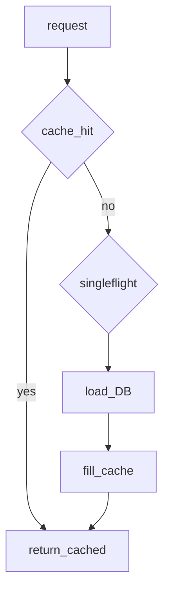

## Введение

Senior-вопросы из источника: выборка SQL/MySQL из Python, DML и особенно **Memcached** — downtime, dogpile, когда кеш вреден. Разберём безопасный доступ к БД и антипаттерны кеша.

## Раздел: БД из Python

Паттерн: драйвер (или ORM) → соединение/пул → cursor/execute → fetch → закрытие. Параметры **только** через placeholders (`%s` / `?`), никогда через f-string в SQL (SQL injection).

```python
# pseudocode
cur.execute("SELECT id, name FROM users WHERE id = %s", (user_id,))
row = cur.fetchone()
```

DML (`INSERT/UPDATE/DELETE`) — в транзакции; commit/rollback явно или через context manager. ORM ускоряет CRUD, но senior обязан читать SQL и индексы. JSON рядом: часто обмен API↔БД через сериализацию (см. PY08).

## Раздел: Memcached pitfalls

Memcached — распределённый in-memory key-value кеш. Полезен для горячих чтений; **не** source of truth и не для данных, которые нельзя потерять.

Риски на собесе:
- **Dogpile (cache stampede):** ключ истёк — толпа запросов бьёт в БД; лечится lock/soft TTL/singleflight.
- Падение ноды: клиент не должен бесконечно долбить мёртвый сервер; failover/rebalance по политике клиента; данные на упавшей ноде считайте потерянными.
- Когда не брать: крупные объекты, необходимость сложных запросов, строгая консистентность, персистентность.

Минимизация downtime: несколько нод, health checks, таймауты, graceful degradation (идти в БД при недоступности кеша).

## Раздел: Частые вопросы с собеседования
**Вопрос.** ORM или сырой SQL — что сказать senior-ожиданию?

**Ответ.** ORM ускоряет CRUD и миграции; senior читает SQL, индексы и планы. Сырой SQL — hot paths, отчёты, bulk. Компромисс: ORM + `text()`/raw там, где profiler показал проблему.

**Вопрос.** Что такое N+1 в контексте Python ORM?

**Ответ.** Один запрос за список родителей и N запросов за детей в цикле. Лечится eager loading (`selectinload`, `prefetch`), JOIN или одним запросом с агрегатом — тема пересекается с SQL EXPLAIN.

**Вопрос.** Memcached vs Redis на собесе?

**Ответ.** Memcached — простой RAM cache без персистентности и богатых структур. Redis — структуры данных, persistence опционально, pub/sub. Cache stampede (dogpile) актуален для обоих.

**Вопрос.** Транзакция в Python с psycopg2/asyncpg?

**Ответ.** `with conn:` или явный begin/commit/rollback; при исключении rollback. Не держите транзакцию открытой во время HTTP-вызова — блокируете строки и connection pool.

## Лаба

**Цель.** Смоделировать stampede и простой singleflight-лок в процессе.

**Шаги.**
1. Функция `get_user(id)` с dict-кешем и TTL.
2. На истечении TTL 20 «параллельных» вызовов (threads) без защиты — посчитайте hits в «БД».
3. Добавьте lock на ключ (singleflight) — сравните число загрузок.
4. Список: 3 причины не класть сущность в Memcached.

**В группу:** Redis vs Memcached — когда что в вашем опыте?

**Готово, если…**
- [ ] Пишете параметризованный SQL
- [ ] Объясняете dogpile
- [ ] Не путаете кеш с БД

## Схема: Cache lookup



## Тест

### Безопасный id в SQL?

**Ответ:** параметр драйвера, не конкатенация

**Пояснение:** иначе SQL injection.

### cache dogpile?

**Ответ:** лавина в БД при промахе hot key

**Пояснение:** lock / early refresh / stale-while-revalidate.

### Данные на упавшей Memcached-ноде?

**Ответ:** считайте потерянными

**Пояснение:** кеш эфемерен; источник — БД.

### PEP 249 — что это?

**Ответ:** DB-API 2.0 для Python

**Пояснение:** единый контракт cursor/connection.

### ORM N+1 query problem?

**Ответ:** лишние запросы в цикле

**Пояснение:** prefetch/select_related в ORM.

## Шпаргалка

<h3>Суть</h3>
<ul>
<li>SQL только с placeholders + транзакции</li>
<li>Memcached = ускорение чтений, не хранилище</li>
<li>stampede / failover / timeouts</li>
</ul>
<h3>Ориентиры</h3>
<pre><code>execute(sql, (params,))
cache get → miss → lock → DB → set
</code></pre>

## Anki

### Front: DML через Python — что обязательно?

Back: транзакция и обработка ошибок/rollback

### Front: Когда Memcached вреден?

Back: нужны персистентность, сложные запросы, сильная консистентность

### Front: Singleflight в кеше зачем?

Back: один загрузчик на ключ при промахе

### Front: connection pool зачем?

Back: переиспользование TCP-сессий к БД

### Front: cache-aside pattern шаги?

Back: read cache → miss → read DB → fill cache

### Front: Memcached vs Redis на собесе?

Back: Memcached проще KV cache; Redis — структуры и persistence опции

## Итоги

- БД-доступ и кеш — зона senior-ответственности
- Анти-stampede важнее «просто подключил memcache»
- Далее: prod concurrency (PY21)

## Ссылки

- [DB-API 2.0](https://peps.python.org/pep-0249/)
- [sqlite3 — DB пример stdlib](https://docs.python.org/3/library/sqlite3.html)(https://peps.python.org/pep-0249/)
- [DEBAGanov — индекс вопросов серии](https://github.com/DEBAGanov/interview_questions/blob/main/400%20вопросов%20с%20ответами%2C%20которые%20должен%20знать%20Python-разработчик.md)
- Learn | /game/learn
- См. также: [Redis KV модель](/game/learn/rd-kv-model), [cache-aside](/game/learn/rd-cache-aside)
- Далее: [Prod concurrency](/game/learn/py-concurrency-io-patterns)
