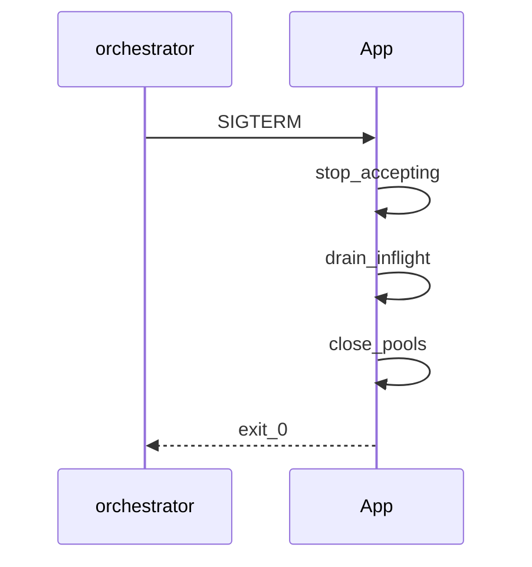

## Введение

Собес senior часто уходит в прод: «растёт RSS», «не ловятся сигналы», «как сходить на Linux-сервер». Связываем non-blocking I/O из PY14 с диагностикой утечек и операционкой.

## Раздел: Non-blocking I/O в проде

В сервисах async/evented модели держат тысячи соединений, пока ждут сеть. Блокирующий драйвер в async-воркере = деградация latency для всех. Паттерны: таймауты на клиентах, backpressure, bounded queues, circuit breaker, graceful shutdown.

Сигналы (`SIGTERM`/`SIGINT`): в многопоточности/на некоторых платформах обработчики ограничены — только main thread в CPython; в async регистрируйте через loop. Некорректные handlers — классический вопрос источника.

## Раздел: Утечки и Linux-диагностика

Чеклист роста памяти (углубление PY15): воспроизвести нагрузкой → метрики RSS/Heap → `tracemalloc`/objgraph → искать кэши без TTL, циклы, утечки в C-ext, неосвобождённые пулы соединений.

На Linux: `ps`/`top`/`pidstat` для PID и CPU/RSS; доступ к файлам на сервере — SFTP/SSH + pathlib, либо agent. Не путать «память Python» и page cache ОС.

## Раздел: Частые вопросы с собеседования
**Вопрос.** Блокирующий драйвер БД в async FastAPI — что делать?

**Ответ.** Вынести в thread pool (`asyncio.to_thread`) или взять async-native драйвер. Блокировка event loop деградирует latency для всех запросов на worker.

**Вопрос.** asyncio vs threads для legacy sync кода?

**Ответ.** Threads проще обернуть старые sync библиотеки без переписывания. Asyncio выигрывает при большом числе одновременных I/O и едином async stack; миграция дорогая — hybrid с пулом threads частый компромисс.

**Вопрос.** Зачем bounded queue в проде?

**Ответ.** Backpressure: producer не заваливает память, если consumer медленный. Unbounded queue маскирует перегрузку до OOM.

**Вопрос.** GIL и signal handlers — нюанс?

**Ответ.** В CPython signal handler выполняется в main thread; в worker threads сигналы не обрабатываются так же. Graceful shutdown планируют через main thread или asyncio loop.add_signal_handler.

## Лаба

**Цель.** Имитация утечки кэша и снятие tracemalloc.

**Шаги.**
1. Глобальный dict без лимита; «обработайте» 100k ключей.
2. Включите tracemalloc; сравните top аллокаций до/после фикса (TTL или LRU).
3. Напишите обработчик SIGINT, который ставит флаг shutdown.
4. Чеклист из 7 шагов «упало в проде» для вашего сервиса.

**В группу:** какой сигнал шлёт ваш оркестратор при stop?

**Готово, если…**
- [ ] Связываете async с таймаутами/backpressure
- [ ] Имеете метод поиска утечки
- [ ] Понимаете ограничения signal handlers

## Схема: Graceful shutdown

## Тест

### sync HTTP в async worker?

**Ответ:** блокирует event loop

**Пояснение:** latency растёт у всех клиентов.

### С чего утечка памяти?

**Ответ:** воспроизвести и tracemalloc

**Пояснение:** без воспроизведения — слепой поиск.

### Сигналы в CPython где?

**Ответ:** главный поток

**Пояснение:** workers — аккуратная схема shutdown.

### Graceful shutdown первый шаг?

**Ответ:** перестать принимать новые запросы

**Пояснение:** drain inflight, закрыть пулы.

### backpressure — что?

**Ответ:** ограничение входящей нагрузки

**Пояснение:** когда система не успевает обрабатывать.

## Шпаргалка

<h3>Суть</h3>
<ul>
<li>таймауты, backpressure, graceful shutdown</li>
<li>утечки: reproduce → measure → fix caches/pools</li>
<li>signals + Linux PID/RSS tools</li>
</ul>
<h3>Ориентиры</h3>
<pre><code>tracemalloc.start()
# pidstat -r -p PID
# handle SIGTERM → drain
</code></pre>

## Anki

### Front: Backpressure — что это?

Back: ограничение входящей нагрузки, когда система не успевает

### Front: Чем полезен pidstat?

Back: CPU/память процесса по PID на Linux

### Front: Graceful shutdown шаги?

Back: stop accept → drain inflight → close pools → exit

### Front: asyncio + blocking DB driver?

Back: run_in_executor / sync pool или async driver

### Front: SIGTERM vs SIGKILL?

Back: TERM — попросить завершиться; KILL — немедленно без cleanup

### Front: Remote file по SSH для диагностики?

Back: читать логи/метрики без интерактива — часть prod runbook

## Итоги

- Prod concurrency — про устойчивость, не только про async синтаксис
- Утечки и сигналы — частые senior-уточнения
- Далее: DRY и границы языка (PY22)

## Ссылки

- [signal](https://docs.python.org/3/library/signal.html)
- [tracemalloc](https://docs.python.org/3/library/tracemalloc.html)
- [DEBAGanov — индекс вопросов серии](https://github.com/DEBAGanov/interview_questions/blob/main/400%20вопросов%20с%20ответами%2C%20которые%20должен%20знать%20Python-разработчик.md)
- Learn | /game/learn
- Далее: [DRY и границы](/game/learn/py-design-dry-architecture)
