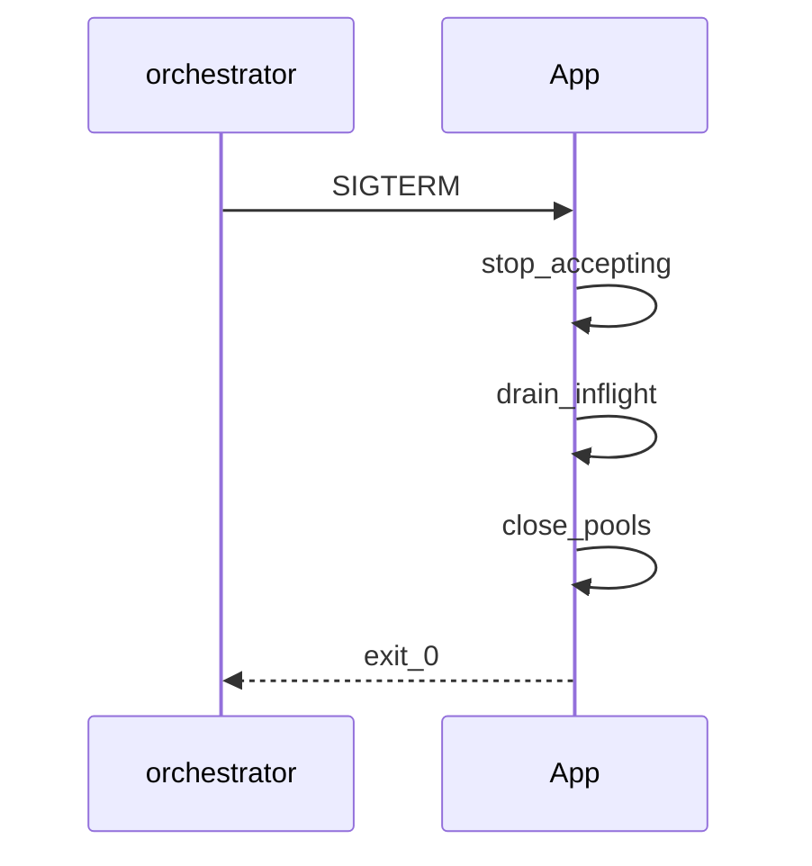
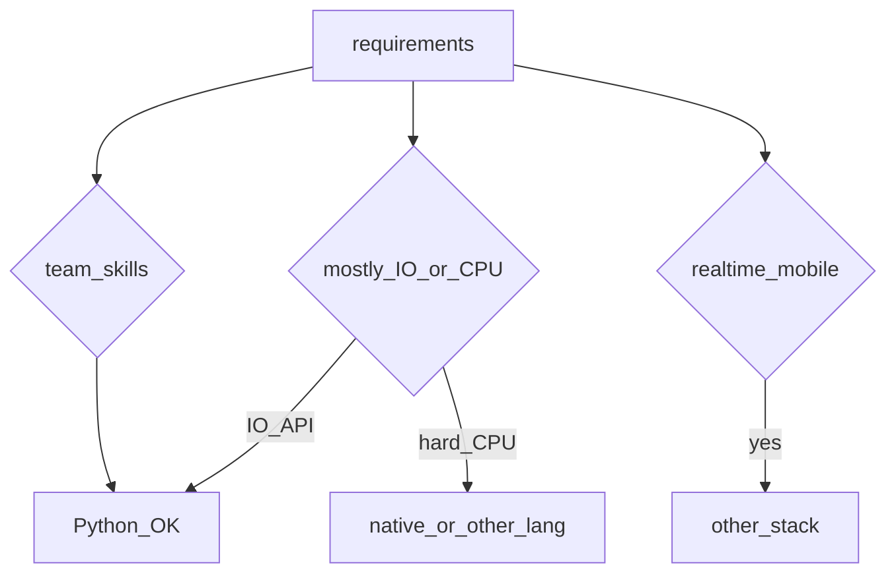
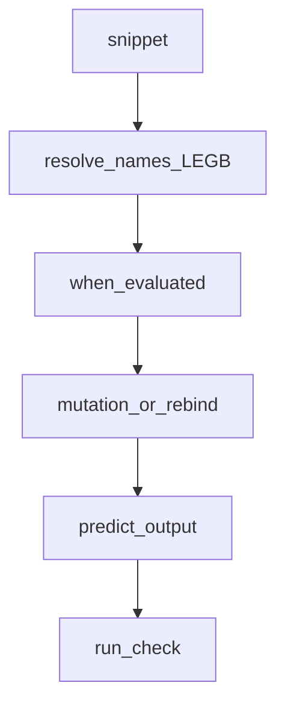

## Введение

Собес senior часто уходит в прод: «растёт RSS», «не ловятся сигналы», «как сходить на Linux-сервер». Связываем non-blocking I/O из PY14 с диагностикой утечек и операционкой.

**DRY и границы.** Не все senior-вопросы — про синтаксис. «Как применяете DRY?», «когда Python не берёте?» проверяют вкус и границы. Свяжем с GIL/async/perf из прошлых выпусков.

**Трюки собеса.** Финишный drill: «что выведет код?» — замыкания в цикле, mutable default, `is` vs `==`, for/else, неочевидный порядок. Не заучивайте ответы источника — тренируйте чтение байт-кода смысла.

**Карта собеса Python.** Финальный выпуск серии PY01–PY24: чеклист по уровням, как готовиться через Anki/тест выпусков, и куда смотреть за пределами трека (appendix в SERIES.md). Полный список 1–407 — внешняя шпаргалка тем, не текст для заучивания дословно.

## Раздел: Как отвечать одним блоком

Этот выпуск собрал соседние короткие темы трека: «Concurrency и I/O в проде», «DRY и границы», «Трюки собеса», «Карта собеса Python». Раньше каждая занимала отдельную карточку на несколько минут, а на собеседовании их спрашивают одним блоком. Ниже у каждой темы свой раздел, затем общие лабы, один тест и одна колода карточек. В ответе сначала назовите, какую тему спросили, потом определение и один пример. Не проговаривайте все разделы, если спросили один. Лабы можно пройти по порядку исходного трека. Если времени мало, сделайте первую и последнюю: первая ставит язык, последняя проверяет, что соседние темы вы не перепутали.

## Раздел: Concurrency и I/O в проде: Non-blocking I/O в проде

В сервисах async/evented модели держат тысячи соединений, пока ждут сеть. Блокирующий драйвер в async-воркере = деградация latency для всех. Паттерны: таймауты на клиентах, backpressure, bounded queues, circuit breaker, graceful shutdown.

Сигналы (`SIGTERM`/`SIGINT`): в многопоточности/на некоторых платформах обработчики ограничены — только main thread в CPython; в async регистрируйте через loop. Некорректные handlers — классический вопрос источника.

## Раздел: Concurrency и I/O в проде: Утечки и Linux-диагностика

Чеклист роста памяти (углубление PY15): воспроизвести нагрузкой → метрики RSS/Heap → `tracemalloc`/objgraph → искать кэши без TTL, циклы, утечки в C-ext, неосвобождённые пулы соединений.

На Linux: `ps`/`top`/`pidstat` для PID и CPU/RSS; доступ к файлам на сервере — SFTP/SSH + pathlib, либо agent. Не путать «память Python» и page cache ОС.

## Раздел: Concurrency и I/O в проде: Частые вопросы с собеседования

**Вопрос.** Блокирующий драйвер БД в async FastAPI — что делать?

**Ответ.** Вынести в thread pool (`asyncio.to_thread`) или взять async-native драйвер. Блокировка event loop деградирует latency для всех запросов на worker.

**Вопрос.** asyncio vs threads для legacy sync кода?

**Ответ.** Threads проще обернуть старые sync библиотеки без переписывания. Asyncio выигрывает при большом числе одновременных I/O и едином async stack; миграция дорогая — hybrid с пулом threads частый компромисс.

**Вопрос.** Зачем bounded queue в проде?

**Ответ.** Backpressure: producer не заваливает память, если consumer медленный. Unbounded queue маскирует перегрузку до OOM.

**Вопрос.** GIL и signal handlers — нюанс?

**Ответ.** В CPython signal handler выполняется в main thread; в worker threads сигналы не обрабатываются так же. Graceful shutdown планируют через main thread или asyncio loop.add_signal_handler.

## Раздел: DRY и границы: DRY через OOP и FP

DRY (Don't Repeat Yourself) — устранение дублирования **знания**, не слепое схлопывание строк кода. Через OOP: базовые классы, миксины, стратегии, композиция сервисов. Через FP: чистые функции, частичное применение, пайплайны map/filter, общие декораторы (retry/auth).

Антипаттерн: преждевременная абстракция «на всякий случай» и God-object. Лучше три похожих явных места, чем неверная общая функция. Правило: дублирование копируют, пока не ясна ось изменения — потом выделяют.

## Раздел: DRY и границы: Когда брать и не брать Python

**Брать:** API/бэкенд, автоматизация, data/ML glue, быстрые прототипы, экосистема пакетов критична, команда сильнее в Python.

**Не брать / выносить кусок:** жёсткий realtime, тяжёлый CPU без native-ускорений, мобильные клиенты, экстремальный cold-start/edge без подходящего рантайма, домен уже стандартизован на другом стеке команды.

Честный senior-ответ связывает ограничения (GIL, GC паузы, упаковка бинарных deps) с конкретной задачей — не «Python плохой/хороший».

## Раздел: DRY и границы: Частые вопросы с собеседования

**Вопрос.** DRY vs «не абстрагируй рано»?

**Ответ.** DRY про дублирование знаний и правил, не про слияние двух похожих строк кода. Преждевременная абстракция создаёт жёсткую связность; сначала два явных места, потом вынос, когда правило стабильно.

**Вопрос.** Когда не брать Python для нового сервиса?

**Ответ.** Жёсткий CPU/latency без выноса в native, mobile runtime, минимальный cold start на edge, команда без Python ops. Честный ответ связывает GIL, packaging и мониторинг с SLA задачи.

**Вопрос.** Композиция vs наследование в Python?

**Ответ.** Предпочитайте композицию сервисов и duck typing; наследование для is-a и shared interface. Миксины через MRO — осознанно, не «удобный copy-paste родителя».

**Вопрос.** Как FP и OOP сочетаются в Python?

**Ответ.** Императив по умолчанию, но map/comprehensions/чистые функции для трансформаций данных; классы для stateful домена и инфраструктуры. Прагматизм, не чистая парадигма.

## Раздел: Трюки собеса: Ответ вслух

На трюке я не угадываю вывод. Называю порядок: что создалось, что мутировалось, какая область видимости. Если сомневаюсь, проговариваю один маленький пример, а не список исключений.

## Раздел: Трюки собеса: Плохой ответ

«Это особенность Python, надо запомнить». Ждут модель выполнения, не коллекцию фактов.

## Раздел: Трюки собеса: Термины

Область видимости — scope. Мутация — mutation. Позднее связывание — late binding.

## Раздел: Трюки собеса: Классические ловушки

1. **Mutable default** — общий список между вызовами (PY04).
2. **Late binding closure** — `lambdas = [lambda: i for i in range(3)]` → все видят финальный `i`; фикс default-arg `lambda i=i: i`.
3. **is vs ==** на интернированных маленьких int/str — не полагайтесь в бизнес-логике.
4. **for/else** — else без break.
5. **Побочные эффекты в аргументах** / порядок вычислений.
6. Ошибка в `__init__` — объект может не доинициализироваться так, как ждёте.

Читайте код медленно: имена, области видимости, когда выражение вычисляется.

## Раздел: Трюки собеса: Мини-задачи «исправь»

На собесе часто просят не только сказать output, но починить. Шаблон ответа: 1) фактический результат 2) почему 3) идиоматичный фикс. Держите в голове LEGB, объектную модель и «ссылки на объекты».

Примеры для тренировки: модификация списка при итерации; `+=` у list vs tuple; сравнение set литералов; `True == 1`; цепочки `a < b < c`.

## Раздел: Трюки собеса: Частые вопросы с собеседования

**Вопрос.** Late binding в closure в цикле — суть ловушки?

**Ответ.** Lambda или inner function захватывает имя переменной цикла, не значение на итерации; к моменту вызова цикл завершён. Фикс: default arg `lambda i=i: i` фиксирует текущее значение.

**Вопрос.** Почему модифицировать list при итерации опасно?

**Ответ.** Итератор не ожидает изменения коллекции — пропуск элементов или RuntimeError. Копируйте список, итерируйте индексы с конца или стройте новый list comprehension.

**Вопрос.** `True == 1` — что говорить?

**Ответ.** `bool` подкласс `int`, поэтому сравнение значений истинно; `True is 1` — ложь. Не используйте такие сравнения в коде — только для объяснения модели типов.

**Вопрос.** LEGB — зачем на tricky-собесе?

**Ответ.** Порядок поиска имён: Local, Enclosing, Global, Builtins. Объясняет closure, shadowing и почему присвоение в функции делает local без `global`/`nonlocal`.

## Раздел: Карта собеса Python: Ответ вслух

Я раскладываю собес на язык, данные и один сервис. По языку могу объяснить область видимости и цену структуры. По данным — транзакцию и индекс. По сервису — где факт и что будет при повторе запроса. Метакласс без этой тройки не заменяет middle.

## Раздел: Карта собеса Python: Плохой ответ

Перечислить все 24 выпуска. На собесе слышно, умеете ли вы выбрать, а не прочитать оглавление.

## Раздел: Карта собеса Python: Термины

Собеседование — interview. Компромисс — tradeoff. Источник правды — source of truth.

## Раздел: Карта собеса Python: Чеклист по уровням

**Junior:** типы/коллекции, строки/файлы, функции/args, модули/venv, ООП-база, исключения, re/json/copy.

**Middle:** итераторы/генераторы, декораторы/with, FP/collections, MRO/dunder, PEP8/typing, asyncio, GIL/GC/память, тесты/pdb.

**Senior:** дескрипторы/метаклассы, perf/packaging/runtimes, веб-фреймворки, БД/кеш, prod concurrency, DRY/границы языка, tricky drill.

Перед собесом: пройдите Anki выпусков своего уровня + один уровень выше; 2–3 лабы руками, не глазами.

## Раздел: Карта собеса Python: Пробелы и внешний список

Вне основной цепочки (см. SERIES appendix): TkInter, Spark/Scala, Java interop, узкий Memcached-ops уже частично в PY20, scientific stack NumPy/SciPy — отдельная ветка. Источник DEBAGanov содержит дубли — пользуйтесь индексом Q→slug в SERIES.md.

Связка с работой: перенесите примеры на ваш стек (FastAPI/Postgres/Redis вместо абстрактного Flask/Memcached), но сохраняйте канонические формулировки механизмов (GIL, MRO, descriptors).

## Раздел: Карта собеса Python: Частые вопросы с собеседования

**Вопрос.** Как готовиться к Python-собесу по этой серии?

**Ответ.** Пройти выпуски по слабым темам из чеклиста, устно объяснить механизм (GIL, MRO, descriptors) без чтения слайдов, прогнать PY23 tricky. Индекс Q→slug в SERIES — карта, не заучивание 400 ответов.

**Вопрос.** Junior vs middle vs senior — один вопрос про concurrency?

**Ответ.** Junior: поток vs процесс и GIL в двух фразах. Middle: asyncio vs threads, когда `to_thread`. Senior: dogpile, backpressure, выбор runtime и observability под SLA.

**Вопрос.** Зачем typing на senior-собесе?

**Ответ.** Показывает зрелость API design и CI; senior проектирует контракты модулей и Protocol для extension points, не только ставит `Any`.

**Вопрос.** Что перенести из учебных примеров в резюме?

**Ответ.** Назовите реальный стек (FastAPI, Postgres, pytest), но формулировки механизмов оставьте точными — интервьюер проверяет глубину, не названия pet-проектов из курса.

## Лаба

**Concurrency и I/O в проде.**

**Цель.** Имитация утечки кэша и снятие tracemalloc.

**Шаги.**
1. Глобальный dict без лимита; «обработайте» 100k ключей.
2. Включите tracemalloc; сравните top аллокаций до/после фикса (TTL или LRU).
3. Напишите обработчик SIGINT, который ставит флаг shutdown.
4. Чеклист из 7 шагов «упало в проде» для вашего сервиса.

**В группу:** какой сигнал шлёт ваш оркестратор при stop?

**Готово, если…**
- [ ] Связываете async с таймаутами/backpressure
- [ ] Имеете метод поиска утечки
- [ ] Понимаете ограничения signal handlers

**DRY и границы.**

**Цель.** Рефакторинг дубля к осознанному DRY.

**Шаги.**
1. Два сервиса с копипастой валидации email/phone.
2. Выделите pure-функции + один декоратор логирования ошибок.
3. Напишите ADR на полстраницы: «почему Python для этого сервиса» или «почему выносим worker на Go/Rust».
4. Список 5 признаков преждевременной абстракции.

**В группу:** пример, где DRY навредил в вашем проекте.

**Готово, если…**
- [ ] Отличаете DRY знания от «схлопнуть строки»
- [ ] Называете 3 кейса «не Python»
- [ ] Связываете выбор с GIL/операционкой

**Трюки собеса.**

**Цель.** Набор из 8 карточек «output + фикс».

**Шаги.**
1. Соберите 8 сниппетов (включая late binding и mutable default).
2. Для каждого запишите предсказание **до** запуска.
3. Запустите — сверьте; где ошиблись, напишите правило одной строкой.
4. В Anki-приложении или бумаге — 8 front/back.

**В группу:** блиц на таймер 10 минут — 5 сниппетов.

**Готово, если…**
- [ ] Предсказываете late binding
- [ ] Не путаете is/==
- [ ] Чините for/else осмысленно

**Карта собеса Python.**

**Цель.** Личный план на 7 дней до собеса.

**Шаги.**
1. Отметьте в чеклисте красным 5 слабых тем.
2. На каждую — 1 Anki-день из соответствующего PY-выпуска + 1 мини-лаба.
3. Mock-интервью 45 минут с коллегой по PY23 + системный вопрос из PY21/22.
4. Список ссылок на docs.python.org, которые откроете в перерыве (не StackOverflow-рандом).

**В группу:** обменяйтесь слабыми темами и проведите взаимный блиц.

**Готово, если…**
- [ ] Есть письменный 7-дневный план
- [ ] Закрыты дыры на уровень вакансии
- [ ] Знаете, где лежат appendix-темы

## Схема: Concurrency и I/O в проде: Graceful shutdown

## Схема: DRY и границы: Решение о стеке

## Схема: Трюки собеса: Разбор сниппета

## Схема: Карта собеса Python: Трек серии

## Тест

### sync HTTP в async worker?

**Ответ:** блокирует event loop

**Пояснение:** latency растёт у всех клиентов.

### DRY — про что?

**Ответ:** не дублировать знание/правила

**Пояснение:** не любой похожий код; слепое схлопывание вредно.

### lambda в цикле range(3) — все 2?

**Ответ:** late binding на i

**Пояснение:** фикс lambda i=i: i.

### Junior-блок серии закрывает?

**Ответ:** язык-база PY01–PY08

**Пояснение:** типы, функции, модули, ООП, исключения, stdlib.

### С чего утечка памяти?

**Ответ:** воспроизвести и tracemalloc

**Пояснение:** без воспроизведения — слепой поиск.

## Шпаргалка

<ul><li>таймауты, backpressure, graceful shutdown</li><li>утечки: reproduce → measure → fix caches/pools</li><li>signals + Linux PID/RSS tools</li><li>DRY = одно место правды для правила</li><li>OOP + FP — инструменты, не религия</li><li>выбор языка = задача × команда × ограничения рантайма</li><li>читайте scope и время вычисления</li><li>mutable default / late binding — топ ловушек</li><li>ответ = output + why + fix</li><li>Junior → Middle → Senior по PY01–24</li><li>готовься Anki + лабы + mock</li><li>полный список вопросов — индекс тем, не копипаст ответов</li></ul>

## Anki

### Front: Backpressure — что это?

Back: ограничение входящей нагрузки, когда система не успевает

### Front: Преждевременная абстракция — симптом?

Back: общая функция с кучей флагов «на будущее»

### Front: Late binding в lambda — фикс?

Back: lambda i=i: i в list comprehension

### Front: Middle must-have темы трека?

Back: generators, decorators, MRO, typing, asyncio, GIL/GC, pytest

### Front: Чем полезен pidstat?

Back: CPU/память процесса по PID на Linux

### Front: Почему «команда умеет X» влияет на стек?

Back: скорость поставки и поддержки важнее теоретического оптимума

## Итоги

- Prod concurrency — про устойчивость, не только про async синтаксис
- Утечки и сигналы — частые senior-уточнения
- Далее: DRY и границы языка (PY22)
- Архитектурный ответ senior = trade-offs, не лозунги
- DRY осознанный; стек — честный
- Далее: tricky drill (PY23)
- Tricky-вопросы тренируются повторением с проверкой
- Всегда объясняйте why, не только число на экране

## Ссылки

- [signal](https://docs.python.org/3/library/signal.html)
- [tracemalloc](https://docs.python.org/3/library/tracemalloc.html)
- [DEBAGanov — индекс вопросов серии](https://github.com/DEBAGanov/interview_questions/blob/main/400%20вопросов%20с%20ответами%2C%20которые%20должен%20знать%20Python-разработчик.md)
- [Learn](/game/learn)
- [The Zen of Python — import this](https://peps.python.org/pep-0020/)
- [Execution model — reference](https://docs.python.org/3/reference/executionmodel.html)
- [Data model](https://docs.python.org/3/reference/datamodel.html)
- [Python 3 Documentation](https://docs.python.org/3/)
- [PEP Index](https://peps.python.org/)
- [Python Packaging User Guide](https://packaging.python.org/)
