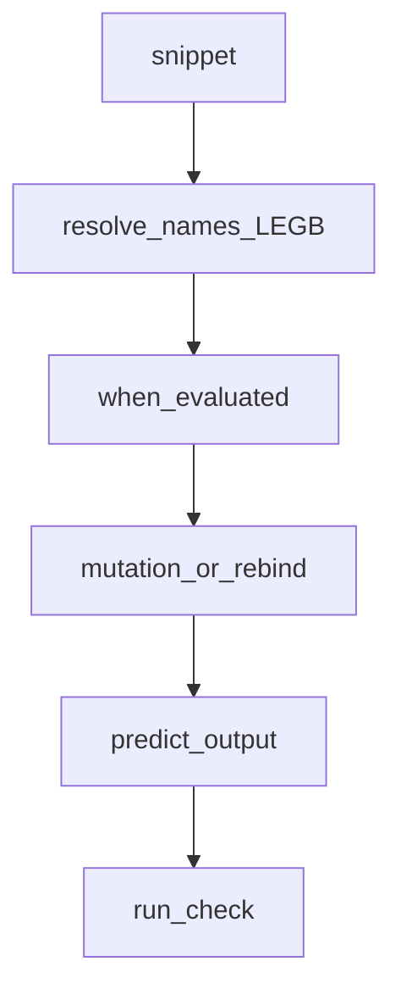

## Введение

Финишный drill: «что выведет код?» — замыкания в цикле, mutable default, `is` vs `==`, for/else, неочевидный порядок. Не заучивайте ответы источника — тренируйте чтение байт-кода смысла.

## Раздел: Классические ловушки

1. **Mutable default** — общий список между вызовами (PY04).
2. **Late binding closure** — `lambdas = [lambda: i for i in range(3)]` → все видят финальный `i`; фикс default-arg `lambda i=i: i`.
3. **is vs ==** на интернированных маленьких int/str — не полагайтесь в бизнес-логике.
4. **for/else** — else без break.
5. **Побочные эффекты в аргументах** / порядок вычислений.
6. Ошибка в `__init__` — объект может не доинициализироваться так, как ждёте.

Читайте код медленно: имена, области видимости, когда выражение вычисляется.

## Раздел: Мини-задачи «исправь»

На собесе часто просят не только сказать output, но починить. Шаблон ответа: 1) фактический результат 2) почему 3) идиоматичный фикс. Держите в голове LEGB, объектную модель и «ссылки на объекты».

Примеры для тренировки: модификация списка при итерации; `+=` у list vs tuple; сравнение set литералов; `True == 1`; цепочки `a < b < c`.

## Раздел: Частые вопросы с собеседования
**Вопрос.** Late binding в closure в цикле — суть ловушки?

**Ответ.** Lambda или inner function захватывает имя переменной цикла, не значение на итерации; к моменту вызова цикл завершён. Фикс: default arg `lambda i=i: i` фиксирует текущее значение.

**Вопрос.** Почему модифицировать list при итерации опасно?

**Ответ.** Итератор не ожидает изменения коллекции — пропуск элементов или RuntimeError. Копируйте список, итерируйте индексы с конца или стройте новый list comprehension.

**Вопрос.** `True == 1` — что говорить?

**Ответ.** `bool` подкласс `int`, поэтому сравнение значений истинно; `True is 1` — ложь. Не используйте такие сравнения в коде — только для объяснения модели типов.

**Вопрос.** LEGB — зачем на tricky-собесе?

**Ответ.** Порядок поиска имён: Local, Enclosing, Global, Builtins. Объясняет closure, shadowing и почему присвоение в функции делает local без `global`/`nonlocal`.

## Лаба

**Цель.** Набор из 8 карточек «output + фикс».

**Шаги.**
1. Соберите 8 сниппетов (включая late binding и mutable default).
2. Для каждого запишите предсказание **до** запуска.
3. Запустите — сверьте; где ошиблись, напишите правило одной строкой.
4. В Anki-приложении или бумаге — 8 front/back.

**В группу:** блиц на таймер 10 минут — 5 сниппетов.

**Готово, если…**
- [ ] Предсказываете late binding
- [ ] Не путаете is/==
- [ ] Чините for/else осмысленно

## Схема: Разбор сниппета

## Тест

### lambda в цикле range(3) — все 2?

**Ответ:** late binding на i

**Пояснение:** фикс lambda i=i: i.

### True == 1?

**Ответ:** True

**Пояснение:** bool подкласс int; не проектировать API так.

### Менять list при for?

**Ответ:** итерировать копию или новый список

**Пояснение:** изменение размера во время обхода — баги.

### [] is []?

**Ответ:** False

**Пояснение:** разные объекты; is сравнивает identity.

### 0.1 + 0.2 == 0.3?

**Ответ:** False

**Пояснение:** float binary; использовать decimal или isclose.

## Шпаргалка

<h3>Суть</h3>
<ul>
<li>читайте scope и время вычисления</li>
<li>mutable default / late binding — топ ловушек</li>
<li>ответ = output + why + fix</li>
</ul>
<h3>Фикс late binding</h3>
<pre><code>fs = [lambda i=i: i for i in range(3)]
</code></pre>

## Anki

### Front: Late binding в lambda — фикс?

Back: lambda i=i: i в list comprehension

### Front: for/else сработает когда?

Back: цикл закончился без break

### Front: a is b для больших int?

Back: может быть False при равных значениях — не опирайтесь на is

### Front: mutable default def f(x=[]) ловушка?

Back: один список на все вызовы

### Front: [[0]*3]*3 матрица — ловушка?

Back: общие ссылки на внутренние списки

### Front: except: bare except опасность?

Back: ловит BaseException включая KeyboardInterrupt

## Итоги

- Tricky-вопросы тренируются повторением с проверкой
- Всегда объясняйте why, не только число на экране
- Финал трека — capstone (PY24)

## Ссылки

- [Execution model — reference](https://docs.python.org/3/reference/executionmodel.html)
- [Data model](https://docs.python.org/3/reference/datamodel.html)
- [DEBAGanov — индекс вопросов серии (tricky)](https://github.com/DEBAGanov/interview_questions/blob/main/400%20вопросов%20с%20ответами%2C%20которые%20должен%20знать%20Python-разработчик.md)
- Learn | /game/learn
- Далее: [Capstone](/game/learn/py-senior-capstone)
