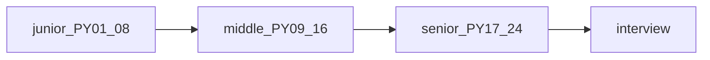

## Введение

Финальный выпуск серии PY01–PY24: чеклист по уровням, как готовиться через Anki/тест выпусков, и куда смотреть за пределами трека (appendix в SERIES.md). Полный список 1–407 — внешняя шпаргалка тем, не текст для заучивания дословно.

## Раздел: Ответ вслух

Я раскладываю собес на язык, данные и один сервис. По языку могу объяснить область видимости и цену структуры. По данным — транзакцию и индекс. По сервису — где факт и что будет при повторе запроса. Метакласс без этой тройки не заменяет middle.

## Раздел: Плохой ответ

Перечислить все 24 выпуска. На собесе слышно, умеете ли вы выбрать, а не прочитать оглавление.

## Раздел: Термины

Собеседование — interview. Компромисс — tradeoff. Источник правды — source of truth.

## Раздел: Чеклист по уровням

**Junior:** типы/коллекции, строки/файлы, функции/args, модули/venv, ООП-база, исключения, re/json/copy.

**Middle:** итераторы/генераторы, декораторы/with, FP/collections, MRO/dunder, PEP8/typing, asyncio, GIL/GC/память, тесты/pdb.

**Senior:** дескрипторы/метаклассы, perf/packaging/runtimes, веб-фреймворки, БД/кеш, prod concurrency, DRY/границы языка, tricky drill.

Перед собесом: пройдите Anki выпусков своего уровня + один уровень выше; 2–3 лабы руками, не глазами.

## Раздел: Пробелы и внешний список

Вне основной цепочки (см. SERIES appendix): TkInter, Spark/Scala, Java interop, узкий Memcached-ops уже частично в PY20, scientific stack NumPy/SciPy — отдельная ветка. Источник DEBAGanov содержит дубли — пользуйтесь индексом Q→slug в SERIES.md.

Связка с работой: перенесите примеры на ваш стек (FastAPI/Postgres/Redis вместо абстрактного Flask/Memcached), но сохраняйте канонические формулировки механизмов (GIL, MRO, descriptors).

## Раздел: Частые вопросы с собеседования
**Вопрос.** Как готовиться к Python-собесу по этой серии?

**Ответ.** Пройти выпуски по слабым темам из чеклиста, устно объяснить механизм (GIL, MRO, descriptors) без чтения слайдов, прогнать PY23 tricky. Индекс Q→slug в SERIES — карта, не заучивание 400 ответов.

**Вопрос.** Junior vs middle vs senior — один вопрос про concurrency?

**Ответ.** Junior: поток vs процесс и GIL в двух фразах. Middle: asyncio vs threads, когда `to_thread`. Senior: dogpile, backpressure, выбор runtime и observability под SLA.

**Вопрос.** Зачем typing на senior-собесе?

**Ответ.** Показывает зрелость API design и CI; senior проектирует контракты модулей и Protocol для extension points, не только ставит `Any`.

**Вопрос.** Что перенести из учебных примеров в резюме?

**Ответ.** Назовите реальный стек (FastAPI, Postgres, pytest), но формулировки механизмов оставьте точными — интервьюер проверяет глубину, не названия pet-проектов из курса.

## Лаба

**Цель.** Личный план на 7 дней до собеса.

**Шаги.**
1. Отметьте в чеклисте красным 5 слабых тем.
2. На каждую — 1 Anki-день из соответствующего PY-выпуска + 1 мини-лаба.
3. Mock-интервью 45 минут с коллегой по PY23 + системный вопрос из PY21/22.
4. Список ссылок на docs.python.org, которые откроете в перерыве (не StackOverflow-рандом).

**В группу:** обменяйтесь слабыми темами и проведите взаимный блиц.

**Готово, если…**
- [ ] Есть письменный 7-дневный план
- [ ] Закрыты дыры на уровень вакансии
- [ ] Знаете, где лежат appendix-темы

## Схема: Трек серии

## Тест

### Junior-блок серии закрывает?

**Ответ:** язык-база PY01–PY08

**Пояснение:** типы, функции, модули, ООП, исключения, stdlib.

### Зачем capstone при 400 вопросах?

**Ответ:** карта и приоритеты

**Пояснение:** серия схлопывает дубли по уровню.

### Темы вне SERIES appendix?

**Ответ:** one-off по вакансии

**Пояснение:** Tk/Spark не всем нужны.

### Middle must-have из трека?

**Ответ:** generators, decorators, MRO, typing, asyncio, GIL, pytest

**Пояснение:** PY09–PY16.

### Как готовиться по серии?

**Ответ:** Anki + лабы + mock

**Пояснение:** теория без кода на собесе слаба.

## Шпаргалка

<h3>Суть</h3>
<ul>
<li>Junior → Middle → Senior по PY01–24</li>
<li>готовься Anki + лабы + mock</li>
<li>полный список вопросов — индекс тем, не копипаст ответов</li>
</ul>
<h3>Старт повторения</h3>
<pre><code>PY02 коллекции · PY10 декораторы · PY15 GIL · PY17 meta · PY23 drill
</code></pre>

## Anki

### Front: Middle must-have темы трека?

Back: generators, decorators, MRO, typing, asyncio, GIL/GC, pytest

### Front: Senior must-have темы трека?

Back: descriptors/metaclasses, perf/packaging, web, DB/cache, prod diagnostics, design

### Front: Где индекс вопрос→выпуск?

Back: SERIES.md в каталоге python Learn

### Front: Первичный источник фактов Python?

Back: docs.python.org, PEPs, packaging.python.org

### Front: DEBAGanov в серии — роль?

Back: индекс номеров вопросов, не канон ответов

### Front: Три якоря повторения перед собесом?

Back: PY02 коллекции, PY10 декораторы, PY15 GIL, PY23 drill (любые три из шпаргалки)

## Итоги

- Серия — учебная карта Junior→Senior, не замена практике
- Повторяйте слабости, а не только любимые темы
- Удачи на собесе — и пишите код руками

## Ссылки

- [Python 3 Documentation](https://docs.python.org/3/)
- [PEP Index](https://peps.python.org/)
- [Python Packaging User Guide](https://packaging.python.org/)
- [DEBAGanov — индекс вопросов серии (полный список 1–407)](https://github.com/DEBAGanov/interview_questions/blob/main/400%20вопросов%20с%20ответами%2C%20которые%20должен%20знать%20Python-разработчик.md)
- Learn | /game/learn
- Назад: [Tricky drill](/game/learn/py-interview-tricky)
