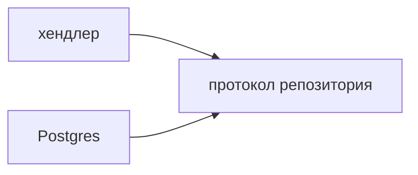

## Введение

На собесе SOLID спрашивают, чтобы увидеть границу модуля, а не аббревиатуру. Достаточно одного класса «заявка» и честного места, где принцип уже лишний.

## Раздел: Пять правил на одном сервисе

- **SRP.** Класс меняется по одной причине. `TicketRepository` пишет в Postgres. Смена текста письма не должна его трогать.
- **OCP.** Новый канал уведомления — новый класс с тем же методом `send`, а не ещё один `if channel ==`.
- **LSP.** Подтип можно подставить вместо базового. Если `FreeTicket` ломает `pay()`, это уже другой тип.
- **ISP.** Клиенту API не нужен интерфейс из двадцати методов. Узкий `TicketReader` честнее «бога» `ITicket`.
- **DIP.** Хендлер FastAPI зависит от протокола репозитория, а не от конкретного `psycopg`. Подмена в тесте становится возможной.

## Раздел: Ответ вслух

Я дроблю код по причине изменения. Ветки `if` на каждый новый канал выношу в отдельные отправители. Зависимость направлена на протокол, поэтому тест подставляет фейк. Если класс один и живёт в скрипте на сто строк, пять интерфейсов я не рисую.

## Раздел: Плохой ответ

Плохой ответ: «SOLID — это всегда мелкие классы и интерфейс на каждый метод». Дробление без причины изменения только мешает читать код.

## Раздел: Термины

Единственная причина изменения — single responsibility. Открыт для расширения — open-closed. Подстановка — Liskov substitution. Узкий интерфейс — interface segregation. Зависимость от абстракции — dependency inversion.

## Лаба

**20 минут.** Возьмите функцию, которая и сохраняет заявку, и шлёт письмо. Разрежьте её на репозиторий и отправитель. Напишите, какой принцип вы применили и какой сознательно не применяли.

**Готово, если…**
- [ ] У сохранения и письма разные причины меняться
- [ ] Хендлер не импортирует конкретный SMTP

## Схема: Зависимость внутрь

## Тест

### Куда деть вторую причину изменения класса?

**Ответ:** в другой модуль

**Пояснение:** Иначе следующий запрос снова раздует тот же файл.

### Новый тип уведомления без правки старых классов. Какой принцип?

**Ответ:** open-closed

**Пояснение:** Добавляется новый отправитель, ветка `if` не растёт.

### Подкласс бросает исключение на методе базового класса. Что сломано?

**Ответ:** подстановка Лисков

**Пояснение:** Вызывающий код не может обращаться с ним как с базовым типом.

### Интерфейс на двадцать методов у одного клиента. Что нарушено?

**Ответ:** узкий интерфейс

**Пояснение:** Клиент зависит от методов, которые ему не нужны.

### Хендлер создаёт `psycopg.connect` внутри себя. Куда смотрит зависимость?

**Ответ:** на конкретную библиотеку

**Пояснение:** Инверсия — зависеть от протокола и получить реализацию снаружи.

## Шпаргалка

<ul><li>Одна причина изменения</li><li>Новое поведение — новый тип</li><li>Подтип не ломает контракт</li><li>Узкий протокол</li><li>Зависимость внутрь, деталь снаружи</li></ul>

## Anki

### Front: Что такое одна причина изменения?

Back: Класс меняют только из-за одной ответственности.

### Front: Чем OCP отличается от «дописать if»?

Back: Новый вариант — новый класс, старый код не ветвится.

### Front: Когда подтип нарушает LSP?

Back: Когда его нельзя подставить вместо базового без сюрприза.

### Front: Зачем узкий Protocol в Python?

Back: Клиент зависит только от нужных методов.

### Front: Куда направлен DIP?

Back: Высокоуровневый код зависит от абстракции, не от драйвера.

### Front: Когда SOLID не разворачивать?

Back: В коротком скрипте без второй причины изменения.

## Итоги

- Называйте принцип и показывайте шов в коде
- Интерфейс без клиента — шум
- Протокол репозитория важнее названия паттерна

## Ссылки

- [ООП база](/game/learn/py-oop-basics)
- [PEP 8 и typing](/game/learn/py-typing-pep8-static)
