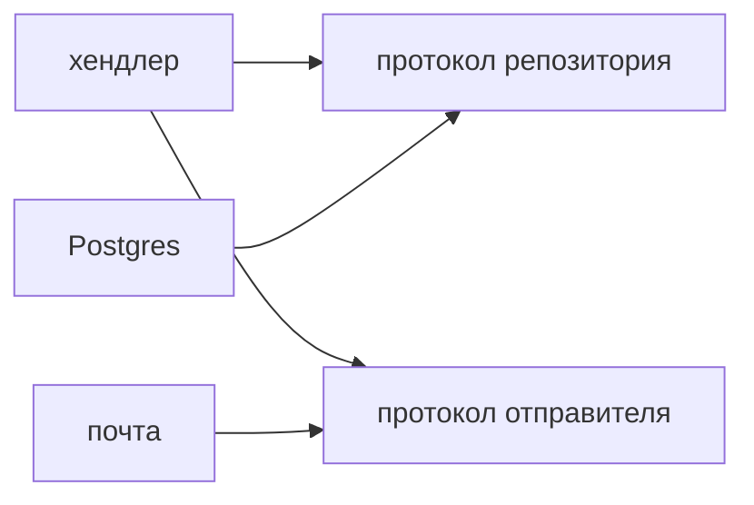

## Введение

На собеседовании SOLID спрашивают не для того, чтобы услышать пять английских фамилий. Интервьюер хочет увидеть, где в вашем коде проходит шов: что можно менять отдельно, что можно подставить в тест и что вы сознательно оставили в одном месте. Аббревиатура без примера звучит как конспект. Пример без названия звучит как «я просто так написал». Нужны оба.

Рабочий пример этого выпуска — сервис заявок. Есть запись в Postgres, письмо автору и растущий список каналов: почта, мессенджер, внутренняя лента. На этом куске умещаются все пять правил, и на нём же видно, где правило уже лишнее. Скрипт на сто строк, который запускают раз в ночь и не собираются развивать, не обязан обрастать протоколами. Сервис, в который каждую неделю добавляют канал и новое правило доступа, без швов начинает ломаться в одном файле.

Дальше каждый принцип разобран как решение, а не как лозунг. Рядом — цена, которую вы платите, если применить его слишком рано. На middle-собесе как раз ждут эту оговорку: вы умеете дробить код и умеете этого не делать.

## Раздел: Пять правил на одном сервисе

**SRP, одна причина изменения.** Класс или модуль меняют по одному поводу. `TicketRepository` пишет и читает заявку. Текст письма, выбор канала и правило «кому можно закрывать» живут в других местах. Если завтра маркетинг поменяет тон письма, репозиторий не открывают. Если завтра поменяется имя колонки, письмо не открывают. Причина изменения — это не «одна публичная функция», а один источник требований. Репозиторий может иметь `add`, `get` и `list` и всё ещё оставаться одной ответственностью: форма строки в базе.

Путают SRP с размером файла. Файл на сорок строк, в котором сохранение, SMTP и проверка роли свалены вместе, нарушает правило сильнее, чем файл на двести строк, который только собирает SQL. Дробить «чтобы было мелко» без второй причины — шум.

**OCP, открыт для расширения.** Новый канал уведомления — новый класс с тем же методом `send`, а не ещё одна ветка `if channel == "mail"`. Старый код почтового отправителя не редактируют, когда появляется лента. Список отправителей собирают снаружи: по имени канала находят объект. В Python это обычный словарь `dict[str, Sender]`, не иерархия ради иерархии.

OCP не запрещает править баг. Если почта падает на пустом адресе, вы меняете почтовый класс. Запрет другой: не вшивать каждый будущий вариант в уже написанную ветку. Как только третий `if` появляется по одной и той же оси, ось пора вынести.

**LSP, подстановка.** Подтип можно поставить туда, где ждали базовый тип, и вызывающий код не узнает сюрприза. Если `FreeTicket.pay()` бросает «бесплатным платить нельзя», а вызывающий код уже обработал обычный отказ платежа иначе, подстановка сломана. Бесплатная заявка — не «билет, который иногда не билет», а другой сценарий со своим контрактом. Общий контракт стоит держать узким: `notify()` обещает доставку или понятную ошибку доставки, но не обещает, что каждый подтип умеет списывать деньги.

В Python нет жёсткой проверки подтипов на этапе запуска, поэтому сюрприз всплывает в проде. Аннотация `Protocol` и тест, который прогоняет все реализации через один и тот же вызов, дешевле, чем рассказ про Лисков без кода.

**ISP, узкий интерфейс.** Клиенту не нужен тип из двадцати методов. Ручке, которая показывает карточку, достаточно `get`. Воркер уведомлений не должен зависеть от `delete` и `pay`. Узкий `Protocol` с одним-двумя методами честнее «бога» `ITicket`. Лишний метод в протоколе — это лишняя причина менять всех, кто его реализует, даже если они методом не пользуются.

Интерфейс без второго клиента не нужен. Пока `get` вызывает только одна ручка, отдельный протокол — церемония. Он окупается, когда появляется тест с подделкой или второй вызывающий код.

**DIP, зависимость от абстракции.** Хендлер FastAPI зависит от протокола репозитория, а не от `psycopg.connect` внутри себя. Реализацию передают снаружи: из зависимости FastAPI, из фабрики, из теста. Тогда тест подставляет память вместо Postgres и не поднимает базу ради проверки правила «чужую заявку закрывать нельзя». Направление важнее названия: деталь (драйвер, SMTP, часы) стоит с краю, правило — в середине.

DIP не требует контейнера внедрения зависимостей. Явный аргумент конструктора или аргумент функции уже есть инверсия. Контейнер имеет смысл, когда таких аргументов становится много и их состав повторяется в каждой ручке.

## Раздел: Разбор на примере

Исходная функция, которую приносят на ревью, выглядит цельной и поэтому опасной. Она открывает соединение, пишет заявку, выбирает канал строкой и шлёт письмо. Любая правка затрагивает всё сразу.

Первый шов — сохранение. Функция `save_ticket` только вызывает репозиторий. Репозиторий принимает уже проверенные поля и возвращает идентификатор. Он не знает, кто попросил сохранить и надо ли писать письмо. Второй шов — уведомление. `Notifier.send(ticket_id, channel)` смотрит в словарь отправителей. Почтовый класс знает SMTP. Класс ленты знает внутренний API. Ни один не знает про INSERT.

Третий шов — правило доступа, и его часто забывают, потому что оно не похоже на «технологию». `can_close(actor, ticket)` отвечает да или нет. Репозиторий не должен внутри себя решать, менеджер ли это. Иначе смена оргструктуры переписывает SQL.

Сборка в хендлере остаётся тонкой: проверить вход, спросить правило, сохранить, уведомить, вернуть код ответа. Хендлер — место, где видно порядок. Он не место, где живёт текст письма и не место, где живёт SQL.

Тест на правило доступа подставляет репозиторий, который отдаёт чужую заявку, и проверяет отказ. Тест на новый канал добавляет отправитель в словарь и не трогает почту. Тест на репозиторий, если он нужен, идёт отдельно и уже смотрит SQL. Три теста держатся за три причины изменения. Это и есть практический SOLID.

Где правило не применяют. Ночной скрипт сверки, который читает CSV и пишет один отчёт, можно оставить функцией. У него одна причина меняться: формат сверки. Выделять пять протоколов «на вырост» значит прятать единственный сценарий за слоями, которые никто не вызывает.

## Раздел: Где это ломается

Первая поломка — интерфейс на каждый класс. Появляется `AbstractTicket`, `ITicket`, `TicketBase` и один наследник. На собесе это выглядят как знание слов. В репозитории это шум: прыжок по файлам ради одной реализации. Протокол заводят от второго клиента или от теста, не от любви к схемам.

Вторая поломка — наследник, который ломает контракт тихо. `AuditTicketRepository.save` кроме записи ещё шлёт письмо. Кто ждал «сохранить», получает побочный эффект. Это нарушение и SRP, и LSP сразу: подтип делает больше, чем обещал базовый вызов. Побочный эффект выносят наружу, в хендлер, где он виден.

Третья поломка — зависимость, спрятанная в функции. Хендлер создаёт клиент Postgres сам. В сигнатуре чисто, в тесте больно. Инверсия начинается с того, что объект приходит аргументом. Не обязательно называть это паттерном в коде. Достаточно, чтобы тест мог передать фейк.

Четвёртая поломка — «открыты для расширения» через гигантский `match` по строкам, который правят каждый спринт. Формально новые ветки добавляются в одном месте, фактически это закрытый перечень, который растёт. Словарь стратегий или отдельные модули, которые регистрируются рядом с каналом, читаются лучше.

На ревью полезный комментарий звучит так: «здесь две причины изменения, давайте разнесём сохранение и письмо». Бесполезный звучит так: «нарушен SOLID». Второй не говорит, какой шов провести.

## Раздел: Ответ вслух

Я дроблю код по причине изменения. Сохранение заявки и текст уведомления — разные причины, поэтому это разные модули. Новый канал — новый отправитель с тем же методом, старые ветки `if` не растут. Хендлер зависит от протокола репозитория, и тест подставляет память. Подтип не бросает сюрприз там, где базовый контракт обещал обычный результат. Если сценарий один и живёт в коротком скрипте, пять интерфейсов я не рисую: их некому реализовывать второй раз.

Если просят пример, я беру один дифф и показываю шов пальцем, а не перечисляю буквы. Если просят, что я не буду дробить, я называю скрипт без второй причины изменения. Такой ответ короче лекции и его можно защитить кодом.

## Раздел: Плохой ответ

Плохой ответ: «SOLID — это всегда мелкие классы и интерфейс на каждый метод». Дробление без причины изменения только мешает читать код. Второй плохой ответ: проговорить расшифровку и замолчать, когда просят показать, куда деть письмо. Расшифровка проверяет память. Шов проверяет, как вы проектируете.

Ещё один слабый ход — объявить, что в Python SOLID не нужен, потому что есть функции. Функция тоже нарушает SRP, если она и пишет в базу, и шлёт почту. Правила про границы модуля, а не про ключевое слово `class`.

## Раздел: Термины

Единственная причина изменения — single responsibility. Открыт для расширения, закрыт для правки старого варианта — open-closed. Подстановка без сюрприза — Liskov substitution. Узкий интерфейс под клиента — interface segregation. Зависимость направлена на абстракцию, деталь приходит снаружи — dependency inversion. Протокол в Python — `Protocol`: структурный контракт методов, без обязательного базового класса. Фейк в тесте — реализация протокола в памяти, не настоящий Postgres и не настоящий SMTP.

## Лаба

**Цель.** Увидеть два шва на одной функции и честно назвать принцип, который вы не стали применять.

**Шаги.**

1. Возьмите функцию, которая проверяет роль, пишет заявку в базу и отправляет письмо. Можно набросать её псевдокодом на полэкрана, без рабочего SMTP.
2. Вынесите запись в репозиторий с методами `add` и `get`. Репозиторий не импортирует почту и не знает ролей.
3. Вынесите отправку в маленький протокол `send(ticket_id: str) -> None` и одну реализацию «почта». Хендлер вызывает протокол, а не SMTP-библиотеку.
4. Оставьте проверку роли в хендлере или в отдельной функции `can_close`. Не прячьте её внутрь SQL.
5. Напишите два теста без базы: отказ для чужой заявки и вызов отправителя после успешного сохранения. Отправитель в тесте — список вызовов в памяти.
6. Отдельным абзацем напишите, какой принцип вы сознательно не разворачивали. Обычно это отдельный интерфейс на роль или иерархия заявок, если подтип один.

**Готово, если…**

- [ ] У сохранения и письма разные причины меняться, и это видно по импортам
- [ ] Хендлер не создаёт соединение с базой и не импортирует конкретный SMTP
- [ ] Тест подменяет хранилище и отправитель без сети
- [ ] В заметке назван принцип, который вы не стали внедрять, и почему

## Схема: Зависимость внутрь

## Тест

### Куда деть вторую причину изменения класса?

**Ответ:** в другой модуль

**Пояснение:** Иначе следующий запрос снова раздует тот же файл.

### Новый тип уведомления без правки старых классов. Какой принцип?

**Ответ:** open-closed

**Пояснение:** Добавляется новый отправитель, ветка `if` не растёт.

### Подкласс бросает исключение на методе базового класса. Что сломано?

**Ответ:** подстановка Лисков

**Пояснение:** Вызывающий код не может обращаться с ним как с базовым типом.

### Интерфейс на двадцать методов у одного клиента. Что нарушено?

**Ответ:** узкий интерфейс

**Пояснение:** Клиент зависит от методов, которые ему не нужны.

### Хендлер создаёт `psycopg.connect` внутри себя. Куда смотрит зависимость?

**Ответ:** на конкретную библиотеку

**Пояснение:** Инверсия — зависеть от протокола и получить реализацию снаружи.

## Шпаргалка

<ul><li>Одна причина изменения</li><li>Новое поведение — новый тип</li><li>Подтип не ломает контракт</li><li>Узкий протокол</li><li>Зависимость внутрь, деталь снаружи</li></ul>

## Anki

### Front: Что такое одна причина изменения?

Back: Класс меняют только из-за одной ответственности.

### Front: Чем OCP отличается от «дописать if»?

Back: Новый вариант — новый класс, старый код не ветвится.

### Front: Когда подтип нарушает LSP?

Back: Когда его нельзя подставить вместо базового без сюрприза.

### Front: Зачем узкий Protocol в Python?

Back: Клиент зависит только от нужных методов.

### Front: Куда направлен DIP?

Back: Высокоуровневый код зависит от абстракции, не от драйвера.

### Front: Когда SOLID не разворачивать?

Back: В коротком скрипте без второй причины изменения.

## Мнемоника

### acronym: SOLID

**Задание:** Пять правил и один смысл буквы, не фамилия.

**Элементы:**
- Одна причина изменения
- Новый вариант — новый тип
- Подтип без сюрприза
- Узкий протокол
- Зависимость снаружи

**Подсказка:** S O L I D. На примере: сохранение, письмо, правило доступа.

**Ответ:** SRP OCP LSP ISP DIP

## Итоги

- Называйте принцип и показывайте шов в коде
- Интерфейс без второго клиента — шум
- Протокол репозитория важнее названия паттерна
- Функция нарушает те же границы, что и класс
- Оговорка «здесь дробить рано» — часть взрослого ответа

## Ссылки

- [ООП база](/game/learn/py-oop-basics)
- [PEP 8 и typing](/game/learn/py-oop-advanced-mro)
