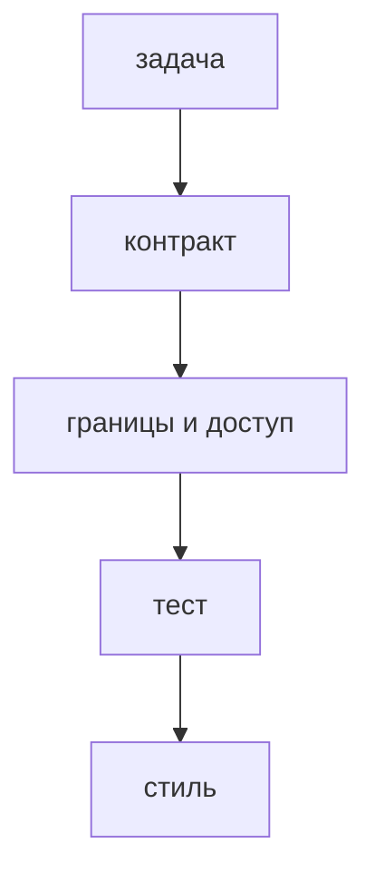

## Введение

Ревью — это смена глаз до продакшена, не суд над автором. На собесе ждут порядок: сначала поведение и риск, потом имена.

## Раздел: Порядок прохода

1. Что обещает задача и что реально меняет diff.
2. Контракт: коды ответов, поля, миграция, обратная совместимость.
3. Ошибки и границы: пустой ввод, повторный запрос, чужой идентификатор.
4. Тест на новое поведение. Нет теста — нет доказательства.
5. Секреты, SQL-склейка, данные клиента в логе.
6. Имена и размер функции — если до этого дошли.

Замечание пишите про код: «здесь статус 200 при конфликте» лучше, чем «так не делают».

## Раздел: Ответ вслух

Я читаю описание PR и diff вместе. Сначала проверяю, не сломан ли контракт и нет ли дыры в доступе. Потом смотрю, есть ли тест на новый случай. Стиль отдаю линтеру. Спорное решение прошу вынести в комментарий к PR, а не в чат.

## Раздел: Плохой ответ

Плохой ответ: «я одобряю, если пайплайн зелёный». Зелёный пайплайн не видит чужой объект и забытую миграцию.

## Раздел: Термины

Просмотр изменений — code review. Запрос на слияние — pull request. Замечание — comment. Блокер — change request.

## Лаба

**20 минут.** Возьмите учебный PR с новым полем. Выпишите три замечания в порядке: контракт, тест, безопасность. Одно стилистическое замечание отложите отдельно и пометьте, что его закроет линтер.

## Схема: Порядок ревью

## Тест

### Что смотреть раньше имён переменных?

**Ответ:** контракт и доступ

**Пояснение:** Сломанный ответ API дороже кривого имени.

### Пайплайн зелёный, теста на новый статус нет. Можно одобрять?

**Ответ:** нет, поведения не видно

**Пояснение:** Старые тесты не знают про новую ветку.

### Как сформулировать замечание?

**Ответ:** про конкретную строку

**Пояснение:** «Плохо» не говорит автору, что исправить.

### Секрет в диффе. Какой статус ревью?

**Ответ:** блокер до ротации

**Пояснение:** Слияние уже раздаёт секрет всем, у кого есть история.

### Зачем автор отвечает на комментарий в треде, а не в мессенджере?

**Ответ:** решение остаётся у диффа

**Пояснение:** Следующий читатель видит, почему строку оставили.

## Шпаргалка

<ul><li>Сначала поведение и доступ</li><li>Новое поведение — новый тест</li><li>Секрет и SQL-склейка блокируют</li><li>Стиль отдайте линтеру</li></ul>

## Anki

### Front: Первый вопрос на ревью?

Back: Совпадает ли diff с обещанием задачи и контрактом.

### Front: Что делает замечание полезным?

Back: Указывает место и ожидаемое поведение.

### Front: Зелёный CI заменяет ревью?

Back: Нет, он не видит смысл задачи и доступ к чужим данным.

### Front: Когда стиль уместен в ревью?

Back: После контракта, границ и теста.

### Front: Куда писать спорное решение?

Back: В тред PR, рядом с диффом.

### Front: Что блокирует слияние сразу?

Back: Секрет, дыра доступа, сломанный контракт без теста.

## Итоги

- Ревью ловит риск, линтер ловит форму
- Замечание привязано к строке
- История решения живёт в PR

## Ссылки

- [SOLID](/game/learn/py-solid)
- [Тесты и pdb](/game/learn/py-testing-debug)
