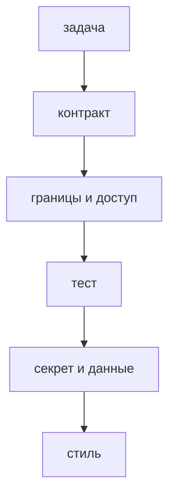

## Введение

Ревью — это вторая пара глаз до продакшена, а не суд над автором и не поиск опечаток. На собеседовании ждут порядок прохода: сначала поведение, контракт и риск, потом доказательство тестом, и только в конце имена. Зелёный пайплайн этот порядок не заменяет. Он говорит, что уже написанные проверки прошли. Он не говорит, что новая ветка вообще кем-то покрыта и что чужой идентификатор в запросе отклоняется.

Хорошее замечание привязано к строке и к ожидаемому поведению. «Так не делают» автор не может починить, потому что не видит критерия. «При конфликте версии здесь уходит 200, нужен 409» можно починить и можно потом найти в истории. Спорное решение остаётся в треде запроса на слияние, а не в мессенджере: следующий читатель диффа не ходит по чатам.

Этот выпуск — про Python-сервис с FastAPI и Postgres, но порядок тот же для фронтенда. Меняется только набор рисков: вместо SQL-склейки смотрят разметку и секрет в бандле. Стиль в обоих случаях отдаётся линтеру, иначе ревью тонет в пробелах и не доходит до дефекта.

## Раздел: Порядок прохода

Начинайте с текста задачи и описания запроса. Дифф без обещания легко одобрить: он «аккуратный», но делает не то. Сверьте три вещи. Что должно измениться для вызывающего кода. Что реально меняют файлы. Чего в задаче не было, но оно приехало заодно. Попутный рефакторинг на двести строк рядом с фиксом на пять прячет ошибку. Его либо отделяют, либо явно называют в описании.

Дальше контракт. Коды ответов, имена полей, обязательность, формат ошибки, миграция схемы. Обратная совместимость важнее красоты: старый клиент не обязан знать про новое поле, но не должен ломаться от переименования. Если миграция необратима, в описании запроса должен быть порядок выкладки: сначала код, который умеет старую и новую форму, потом смена данных.

Затем границы и доступ. Пустой ввод, повторный запрос, чужой идентификатор, слишком длинная строка, отсутствие права. Именно здесь живут дефекты, которые пайплайн не видит, потому что старые тесты ходят своим пользователем в свои объекты. Вопрос ревьюера простой: «какая строка запрещает это чужому». Если строки нет, замечание блокирует слияние.

Потом тест. Новое поведение без нового теста — это рассказ. Тест должен падать на старом коде и проходить на новом. Проверка названия функции не считается. Для ошибки нужен отдельный тест, не только счастливый путь. Если поведение зависит от времени или сети, в тесте подставляют часы и фейк, а не sleep.

Безопасность идёт рядом с границами, не «если останется время». Секрет в диффе, склейка SQL, данные клиента в логе, отладочный флаг, который оставляет трассировку в ответе. Такое замечание — блокер до ротации секрета или до удаления строки. Одобрить «а потом поправим» значит раздать секрет всем, у кого есть история репозитория.

Имена, размер функции и порядок импортов — последний проход, и только если линтер это не ловит. Замечание про имя уместно, когда имя врёт о контракте: функция называется `get`, а внутри пишет. Замечание про длину уместно, когда в одной функции две причины изменения. Остальное — шум, который учит автора прятать смысл за переносами.

## Раздел: Как писать замечание

Полезное замечание состоит из места, наблюдения и ожидаемого поведения. Место даёт интерфейс ревью: строка или фрагмент. Наблюдение — что код делает сейчас, без оценки человека. Ожидание — что должно быть и почему это важно вызывающему коду. Тон деловой. «Ты опять забыл» не чинит дефект и портит следующий запрос: автор начнёт защищаться вместо правки.

Различайте блокер и пожелание. Блокер — сломанный контракт, дыра доступа, секрет, отсутствие теста на новое поведение, миграция без порядка выкладки. Пожелание — имя, которое можно улучшить, альтернативная структура, если текущая уже верна. Если всё помечено блокером, автор перестаёт видеть настоящий риск. Если дыру пометили пожеланием, её вольют.

Автор отвечает в треде у диффа. «Поправил» без ссылки на коммит или без объяснения, почему строку оставили, через неделю не читается. Если решение спорное и его оставляют, одна фраза «оставляем N+1, список не больше двадцати, см. комментарий» стоит дороже молчаливого одобрения. Молчание не переносит контекст.

Ревьюер не переписывает запрос за автора, кроме совсем короткого предложения. Патч на сто строк в комментарии снимает ответственность и часто сам содержит новые ошибки. Вопрос «что будет при повторной отправке» полезнее готового кода, если автор контекст знает лучше.

Срок тоже часть ревью. Запрос, который висит без первого прохода несколько дней, начинает вбирать новые коммиты, и смотреть его заново больнее. Короткий первый проход по контракту и риску в тот же день полезнее идеального разбора через неделю.

## Раздел: Разбор на примере

Представьте запрос «добавить статус архива». Дифф: новое поле, ручка PATCH, кнопка на фронте. Описание: «можно архивировать». Пайплайн зелёный, потому что старые тесты создания заявки живы.

Первый вопрос — контракт. Какой код, если заявка уже в архиве. Какой код, если идентификатор чужой. Есть ли миграция с значением по умолчанию для старых строк. Второй вопрос — тест. Есть ли проверка, что чужой пользователь получает отказ, и что повторный архив не плодит вторую запись истории. Третий вопрос — данные. Не пишется ли в лог тело запроса целиком, вместе с комментарием клиента.

Замечания в этом порядке. Сначала: «чужой id проходит в UPDATE, нужна проверка владельца до записи, ожидаю 404 или 403 по нашей договорённости». Затем: «нет теста на повторный архив, без него регрессию не поймаем». Затем, если дошли: «лог печатает comment, уберите поле из записи». Имя переменной `s` в этот проход не обсуждают. Его поправит форматтер или следующий спокойный заход.

Если автор ответил «проверка будет в следующем запросе», это не закрытие блокера. Доступ либо есть в этом диффе, либо запрос не готов. Откладывать дыру в «потом» — способ потерять её.

## Раздел: Где ревью ломается

Ревью ломается, когда его превращают в чтение стиля. Десять комментариев про кавычки, ноль про поведение. Автор учится угождать формату и перестаёт звать ревьюера на опасные места. Линтер и форматтер должны быть в пайплайне до человека.

Ревью ломается, когда одобряют знакомого автора без чтения. Доверие к человеку не заменяет чтение контракта. Именно в «маленьких» правках знакомых людей уезжают забытые флаги.

Ревью ломается, когда замечание живёт в чате. Через месяц дифф зелёный, а почему отвергли вариант с общей сессией, никто не помнит. Тред у строки переживает смену мессенджера.

Ревью ломается, когда ревьюер требует идеальную архитектуру в чужой задаче на два часа. Большой перенос уместен отдельным запросом. В текущем достаточно не ухудшить шов: не дописывать третью ответственность в и так толстую функцию, если можно положить ветку рядом.

## Раздел: Ответ вслух

Я читаю описание запроса и дифф вместе. Сначала сверяю обещание задачи с контрактом: коды, поля, миграция. Потом ищу границы — пустой ввод, повтор, чужой идентификатор — и строку, которая эти границы держит. Если поведения нового нет в тестах, я не одобряю, даже когда пайплайн зелёный. Секрет и склейку SQL блокирую сразу. Стиль оставляю линтеру. Спорное решение прошу оставить комментарием у диффа, чтобы следующий читатель видел причину.

## Раздел: Плохой ответ

Плохой ответ: «я одобряю, если пайплайн зелёный». Зелёный пайплайн не видит чужой объект, забытую миграцию и секрет в примере конфигурации. Второй плохой ответ: «я смотрю, чтобы код был красивым». Красота без контракта пропускает дефект и задерживает поставку спором о вкусе.

## Раздел: Термины

Просмотр изменений — code review. Запрос на слияние — pull request или merge request. Замечание — comment. Просьба изменить до слияния — change request, блокер. Неблокирующее замечание — suggestion, nit. Непрерывная проверка — CI. Линтер ловит форму. Ревьюер ловит смысл и риск.

## Лаба

**Цель.** Разложить замечания по риску, а не по вкусу.

**Шаги.**

1. Возьмите учебный дифф или набросайте его: новое поле «архив», ручка обновления, лог всего тела, нет теста на чужой идентификатор, имя переменной из одной буквы.
2. Выпишите три замечания в порядке: контракт или доступ, тест, безопасность. У каждого — место, что не так, что ожидаете.
3. Одно стилистическое замечание вынесите отдельно и пометьте, что его закроет линтер, если правило уже есть.
4. Решите, какие из четырёх блокируют слияние. Стиль не блокирует. Отсутствие проверки владельца блокирует.
5. Напишите короткий ответ автора на блокер: что измените в этом же запросе, а не «в следующем».

**Готово, если…**

- [ ] Блокер назван раньше стиля
- [ ] В замечании есть ожидаемое поведение, не только оценка
- [ ] Для нового поведения указан отсутствующий тест
- [ ] Секрет или лишние данные в логе не оставлены «на потом»

## Схема: Порядок ревью

## Тест

### Что смотреть раньше имён переменных?

**Ответ:** контракт и доступ

**Пояснение:** Сломанный ответ API дороже кривого имени.

### Пайплайн зелёный, теста на новый статус нет. Можно одобрять?

**Ответ:** нет, поведения не видно

**Пояснение:** Старые тесты не знают про новую ветку.

### Как сформулировать замечание?

**Ответ:** про конкретную строку

**Пояснение:** «Плохо» не говорит автору, что исправить.

### Секрет в диффе. Какой статус ревью?

**Ответ:** блокер до ротации

**Пояснение:** Слияние уже раздаёт секрет всем, у кого есть история.

### Зачем автор отвечает на комментарий в треде, а не в мессенджере?

**Ответ:** решение остаётся у диффа

**Пояснение:** Следующий читатель видит, почему строку оставили.

## Шпаргалка

<ul><li>Сначала поведение и доступ</li><li>Новое поведение — новый тест</li><li>Секрет и SQL-склейка блокируют</li><li>Стиль отдайте линтеру</li><li>Спорное решение живёт в треде</li></ul>

## Anki

### Front: Первый вопрос на ревью?

Back: Совпадает ли diff с обещанием задачи и контрактом.

### Front: Что делает замечание полезным?

Back: Указывает место и ожидаемое поведение.

### Front: Зелёный CI заменяет ревью?

Back: Нет, он не видит смысл задачи и доступ к чужим данным.

### Front: Когда стиль уместен в ревью?

Back: После контракта, границ и теста.

### Front: Куда писать спорное решение?

Back: В тред PR, рядом с диффом.

### Front: Что блокирует слияние сразу?

Back: Секрет, дыра доступа, сломанный контракт без теста.

## Мнемоника

### peg: Замечание на ревью

**Задание:** Порядок фразы, а не «мне не нравится».

**Элементы:**
- что сломается
- какой шов
- какой фикс

**Подсказка:** Без последствия комментарий звучит как вкус.

**Ответ:** 1 последствие · 2 шов · 3 фикс

## Итоги

- Ревью ловит риск, линтер ловит форму
- Замечание привязано к строке и к ожиданию
- История решения живёт в запросе на слияние
- Зелёный пайплайн не доказывает новую ветку
- Блокер и пожелание нельзя мешать в одну кучу

## Ссылки

- [SOLID](/game/learn/py-solid)
- [Тесты и pdb](/game/learn/py-threading-gil-gc)
