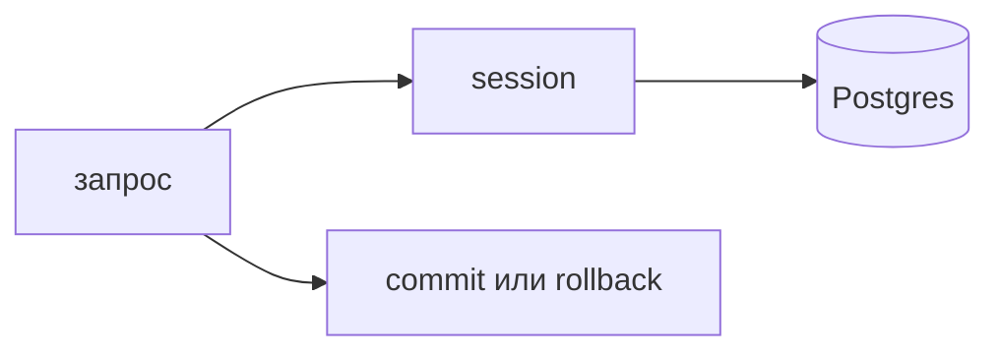

## Введение

Вакансии ждут PostgreSQL и ORM вместе. SQLAlchemy — обычный ответ на Python-стеке. Смысл не в декораторах модели, а в том, какой SQL уйдёт в базу и кто закроет транзакцию.

## Раздел: Сессия и модель

Модель описывает таблицу. Сессия копит изменения в памяти до `commit`. `flush` отправляет SQL, но транзакцию не заканчивает. Ошибка пути — `commit` в репозитории на каждый `add`: вызывающий больше не может собрать несколько записей в одну транзакцию.

В FastAPI сессию открывают на запрос и закрывают в `finally` или через зависимость. Держать одну глобальную сессию на процесс нельзя: она не дружит с конкурентными запросами.

N+1: список заявок, и на каждую лениво читается автор. Лечится `selectinload` / `joinedload` или явным JOIN, который вы можете показать. Если SQL не можете прочитать, ORM уже мешает.

## Раздел: Ответ вслух

Модель — это таблица в коде, сессия — единица работы. Коммичу на границе запроса, не внутри каждого метода. Список с связями проверяю по числу запросов: один список и один догруз связей, а не запрос на строку. Сырой SQL оставляю там, где план важнее удобства.

## Раздел: Плохой ответ

Плохой ответ: «ORM, значит SQL знать не нужно». На собесе как раз просят объяснить JOIN, который библиотека построила.

## Раздел: Термины

Единица работы — unit of work. Сессия — session. Ленивая загрузка — lazy load. Жадина N+1 — N+1 select. Явная загрузка — eager load.

## Лаба

**25 минут.** Опишите две модели, `Ticket` и `User`. Напишите выборку списка заявок с автором так, чтобы авторов не читали в цикле. Зафиксируйте, где вызывается `commit`, а где только `add`.

## Схема: Граница транзакции

## Тест

### Когда изменения модели попадают в базу?

**Ответ:** на commit

**Пояснение:** До этого они живут в сессии. `flush` шлёт SQL внутри ещё открытой транзакции.

### Почему одна сессия на весь процесс — ошибка?

**Ответ:** запросы делят состояние

**Пояснение:** Параллельные запросы путают идентичность объектов и транзакции.

### Список из 50 заявок делает 51 SELECT. Как это называется?

**Ответ:** проблема N+1

**Пояснение:** Один запрос списка и по запросу на каждую связь.

### Чем лечить N+1, если связь нужна в ответе?

**Ответ:** eager load или JOIN

**Пояснение:** `selectinload` догружает пачку, а не по одной строке.

### Где заканчивать транзакцию в API?

**Ответ:** на границе запроса

**Пояснение:** Репозиторий добавляет объекты, хендлер решает commit или rollback.

## Шпаргалка

<ul><li>Модель описывает таблицу</li><li>Сессия на запрос</li><li>commit на границе</li><li>N+1 видно по числу SELECT</li></ul>

## Anki

### Front: Что такое session в SQLAlchemy?

Back: Единица работы: объекты и SQL до commit.

### Front: flush и commit?

Back: flush отправляет SQL, commit завершает транзакцию.

### Front: Как выглядит N+1?

Back: 1 запрос списка + N запросов связей.

### Front: Чем гасят N+1?

Back: joinedload, selectinload или явный JOIN.

### Front: Куда класть session в FastAPI?

Back: На время одного запроса, затем закрыть.

### Front: Когда писать текст SQL самому?

Back: Когда план и форма запроса важнее удобства модели.

## Итоги

- ORM — способ собрать SQL, не замена знанию SQL
- Транзакция живёт на границе запроса
- Число запросов на список проверяют глазами

## Ссылки

- [PostgreSQL: таблица и SELECT](/game/learn/s01e07-postgres)
- [JOIN и индекс](/game/learn/s01e08-sql)
