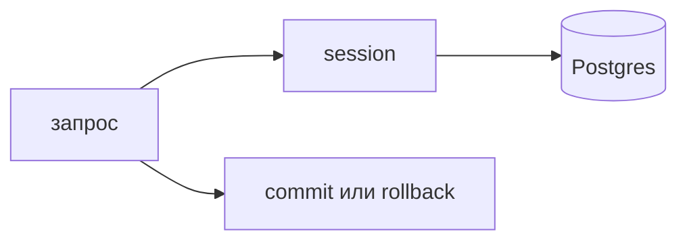

## Введение

Вакансии Python почти всегда ставят PostgreSQL рядом с ORM. SQLAlchemy — обычный ответ на этом стеке, и на собеседовании его спрашивают не как список декораторов. Спрашивают, какой SQL уйдёт в базу, кто откроет транзакцию и кто её закроет, если посередине пути случится ошибка. Модель описывает таблицу. Сессия копит изменения. База узнаёт о них не в момент присваивания поля в Python, а когда сессия отправляет команду.

Путаница начинается с фразы «ORM, значит SQL знать не нужно». Как раз наоборот: библиотека прячет сборку текста, но план, индекс и число round-trip остаются вашими. Умение прочитать запрос, который построил `selectinload`, ценнее умения вспомнить имя метода. Если запрос прочитать нельзя, ORM уже мешает, и честнее написать текст SQL в этом узком месте.

Выпуск держится на сервисе заявок: таблица заявок, таблица авторов, список на экране. Этого хватает, чтобы показать сессию на запрос, границу commit и классическую беду списка — N+1.

## Раздел: Сессия и модель

Модель — класс, у которого поля соответствуют колонкам. Она не обязана совпадать с формой JSON один в один. Экран может хотеть имя автора строкой, а в базе автор — внешний ключ. Сборку ответа делают отдельно, иначе модель обрастает полями «только для ручки».

Сессия — единица работы. Вы добавляете объекты, меняете поля, сессия помнит это в памяти. `flush` отправляет SQL, но транзакцию не заканчивает: другой код в том же запросе ещё может откатиться вместе с вами. `commit` фиксирует. `rollback` снимает незафиксированное. Ошибка пути — вызывать `commit` внутри каждого метода репозитория. Тогда вызывающий код не может собрать «создать заявку и запись истории» в одну транзакцию: первая часть уже не откатится, если вторая упадёт.

В FastAPI сессию открывают на время одного HTTP-запроса и закрывают в `finally` или через зависимость, которая сделает commit при успехе и rollback при исключении. Одна глобальная сессия на процесс — дефект. Её идентичность объектов и транзакция становятся общими для параллельных запросов. Два клиента начинают видеть и портить чужие неприкреплённые изменения. Сессия не потокобезопасна и плохо дружит с произвольным `await`, если одну и ту же передавать между задачами без дисциплины.

Репозиторий принимает сессию снаружи или получает её из единицы работы, но не создаёт соединение на каждый метод и не коммитит сам, если он часть большего сценария. `add` значит «учти объект». Решение «сохраняем» принимает граница запроса.

Идентичность внутри сессии тоже стоит помнить. Два раза прочитали одну строку — чаще получите тот же объект в памяти. Это удобно, пока вы не держите объект после закрытия сессии и не обращаетесь к ленивому отношению: будет ошибка или тихий повторный запрос, если сессию ещё не закрыли, но вы уже думали, что работа закончена. Наружу из хендлера отдают простые структуры или схему Pydantic, снятую пока сессия жива. Не отдают живую модель в фон и в шаблон, который прочитает её позже.

## Раздел: N+1 и явная загрузка

Список из пятидесяти заявок, и на каждую лениво читается автор. В журнале базы это один SELECT списка и пятьдесят SELECT авторов. На стенде с тремя строками незаметно. На проде список «все открытые» становится секундами и лишней нагрузкой. Имя беды — N+1: один запрос коллекции и по запросу на каждую связь.

Ленивая загрузка удобна в одном сценарии: открыли карточку, связь нужна иногда. На списке она вредна. Лечение — заранее сказать, что авторы нужны пачкой. `selectinload` делает второй запрос с `IN` по идентификаторам. `joinedload` присоединяет таблицу к первому запросу. Оба варианта — eager load, явная загрузка. Какой выбрать, зависит от размера строки и от того, не раздувает ли JOIN результат повторами. На собесе достаточно сказать: я смотрю число запросов и не читаю связь в цикле Python.

Проверка простая. Включите вывод SQL на учебном прогоне списка или посчитайте обращения в тесте. Ожидание для списка с автором: запросы на список и на авторов, а не «один плюс длина страницы». Если страница двадцать строк, два или три запроса нормальны. Двадцать один — уже повод чинить до спора о кэше.

Кэш и «просто закэшируем список» не лечат N+1, если каждый элемент всё равно догружается при сборке ответа. Сначала уберите цикл запросов, потом думайте, надо ли кэшировать готовый ответ.

Сырой SQL уместен, когда план важнее удобства: отчёт с несколькими агрегатами, необычный `ON`, запрос, который вы уже объясняете через `EXPLAIN`. Прятать такой текст в цепочку методов, которую никто не может прочитать, хуже, чем явный текст в репозитории. ORM остаётся для обычной карточки и записи.

## Раздел: Разбор на примере

Ручка `GET /tickets` раньше делала так: сессия выбирает заявки, цикл в Python берёт `ticket.author.email`. Модель автора связана лениво. На три строки в тесте всё зелёное и быстрое.

На стенде страница пятьдесят строк. Журнал показывает пятьдесят один SELECT. Исправление: в запросе списка сразу указать загрузку автора пачкой. Репозиторий метода `list_with_author` возвращает заявки, у которых автор уже в памяти. Хендлер только собирает JSON. Он не инициирует новые запросы.

Граница транзакции для чтения может быть короткой: открыли, прочитали, закрыли. Для `POST /tickets` она длиннее по смыслу, хотя и быстрая по времени: создать заявку, записать историю, и только потом commit. Если история не записалась, заявки тоже нет. Поэтому `commit` стоит после обоих `add`, в зависимости FastAPI, а не внутри `TicketRepository.add`.

Тест правила «нельзя создать заявку без заголовка» может идти без базы: это проверка входа до сессии. Тест «список не делает запрос на каждую строку» либо поднимает учебную базу и считает SQL, либо проверяет, что репозиторий вызван одним методом, а не в цикле. Второй вариант слабее, зато не требует Postgres в каждом прогоне. Честный учебный прогон хотя бы раз смотрят глазами в логе SQL.

## Раздел: Где это ломается

Глобальная сессия ломается под двумя параллельными запросами: один сделал rollback и снял чужие объекты, либо увидел грязное состояние соседа. Симптом плавающий, на одном пользователе его нет.

`commit` в репозитории ломает составной сценарий. Заявка сохранилась, письмо в очередь не встало, пользователь видит успех наполовину. Откатить уже нечего.

Ленивая связь после закрытия сессии ломает сериализацию: исключение в момент сборки ответа или, хуже, скрытый запрос, если соединение ещё держится пулом неожиданным образом. Снимайте данные внутри сессии.

`expire_on_commit` и повторное чтение атрибута после commit удивляют тех, кто думает, что объект навсегда наполнен. После фиксации сессия может обнулить поля и перечитать их следующим обращением. Если объекта уже нет в сессии, будет ошибка. Поэтому наружу идёт копия полей.

N+1, «вылеченный» загрузкой всех связей на свете, ломает память: в список подтянули авторов, вложения и комментарии, хотя экрану нужны идентификатор и заголовок. Явная загрузка — только того, что ответ реально читает.

## Раздел: Ответ вслух

Модель — таблица в коде, сессия — единица работы. Коммичу на границе запроса, не внутри каждого метода репозитория. Сессию держу на один запрос и закрываю. Список со связями проверяю по числу SQL: страница и одна догрузка связей, а не запрос на строку. Ленивую связь не трогаю из цикла. Сырой SQL оставляю там, где план важнее цепочки методов, и этот текст лежит в репозитории, где его видно.

## Раздел: Плохой ответ

Плохой ответ: «ORM, значит SQL знать не нужно». На собесе как раз просят объяснить JOIN или второй SELECT, который библиотека построила. Второй плохой ответ: «сессия одна на приложение, так быстрее». Быстрее до первого параллельного запроса, дальше это гонка состояний.

## Раздел: Термины

Единица работы — unit of work, в SQLAlchemy это session. Сброс SQL без конца транзакции — flush. Фиксация — commit. Откат — rollback. Ленивая загрузка — lazy load. Жадная пачка запросов — N+1. Явная загрузка — eager load: joinedload или selectinload. План запроса смотрят через EXPLAIN, не через ощущение «и так быстро».

## Лаба

**Цель.** Развести commit и add и убрать чтение автора из цикла.

**Шаги.**

1. Опишите две модели: `Ticket` с внешним ключом на автора и `User`. Поля минимальные: id, title, author_id, email.
2. Напишите выборку списка заявок так, чтобы авторы читались пачкой, не в цикле Python. Называйте метод загрузки, который выберете, и почему.
3. Набросайте сценарий создания: `add` заявки и `add` истории. Отметьте единственное место `commit` — после обоих add, на границе запроса.
4. Отдельным абзацем опишите, что увидите в журнале SQL до исправления и после: сколько SELECT на страницу из 50 строк.
5. Напишите, какие поля снимете в схему ответа, пока сессия ещё открыта.

**Готово, если…**

- [ ] commit не спрятан внутри `add`
- [ ] список не обращается к ленивому автору в цикле
- [ ] названо число запросов до и после
- [ ] наружу не отдаётся живая модель «на потом»

## Схема: Граница транзакции

## Тест

### Когда изменения модели попадают в базу?

**Ответ:** на commit

**Пояснение:** До этого они живут в сессии. `flush` шлёт SQL внутри ещё открытой транзакции.

### Почему одна сессия на весь процесс — ошибка?

**Ответ:** запросы делят состояние

**Пояснение:** Параллельные запросы путают идентичность объектов и транзакции.

### Список из 50 заявок делает 51 SELECT. Как это называется?

**Ответ:** проблема N+1

**Пояснение:** Один запрос списка и по запросу на каждую связь.

### Чем лечить N+1, если связь нужна в ответе?

**Ответ:** eager load или JOIN

**Пояснение:** `selectinload` догружает пачку, а не по одной строке.

### Где заканчивать транзакцию в API?

**Ответ:** на границе запроса

**Пояснение:** Репозиторий добавляет объекты, хендлер решает commit или rollback.

## Шпаргалка

<ul><li>Модель описывает таблицу</li><li>Сессия на один запрос</li><li>commit на границе сценария</li><li>N+1 видно по числу SELECT</li><li>Наружу — копия полей, не живая модель</li></ul>

## Anki

### Front: Что такое session в SQLAlchemy?

Back: Единица работы: объекты и SQL до commit.

### Front: flush и commit?

Back: flush отправляет SQL, commit завершает транзакцию.

### Front: Как выглядит N+1?

Back: 1 запрос списка + N запросов связей.

### Front: Чем гасят N+1?

Back: joinedload, selectinload или явный JOIN.

### Front: Куда класть session в FastAPI?

Back: На время одного запроса, затем закрыть.

### Front: Когда писать текст SQL самому?

Back: Когда план и форма запроса важнее удобства модели.

## Итоги

- ORM собирает SQL, но не заменяет умение его читать
- Транзакция живёт на границе сценария, не внутри каждого add
- Число запросов на список проверяют по журналу
- Ленивую связь не трогают из цикла и после закрытия сессии
- Явно грузят только то, что ответ действительно читает

## Ссылки

- [PostgreSQL: таблица и SELECT](/game/learn/s01e07-postgres)
- [JOIN и индекс](/game/learn/s01e08-sql)
