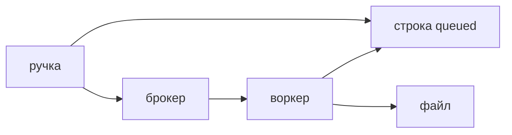

## Введение

HTTP-запрос не должен ждать отчёт десять минут. Прокси оборвёт соединение, пользователь обновит страницу, процесс API перезапустят — и работа, которая жила только в памяти запроса, пропадёт. Вакансии поэтому ставят рядом Celery, RabbitMQ, Redis и иногда Kafka. Для разработчика важны роли, а не логотип: кто принимает команду, кто хранит сообщение, кто выполняет функцию и что будет, если то же сообщение придёт второй раз.

Очередь нужна, когда работу надо пережить рестарт API и когда её можно закончить позже, чем клиент готов ждать. Письмо, выгрузка, пересчёт, вызов медленного внешнего API — типичные жители воркера. Проверка поля и ответ «заявка создана» остаются в запросе. Путать «вынести в Celery» и «написать async def» — частая ошибка на собесе. Асинхронная функция ускоряет ожидание сети внутри процесса. Она не сохраняет задачу, если процесс умер.

Этот выпуск разбирает путь «сгенерировать выгрузку»: ручка принимает команду, брокер держит сообщение, воркер пишет файл, повтор не создаёт вторую оплату и не портит чужой отчёт.

## Раздел: Роли

Продюсер — ручка FastAPI. Она проверяет вход, право и кладёт задачу. Она не считает файл. Ответ клиенту короткий: команда принята, вот идентификатор операции, статус «в работе». Клиент потом спрашивает статус или получает ссылку, когда строка в базе станет «готово».

Брокер хранит сообщение, пока воркер его не подтвердит. RabbitMQ делает подтверждения явно: сообщение не считается обработанным, пока воркер не прислал ack. Redis как брокер поднять проще, и для учебной очереди его хватает, но семантика «точно не потеряли и не отдали двум сразу» у классической очереди с подтверждением читается яснее. На собесе не нужно клясться одним брокером. Нужно сказать, что брокер не исполняет вашу функцию: он почта между API и воркером.

Воркер — отдельный процесс Celery. Он импортирует задачу по имени, получает простые аргументы и выполняет функцию. Рядом с API его запускают отдельно. Если воркер не запущен, ручка всё ещё отвечает «принято», а сообщения копятся. Это нормальная авария, её видно по длине очереди, а не по коду ответа ручки.

Result backend нужен, только если клиент или другой код спрашивает итог через механизм Celery. Если итог и так пишется в свою таблицу «выгрузки», отдельное хранилище результатов лишнее: оно расходится с вашей таблицей и само требует очистки. Источник правды — ваша строка со статусом.

Kafka в этом разговоре — журнал событий на несколько независимых читателей. Её не ставят «вместо Celery», когда нужна одна работа с повтором. Celery стремится выполнить задачу. Журнал хранит ленту, чтобы разные потребители прочитали её каждый по своей позиции. Путать их дорого: у журнала нет «одной очереди работ», у очереди работ нет долгой ленты для нового подписчика.

## Раздел: Повтор и идемпотентность

Сообщение могут доставить ещё раз. Воркер взял задачу, записал файл, процесс убило до ack — брокер считает, что работу никто не подтвердил, и отдаёт её снова. `autoretry` на исключение делает то же по договорённости: ошибка сети, и функция стартует сначала. Поэтому задача обязана быть идемпотентной. Один ключ операции — один эффект. Повтор не создаёт вторую оплату, второй файл с другим смыслом и второе письмо «вам выгрузка», если первое уже ушло.

Ключ приходит в аргументах: идентификатор выгрузки, который ручка создала в базе до отправки в брокер. Воркер по этому идентификатору ставит статус. Если статус уже «готово», он выходит без второй работы. Так повтор становится безопасной веткой, а не аварией.

Аргументы задачи — простые значения: строки, числа, идентификаторы. Не живая сессия SQLAlchemy, не открытый файл, не объект запроса FastAPI. Воркер — другой процесс, иногда другая машина. Он откроет свою сессию, прочитает строку по id и закроет её. Всё, что нельзя положить в JSON, в аргументы не кладут.

Порядок тоже не обещан, если вы его специально не строите. Две задачи «пересчитать» могут обогнать друг друга. Если важен последний итог, в строке хранят версию или время команды и старый воркер не затирает новый результат. Очередь сама по себе не даёт «строго одну за другой» между разными сообщениями без дополнительной договорённости.

Таймаут и яд. Задача, которая всегда падает, не должна крутиться бесконечно. Есть предел попыток, после него сообщение уходит в сторону — в мёртвую очередь или в статус «ошибка» в вашей таблице, с текстом, который увидит человек. Бесконечный retry без предела забивает воркеры одной больной командой.

## Раздел: Разбор на примере

Пользователь нажимает «выгрузить мои заявки». Ручка проверяет, что пользователь есть, создаёт строку `exports` со статусом `queued` и своим id, отправляет задачу `build_export(export_id)` и отвечает 202 с этим id. Тело ответа не содержит файла.

Воркер читает строку. Если она уже `done` или `failed` окончательно, выходит. Иначе ставит `running`, собирает файл, кладёт его в хранилище, записывает ссылку и `done`, подтверждает сообщение. Если упал на полпути, статус остаётся `running` или возвращается в `queued` правилом, которое вы выбрали заранее, и попытка повторяется. Повтор снова видит тот же `export_id` и не заводит вторую строку.

Клиент опрашивает `GET /exports/{id}` раз в несколько секунд или получает событие, когда статус сменился. Это уже отдельное решение про канал. Сама очередь его не рисует.

Что не кладут в задачу: «все заявки JSON-ом в аргументе». Аргумент раздувается, брокер не база. В задаче идентификатор, данные воркер читает сам.

Когда очередь не нужна. Отправка одного короткого письма, если почтовый вызов и так уложен в десятки миллисекунд и потеря при рестарте приемлема, может остаться в запросе. Как только потеря или длительность становятся болью, появляется брокер. Не наоборот: не ставить Celery на каждый `print`.

## Раздел: Где это ломается

Задача без ключа идемпотентности и с retry списывает деньги дважды или шлёт два письма. Тест на повтор — часть задачи, не роскошь.

Сессия базы в аргументах не доезжает до воркера или доезжает сломанной. Симптом — странные ошибки сериализации. Лечение — передавать id.

Ручка ждёт `task.get()` внутри HTTP. Формально работа в Celery, фактически запрос снова висит, пока воркер не кончит, и таймаут прокси возвращается. Ждать результат внутри того же запроса имеет смысл только для очень коротких задач в учебном коде. В сервисе ручка заканчивается, когда брокер принял сообщение.

Нет наблюдаемости. Очередь растёт, пользователи видят вечное «в работе», а алерта на длину и на возраст самого старого сообщения нет. Хотя бы статус в своей таблице и лог с `export_id` дают возможность ответить «что с этой выгрузкой».

Путают брокер и кэш. Redis, который уже стоит для кэша, можно использовать как брокер, но ключи кэша и сообщения очереди — разные роли. Смешать их в одну базу без префикса и без понимания вытеснения значит однажды потерять сообщения из-за политики памяти кэша.

## Раздел: Ответ вслух

Ручка проверяет команду и кладёт в брокер задачу с идентификатором. Воркер делает работу и подтверждает сообщение после успеха. Повтор возможен, поэтому один и тот же id не применяет эффект дважды. Аргументы простые, свою сессию воркер открывает сам. Redis как брокер проще поднять, RabbitMQ явнее про подтверждения. Kafka беру, когда нужна лента для нескольких читателей, а не одна работа. `async def` очередь не заменяет: он не переживает рестарт процесса.

## Раздел: Плохой ответ

Плохой ответ: «поставим Celery на всё асинхронное». Внутрипроцессный async остаётся для ожидания сети в запросе. Очередь — когда работу надо доделать после ответа клиенту и после рестарта. Второй плохой ответ: «брокер гарантирует ровно один раз, можно не думать». Доставка с повтором — обычный режим. Ровно один эффект делаете вы, ключом в своих данных.

## Раздел: Термины

Задача — task. Производитель сообщения — producer. Брокер — broker. Исполнитель — worker. Подтверждение — ack. Повтор — retry. Идемпотентность — один ключ, один эффект. Хранилище результата Celery — result backend. Журнал событий — log, в разговоре про Kafka это не файл логов приложения, а лента сообщений. Мёртвая очередь — dead letter, куда попадает сообщение после исчерпания попыток.

## Лаба

**Цель.** Описать выгрузку так, чтобы HTTP не ждал файл, а повтор не портил результат.

**Шаги.**

1. Нарисуйте четыре блока: ручка, строка в базе, брокер, воркер. Подпишите, какой статус видит клиент сразу после POST.
2. Выберите аргумент задачи. Это `export_id`, не список заявок и не сессия.
3. Опишите, что делает воркер, если строка уже в статусе `done`.
4. Опишите предел попыток и куда попадает окончательная ошибка: статус строки, не бесконечный цикл.
5. Одной фразой разведите Celery и Kafka: работа против ленты для многих читателей.
6. Одной фразой разведите Celery и `async def`.

**Готово, если…**

- [ ] Ответ HTTP не содержит файл и не блокируется на `get()`
- [ ] Ключ идемпотентности создан до отправки в брокер
- [ ] Повтор описан как безопасный выход
- [ ] Назван предел попыток

## Схема: Путь задачи

## Тест

### Почему тяжёлую выгрузку не делают внутри POST?

**Ответ:** запрос оборвётся по таймауту

**Пояснение:** Клиент и прокси не обязаны ждать минуты. Работа живёт в воркере.

### Чем брокер отличается от воркера?

**Ответ:** брокер хранит, воркер делает

**Пояснение:** Redis или RabbitMQ не исполняют вашу функцию.

### Зачем идемпотентность при retry?

**Ответ:** повтор не удваивает эффект

**Пояснение:** Сообщение могут доставить ещё раз после обрыва до ack.

### Когда уместен result backend?

**Ответ:** клиент позже читает итог

**Пояснение:** Если итог пишется в свою таблицу, отдельное хранилище результатов не нужно.

### Чем очередь Celery отличается от журнала Kafka?

**Ответ:** работа против ленты событий

**Пояснение:** Celery стремится выполнить задачу один раз. Kafka хранит поток для разных читателей.

## Шпаргалка

<ul><li>HTTP только принимает команду</li><li>Брокер не равен воркеру</li><li>Повтор требует один ключ эффекта</li><li>Сессию БД в аргументы не кладут</li><li>У попыток есть предел</li></ul>

## Anki

### Front: Что кладут в аргументы Celery-задачи?

Back: Простые значения: id, не живую сессию.

### Front: Кто такой broker?

Back: Очередь сообщений между API и воркером.

### Front: Зачем ack после успеха?

Back: Чтобы сообщение не считалось потерянным до успеха и не зависло без подтверждения.

### Front: Что будет при retry без идемпотентности?

Back: Побочный эффект выполнится повторно.

### Front: Redis или RabbitMQ в роли брокера?

Back: Оба могут. RabbitMQ явнее подтверждает доставку.

### Front: Celery заменяет async def?

Back: Нет. Async остаётся внутри процесса, очередь переживает рестарт.

## Мнемоника

### link: Фоновая задача

**Задание:** Что должно быть у задачи, кроме функции.

**Элементы:**
- брокер
- имя задачи
- повтор
- результат

**Подсказка:** Имя нужно, чтобы воркер нашёл код после выкладки.

**Ответ:** брокер → имя → retry → result

## Итоги

- Запрос заканчивается, когда команда принята, а не когда файл готов
- Повтор — нормальная ветка, её закрывают ключом в своих данных
- Воркер сам открывает базу по идентификатору
- Kafka и Celery отвечают на разные вопросы
- Бесконечный retry без статуса ошибки прячет больную задачу

## Ссылки

- [Asyncio](/game/learn/py-oop-advanced-mro)
- [Очереди для аналитика](/game/learn/sa-sync-async-queues)
