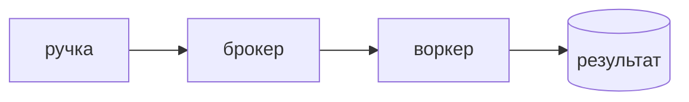

## Введение

HTTP-запрос не ждёт отчёт на десять минут. Вакансии называют Celery рядом с RabbitMQ, Kafka и Redis. Для разработчика важно: кто кладёт задачу, кто её выполняет и что будет при втором получении того же сообщения.

## Раздел: Роли

Продюсер — ручка FastAPI: проверила вход и отправила задачу. Брокер — RabbitMQ или Redis: хранит сообщение, пока воркер свободен. Воркер Celery выполняет функцию. Result backend нужен, только если клиент потом спрашивает итог. Для «посчитай и забудь» он лишний.

Kafka в этой схеме — журнал событий на несколько потребителей. Celery — очередь работ с retry. Путать их на собесе дорого.

Задача должна быть идемпотентной: повтор после обрыва не создаёт вторую оплату. `autoretry` без этого удваивает эффект. Аргументы задачи — простые значения, не живая сессия SQLAlchemy.

## Раздел: Ответ вслух

Ручка принимает команду и кладёт задачу в брокер. Воркер делает работу и подтверждает сообщение после успеха. Повтор возможен, поэтому ключ операции один и тот же эффект не применяется дважды. Redis как брокер проще поднять, RabbitMQ честнее по подтверждениям. Kafka беру, когда нужен журнал, а не одна работа.

## Раздел: Плохой ответ

Плохой ответ: «поставим Celery на всё асинхронное». `async def` на I/O внутри процесса — не очередь. Очередь нужна, когда работу надо пережить рестарт API.

## Раздел: Термины

Задача — task. Брокер — broker. Воркер — worker. Повтор — retry. Идемпотентность — один ключ, один эффект. Подтверждение — ack.

## Лаба

**25 минут.** Опишите задачу «сгенерировать выгрузку». Укажите аргументы, брокер, что храните как ключ идемпотентности и какой ответ отдаёт HTTP, не дожидаясь файла.

## Схема: Путь задачи

## Тест

### Почему тяжёлую выгрузку не делают внутри POST?

**Ответ:** запрос оборвётся по таймауту

**Пояснение:** Клиент и прокси не обязаны ждать минуты. Работа живёт в воркере.

### Чем брокер отличается от воркера?

**Ответ:** брокер хранит, воркер делает

**Пояснение:** Redis или RabbitMQ не исполняют вашу функцию.

### Зачем идемпотентность при retry?

**Ответ:** повтор не удваивает эффект

**Пояснение:** Сообщение могут доставить ещё раз после обрыва до ack.

### Когда уместен result backend?

**Ответ:** клиент позже читает итог

**Пояснение:** Если итог пишется в свою таблицу, отдельное хранилище результатов не нужно.

### Чем очередь Celery отличается от журнала Kafka?

**Ответ:** работа против ленты событий

**Пояснение:** Celery стремится выполнить задачу один раз. Kafka хранит поток для разных читателей.

## Шпаргалка

<ul><li>HTTP только принимает команду</li><li>Брокер не равен воркеру</li><li>Повтор требует один ключ эффекта</li><li>Сессию БД в аргументы не кладут</li></ul>

## Anki

### Front: Что кладут в аргументы Celery-задачи?

Back: Простые значения: id, не живую сессию.

### Front: Кто такой broker?

Back: Очередь сообщений между API и воркером.

### Front: Зачем ack после успеха?

Back: Чтобы сообщение не ушло второму воркеру зря и не потерялось до успеха.

### Front: Что будет при retry без идемпотентности?

Back: Побочный эффект выполнится повторно.

### Front: Redis или RabbitMQ в роли брокера?

Back: Оба могут. RabbitMQ явнее подтверждает доставку.

### Front: Celery заменяет async def?

Back: Нет. Async остаётся внутри процесса, очередь переживает рестарт.

## Итоги

- Запрос заканчивается, когда задача принята брокером
- Повтор — нормальная ветка, не авария
- Kafka и Celery отвечают на разные вопросы

## Ссылки

- [Asyncio](/game/learn/py-async-io)
- [Очереди для аналитика](/game/learn/sa-sync-async-queues)
