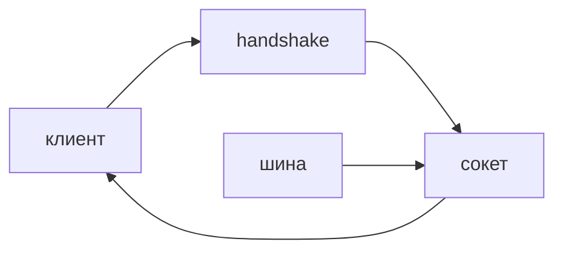

## Введение

WebSocket — один TCP-канал после рукопожатия HTTP. Его берут для ленты событий и совместного редактирования. Статус «заявка создана» чаще честнее отдать ответом POST.

## Раздел: Что удержать в голове

Рукопожатие проверяет доступ сразу: токен в первом запросе, не «потом разберёмся в первом сообщении». Соединение занимает память на процессе. Несколько инстансов API без общей шины не видят чужих клиентов: публикацию тогда несут через Redis или брокер.

Обрыв — норма. Клиент переподключается. Сервер шлёт ping и снимает мёртвые сокеты. Сообщение — кадр, не транзакция: запись в Postgres подтверждайте отдельно, не фактом `send`.

## Раздел: Ответ вслух

Канал нужен, когда сервер инициирует сообщение. Авторизую на рукопожатии. Держу слабую ссылку на соединение и таймаут. Если реплик несколько, событие публикую в общую шину, иначе его увидит только один процесс. Обычные команды оставляю в REST.

## Раздел: Плохой ответ

Плохой ответ: «сделаем весь API на сокетах, так быстрее». Вы теряете кэш, коды ошибок и нормальный ретрай запроса.

## Раздел: Термины

Рукопожатие — handshake. Кадр — frame. Обрыв — disconnect. Пульс — ping/pong. Широковещание — broadcast.

## Лаба

**20 минут.** Для ленты статусов заявки выберите: REST, опрос раз в несколько секунд или WebSocket. Напишите, где проверяется доступ и что видит клиент после обрыва.

## Схема: Кто говорит первым

## Тест

### Когда WebSocket уместнее POST?

**Ответ:** сервер сам шлёт события

**Пояснение:** Команда клиента хорошо ложится на обычный запрос.

### Где проверять право открыть канал?

**Ответ:** на рукопожатии

**Пояснение:** После открытия сокета отказ уже дороже.

### Два процесса API. Почему второй клиент не слышит событие первого?

**Ответ:** память сокетов локальна

**Пояснение:** Нужна общая шина, иначе broadcast видит только свой процесс.

### Ping завис. Что делать серверу?

**Ответ:** закрыть соединение

**Пояснение:** Мёртвый сокет держит слот и даёт клиенту ложное чувство связи.

### Успешный send заменяет commit в базу?

**Ответ:** нет

**Пояснение:** Кадр могли не обработать. Факт хранит Postgres.

## Шпаргалка

<ul><li>Канал для инициативы сервера</li><li>Доступ на handshake</li><li>Реплики API требуют шину</li><li>Обрыв заложен в протокол</li></ul>

## Anki

### Front: Что такое handshake WebSocket?

Back: HTTP-запрос, который переключает соединение на кадры.

### Front: Куда класть проверку токена?

Back: В рукопожатие, до приёма сообщений.

### Front: Почему broadcast ломается на двух подах?

Back: Список сокетов живёт в памяти одного процесса.

### Front: Зачем ping?

Back: Отличить живой канал от зависшего.

### Front: send успешен. Данные уже в базе?

Back: Нет. Кадр и транзакция — разные подтверждения.

### Front: Чем плох «весь API на сокетах»?

Back: Теряются коды HTTP, идемпотентность запроса и простой ретрай.

## Итоги

- Сокет — канал событий, не замена ресурса REST
- Доступ проверяют до первого кадра
- Несколько копий API без шины не составляют один эфир

## Ссылки

- [Asyncio](/game/learn/py-async-io)
- [JWT](/game/learn/sec-jwt-storage)
